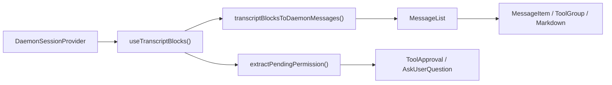
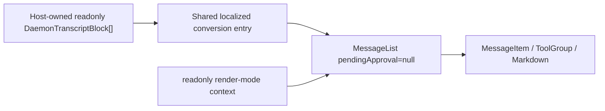

# WebShell 只读守护进程转录渲染设计

[English](2026-07-14-web-shell-readonly-daemon-transcript.md) | [简体中文](2026-07-14-web-shell-readonly-daemon-transcript.zh-CN.md)

## 文档状态

- 状态：已实现
- 日期：2026-07-14
- 范围：`packages/web-shell`
- 输入：`readonly DaemonTranscriptBlock[]`
- 输出：继承 WebShell `MessageList` 展示能力的只读转录视图

## 1. 背景

WebShell 已有一条完整的守护进程转录渲染路径，但目前只能经由分屏视图中的
`App` 或 `ChatPane` 间接使用。该组件先从 `DaemonSessionProvider` 读取转录
块，把块转换成 WebShell 的内部消息，最后交给 `MessageList` 渲染。

新用例已直接持有 `DaemonTranscriptBlock[]`，只需要 WebShell 的消息样式与
渲染能力来展示历史内容：不需要建立守护进程会话连接，也绝不能执行会话变更。
明确属于目标之外的交互包括工具审批、`AskUserQuestion`、重试、分支、提交
提示，以及打开会修改会话状态的面板。

如果宿主直接消费 `transcriptBlocksToDaemonMessages` 的结果并自行组装内部
组件，就会暴露 WebShell 私有的 `DaemonMessage` 模型、context 与 CSS 约束；
并且当 `MessageList` 增加功能时，其渲染会偏离受支持的路径。因此
`@qwen-code/web-shell` 需要提供一个稳定的公共入口。

## 2. 目标

1. 新增一个直接接受并渲染 `readonly DaemonTranscriptBlock[]` 的公共 React
   组件。
2. 复用现有 `transcriptBlocksToDaemonMessages()` 与同一个 `MessageList`，
   使用户、助手、思考、工具、子代理、计划、状态、Markdown、时间线与长会话
   虚拟滚动能力随 `MessageList` 自动演进。
3. 组件可在没有 `DaemonWorkspaceProvider`、`DaemonSessionProvider` 或网络
   连接的情况下独立渲染。
4. 在只读边界内不调用任何守护进程/会话变更，也不展示待审批权限或
   `AskUserQuestion` 的响应 UI。
5. 以新增导出为主，不改变现有 `WebShell`、`WebShellWithProviders`、`App`
   或 `ChatPane` 的运行时路径、默认值或 DOM 行为。
6. 新增完整的组件单元测试，并通过现有 WebShell 测试套件、构建、lint 与
   typecheck。

## 3. 非目标

- 新增转录获取、分页、缓存或 SSE 订阅；块由宿主提供。
- 向现有 `WebShellProps` 插入只读模式，或给 `App` 增加条件化的
  `readOnly`/`blocks` 双数据源。
- 导出内部 `MessageList`、`Message` 或 `DaemonMessage` 类型。
- 展示或处理未解决的工具审批或 `AskUserQuestion`。
- 提供 App 外壳的输入区（composer）、排队提示、流式状态、侧栏、分屏、
  对话框、工件右侧面板等能力。`MessageList` 内建的时间线保留。
- 从块推断或加载单独的会话工件。App 层的文件变更、工件与计划任务回合输出
  卡片不在范围内。
- 阻止仅修改本地展示状态的交互，如复制、折叠/展开工具、展开已完成回合、
  表格过滤或时间线导航。

## 4. 术语与只读边界

本设计中"只读"指**不读取也不修改守护进程/会话运行时状态**，并不是对整个
DOM 设置 `pointer-events: none`。

| 类别              | 行为                                                    | 保留                 |
| ----------------- | ------------------------------------------------------- | -------------------- |
| 被动展示          | 文本、Markdown、图片、diff、shell 输出、工具/子代理状态 | 是                   |
| 本地查看          | 复制、折叠、展开、虚拟滚动、时间线、表格排序/过滤       | 是                   |
| 宿主定制展示      | Markdown/代码块渲染器、消息内容渲染器                   | 是；副作用由宿主负责 |
| 普通外部链接      | 经浏览器安全 URL 变换后的新窗口导航                     | 是                   |
| WebShell 语义导航 | `qwen-session://` 派发全局 `qwen:open-session` 事件     | 否；渲染为非交互文本 |
| 会话变更          | 发送提示、取消、重试、分支、回退、切换模型/模式         | 否                   |
| 权限变更          | 批准/拒绝工具、提交/忽略 `AskUserQuestion`              | 否                   |
| 外部数据加载      | 组件发起的会话 attach 或转录/工件/任务/MCP 拉取         | 否                   |

这一边界保住了 `MessageList` 的阅读体验，同时确保组件自身不具备写入守护
进程的能力。

## 5. 现状与调用方地图

| 模块                                                         | 当前职责                                                | 与本设计的关系                 |
| ------------------------------------------------------------ | ------------------------------------------------------- | ------------------------------ |
| `packages/sdk-typescript/src/daemon/ui/types.ts`             | 定义 `DaemonTranscriptBlock` 联合类型                   | 新组件的公共输入模型           |
| `packages/web-shell/client/adapters/transcriptToMessages.ts` | 将块组合成 WebShell `DaemonMessage[]`                   | 直接复用；不新建转换器         |
| `packages/web-shell/client/hooks/useMessages.ts`             | 从会话 hook 读取块并提供本地化转换选项                  | 提取共享纯转换入口，接受外部块 |
| `packages/web-shell/client/components/MessageList.tsx`       | 回合折叠、工具/子代理分组、时间线、虚拟滚动与逐消息渲染 | 新旧路径共享的唯一列表实现     |
| `packages/web-shell/client/components/MessageItem.tsx`       | 按消息角色分发具体渲染器                                | 无需改动                       |
| `packages/web-shell/client/App.tsx`                          | 完整单会话 WebShell、审批、输入区、侧面板               | 现有路径保持不变               |
| `packages/web-shell/client/components/ChatPane.tsx`          | 分屏视图中的完整交互会话                                | 现有路径保持不变               |
| `packages/web-shell/client/index.tsx` / `index.ts`           | 包运行时/源码导出                                       | 导出新组件与类型               |

当前主路径是：



新的只读路径绕过会话 provider 与权限分支：



在 WebShell 主编辑器中，`/tasks` 与 `/mcp` 在 `App` 内部被拦截：它们只更新
对话框 React 状态，不调用 `sendPrompt()`，也不写会话 JSONL。因此持久化转录
中没有这两个本地面板的哨兵标记，新入口也不添加相应的识别或过滤分支。

## 6. 公共 API

新增名为 `WebShellTranscript` 的组件，从 `@qwen-code/web-shell` 包根导出。

```ts
export interface WebShellTranscriptProps {
  /** Ordered transcript blocks from one logical session. */
  blocks: readonly DaemonTranscriptBlock[];

  theme?: WebShellTheme;
  language?: 'en' | 'zh-CN' | 'zh' | 'zh-cn' | 'ru' | 'ru-ru';
  className?: string;
  style?: React.CSSProperties;
  chatMaxWidth?: number;
  workspaceCwd?: string;

  compactThinking?: boolean;
  collapseCompletedTurns?: boolean;
  markdownTableMode?: MarkdownTableMode;
  virtualScrollThreshold?: number;
  markdown?: WebShellMarkdownCustomization;

  composerTagIcons?: WebShellComposerTagIconMap;
  renderToolHeaderExtra?: ToolHeaderExtraRenderer;
  parseUserMessageContent?: UserMessageContentParser;
  renderUserMessageContent?: UserMessageContentRenderer;
  renderComposerTag?: ComposerTagRenderer;
  renderComposerTagTooltip?: ComposerTagRenderer;
  renderAssistantTurnFooter?: AssistantTurnFooterRenderer;
}

export function WebShellTranscript(
  props: WebShellTranscriptProps,
): React.ReactElement;
```

说明：

- `blocks` 必填，既不复制也不修改。调用方应保持数组内块的会话与顺序一致。
- 视觉 props 沿用 `WebShellProps` 的名称与类型，避免同一能力出现第二套配置
  语义。
- 不暴露 `onComposerTagClick`、`onRetryClick`、`onBranchSession`、
  `onTurnOutputOpen`、权限回调或输入区回调。
- `theme` 默认 `dark`。省略 `language` 时按 WebShell 的 URL/浏览器语言解析
  规则。`chatMaxWidth` 默认 1000px。
- `compactThinking` 默认 `false`，`collapseCompletedTurns` 默认 `true`，与
  现有 `WebShell` 一致。
- 组件把转录视为静态/已回放内容，向 `MessageList` 传 `isResponding={false}`。
  实时流式不在当前 API 范围内。

示例：

```tsx
import { WebShellTranscript } from '@qwen-code/web-shell/transcript';
import type { DaemonTranscriptBlock } from '@qwen-code/sdk/daemon';

export function HistoryView({
  blocks,
}: {
  blocks: readonly DaemonTranscriptBlock[];
}) {
  return (
    <WebShellTranscript
      blocks={blocks}
      theme="dark"
      language="zh-CN"
      workspaceCwd="/workspace/project"
      style={{ height: 640 }}
    />
  );
}
```

宿主必须给组件一个可用的高度。组件自身保持 WebShell 的 `height: 100%`、
内部滚动与内容宽度行为。

## 7. 详细设计

### 7.1 共享本地化转换

`transcriptBlocksToDaemonMessages()` 继续作为唯一的块到消息适配器。在
`useMessages.ts` 中提取一个内部纯函数，例如：

```ts
export function transcriptBlocksToLocalizedMessages(
  blocks: readonly DaemonTranscriptBlock[],
  t: Translator,
): Message[];
```

该函数只从其内部包模块导出，供新组件复用；不从包根暴露。

函数只组装当前 `useMessages()` 所用的本地化标签，然后调用现有适配器。现有
`useMessages()` 与新组件都调用它，避免提示取消、分支、回合中插入与流中断
等文案漂移。

这是现有渲染路径唯一需要的内部重构。函数输入、输出与现有转换结果保持
不变，适配器的块组合规则也不修改。

### 7.2 `WebShellTranscript` 组件结构

新增 `packages/web-shell/client/components/WebShellTranscript.tsx`，内部
顺序如下：

1. 解析主题与语言并创建翻译器。
2. 用 `useMemo` 把 `blocks` 转换为 `Message[]`。
3. 创建与现有 App 相同的消息层定制值。
4. 挂载 WebShell 的主题、i18n、定制、紧凑模式、只读渲染模式与 portal
   context。
5. 以 `data-web-shell-root` 与 `data-web-shell-shadcn` 创建独立根节点，
   复用 App 的主题类、基础变量、字体、背景与 CSS 隔离规则。
6. 渲染同一个 `MessageList`。

`MessageList` 的关键固定输入是：

```tsx
<MessageList
  messages={messages}
  pendingApproval={null}
  isResponding={false}
  workspaceCwd={workspaceCwd ?? ''}
  virtualScrollThreshold={virtualScrollThreshold}
/>
```

绝不传入这些动作 props：

- `onShowContextDetail`
- `onRetryClick`
- `onBranchSession`
- `onReviewChanges`
- `onOpenArtifact`
- `onOpenScheduledTask`
- `onTurnOutputOpen`

也不传 loading、catch-up、tail 或回合输出数据，避免对 App 的连接状态与
外部资源模型产生任何依赖。

### 7.3 交互渲染器的隔离

只给 `MessageList` 传 `pendingApproval={null}` 并不能完全保证只读行为。
目标状态、Markdown 与工具结果中的会话链接不走 `MessageList` 回调，而是向
`window` 派发全局语义事件，可能改变同一页面上另一个 WebShell 的页脚或
活动会话。

在 `client/transcriptRenderMode.ts` 新增一个包内部的转录渲染模式 context，
默认值为 `interactive`。现有 `App` 与 `ChatPane` 不需要新增 provider，行为
保持不变。`WebShellTranscript` 将其设为 `readonly`。只读模式只施加以下
限制：

- 保留 `qwen-session://` 链接的文本与样式，但不派发 `qwen:open-session`。
- `GoalStatusMessage` 不派发 `GOAL_STATUS_ACTIVE_EVENT`。
- 不拦截普通 HTTPS 链接与复制、折叠、排序等本地查看交互。

该 context 只改变 `Markdown`、`ToolGroup` 与 `GoalStatusMessage` 中的
语义事件出口，默认值锁定为 `interactive`。这避免了新增一个需要从
`MessageList` 穿透到每个渲染器的 `readOnly` prop。新单元测试必须同时证明
默认 interactive 行为不变、只读行为被抑制。

### 7.4 主题、CSS 与 Portal

WebShell 库构建把组件 CSS 注入并作用域化到 `[data-web-shell-root]` 或
`[data-web-shell-portal-root]` 之下。新组件必须创建自己的 WebShell 根；
否则 `MessageList` 产生的 DOM 可能无法匹配 CSS module 规则。

时间线 tooltip 与高级 Markdown 表格使用 portal。为完整继承这些能力，新
组件使用与 App 等价的 portal 宿主生命周期：

- 挂载时向 `document.body` 追加带 `data-web-shell-portal-root` 与
  `data-web-shell-shadcn` 的节点。
- 同步根节点的主题类与 CSS 变量。
- 通过 `WebShellPortalRootContext` 提供该节点。
- 卸载时移除该节点及其 observer/listener。

把这一生命周期放在新组件内部，而不是重构 App 的既有 portal 代码，把现有
行为的回归面限制在新入口。SSR 期间不访问 `document`；仅在客户端挂载后
启用 portal。

### 7.5 错误隔离

新入口有一个外层公共边界和一个内层内容组件。块转换、provider/portal 初始
化与 `MessageList` 都发生在边界的子组件内，确保任一阶段的失败都能到达与
公共 WebShell 入口相同的 `RootErrorFallback`。每条消息仍由 `MessageItem`
自身的边界隔离，单个 Markdown、KaTeX、Mermaid 或工具渲染器的失败不会把
整份转录清空。

### 7.6 块渲染策略

所有策略继续使用现有适配器；不在新组件内添加第二个 switch。

| `DaemonTranscriptBlock.kind` | 只读结果                                              |
| ---------------------------- | ----------------------------------------------------- |
| `user`                       | 用户消息、图片与输入注解                              |
| `assistant`                  | 助手 Markdown；连续块合并；子代理内容按父级归组       |
| `thought`                    | 思考消息；连续块合并                                  |
| `tool`                       | 工具分组的现有卡片：diff/read/shell/fetch/todo/子代理 |
| `shell`                      | 关联到最近的执行工具；不可用时走现有 raw-shell 回退   |
| `user_shell`                 | 用户 shell 命令/输出                                  |
| `status` / `debug`           | 计划或系统/状态消息                                   |
| `error`                      | 无重试动作的错误系统消息                              |
| `prompt_cancelled`           | 本地化的取消状态                                      |
| 未解决的 `permission`        | 不转换、不展示、不提供动作入口                        |
| 已解决的 `permission`        | 沿用适配器现有的历史工具占位/结果规则                 |
| `AskUserQuestion` 权限       | 不显示表单；仅当其后存在真实工具块时显示历史结果      |

### 7.7 更新与性能

- 仅当 `blocks` 身份或语言变化时才重新执行 O(n) 转换。
- `MessageList` 保留其现有的 memoization、回合分组与虚拟滚动阈值。
- 不深拷贝块，也不为每个块创建新的 React provider。
- 调用方频繁提供内容相同、身份全新的数组会再次触发转换。这是可接受的，与
  当前 `useTranscriptBlocks()` 的更新模型一致。
- 本版本不新增增量适配器。只有当测量表明大外部转录的更新是瓶颈时，才单独
  设计增量转换。

## 8. 兼容性与回归控制

### 8.1 现有路径保持不变

- `WebShellProps` 不新增必填字段，不改任何默认值。
- `WebShell` 与 `WebShellWithProviders` 继续渲染 `App`。
- `App` 与 `ChatPane` 继续从各自的 provider/hook 读取会话状态。
- 审批浮层、输入区、侧栏、分屏与工件面板不经过新组件。
- `MessageList` 不新增 `readOnly` prop 分支。新调用方通过传
  `pendingApproval={null}`、省略动作回调，以及使用默认值仍为 interactive 的
  内部渲染模式 context 来隔离少数全局语义事件，从而建立只读行为。

### 8.2 包导出

同时更新 `client/index.tsx` 与 `client/index.ts`，导出：

```ts
export { WebShellTranscript } from './components/WebShellTranscript';
export type { WebShellTranscriptProps } from './components/WebShellTranscript';
```

两个 barrel 都必须修改，避免当前"运行时入口 + 声明/源码入口"的双路径出现
"运行时可导出但类型声明缺失"。不新增包子路径导出。

### 8.3 安全

- 新入口不导入 `useActions()`、`useTranscriptStore()`、`useConnection()` 或
  `fetch`。
- 待审批权限内容不进入交互渲染器。
- 不检查也不改写状态消息内容。`/tasks` 与 `/mcp` 的对话框状态天然不存在于
  持久化转录中。
- 只读渲染模式不派发可能影响同页另一 WebShell 的会话/目标全局事件。
- Markdown URL 与 HTML 处理继续使用现有 WebShell sanitizer/transform；不新增
  `dangerouslySetInnerHTML` 或其他绕过手段。
- 自定义渲染器是宿主代码。宿主渲染器执行的副作用不在组件保证的只读边界内，
  README 必须明确说明这一点。

## 9. 测试设计

### 9.1 新组件契约单元测试

新增 `WebShellTranscript.test.tsx`，mock `MessageList` 以验证边界与接线：

1. 共享本地化适配器以正确的顺序与内容把块转换为消息。
2. `pendingApproval` 始终为 `null`。
3. 会话变更、权限、重试、分支与回合输出回调全部缺省。
4. `isResponding` 默认为 `false`，workspace 与虚拟滚动配置正确透传。
5. 主题、语言、紧凑/折叠行为与消息定制进入正确的 context。
6. `blocks` 或语言变化时重新生成消息，不重复旧内容。
7. 空块渲染空列表且不抛错。

### 9.2 新增 DOM 集成单元测试

新增 `WebShellTranscript.dom.test.tsx`，使用真实 `MessageList`：

1. 在没有守护进程 provider 的 React 树中成功渲染。
2. 有代表性的 user、assistant Markdown、thought、tool、子代理、plan、
   status、error 与 prompt-cancelled 块进入对应的 WebShell DOM。
3. 本地折叠/展开、复制与时间线导航仍然可用，证明 `MessageList` 能力被
   复用。
4. 未解决的普通权限不产生审批面板。
5. 未解决的 `AskUserQuestion` 不产生选项、输入、提交或忽略 UI。
6. 已解决的历史工具/AskUser 结果遵循适配器现有的展示规则。
7. 只读的会话链接与目标状态不派发全局语义事件；对应的现有组件测试继续证明
   默认 interactive 行为不变。
8. 暗色/亮色类、语言、本地化文本、聊天最大宽度与 CSS 根标记正确。
9. portal 根正确挂载与卸载，portal 内容位于作用域化根之下。
10. 单个自定义渲染器抛错时回退到内建渲染器，且消息其余部分保留。

### 9.3 共享转换与导出测试

- 扩展 `useMessages`/适配器测试，证明现有 hook 与外部块使用完全相同的
  本地化选项。
- 扩展 `index.test.tsx` 或构建产物测试，验证运行时具名导出存在。
- 构建后验证 `dist/types/index.d.ts` 包含 `WebShellTranscript` 及其 props 的
  导出，防止两个入口声明漂移。

### 9.4 现有回归套件

实现后的最低验证序列：

```bash
cd packages/web-shell
npm run build
npx vitest run --config vitest.config.ts \
  client/components/WebShellTranscript.test.tsx \
  client/components/WebShellTranscript.dom.test.tsx \
  client/hooks/useMessages.test.ts \
  client/adapters/transcriptToMessages.test.ts \
  client/components/MessageList.test.ts \
  client/components/MessageList.dom.test.tsx \
  client/components/messages/Markdown.test.ts \
  client/components/messages/ToolGroup.test.tsx \
  client/components/messages/SystemMessage.test.tsx \
  client/index.test.tsx
npm test
npm run format:check
npm run lint
npm run typecheck

cd ../..
npm run build
npm run typecheck
```

`npm test` 是现有 WebShell 全量套件，本次变更必须通过。本变更不新增独立
页面，也不改动现有 Playwright 冒烟测试的 App/守护进程协议，因此不新增浏览器
E2E 测试。`WebShellTranscript.dom.test.tsx` 覆盖真实 DOM 行为。

## 10. 实现步骤

1. 在 `useMessages.ts` 中提取共享的本地化块转换，保持当前 hook 输出不变。
2. 新增内部转录渲染模式 context，并在会话链接/目标事件出口消费它；保持
   `interactive` 为默认值。
3. 新增 `WebShellTranscript` 及其 props，实现根/provider/portal/
   `MessageList` 接线。
4. 向两个公共 barrel 添加运行时与类型导出。
5. 更新 `packages/web-shell/README.md`，补充只读集成示例、宿主高度要求与
   只读边界。
6. 新增契约、DOM、交互隔离与导出/类型声明测试。
7. 运行定向测试、WebShell 全量套件、构建、lint 与 typecheck。
8. 按仓库指引评审完整 diff；任何修复后重跑第 7 步。

## 11. 备选方案

### 11.1 在现有 `WebShell` 上增加 `blocks` 与 `readOnly`

否决。`App` 当前无条件消费多个守护进程 hook，并管理审批、输入区、会话、
侧栏与面板。双数据源会在 `App` 各处增加条件分支，既要挂 provider 又要防
变更，其回归面远大于本需求。

### 11.2 公开导出 `MessageList`

否决。调用方仍会依赖私有的 `Message[]`、多个 context、CSS 根约定与 portal
约定，内部模型将变成长期公共 API。

### 11.3 为只读用途复制渲染器

否决。复制会立即分叉 Markdown、工具/子代理、回合折叠、时间线与虚拟滚动
行为，无法满足继承 `MessageList` 渲染能力的要求。

### 11.4 在新组件中展示禁用态的权限/AskUserQuestion

否决。禁用表单仍会创建交互语义与额外的状态分支，并误导用户以为可以在历史
视图中作答。待审批权限在本版本中隐藏；其后的工具块携带历史结果。

## 12. 风险与缓解

| 风险                               | 缓解                                                                |
| ---------------------------------- | ------------------------------------------------------------------- |
| 新入口与 App 之间本地化转换漂移    | 两者调用同一个本地化转换助手                                        |
| Portal 错过 CSS 作用域             | 单独创建 `data-web-shell-portal-root`、同步变量，并用 DOM 测试覆盖  |
| 意外修改守护进程状态               | 新组件不导入任何 action hook、不暴露变更回调；契约测试锁定          |
| App 本地对话框状态被误当作转录数据 | 明确记录 `/tasks` 与 `/mcp` 不写 JSONL；新入口不复制 App 对话框状态 |
| 全局语义事件影响同页另一 WebShell  | 只读渲染模式抑制会话/目标事件；回归测试覆盖默认行为                 |
| 新块类型没有展示                   | 经共享适配器继续支持；不在组件内复制 switch                         |
| 包运行时与类型导出分歧             | 同时更新两个 barrel 并检查构建产物声明                              |
| 大转录重算成本                     | `useMemo` 加现有虚拟滚动；增量转换待测量支持后再做                  |
| 自定义渲染器引入副作用             | 记录宿主责任；默认渲染器保持只读                                    |

## 13. 验收标准

- 宿主仅提供块即可在没有守护进程 provider 的环境中渲染 WebShell 转录。
- 有代表性的块与同一数据在现有 WebShell `MessageList` 中的渲染完全一致。
- 待审批的工具权限与 `AskUserQuestion` 不产生交互 UI 或提交路径。
- 只读视图不派发全局会话/目标语义事件。
- 新组件保留 `MessageList` 的本地阅读交互与长列表能力。
- 现有 `WebShell`/`WebShellWithProviders` 的 API、默认值、测试与运行时行为
  保持不变。
- `@qwen-code/web-shell` 的运行时与 `.d.ts` 都导出新组件及其 props。
- 新单元测试、现有 WebShell 全量套件与根构建/typecheck 全部通过。
