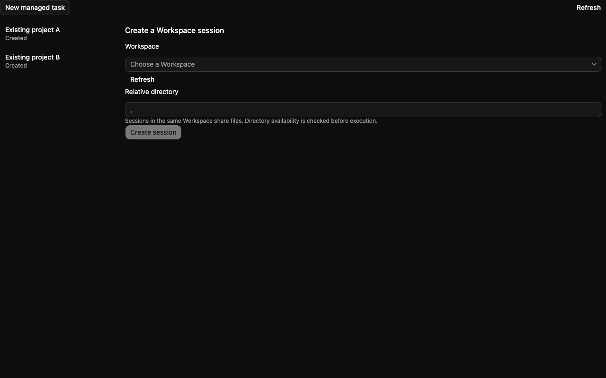
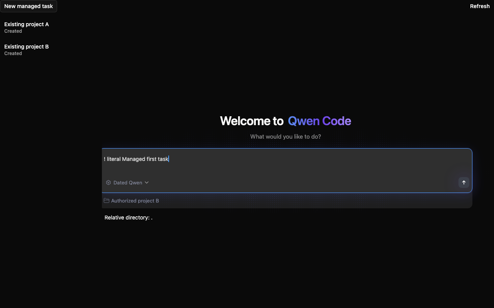
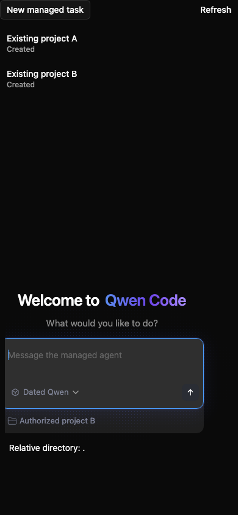

# Managed Agent 标准 Web Shell 界面

[English version](2026-10-12-managed-web-shell-usability.md)

## 问题与现状

Managed Agent 使用独立的文本框/发送表单和工作区创建表单，用户无法沿用标准 Web Shell 的欢迎页/输入框流程，Java 创建页也没有宿主提供的模型预设选择。标准 Web Shell 已有欢迎标题、消息列表、输入框、模型菜单和工作区选择器。

Java provider 已提供按租户/用户授权的工作区 list/get、绑定工作区的空会话创建、transcript、Actions、取消和修订校验 cwd 操作。已有创建 API 接受初始输入并固定 AgentDefinition。本功能复用该契约和界面，不修改 Java 路由或 schema。

## 预期行为

新建 Java 绑定会话复用 WelcomeHeader、ChatEditor、原生模型菜单、工作区底栏和已有 App 布局样式。用户显式选择授权工作区、可选相对目录和模型预设，再发送第一个任务。一次创建请求准入会话和初始 Turn，创建后不额外 submit。

对话页复用已有 MessageList 和 ChatEditor 布局。准入、审批 Actions、取消、进度、transcript 分页、cwd 和工具结果仍由 Managed 消费。已加载的空对话展示标准欢迎标题。已有会话保留原工作区和 AgentDefinition；更换模型或工作区需新建会话。

## 权限归属与模型选择

宿主可通过 ManagedAgentWebShell 或 Java provider 传入 `modelPresets`，内容为 AgentDefinition ID 与展示名称。可选 ID 必须已经发布并被 Java 允许，默认 Agent 保持可选。展示名称不能证明实际执行模型；定义修订/digest 固定与准入由 Java 执行。浏览器不传原始模型覆盖或模型凭证。

工作区选项仅来自 Java 授权 list/get 响应。ID 按不透明身份处理，包括合法的 `__standalone__`；仅启用无项目能力时，标准选择器才将该哨兵视为特殊操作。只有一个工作区时也应显式可选。不引入 daemon 文件系统发现或主工作区回退。

## 准入、重试与草稿

首次请求前，在已有隔离 pending 记录中保存冻结的 Agent ID、工作区 ID、相对目录、输入、client ID 和幂等 key。丢失响应时重试完全相同的请求；保存会话 ID 后只读回，不重发输入。选中会话和清理所属输入框前验证返回的会话、Agent 和工作区身份。保留旧空 pending 记录和不支持初始输入创建的旧 provider。

后续对话输入沿用已有 Managed pending 命令流程。仅在准入后清理属于该请求的输入框草稿。查看会话 B 时重试会话 A，必须保留 B 的草稿。放弃本地确认恢复所属输入，不删除服务端状态。同一身份的凭证刷新保留 pending；租户/用户 scope 变化重新挂载并终止旧命令生命周期。

共享输入框选项为 Managed 禁用 Shell 模式和旧历史回退。聚焦/全局感叹号快捷键保留为字面输入，直接 Shell setter 不能启用模式，移动端 Shell 控件隐藏。普通 Web Shell 保持现有默认行为。Managed 同时禁用 daemon 附件、文件引用、斜杠命令、模式覆盖、Git 和语音控件。

## 文件与集成

| 范围                                | 改动                                                                |
| ----------------------------------- | ------------------------------------------------------------------- |
| Managed 页面和创建器                | 复用标准组件和布局，将原生菜单接入 Java 身份和冻结准入。            |
| Java provider 与 provider 接口      | 增加可选预设数据和带初始输入的绑定创建；会话摘要保留 Agent 身份。   |
| 共享输入框、composer 和工作区选择器 | 增加有实际调用方的禁用/可见性选项，默认兼容；按能力限制无项目哨兵。 |
| 独立 wrapper                        | 无需 daemon 上下文即可转发宿主预设；复用标准根布局和主题尺寸变量。  |
| 开发入口                            | 解析显式工作区开关、模型预设和可选可信本地用户身份。                |
| 测试与文档                          | 覆盖真实菜单/输入框、HTTP 载荷、重试、草稿和兼容性；说明宿主配置。  |

本地 Vite 开发可通过 `managedWorkspace=1` 或 `VITE_MANAGED_AGENT_WORKSPACE_BINDING=true` 启用；预设来自 `VITE_MANAGED_AGENT_MODEL_PRESETS`。可选 `VITE_MANAGED_AGENT_ACTOR_ID` 与租户共同构成存储 scope，并使用已有可信用户 header。该 header 配置仅适用于可信 loopback 开发部署；生产宿主自行提供认证 header 和产品 scope。

## 范围与约束

不包含 Java 源码/API/schema、审批策略、模型发现契约、工作区注册、管理脚本、Vite 管理端点、Runtime 准备、运行中模型切换或 child-agent 任务面板。现有文件执行仍需单独配置 Java/Broker/Harness 挂载与授权。本地 macOS 演示不证明生产隔离、持久化 Linux 恢复或 MySQL 故障恢复。

## 验证与验收

从具体包运行创建器、provider、wrapper、对话、原生选择器、共享输入框/core 和开发选项的定向测试；运行仓库构建/typecheck/bundle 及改动文件静态检查。浏览器覆盖授权工作区显式选择、模型预设、字面感叹号/Enter/Shift+Enter、一次初始创建且无重复 submit、丢响应重试、已接受后的读回重试、其他会话草稿保护和窄屏。故障注入采用确定性 transport，并注明 mock 证据。

从未修改的 main 基线和拆出后的实现记录前后界面证据。历史真实 Java/模型执行单独归属于本地演示，不继承为精确 PR head 验收。收集新证据时不修改用户现有本地服务、数据库或对话。

## 待决问题

本批无。模型发现、运行中模型切换和正式工作区管理需独立契约与后续工作。

## 界面证据

精确 main 基线和拆出的实现使用同一隔离深色宿主及确定性授权 Java transport。截图证明浏览器展示，不证明真实后端/模型执行。

