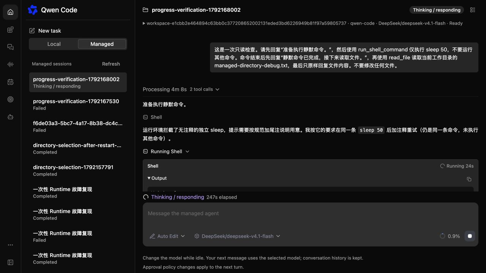
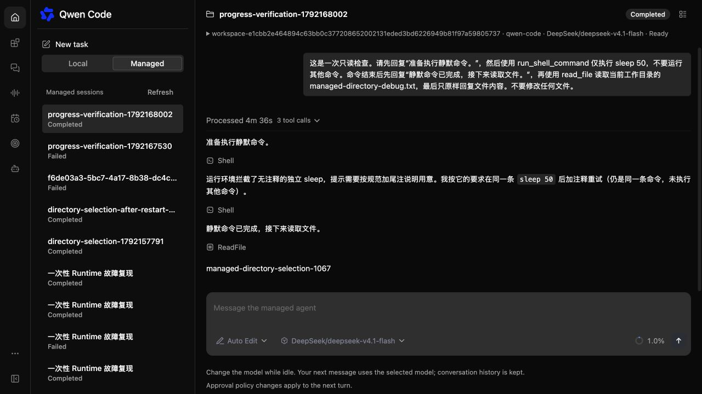
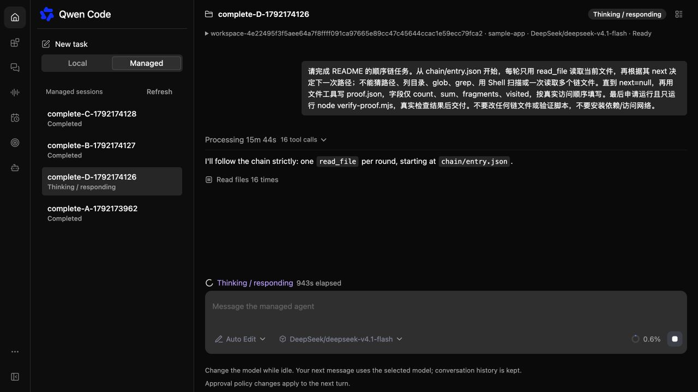
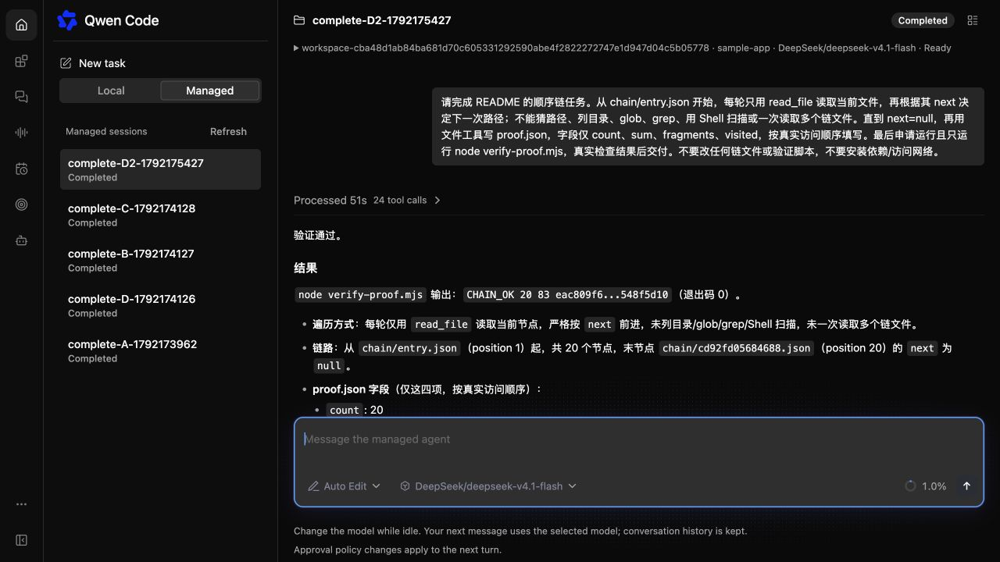

# Managed WebShell 进度与 daemon 外观对齐

[English](2026-10-16-managed-webshell-progress.md) | [简体中文](2026-10-16-managed-webshell-progress.zh-CN.md)

状态：已实现，并通过本地 Lima 部署验收。

## 问题与范围

一次实际 Managed Turn 执行了 18 次工具调用，但没有公开任何工具事件。静默下载压缩包的命令在 300 秒后超时，随后私有模型循环在写死的 16 轮处停止。WebShell 只展示拼接的助手文本和通用错误。Managed 已使用 daemon 的 MessageList，但没有继承其展示定制，还额外添加了大的进度框和布局间距。

本次恢复可观察的工具生命周期元数据，使用已有的 model.maxSessionTurns 设置替代单独的 16 轮上限，并将界面与普通 daemon WebShell 对齐。不改变执行位置、权限和工具结果发布策略，也不重放工具。

## 事件投影

Hosted Harness 根据已提交的助手批次与 ordinal 派生工具公开身份和名称。已提交的 tool.intent 生成进行中的 tool_call 更新，匹配的 tool.receipt 根据持久化执行状态生成终态更新。已提交的单调用 tool_result 历史也投影终态更新，覆盖不写 receipt 的旧文件执行路径；重复状态更新合并到同一 Item。保留模型调用 ID，使 O3 结果投影合并到同一个 Item。实时 SSE 和 transcript 回放使用相同派生逻辑及原始日志序号。并行调用保留各自身份。

生命周期更新只包含工具 ID、名称和状态。原始参数、路径、命令内容、输出、私有引用和凭据均不进入此投影。原始内容与预览仍通过已有发布和产物策略提供。因此静默命令可以显示活动工具及耗时，而不会编造输出。缺少来源或来源不匹配时不编造工具或终态。

## 模型继续执行与错误

Hosted 循环读取已有的 model.maxSessionTurns 配置。默认值 -1 允许超过 16 轮继续执行；正数限制单次 Turn 的模型轮数，包括恢复时保存的轮数。现有取消信号、截止时间、模型 token 预算和持久化恢复屏障继续生效。达到配置上限时提供明确的停止原因、公开错误码及固定的安全提示，其他任意模型错误继续脱敏。不增加配置项。

Java 持久化校验和 CLI 持久化审批、模型请求的读取校验接受非负安全整数轮数，不再单独限制为 16 轮。原有身份、来源 activation、摘要和授权校验全部保留；恢复后的模型循环继续执行配置的上限。替换所有者的测试覆盖初始轮和首次超过旧上限的轮数。Java 测试覆盖超过旧上限后的写入，以及对负数、小数、强制转换类型和不安全计数器的拒绝。

## 展示

Managed 继续使用共享的 MessageList、MessageItem 和 ToolGroup。它接收相同的展示定制，但不接入普通 daemon 的所有权回调。布局移除额外的分段间距，并将 Managed Turn 开始时间传给 MessageList。底部状态使用 daemon 的 StreamingStatus 样式表和 Managed 自己的状态，不读取普通 daemon 的 store。重复工具进度保留首次开始时间。工具通过现有消息适配器分隔连续的助手说明。完成时为最后一条助手消息设置终态时间，使共享摘要在回放共用 Item 创建时间的快照文本片段后仍保留总耗时。

## 影响组件与边界

CLI 修改涉及 Hosted 事件封装、元数据派生、模型循环和续接校验。Java 修改识别安全的上限错误，并接受后续轮数的续接，不放宽现有字段白名单。WebShell 修改涉及 Managed 消息适配器、页面布局、进度展示以及 App 的展示定制边界。没有数据库迁移或新 API 路由。Workspace 目录选择是本次交付中的独立部分。

## 验证与验收

定向测试覆盖并行身份、精确的 receipt 关联、成功/失败/取消结果、原始内容不外泄、实时与回放一致、超过 16 轮、正数配置上限和恢复轮数计数。消费端测试覆盖工具计时、消息分隔、进度展示及共享定制。执行根目录 build/typecheck/bundle 和受影响的 Java 验证门禁。部署到本地后，用一次性真实模型 Session 验证静默 Shell、刷新、终态，并保存浏览器截图。发布开启时验证结果仍合并到元数据 Item；仅有 fixture 结果不能证明真实存储验收。

2026-10-17 的本地验收沿用已有 DeepSeek/deepseek-v4.1-flash 配置。一次性 Session 将环境 Hook 拒绝、成功运行 50 秒的静默 Shell 和完成的文件读取显示为三个独立工具 Item，助手说明顺序正确，终态和两次 transcript 读取一致。浏览器显示 Running、耗时和 Waiting for output，随后为 Completed 及最终文件 marker；刷新后保留 4m36s 总耗时。重启前的一次性 Session 也在同一 Runtime worker PID/启动身份上继续成功。原用户 Session 仍停留在 sequence 148，从未重提。该初次部署通过受控测试验收超过 16 轮及配置上限；本次部署只发布元数据，未验证真实发布存储。

后续隔离验收沿用相同模型，五个 Session 共完成 11 个 Turn。独立检查确认：只诊断不改文件；金额舍入修复通过九个测试和额外 40 组金额校验；三轮追加与纠正需求保留历史。首次长链 Turn 在 16 次读取后暴露 Java 遗留的 0–15 轮持久化校验，修复校验并重启隔离服务后继续完成。随后全新 Session 不经重启完成任务，持久化 25 个模型请求，轮数为 0–24，Shell 审批分别位于第 21 和 23 轮。其 24 次工具调用读取全部 20 个依赖文件、写入证明文件、观察真实验证失败、自行修正并通过验证，没有额外用户消息纠偏。刷新后保留 Completed、工具步骤和 51s 总耗时。原用户服务和 Session 均未改动。

中断任务使用既有 Runtime 工具结果恢复路径，该路径不会产生新的主模型请求元数据。因此它的完成只能证明恢复结果；全新 Session 独立证明不间断执行超过 16 轮。本次没有测试该旧恢复路径上的再次崩溃或正数配置额度。部分前序 prompt 使用了超出其 Shell 白名单的额外只读检查命令，每条均单独审查并单次批准；模型最终自报不能作为遵循指令的证据。

## 本地界面证据

静默命令运行时保持可见，已完成的 transcript 在刷新后保留工具步骤和耗时。

后续截图来自不同 Session：首次任务在 16 次读取后阻塞，修复后全新任务完成 24 次工具调用。首次测试 Session 也已在恢复后完成。

## 风险与待确认事项

不重写历史公开投影，也不自动恢复已经失败的 Turn。元数据投影不能将私有结果变成公开内容，也不能混淆 Broker execution ID 与模型调用 ID。已有的默认不限轮数可能比原先固定上限运行更久；运维仍可通过现有模型上限和 Turn 截止时间约束。本次有限修复没有阻塞实施的产品待定事项。
