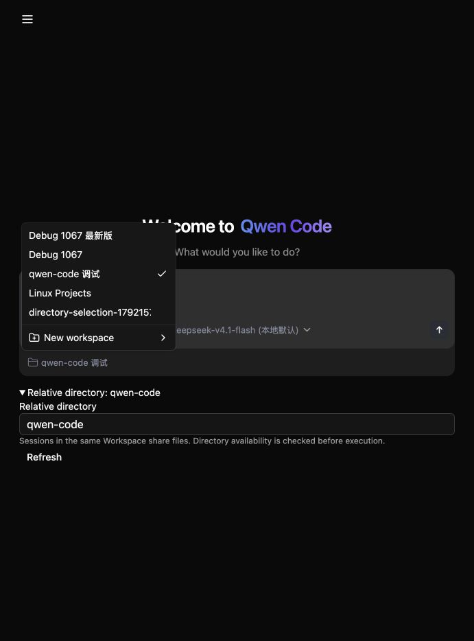

# 选择已有的 Managed Workspace 目录

[English](2026-10-16-managed-workspace-directory-selection.md) | [简体中文](2026-10-16-managed-workspace-directory-selection.zh-CN.md)

状态：已在本地实现并通过 Lima Linux 验证，生产验收不属于本次范围。

## 问题与现状

本次改动之前，New workspace 只接受名称，并创建由服务端管理的空目录。用户无法选择已有的 Linux 项目。本地调试部署中的 Java 和 `local-process` 工具 worker 都在 Lima Linux 中运行，因此目录发现也必须在该机器上执行。

## 预期行为

New workspace 在创建空目录之外增加已有目录模式。用户选择已授权的根目录，浏览其中的真实子目录，再为选中的项目目录创建命名 Workspace。项目保留在原位置。页面刷新后仍保留选择，并将其作为该 Workspace 新 Session 的默认工作目录。

可选择的根目录是使用本地存储、且当前认证 actor 拥有 OWNER 权限的 ACTIVE ROOT Workspace。管理员先注册项目父目录并向其所有者授权；本地部署也以此方式提供 Linux 项目父目录。所选目录是工作目录，并非新的权限边界：同一 storage 中的 Workspace 继续使用现有的共享文件访问范围和 physical-owner lease 语义。

## API 与权限

仅限 WebShell 的 `workspaces/directories/query` 接口接受 `workspaceId` 和 `cwdRelative`，返回已授权的 canonical 根目录和当前目录、有界的直接真实子目录列表，以及截断标志。该接口属于持久 Workspace 范围；读取文件系统前必须检查 tenant、actor、ACTIVE ROOT 状态、OWNER 授权、已配置 mount、native identity 和 marker。路径通过现有相对路径契约规范化。路径穿越、软链接、保留维护目录、不可访问目录和不支持的 storage 均关闭准入。目录发现不会回退到普通 daemon。SSH 和 CSI storage 不会出现在本地目录候选中，并在解析本地文件系统之前被拒绝；SSH 注册继续使用独立的 node/path 检查及操作接口。OpenAPI v1.56 为本地浏览请求使用单独名称，与 v1.52 的 SSH 目录检查请求区分。

现有创建请求增加可选的 `sourceWorkspaceId` 和 `cwdRelative` 字段，二者必须同时提供。缺省时保持创建空目录的行为。提供时验证源 Workspace 和目录，使用源 storage、配置和策略发布新的逻辑 Workspace，不再创建或注册 physical root。receipt 固定源身份及 generation，并在发布前再次检查。源身份发生变化或权限被撤销后，待完成请求不能继续成功。

现有 actor 范围的 WORKSPACE_CREATE receipt 持久化所选源、generation、storage 和目录。digest 覆盖规范化请求，选择已有目录时也包括源 generation。同 key 重试与已固定的 generation 比较，不会在源变化后悄悄重新绑定。完成后的重放检查新 Workspace 的当前权限，不会恢复授权。无需修改 schema 或 native marker。WebShell summary 从 receipt 投影可选的 `defaultCwdRelative`；历史和静态 Workspace 默认为 `.`。公开 API 的 Session 选择语义保持不变。

## 浏览器集成

复用共享目录浏览对话框及其过期响应保护。目录请求走 Java Managed provider。浏览器在提交前保留待完成请求的名称、源、目录和幂等 key；结果不确定时，用完全相同的请求重试。显式“放弃本地确认”操作仅删除浏览器持久化记录，并恢复目录和名称编辑，刷新后同样可用。界面说明工作区可能已存在，放弃不会删除它；新的创建使用新的 key。浏览器存储操作失败时，保留冻结请求。选择、刷新或新建 Workspace 时，从持久化默认目录初始化输入框，不改变草稿或模型。

## 涉及范围

| 层次                             | 改动                                               |
| -------------------------------- | -------------------------------------------------- |
| Java Workspace store 和 registry | 已授权目录发现、选择目录创建、receipt 投影         |
| WebShell API 契约                | 目录查询、可选创建字段和默认目录、surface gate     |
| WebShell provider 和创建界面     | 目录对话框、待完成请求持久化、默认目录             |
| 部署与验证                       | 注册 Linux 项目父目录；范围 API、UI 和真实工具验证 |

## 边界与风险

本次覆盖已有的可信 Linux local-process 部署，不选择 Mac 路径、不导入任意未授权服务端路径、不增加机器传输、不复制项目，也不修改运行时恢复。storage root 仍位于 Git worktree 之外，仓库位于子目录中，保留 marker 和 child-Git 生命周期规则。管理员必须选择文件访问范围整体适合其所有者的项目父目录。目录发现有界，不递归扫描文件系统。receipt 和授权事务必须在并发重试及源权限撤销时保持正确。

## 验证与验收

1. 基线 New workspace 没有目录选择，新 API 不存在。
2. OWNER 能浏览真实 Linux 子目录，并创建可以通过真实模型和工具读取已有项目文件的 Workspace。
3. 刷新、重新选择和仅重启 Java 后，默认项目目录及 native registration 保持不变。
4. READER、OPERATOR、其他 actor、其他 tenant、非 ACTIVE 源、路径穿越、软链接、维护目录和未配置 storage 请求均被拒绝，且不泄露目录内容。
5. 相同 key 和并发重试只创建一个 Workspace；请求变化产生冲突；待完成请求遇到源变化失败；完成后的重放不会重新授权或注册正在持有的 storage。
6. 创建空目录、模型选择、草稿保留、普通 daemon 行为和原 Workspace 恢复继续正常工作。

## 本地界面证据

选择的 Linux 项目在创建和刷新后仍是 Workspace 的默认目录。

## 待定事项

此范围内无待定事项。新增可选项目父目录属于管理员配置，不从浏览器提供的路径推断权限。
