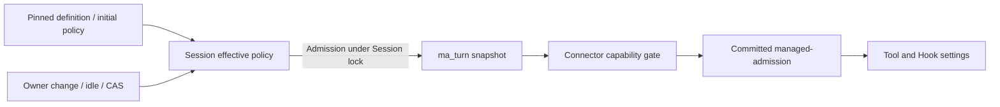

# Approval changes in stored AgentDefinition Sessions

[English](2026-10-17-managed-definition-approval-selection.md) | [简体中文](2026-10-17-managed-definition-approval-selection.zh-CN.md)

## Status and goal

Implementation based on research against `dac04ed35` on 2026-10-17. This document records the accepted design, compatibility constraints and verification requirements. Local verification results are recorded below; deployment-lane checks are distinguished from macOS evidence.

An owner should be able to change the next user-submitted Turn's approval mode in an existing, supported Workspace Session created from a stored AgentDefinition. Keep the Session, conversation history, model selection, Workspace and draft. Reuse the existing `default`, `auto-edit` and `yolo` modes and the [built-in approval selection mechanism](managed-approval-selection.md).

## Current behavior and evidence

Before implementation, read-only requests to the running Java service reproduced the difference between an idle custom preset Session and an idle built-in Session on the same Workspace. Both reported foreground Shell support, `default` approval and a completed Turn. The custom Session returned `approvalModeChange=false` and only `default`; the built-in Session returned support for all three modes. No policy mutation, model call or restart was performed for this research.

The baseline restriction existed at several layers:

- `WorkspaceToolProfiles.supportsApprovalSelection` accepts only built-in `qwen-code` with no definition digest.
- Summary/Actions capabilities and the change transaction use that eligibility.
- Turn snapshot insertion and lookup independently repeat the built-in restriction.
- The Harness advertises `approval-selection/1` but rejects every `approvalSelection` attached to a stored AgentDefinition.
- Creation intentionally compiles and pins the definition's initial policy. That creation contract is separate from a later Session override.

Opening the menu alone would leave execution and recovery inconsistent.

## Scope and decisions

| Area              | Decision                                                                                                                                                                                                                                                                 |
| ----------------- | ------------------------------------------------------------------------------------------------------------------------------------------------------------------------------------------------------------------------------------------------------------------------ |
| Eligible Sessions | Existing, Workspace-bound built-in Sessions and valid stored-definition Sessions using exactly `hosted-workspace-files/1`, `hosted-workspace-shell/1` or `hosted-workspace-shell/2`. Existing actor, execution-registry and deployment checks still apply.               |
| Modes             | `default`, `auto-edit` and `yolo`. The recorded owner with current OPERATOR or OWNER access makes an explicit choice while idle.                                                                                                                                         |
| Definition policy | `permission_policy.approval_mode` remains the immutable creation policy. For eligible Sessions, the owner may override ordinary approval for later user Turns. This extends the previous fixed-policy behavior; it does not change the definition's content or revision. |
| Creation          | Keep existing definition compilation, creation options and creation-request validation. A custom creation request cannot override its compiled initial policy. A newly created Session may use the existing-session operation once eligible and idle.                    |
| Excluded profiles | Do not add files/2, MCP, read-only child, team-lead, CSI, unknown profiles or text Sessions without a Workspace. Do not use a profile-prefix allowance.                                                                                                                  |
| Other inputs      | Do not change child/workflow inheritance or make monitor/channel/internal wake inputs inherit the Session override. Those retain their existing initial-policy contracts.                                                                                                |
| Permissions       | Approval selection changes whether an already admitted tool asks. Workspace grants, tool families, Runtime authority, Shell opt-ins, Hook pins and sandbox boundaries remain authoritative.                                                                              |

## State and transaction rules

Reuse schema V6 fields; no new table, column, migration, definition revision or policy configuration is required:

- `ma_session.approval_mode` and the definition pin remain the initial identity.
- `selected_approval_mode` and `approval_revision` hold the current override.
- Each newly admitted eligible Turn freezes its mode and revision in `ma_turn`, including revision zero.
- The Harness commits a positive selection in the existing `managed-admission` resource. Keep its schema and the prompt `payloadDigest` algorithm.

Reuse the existing Session lock and transaction for `session-approval/change`:

1. Resolve the bound Session and current access. Only its recorded owner with OPERATOR or OWNER access may change or replay a receipt. Retain creator fallback for older owner records and existing 403/404 isolation.
2. Resolve a same-key receipt before current capability/busy admission. Return its original result without another revision or a policy rollback; reject different content. Current authorization is still required.
3. For a new change, verify exact eligibility, the Session-specific Harness capability and a supported mode. Preserve the idle barrier: active Turns, requested Actions, open operations/rename, storage migration, retained Runtime Sessions, recovery-blocked Turns and a non-ready Session head block changes.
4. Compare `expectedRevision`, atomically write the override, increment revision, save the receipt and emit `session.approval.changed`. Preserve safe-integer limits and existing errors.

Do not add a new same-mode rule: the UI avoids sending the current mode; a fresh valid backend command follows the existing revision behavior. Turn admission takes the same lock. Change-first freezes the new policy; admission-first preserves the old snapshot and makes the change busy. No accepted Turn is reinterpreted.

Healthy resident workers and retained Runtime ownership are different facts. In particular, a Hook owner can survive a completed Turn; its unconfirmed release continues to block a policy change. This feature does not release that owner.

## Capability and execution design

Add the private Harness feature `agent-definition-approval-selection/1` while retaining `approval-selection/1` and protocol version 1. The new feature means positive-revision approval selection works for the eligible stored-definition profiles. It is advertised only with that implementation and requires the existing feature as well.

| Session / state                                           | Required feature for a new change or selected execution                                                                                   |
| --------------------------------------------------------- | ----------------------------------------------------------------------------------------------------------------------------------------- |
| Built-in eligible Session                                 | `approval-selection/1`                                                                                                                    |
| Eligible stored-definition Session                        | Both `approval-selection/1` and `agent-definition-approval-selection/1`                                                                   |
| Stored-definition Session with no override                | Existing initial-policy execution remains compatible with an older Harness; it offers no change there.                                    |
| Stored-definition Session with revision greater than zero | Both features on every execution-capable attachment, submit and recovery path, even when the selected mode equals the initial mode again. |

Use the same eligibility and capability decisions for list/get, existing-Session `session-approval/query`, policy mutation and execution-capable attachment checks. Preserve existing durable Turn admission: a direct API command may still record a Turn while feature support is absent, but dispatch and attachment refuse execution through the existing retry/failure path. WebShell disables fresh sends in that state. A custom initial-`yolo` files Session that switches to an asking mode must expose and deliver Actions. Losing the new feature must block selected execution, not silently execute the initial policy. Keep readback, authorized receipt confirmation and existing cancellation/lifecycle settlement paths; they must not acquire a new dependency on starting selected work. Action readback remains visible after feature withdrawal; delivering a decision that can advance selected execution still requires both features.

`HarnessConnector` needs a distinct stored-definition capability query with a false default; the Qwen connector implements it from the negotiated feature list. Service/Store admission must choose support from the immutable Session facts, retaining store-side checks under the Session lock. A generic `approval-selection/1` boolean must never authorize the custom branch.

`HarnessSessionRef` does not carry an agent identity or definition digest. Keep the Java SDK's generic feature check, current `approvalSelection: {mode, revision}` builder and prompt-identity comparison. The Java connector already owns the Session facts and performs the extra check; no new SDK request flag or wire field is needed.

The Harness removes its blanket custom-definition rejection only for the exact eligible profiles with a confirmed initial approval definition. Parse, validate, freeze and compare the existing selection identically to built-in execution. Live and recovered tool execution and Hooks read the selection from the committed admission, preserving the initial timeout. Never read a mutable Session override in an executing tool.

`yolo` skips ordinary file/Shell approval; explicit Hook ask/deny and approved-input checks remain effective. Do not broaden Hook/cgroup or platform support. Keep custom creation serialization unchanged, including `hostedApprovalDefinition(..., !agentDefinition)`. Both old and newly created custom initial-`yolo` files Sessions omit approval/timeout fields and use the existing ten-minute fallback, including after an override and reload. Custom initial-`default`/`auto-edit` Sessions retain their stored configured timeout across overrides and reloads. Do not add a new selectable-definition representation or rewrite existing definition resources and digests in this feature.

## Existing Sessions, history and recovery

Use the current conservative legacy rules; do not backfill old Turn rows or infer their provenance from timestamps.

| Stored state                                                                                | Required behavior                                                                                                          |
| ------------------------------------------------------------------------------------------- | -------------------------------------------------------------------------------------------------------------------------- |
| Old custom Turn has no snapshot; Session revision is zero                                   | Return no selection and preserve the original request's omission. Execute only under the confirmed initial definition.     |
| New eligible Turn has an initial-policy snapshot at revision zero                           | Keep that SQL snapshot; consistently omit the private field on every Harness generation.                                   |
| Turn has a positive snapshot                                                                | Send exactly that saved selection and require both features for a custom Session. Later Session changes cannot replace it. |
| An execution lookup encounters a missing snapshot after the Session has a positive revision | Preserve `409 approval_snapshot_missing`. Do not substitute the current selection or synthesize revision zero.             |
| Read history or replay a completed create/submit receipt after the first change             | Return the original history/receipt. Do not run the old Turn again or add selection bytes to its original prompt.          |

The last row relies on a verified existing invariant: replay may queue dispatch, but `HarnessCoordinator` first calls `claimTurn`, which only claims `ACCEPTED`, `RUNNING` or `CANCELLING`. Terminal history cannot reach a new Harness submit. The idle barrier prevents the first change while an old uncompleted or recovery-blocked Turn exists. Passive attachment validation checks the active Turn, not every historical row.

A direct, unchanged replay of a settled Harness admission can still return its receipt without execution. Do not claim all such reads fail. Changing its selection, reviving a terminal Turn or sending a snapshot-less old Turn for execution after an override is unsupported and must refuse. Regression tests must establish both receipt preservation and absence of re-execution.

Keep AgentDefinition revision/content digest, `managed-definition`/`definitionRef`, initial approval confirmation, recovery authorization and checkpoints intact. Continue uses the original admission, not the latest policy. `WorkspaceRecoveryStore` already includes initial/selected policy and revision in recovery source facts; preserve its source-drift detection.

## WebShell and API behavior

Reuse the current WebShell routes and fields:

- `session-approval/query` returns effective `approvalMode`, `approvalRevision`, available modes and support for an eligible custom Session.
- `session-approval/change` retains owner-scoped idempotency, CAS and errors.
- Session list/get consistently expose effective mode, revision, immutable `initialApprovalMode` and `approvalModeChange`. Capability describes supported shape/access; busy-state admission remains separate.

Creation's `session-options/query` continues to return only the definition's compiled initial mode, regardless of any existing Session's later override. It is not the existing-Session approval-options route.

The existing UI hook already persists an intention before sending, confirms the original key after a lost response, waits for a non-stale summary and blocks send/model/cwd while uncertain. Reuse it without an agent-ID exception. Preserve the draft, history and selected model.

Eligible existing Sessions display “Approval policy changes apply to the next turn.” Busy/recovery and unsupported states keep their controls disabled. Replace the generic fixed-policy hint with a truthful statement that the current Session cannot change approval policy; do not promise that starting the same preset will offer another initial mode. Creation still uses the definition's compiled choice. No new public REST mutation or support-reason API is required.

## Implementation map

| Component                                                  | Required work and downstream checks                                                                                                                                                                |
| ---------------------------------------------------------- | -------------------------------------------------------------------------------------------------------------------------------------------------------------------------------------------------- |
| `WorkspaceToolProfiles`                                    | Extend exact eligibility to valid stored pins; keep other profiles excluded.                                                                                                                       |
| `ManagedAgentStore`                                        | Align policy-change eligibility, both snapshot-insertion CASE expressions and snapshot lookup. Reuse authorization, receipts, locking, limits and missing-snapshot refusal.                        |
| `ManagedAgentService`                                      | Align batch summary reads, owner capabilities, effective mode/revision, Actions and executable-state decisions with Session-specific feature support.                                              |
| `HarnessConnector` / `QwenHostedHarnessConnector`          | Negotiate the additional feature and enforce it on positive custom submit, create/load attachment, passive recovery and continue. Keep original definition confirmation and cancellation behavior. |
| `hosted-harness-contract.ts` / `hosted-harness-session.ts` | Advertise the feature and admit eligible custom snapshots; retain resident/cold duplicate identity checks.                                                                                         |
| `hosted-approval-selection.ts` / tool/Hook consumers       | Reuse frozen admission settings and initial timeout; verify live and recovered calls at both execution sites. No Core data-format change is planned.                                               |
| Java SDK                                                   | Regression-test unchanged serialization, generic feature checks and active-prompt identity; no new Session-kind model or builder parameter.                                                        |
| WebShell                                                   | Exercise custom summaries/options through existing hook/provider/editor; correct the fixed-policy wording in both languages.                                                                       |
| Contract and documentation                                 | Update OpenAPI descriptions and generated types through the generator, README and both approval designs when implementing. Keep creation-policy descriptions accurate.                             |

Keep compiler policy, definition storage, attachment identity and baseline `ManagedActionStore.approvalMode` reads intact. That read confirms the definition, not the selected Turn policy. Review every eligibility/helper/approval-mode read site; widening only one predicate is insufficient.

## Rollout and rollback

No schema migration is proposed; existing V6 fields are present in the researched V9 catalog. This does not make old Java writers compatible.

1. Upgrade Harness first; it advertises both features and keeps old clients working with initial policies.
2. In a maintenance window, stop or fence every old Java/Broker reader and writer sharing the catalog. Deploy the new implementation everywhere before reopening custom policy changes.
3. Publish WebShell after the control plane is ready. Existing custom Sessions remain at their initial policy until an authorized owner explicitly changes them; no Session recreation or definition republish is required.

An old Java implementation ignores custom overrides and snapshots. After a custom override has been committed, rolling back to that binary or allowing it to share the catalog can execute an incorrect policy. Schema-version validation cannot detect this unchanged schema. Keep a compatible rollback build or use a maintenance/forward-fix procedure with affected Sessions blocked from execution. Do not clear revisions or rewrite definition/history as a rollback shortcut.

A new Java control plane with an old Harness must report no custom-change support. If a selected custom Session loses the new feature after replacement, execution remains blocked until support returns, including when its selected mode has returned to the initial value.

## Validation and acceptance

The pre-implementation baseline reproduced the capability gap. The following matrix defines implementation acceptance; the local verification record distinguishes passed checks from deployment-lane requirements.

| Group                          | Minimum evidence                                                                                                                                                                                                                                                                                                                                  |
| ------------------------------ | ------------------------------------------------------------------------------------------------------------------------------------------------------------------------------------------------------------------------------------------------------------------------------------------------------------------------------------------------- |
| Eligibility and UI             | Real stored definitions, not a fabricated digest on a built-in row; files/1 and Shell/1,/2 representatives; list/get and `session-approval/query` agree on existing-Session policy. `session-options/query` retains the single compiled creation mode; excluded profiles stay fixed.                                                              |
| Policy and identity            | One existing custom Session follows `default → yolo → auto-edit → default`. Original definition revision/digest, initial policy, creation replay, model, history and draft remain unchanged. Publishing a newer definition does not rebind it.                                                                                                    |
| Real effects                   | In a custom Shell Session with a deterministic model, a write plus foreground Shell command has ordinary approval counts 2/0/1 under default/yolo/auto-edit. Denial has no effect; allowance produces exact bytes once. Preserve profile-specific file/read behavior; files/1 does not expose glob to the model, and this change does not add it. |
| Hooks and Actions              | A custom initial-yolo files Session can return to asking; pending Actions remain usable. Explicit Hook ask/deny still applies under yolo. A retained Hook owner blocks changes until confirmed release. MCP fixture success is not evidence for these profiles.                                                                                   |
| Authorization and transactions | Owner plus current OPERATOR; non-owner OWNER/OPERATOR, reader, revoked grant and cross-tenant refusal; same-key replay, different-body conflict, stale CAS, safe limits and both send/change lock orders. Verify on real MySQL.                                                                                                                   |
| Legacy and replay              | Old custom null snapshots at revision zero, new zero snapshots, frozen positive snapshots, completed create/submit receipt replay with zero SDK submits, resident/cold identity conflicts and post-selection missing-snapshot refusal.                                                                                                            |
| Recovery and compatibility     | New and old Harness combinations, replacement/downgrade, awaiting approval, commit/ACK loss and continued execution use the original Turn; no duplicate effects. Initial definition/timeout and cancellation settlement remain intact.                                                                                                            |
| Browser recovery               | Lost change response, refresh, original-intention confirmation, stale or cross-Session readback, capability withdrawal and preserved draft.                                                                                                                                                                                                       |

Timeout acceptance covers old and new custom initial-yolo files Sessions (the same ten-minute fallback), plus custom initial-default/auto-edit Sessions with a non-default stored timeout. Switch policy and reload; each retains its original timeout and definition pin. Also cover an old create committed before its response was lost: after upgrade, create replay may fall through to load, which must keep the original `definitionRef`/digest, initial policy and timeout representation.

Extend `ManagedApprovalChangeTest` and its `ManagedApprovalChangeMySqlIT` subclass, creation/definition and connector tests, SDK tests, the existing CLI approval/Harness/tool suites, and WebShell hook/provider/page tests. Add an eligible stored-definition case to a real MySQL + packaged Harness + worker fixture. Qualify command Hooks on Linux with cgroup v2; macOS foreground acceptance does not establish Linux or whole-host recovery.

Implementation completion requires affected tests, root build/typecheck/bundle, Java verification, the MySQL profile, contract gates, two clean self-audit passes and independent review. Markdown formatting and reference checks cover both language versions. Report unavailable runtime gates explicitly; do not treat unit or macOS evidence as Linux process qualification.

## Local verification record

On macOS, the root build, typecheck and bundle passed after synchronizing with `95b8d377a`. The six related CLI suites passed 901 tests; WebShell page/hook/provider suites passed 197 tests. Two unchanged Java SDK approval-negotiation regressions also passed. Final Java verification reported 4,577 unit/H2 tests with no failures or errors and 18 skips, plus 45 real-MySQL approval transaction tests without skips and passing Checkstyle/SpotBugs gates. Skipped checks are not acceptance evidence.

An isolated real-MySQL, packaged Harness and durable native-worker run passed 16 deterministic user Turns across all three eligible custom profiles. It verified the 2/0/1 approval matrix, denied calls with no effects, exact allowed effects once, initial-yolo Actions, immutable identity, terminal receipts with no resubmission, revision-zero omission, positive snapshots and two Harness generations. Actual Actions retained 73,000ms for the initial asking definitions and the 600,000ms fallback for initial-yolo files after overrides and cold load. The loopback model establishes controlled tool execution, not upstream-model acceptance.

The existing local custom Session was backed up and reopened after updating the control plane and Harness. Its definition, Workspace, model, initial policy and history sequence were unchanged; the browser displayed all three modes while retaining its original `default` selection. The tracked `HostedPublicWorkspaceIT#storedDefinitionApprovalSelectionRoundTripsThroughRealWorkspaceToolsOnMySql` case also passed with the native fixture and preserves the central roundtrip as a repeatable regression.

The existing FG6a `start` selector was attempted on macOS and refused Workspace execution in its legacy physical fixture; it is not a passing fault gate. Linux command Hook/cgroup acceptance, the full Hosted/fault profiles, Windows, whole-host restart and real upstream-model calls remain unverified for this change. Existing unit coverage of Hook and recovery policy does not replace those deployment checks.

## Implementation sequence and follow-ups

1. Add the Harness feature and custom admission/duplicate/recovery tests while keeping initial definition identity stable.
2. Extend Java eligibility, Session-specific capability enforcement and snapshot read/write together; add transaction, legacy and MySQL tests before exposing support.
3. Connect existing WebShell behavior, update contract/docs and run end-to-end acceptance on isolated fixtures.
4. Deploy with the all-writer maintenance rule and verify an existing custom Session through real effects before declaring support.

There are no unresolved decisions inside this scope. Creation-time policy overrides, additional profiles, internal-input inheritance, Hook-owner release and automatic mixed-version/rollback fencing require separate designs.
