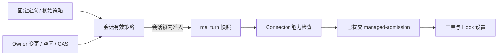

# 已保存 AgentDefinition 会话的审批策略切换

[English](2026-10-17-managed-definition-approval-selection.md) | [简体中文](2026-10-17-managed-definition-approval-selection.zh-CN.md)

## 状态与目标

基于 2026-10-17 的 `dac04ed35` 调研实现。本文记录已确认的设计、兼容性约束和验证要求；本地验证结果记录在下文，部署测试通道与 macOS 证据分别说明。

对于由已保存 AgentDefinition 创建、绑定 Workspace 且受支持的已有会话，owner 应能修改下一次用户提交回合使用的审批策略。保留会话、对话历史、模型选择、Workspace 和草稿，复用 `default`、`auto-edit`、`yolo` 及[内置审批切换机制](managed-approval-selection.zh-CN.md)。

## 当前行为与证据

实现前，对运行中 Java 服务的只读请求复现了同一 Workspace 上空闲预设会话与内置会话的差异。两者均支持前台 Shell、当前审批为 `default`，最新回合已完成。预设会话返回 `approvalModeChange=false`、仅有 `default`；内置会话返回三种模式和切换能力。本次调研未修改策略、调用模型或重启服务。

基线限制分布在多层：

- `WorkspaceToolProfiles.supportsApprovalSelection` 仅接受没有 definition digest 的内置 `qwen-code`。
- 摘要、Actions 能力与切换事务使用该资格判断。
- 回合快照写入与读取又各自重复了内置会话限制。
- Harness 虽声明 `approval-selection/1`，但拒绝已保存 AgentDefinition 携带任何 `approvalSelection`。
- 创建流程有意编译并固定定义的初始策略。创建合约与后来的会话覆盖属于不同阶段。

只放开菜单会导致执行与恢复不一致。

## 范围与决策

| 范围           | 决策                                                                                                                                                                                           |
| -------------- | ---------------------------------------------------------------------------------------------------------------------------------------------------------------------------------------------- |
| 合资格会话     | 已有、绑定 Workspace，且精确使用 `hosted-workspace-files/1`、`hosted-workspace-shell/1` 或 `hosted-workspace-shell/2` 的内置会话或有效已保存定义会话。继续检查 actor、执行注册事实及部署开关。 |
| 模式           | `default`、`auto-edit`、`yolo`。记录上的 owner 当前持有 OPERATOR 或 OWNER 权限时，可在空闲状态显式选择。                                                                                       |
| 定义策略       | `permission_policy.approval_mode` 保持不可变的创建策略。合资格会话的 owner 可以为后续用户回合覆盖普通审批策略。这扩展了原来的固定策略行为，不修改定义内容或修订。                              |
| 创建           | 保留定义编译、创建选项与创建请求校验。自定义创建请求不能覆盖编译后的初始策略。新创建的会话在满足资格和空闲条件后，可使用已有会话的切换操作。                                                   |
| 排除的 profile | 不增加 files/2、MCP、只读子会话、team-lead、CSI、未知 profile 或未绑定 Workspace 的文本会话；不能使用 profile 前缀放行。                                                                       |
| 其他输入       | 不改变 child/workflow 继承，也不让 monitor/channel/内部唤醒输入自动继承会话覆盖；它们保留现有初始策略合约。                                                                                    |
| 权限           | 审批选择决定已准入工具是否询问。Workspace 授权、工具种类、Runtime 权威、Shell 开关、Hook pin 与沙箱边界继续生效。                                                                              |

## 状态与事务规则

复用 schema V6 字段，无需增加表、列、迁移、定义修订或策略配置：

- `ma_session.approval_mode` 与定义 pin 继续表示初始身份。
- `selected_approval_mode` 与 `approval_revision` 表示当前覆盖。
- 每个新接纳的合资格回合都在 `ma_turn` 冻结模式与修订，包括修订零。
- Harness 将正修订选择提交到现有 `managed-admission` 资源，保留其 schema 与 prompt `payloadDigest` 算法。

`session-approval/change` 复用现有会话锁与事务：

1. 解析绑定会话和当前授权。仅记录上的 owner 且持有 OPERATOR 或 OWNER 权限时可以变更或重放回执。保留旧 owner 记录的 creator 回退，以及现有 403/404 隔离语义。
2. 在当前能力和忙碌准入前查询同键回执。返回原结果，不再次递增修订或倒退当前策略；同键不同内容拒绝。仍须先检查当前授权。
3. 对新变更校验精确资格、会话对应的 Harness 能力与受支持模式。保留空闲屏障：活动回合、待决 Action、未完成操作/rename、存储迁移、保留的 Runtime Session、恢复阻塞回合和非 ready 会话 head 均阻止切换。
4. 核对 `expectedRevision`，原子写入覆盖、递增修订、保存回执并发出 `session.approval.changed`。保留安全整数上限和既有错误。

不增加新的“同模式”规则：页面不发送当前模式；后端收到新的有效命令时沿用既有修订行为。回合准入获取同一把锁。变更先提交则冻结新策略；准入先提交则保留旧快照并让变更因忙碌而拒绝。不能重新解释已接纳回合。

健康常驻 worker 与保留的 Runtime 所有权是不同事实。Hook owner 尤其可能跨越已完成回合，其释放尚未确认时继续阻止策略切换；本功能不负责释放该 owner。

## 能力协商与执行设计

新增私有 Harness 能力 `agent-definition-approval-selection/1`，保留 `approval-selection/1` 和协议版本 1。新能力表示合资格的已保存定义 profile 支持正修订审批选择；实现完成后才声明，并且必须同时具备原能力。

| 会话或状态                   | 新切换或已选择策略执行所需的能力                                                         |
| ---------------------------- | ---------------------------------------------------------------------------------------- |
| 合资格内置会话               | `approval-selection/1`                                                                   |
| 合资格已保存定义会话         | 同时具备 `approval-selection/1` 和 `agent-definition-approval-selection/1`               |
| 尚未覆盖策略的已保存定义会话 | 现有初始策略执行仍可兼容旧 Harness，但不向其开放切换。                                   |
| 修订大于零的已保存定义会话   | 所有可能执行的 attachment、submit 与恢复路径都要求两项能力，即使当前选择已切回初始模式。 |

list/get、已有会话的 `session-approval/query`、策略变更和可能执行的 attachment 检查应使用一致的资格与能力判断。保留既有持久回合准入：能力缺失时，直接 API 命令仍可能记录回合，但 dispatch 和 attachment 沿既有重试/失败路径拒绝执行；WebShell 此时禁用新发送。初始为 `yolo` 的自定义 files 会话切回询问模式时，必须提供并交付 Actions。新能力消失时阻止按已选策略执行，不能悄悄执行初始策略。保留读回、已授权回执确认及现有取消/生命周期收尾路径，不能让它们新增“启动已选策略工作”的依赖。能力撤回后仍可读回 Action；交付可能推进已选策略执行的决定则继续要求两项能力。

`HarnessConnector` 增加独立的已保存定义能力查询，默认返回 false；Qwen connector 根据协商后的能力列表实现。Service/Store 必须根据不可变会话事实选择支持条件，并在会话锁内保留 Store 检查。通用的 `approval-selection/1` 布尔值不能授权自定义分支。

`HarnessSessionRef` 不含 agent 身份或 definition digest。保留 Java SDK 的通用能力检查、现有 `approvalSelection: {mode, revision}` builder 和 prompt 身份比较。Java connector 已持有会话事实，由它检查额外能力，无需增加 SDK 请求标记或 wire 字段。

Harness 只对精确合资格 profile 且已确认初始审批定义的会话，解除自定义定义的整体拒绝。选择的解析、校验、冻结和比较与内置执行一致。实时与恢复后的工具执行、Hook 都从已提交 admission 读取选择，保留初始超时；执行工具时不能读取可变的会话覆盖。

`yolo` 跳过普通文件/Shell 审批；Hook 明确 ask/deny 和获批输入检查仍生效。不扩大 Hook/cgroup 或平台支持。保持自定义创建序列化不变，包括 `hostedApprovalDefinition(..., !agentDefinition)`。新旧自定义初始 `yolo` files 会话均省略审批/超时字段，沿用现有十分钟默认值，覆盖策略并重新加载后仍保留它。自定义初始 `default`/`auto-edit` 会话保留已存配置超时，切换和重新加载都不能改变。本功能不增加新的 selectable-definition 表示，也不改写已有定义资源和 digest。

## 已有会话、历史与恢复

沿用现有保守的旧数据规则，不回填旧回合，也不根据时间戳推测来源。

| 已存状态                                          | 必须满足的行为                                                               |
| ------------------------------------------------- | ---------------------------------------------------------------------------- |
| 旧自定义回合没有快照，会话修订为零                | 返回无选择，保留原请求省略该字段的身份；仅按已确认的初始定义执行。           |
| 新合资格回合保存了初始策略、修订零快照            | 保留 SQL 快照；所有 Harness 代际都一致省略私有字段。                         |
| 回合有正修订快照                                  | 精确发送这份已保存的选择；自定义会话要求两项能力，之后的会话变更不能替换它。 |
| 会话已有正修订，执行读取却发现快照缺失            | 保留 `409 approval_snapshot_missing`。不能用当前选择替代或合成修订零。       |
| 首次切换后读取历史或重放已完成 create/submit 回执 | 返回原历史/回执，不重新运行旧回合，也不向其原 prompt 补入选择字段。          |

最后一行依赖已核查的现有不变量：重放可能排队 dispatch，但 `HarnessCoordinator` 先调用 `claimTurn`，后者仅领取 `ACCEPTED`、`RUNNING` 或 `CANCELLING`。终态历史不能到达新的 Harness submit。空闲屏障阻止在旧未完成或恢复阻塞回合存在时首次切换。被动 attachment 校验检查当前活动回合，不扫描所有历史行。

直接、原样重放已结算的 Harness admission 仍可只返回回执，不产生执行；不能宣称此类读取都会失败。变更其 selection、把终态回合恢复为可执行状态，或在覆盖后将缺快照旧回合重新交付执行均不支持，必须拒绝。回归测试须同时证明回执保留和没有重新执行。

保留 AgentDefinition 修订/内容 digest、`managed-definition`/`definitionRef`、初始审批确认、恢复授权与 checkpoint。continue 使用原 admission，不使用最新策略。`WorkspaceRecoveryStore` 已将初始/所选策略和修订纳入恢复源事实，继续检测来源漂移。

## WebShell 与 API 行为

复用当前 WebShell 路由和字段：

- `session-approval/query` 为合资格自定义会话返回有效 `approvalMode`、`approvalRevision`、可选模式和支持能力。
- `session-approval/change` 保留 owner 范围的幂等、CAS 与错误语义。
- 会话 list/get 一致提供有效模式、修订、不可变 `initialApprovalMode` 和 `approvalModeChange`。能力描述受支持的形态与授权，忙碌准入仍单独检查。

创建的 `session-options/query` 继续只返回定义编译后的初始模式，不受任何已有会话之后的覆盖影响；它不是已有会话的审批选项查询。

现有 UI hook 已在发送前保存意图、响应丢失后按原键确认、等待非过期摘要，并在结果不确定时锁住发送/模型/cwd。复用这些行为，不添加 agent ID 特例；保留草稿、历史和已选模型。

合资格已有会话显示“审批策略变更将在下一回合生效”。忙碌/恢复和不支持状态继续禁用控件。将笼统的固定策略提示改为如实说明当前会话不支持修改审批策略，不能承诺重新选择同一预设就有其他初始模式。创建仍使用定义编译后的选项。不增加公开 REST 变更操作或支持原因 API。

## 实现影响图

| 组件                                                       | 必要工作与下游检查                                                                                                  |
| ---------------------------------------------------------- | ------------------------------------------------------------------------------------------------------------------- |
| `WorkspaceToolProfiles`                                    | 将精确资格扩展到有效已保存定义 pin，继续排除其他 profile。                                                          |
| `ManagedAgentStore`                                        | 同步策略变更资格、快照写入的两个 CASE 和快照读取；复用授权、回执、锁、上限及缺快照拒绝。                            |
| `ManagedAgentService`                                      | 批量摘要读取、owner 能力、有效模式/修订、Actions 与可执行状态按会话对应的能力保持一致。                             |
| `HarnessConnector` / `QwenHostedHarnessConnector`          | 协商额外能力，在正修订自定义 submit、create/load attachment、被动恢复及 continue 检查；保留初始定义确认与取消行为。 |
| `hosted-harness-contract.ts` / `hosted-harness-session.ts` | 声明能力并准入合资格自定义快照；保留驻留/冷重复请求的身份比较。                                                     |
| `hosted-approval-selection.ts` / 工具与 Hook 消费方        | 复用冻结 admission 设置与初始超时，核对实时和恢复两处执行入口；不计划改变 Core 数据格式。                           |
| Java SDK                                                   | 回归验证序列化、通用能力检查和活动 prompt 身份保持不变；不新增 Session-kind 模型或 builder 参数。                   |
| WebShell                                                   | 用自定义摘要/选项验证现有 hook/provider/editor，修正两种语言的固定策略提示。                                        |
| 合约与文档                                                 | 实现时更新 OpenAPI 描述、通过生成器更新类型，并同步 README 与两种语言的审批设计；保留准确的创建策略说明。           |

保留编译器策略、定义存储、attachment 身份和 `ManagedActionStore.approvalMode` 的 baseline 读取；该读取确认定义，而非回合所选策略。审查每个资格/helper/审批模式读点，不能只放开一处判断。

## 上线与回滚

不计划 schema 迁移；调研使用的 V9 catalog 已含 V6 字段。这不代表旧 Java 写入端兼容新行为。

1. 先升级 Harness；同时声明两项能力，旧客户端仍可按初始策略工作。
2. 在维护窗口停止或隔离共享 catalog 的全部旧 Java/Broker 读写端。所有实例升级完成后，再开放自定义策略切换。
3. 控制面就绪后发布 WebShell。已有自定义会话保持初始策略，直到获授权的 owner 显式修改，无需重建会话或重新发布定义。

旧 Java 实现会忽略自定义覆盖和快照。自定义覆盖一旦提交，回滚到该旧版本或允许它共享 catalog，可能按错误策略执行；未改变的 schema 版本无法检测此问题。保留兼容的回滚版本，或在阻止受影响会话执行的维护流程中向前修复。不能通过清零修订、改写定义或历史来快速回滚。

新 Java 配合旧 Harness 时必须返回不支持自定义切换。若已切换的自定义会话在 Harness 替换后失去新能力，执行保持阻塞直到能力恢复，即使选择已回到初始模式。

## 验证与验收

实现前基线复现了能力差异。下表定义实现验收要求；本地验证记录区分已通过检查与部署测试通道的要求。

| 分组            | 最小证据                                                                                                                                                                                                                                 |
| --------------- | ---------------------------------------------------------------------------------------------------------------------------------------------------------------------------------------------------------------------------------------- |
| 资格与 UI       | 通过真实已保存定义创建，不靠给内置行伪造 digest；覆盖 files/1、Shell/1,/2 代表会话；list/get 与 `session-approval/query` 的已有会话策略一致；`session-options/query` 保留唯一编译创建模式，排除的 profile 仍固定。                       |
| 策略与身份      | 同一已有自定义会话完成 `default → yolo → auto-edit → default`，原定义修订/digest、初始策略、创建重放、模型、历史和草稿保持；发布新定义不重新绑定旧会话。                                                                                 |
| 真实副作用      | 自定义 Shell 会话使用确定性模型，一次写入加一条前台 Shell 在 default/yolo/auto-edit 下普通审批次数为 2/0/1；拒绝没有副作用，批准后精确字节且仅执行一次；另行保留各 profile 的文件与读取行为；files/1 不向模型暴露 glob，不扩展该工具面。 |
| Hook 与 Actions | 初始 yolo 的自定义 files 会话可切回询问，待决 Actions 可正常操作；yolo 下 Hook 明确 ask/deny 仍生效；保留的 Hook owner 释放确认前阻止变更；MCP fixture 成功不能证明这些 profile 正确。                                                   |
| 授权与事务      | owner 加当前 OPERATOR；非 owner 的 OWNER/OPERATOR、reader、撤权、跨租户拒绝；同键重放、异内容冲突、过期 CAS、安全上限和发送/切换两种锁顺序；使用真实 MySQL 验证。                                                                        |
| 旧数据与重放    | 旧自定义 null 快照/修订零、新零快照、冻结正快照；已完成 create/submit 回执重放时 SDK submit 次数为零；驻留/冷重复身份冲突和切换后缺快照拒绝。                                                                                            |
| 恢复与兼容      | 新旧 Harness 组合、替换/降级、等待审批、提交后 ACK 丢失和继续执行均保留原回合策略，不重复副作用；保留初始定义/超时及取消收尾。                                                                                                           |
| 浏览器恢复      | 丢失切换响应、刷新、确认原意图、过期或跨会话读回、能力撤回和草稿保留。                                                                                                                                                                   |

超时验收覆盖新旧自定义初始 yolo files 会话（相同的十分钟默认值），以及已存非默认超时的自定义初始 default/auto-edit 会话。切换策略并重新加载后，各自的原超时与定义 pin 保持不变。另覆盖旧创建已提交但响应丢失：升级后 create 重放可以转为 load，必须保留原 `definitionRef`/digest、初始策略及超时表示。

扩展 `ManagedApprovalChangeTest` 及其 `ManagedApprovalChangeMySqlIT` 子类、创建/定义与 connector 测试、SDK 测试、既有 CLI 审批/Harness/工具测试和 WebShell hook/provider/page 测试。在真实 MySQL 加打包 Harness 加 worker 的夹具中新增合资格已保存定义场景。命令 Hook 在具备 cgroup v2 的 Linux 上验收；macOS 前台验收不证明 Linux 或整机恢复能力。

实现完成需要受影响测试、根目录 build/typecheck/bundle、Java 验证、MySQL profile、合约门禁、连续两轮干净自审和独立审查。两种语言均执行 Markdown 格式和引用检查。无法运行的门禁需明确报告；单元测试或 macOS 证据不等同于 Linux 进程资格验收。

## 本地验证记录

在 macOS 上，同步到 `95b8d377a` 后根目录 build、typecheck、bundle 通过。六个相关 CLI 套件共 901 项测试通过，WebShell page/hook/provider 共 197 项通过；Java SDK 两项未修改的审批协商回归也通过。最终 Java 验证报告 4,577 项 unit/H2 测试、零失败和错误、跳过 18 项，另有 45 项真实 MySQL 审批事务测试无跳过且 Checkstyle/SpotBugs 门禁通过。跳过的检查不算验收证据。

隔离的真实 MySQL、打包 Harness 与持久原生 worker 完成三种合资格自定义 profile 的 16 个确定性用户回合，验证 2/0/1 审批矩阵、拒绝无副作用、批准后精确执行一次、初始 yolo 的 Actions、不可变身份、终态回执不重新提交、修订零省略字段、正修订快照与两代 Harness。真实 Action 在覆盖和冷加载后仍分别保持初始询问定义的 73,000ms，以及初始 yolo files 的 600,000ms 默认值。loopback 模型证明受控工具执行，不等于上游真实模型验收。

已有本地自定义会话在备份并更新控制面、Harness 后重新打开。定义、Workspace、模型、初始策略与历史序列保持；浏览器显示三种模式，原选择仍为 `default`。受版本控制的 `HostedPublicWorkspaceIT#storedDefinitionApprovalSelectionRoundTripsThroughRealWorkspaceToolsOnMySql` 用例也已通过原生夹具验证，将核心切换闭环保留为可重复的回归测试。

在 macOS 尝试既有 FG6a `start` selector，其旧 physical fixture 拒绝 Workspace 执行，不能算 fault gate 通过。本次尚未验证 Linux 命令 Hook/cgroup、完整 Hosted/fault profiles、Windows、整机重启与真实上游模型调用。既有 Hook 和恢复策略单元测试不能替代这些部署检查。

## 实现顺序与后续事项

1. 添加 Harness 能力及自定义准入/重复/恢复测试，保持初始定义身份稳定。
2. 同时扩展 Java 资格、会话对应能力检查和快照读写；开放能力前补齐事务、旧数据与 MySQL 测试。
3. 接通既有 WebShell 行为，同步合约/文档，使用隔离夹具执行端到端验收。
4. 按全部写入端维护规则部署，通过已有自定义会话的真实副作用验收后再声明支持。

本范围内没有未决设计。创建时覆盖策略、更多 profile、内部输入继承、Hook owner 释放及自动混版本/回滚隔离需要另行设计。
