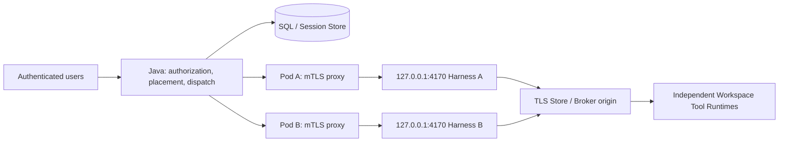
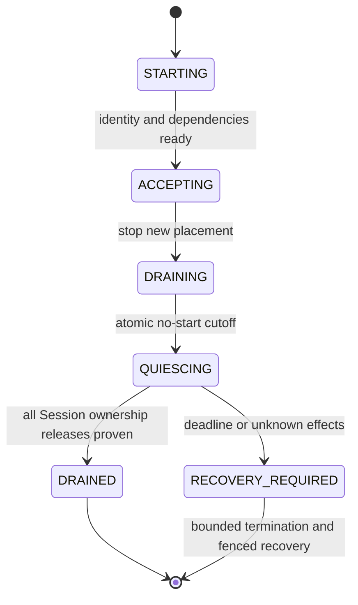

# Kubernetes shared Hosted Harness pool

[English](2026-10-21-managed-harness-kubernetes.md) | [简体中文](2026-10-21-managed-harness-kubernetes.zh-CN.md)

Status: Implementation candidate, 2026-10-23, integrated with main `32b4234b84` and its single-V1 first-release contract. Original source audit: `97567d5dd733ad905aacf61f1f61a1e71c6fcc72`. Historical ACK idle-pool acceptance predates this baseline; new-head CI, foreground/fault and automatic-scaling gates remain pending. This refines [shared multi-tenant Harness](2026-10-21-managed-shared-harness.md).

## Scope and decisions

Use one active Java control plane with a shared Harness Deployment. Each Harness Pod can serve multiple tenants and users. Java owns authorization, durable placement and dispatch; Kubernetes owns Pod lifecycle and replica count. Keep the existing Agent loop, public Session APIs and Runtime Broker boundary.

The first pool supports compatible instances, sticky Session ownership, manual scale-out and strict crash recovery. Add non-destructive release for resource-idle Sessions before enabling normal scale-in. Add application metrics and automatic scale-out afterward; automatic scale-in remains disabled until every enabled execution profile has passed arbitrary-victim termination tests.

Java high availability, a new Tool Runtime provisioner, universal live migration, scale-to-zero, tenant-provided model keys and dynamic configuration hot reload are outside this design. Shared-process tenant isolation from the parent design remains a prerequisite, not a property Kubernetes supplies.

## Verified starting point

| Finding at the audited commit                                                                                      | Source and implication                                                                                                                                                                                                                                                                                                                                                                                                                                   |
| ------------------------------------------------------------------------------------------------------------------ | -------------------------------------------------------------------------------------------------------------------------------------------------------------------------------------------------------------------------------------------------------------------------------------------------------------------------------------------------------------------------------------------------------------------------------------------------------- |
| Hosted requires loopback bind and bearer authentication.                                                           | [Profile:40](../../packages/cli/src/serve/hosted-harness-profile.ts), [resolved-bind check:3539](../../packages/cli/src/serve/run-qwen-serve.ts). A Pod cannot simply expose the Harness on `0.0.0.0`.                                                                                                                                                                                                                                                   |
| Loopback requests have a Host gate; remote Store/Broker calls require TLS by default.                              | [Host gate:340](../../packages/cli/src/serve/auth.ts), [Broker URL:26](../../packages/cli/src/serve/managed-runtime-broker-url.ts), [Store URL:844](../../packages/core/src/managed-runtime/http-managed-session-store.ts). A proxy must preserve these boundaries.                                                                                                                                                                                      |
| Java has one SDK client and global boot adoption.                                                                  | [Connector:63,1557,1591](../../packages/managed-agent-server/src/main/java/com/alibaba/qwen/code/managedagent/harness/QwenHostedHarnessConnector.java). Random Service balancing would invalidate unrelated attachments.                                                                                                                                                                                                                                 |
| Owner subscriptions use one writer identity.                                                                       | [Subscriptions:130](../../packages/managed-agent-server/src/main/java/com/alibaba/qwen/code/managedagent/session/OwnerSubscriptions.java), [connector contract:200](../../packages/managed-agent-server/src/main/java/com/alibaba/qwen/code/managedagent/harness/HarnessConnector.java). Per-attachment owner identity is required.                                                                                                                      |
| The bound writer token covers tenant, Workspace and Session, not placement.                                        | [Credentials:57](../../packages/managed-agent-server/src/main/java/com/alibaba/qwen/code/managedagent/security/WriterCredentialPolicy.java), [writer acquisition:670](../../packages/managed-agent-server/src/main/java/com/alibaba/qwen/code/managedagent/persistence/ManagedSessionStore.java). A routing CAS alone cannot prevent old-owner reacquisition.                                                                                            |
| Ordinary Hosted registration returns no drain handle; SIGTERM closes the listener concurrently with host teardown. | [Registration:10816](../../packages/cli/src/serve/hosted-harness-session.ts), [close:193](../../packages/cli/src/serve/serve-app-lifecycle.ts). Its default listener timeout is five seconds, independently of Pod grace time.                                                                                                                                                                                                                           |
| Detach can cancel pending business inputs and drain Runtime resources.                                             | [Detach:10269,10443](../../packages/cli/src/serve/hosted-harness-session.ts). It is not an ownership handoff operation.                                                                                                                                                                                                                                                                                                                                  |
| Wake pumps can start accepted backlog independently of HTTP submission.                                            | [Pump:213](../../packages/cli/src/serve/hosted-monitor-wake.ts). Rejecting new Session creation alone cannot quiesce a Pod.                                                                                                                                                                                                                                                                                                                              |
| Existing Session/queue gauges count ACP bridges, not the Hosted Session Map.                                       | [Metrics:7313](../../packages/cli/src/serve/run-qwen-serve.ts), [Hosted Map:3663](../../packages/cli/src/serve/hosted-harness-session.ts). Existing daemon gauges cannot drive Harness HPA.                                                                                                                                                                                                                                                              |
| The current first-release schema uses one V1 baseline.                                                             | [Schema initialization](../../packages/managed-agent-server/src/main/java/com/alibaba/qwen/code/runtimebroker/managedschema/ManagedSchema.java), [Flyway strategy](../../packages/managed-agent-server/src/main/java/com/alibaba/qwen/code/managedagent/config/ManagedSchemaConfiguration.java), [first-release policy](2026-10-23-managed-first-release-contract.md). Earlier development catalogs require a fresh installation rather than an upgrade. |

These are source observations. Existing tests were inspected, not executed for this research.

## Topology and transport

Keep the loopback-only Hosted profile. Use an operator-managed in-Pod mTLS reverse proxy, with Envoy as the reference packaging choice, to expose the private Pod endpoint. The proxy accepts approved Java service identities, retains Harness bearer authentication, rewrites upstream Host to `127.0.0.1:4170`, rejects browser Origin, and exposes only the approved private routes. It preserves protocol/boot headers, event IDs and epochs. Disable buffering, caching and automatic mutation retries; streaming timeouts must accommodate the existing 15-second SSE keepalive. See [Envoy TLS](https://www.envoyproxy.io/docs/envoy/latest/intro/arch_overview/security/ssl).

Provide a genuine TLS endpoint for Java Store/Broker, or an authenticated local egress proxy. Do not enable non-loopback plaintext exceptions. Add an explicit optional `SSLContext` input to the Java Hosted SDK, consumed by Harness configuration for pool mTLS; retain ordinary JVM defaults for the local path. Keep hostname verification enabled. Load client key/trust material from mounted files and rotate by controlled replacement initially. See the [JDK HTTP client TLS contract](https://docs.oracle.com/en/java/javase/21/docs/api/java.net.http/java/net/http/HttpClient.Builder.html).

An individual endpoint must have a valid TLS authority: direct Pod-IP dialing requires a matching IP SAN; a DNS endpoint requires a matching certificate and verified mapping to the discovered Pod. Do not assume Deployment Pods have StatefulSet-style stable DNS, or turn off hostname verification to compensate. Certificate issuance and SAN lifecycle are explicit deployment inputs. A reverse proxy is an additional trusted platform component, not an untrusted execution sandbox.

## Discovery and instance identity

Keep two discovery modes: the current static single address by default, and namespace-scoped Kubernetes discovery when explicitly configured. Static multi-instance configuration is useful for deterministic tests. A single deployment mode chooses its source; failed Kubernetes discovery never falls back to localhost.

Use `discovery.k8s.io/v1` EndpointSlices for a configured Service. Verify namespace, Service name and UID, EndpointSlice ownership, Pod target UID and port. Resolve the concrete HTTPS endpoint and perform authenticated boot/protocol/capability negotiation before selecting it. Keep Pod UID, process boot ID and network address distinct. A reused IP or a new process in the same Pod is a different incarnation.

List first, then watch from the returned `resourceVersion`; deduplicate endpoints across slices and address families. Typed list members may omit `kind` and `apiVersion`; accept that representation while rejecting an explicitly wrong kind and preserving all ownership checks. Re-list on `410 Gone`, resume interrupted watches with bounded backoff, and publish a complete replacement snapshot after a successful list. During discovery uncertainty, pause new placement and preserve existing owner bindings; reachable, authenticated existing owners may continue. Endpoint disappearance is not proof of stopped execution. Terminating or not-ready endpoints are excluded from new assignments, while an existing draining owner can remain directly addressable. See [EndpointSlice conditions](https://kubernetes.io/docs/concepts/services-networking/endpoint-slices/) and [watch recovery](https://kubernetes.io/docs/reference/using-api/api-concepts/#efficient-detection-of-changes).

Only Java receives the discovery ServiceAccount token. Grant namespace-scoped EndpointSlice list/watch and the necessary named-Service read; client label filtering is not an RBAC authorization boundary. Harness and proxy do not need Kubernetes API credentials. Enforce ingress/egress policy with a supporting CNI and keep user Tool Runtimes outside the Harness Pod. See [ServiceAccount mounting](https://kubernetes.io/docs/tasks/configure-pod-container/configure-service-account/) and [NetworkPolicy](https://kubernetes.io/docs/concepts/services-networking/network-policies/).

## Durable placement and Store-enforced fencing

Add placement fields to the existing `ma_session` root rather than creating a general persisted Pod inventory:

| Proposed field            | Meaning and reader                                                                                                                         |
| ------------------------- | ------------------------------------------------------------------------------------------------------------------------------------------ |
| `harness_instance_id`     | Assigned static instance identity or trusted Kubernetes Pod identity; read by the router and Store credential enforcement.                 |
| `harness_owner_boot_id`   | Intended process incarnation; checked by the SDK and Store. Existing `harness_boot_id` remains the last attached event-source observation. |
| `harness_placement_epoch` | Monotonic assignment version; used by CAS, caches, writer grants and release proof.                                                        |
| `harness_placement_state` | `UNASSIGNED`, `ACTIVE`, `QUIESCING` or terminal `RELEASED` ownership state. It is neither Pod readiness nor public Session status.         |

Add a bounded owner/boot index for placement enumeration during drain and restart; do not poll-scan every Session. The in-memory discovery inventory remains disposable.

Unassigned legacy-local rows have no pool owner. In pool mode, Java authorizes the actor and canonical Session/Workspace, selects a compatible accepting instance, and commits placement before create/load. Every retry resolves the existing placement; a failed RPC does not select another Pod. Placement applies to Hosted-eligible roots, including any explicitly admitted CONTROL Session, under their kind-specific lifecycle rules; auxiliary CONTROL records without a Harness owner are not assigned. Public and CONTROL Session-ID factories must preserve global private-ID uniqueness, or explicitly reject colliding scopes before exposing a cached handle.

Use a new placement-bound writer grant, conceptually `qwp1`, authenticated with the existing HMAC machinery over tenant, Workspace, Session, instance identity, boot ID and placement epoch. Java is the issuer. Store checks the grant against durable current placement on acquire, renew, commit, activation and seal, including any new-work authorization path. Legacy scope-only `qwt1` tokens are rejected for pool-assigned rows. Token contents without a transactional current-placement check are insufficient. Ordinary data reads retain their existing authentication and scope checks; no public caller supplies placement authority.

Retain existing writer generation/lease, activation identity, Turn dispatch lease and Runtime execution fences. A placement epoch is not another independently renewed lease. Change placement only after a verified non-destructive release or database-proven writer expiry and the existing recovery prerequisites. A placement change must prevent the former boot from reacquiring even after `SEALED` or lease expiry. Old delayed requests cannot seal, renew or write a successor's state.

`QUIESCING` still permits the existing live writer to renew and commit pre-cutoff Turn progress, and permits release of its attachment activation. It does not authorize a new writer acquisition or new activation. Terminal revocation begins when release proof commits, or when placement changes through the fenced crash path; simply marking a Session quiescing must not prevent its admitted Turn from finishing.

All affected Store transactions need the same root-before-head rule: take existing tenant/admission guards where required, then the Session root and placement, then the journal head, retaining the established dependent-record order. Renew currently starts at the head and must be reconciled with this rule. Do not acquire the Session root after holding its head. Validate the complete lock graph against acquire, renew, commit, wake claim, release, lifecycle and Runtime fencing in real MySQL.

## Routing and downstream consumers

Keep one SDK client per concrete instance/boot, with independently scoped attachment, heartbeat and recovery caches. Resolve a placement once per operation and retain that target through the response; a boot change invalidates only that incarnation. Cache keys include tenant, Session and placement epoch. The router handles ownership, while the existing connector continues implementing the Hosted protocol.

| Consumer                                          | Required placement behavior                                                                                         |
| ------------------------------------------------- | ------------------------------------------------------------------------------------------------------------------- |
| `HarnessCoordinator`                              | Create/load, submit, stream, continue, cancellation and takeover use one fenced target.                             |
| `ManagedAgentService`, `SessionRenameCoordinator` | Inline and background title operations preserve the same target and durable command identity.                       |
| `ActionResponseCoordinator`                       | Approval replies reach the current active Turn owner; never recreate the action on another Pod.                     |
| `ManagedAutomationService`, `AutomationScanner`   | Fire, reconcile and cancel retain the automation's principal and owning Session.                                    |
| `ManagedChannelService`, `SessionMessageRelay`    | Receive/consume/delivery receipts route by each destination Session; replay existing command identities.            |
| `ChildResultRelay`, `TaskCancelCoordinator`       | Resolve parent and child separately; they can reside on different Pods.                                             |
| `SessionLifecycleCoordinator`                     | Business close/delete/resource phases stay separate from Pod ownership release.                                     |
| `WakeRecovery`, `TransportWakeActivator`          | Consult placement and quiesce state before starting background work.                                                |
| `OwnerSubscriptions`                              | Carry writer identity per attachment, group SQL checks by writer and tenant, and retain SQL proof of a live writer. |

MCP and Hook pins continue through Session create/load and the existing Runtime boundary; they are not a second routing authority. Existing ownerless `supports*` predicates use one homogeneous required capability contract for the pool. Every selected Pod must satisfy it. Bound Session operations check their actual owner; support on an arbitrary replica cannot authorize a request. Start with one engine digest and compatible recovery readers; heterogeneous engine routing is out of scope.

## New private lifecycle contract

The following are opt-in private endpoints implemented for pool instances. Classify the first two and metrics as process-global, and release as live-Session-owner scoped. Keep them Hosted-only, service-authenticated, versioned and unavailable through browser/public routes.

| Private route                                     | Contract                                                                                                                                                             |
| ------------------------------------------------- | -------------------------------------------------------------------------------------------------------------------------------------------------------------------- |
| `GET /internal/hosted-harness/v1/instance`        | Returns trusted instance/boot identity, lifecycle state, capability identity and Hosted-owned capacity counters. It does not acquire a Session or start work.        |
| `POST /internal/hosted-harness/v1/instance:drain` | Idempotent drain intent tied to operation ID and expected boot. Stops new placement eligibility and establishes the no-start cutoff. Does not close public Sessions. |
| `POST /session/:id/ownership:release`             | Validates canonical scope, attachment, placement epoch and writer generation; releases only a proven resource-idle Session without cancelling pending inputs.        |
| `GET /internal/hosted-harness/v1/metrics`         | Bounded Hosted-specific instrumentation for authorized monitoring; contains no prompts, credentials or tenant/Session metric labels.                                 |

Require explicit negotiated features `harness-pool-owner/1` and `harness-instance-lifecycle/1` before enabling pool placement. Add the new fields to private DTO/schema/client fixtures and the shared contract tests; do not reinterpret the existing protocol-v1 envelope. Old Harness processes remain valid for explicitly configured local single-address mode and are ineligible for the pool.

Authorization and exact committed-receipt replay precede refusal of fresh work. A drain refusal must unambiguously mean no fresh admission occurred. Status, streaming, original execution observation, approval and cancellation needed by admitted work remain available. The cutoff concerns new top-level work: an already running Turn retains the continuation permit defined below. Recovery without that existing permit cannot start model or tool work on the quiescing instance.

If admission closes while a recovery is awaiting durable reads or Runtime acquisition, its dispatch guard returns `409 hosted_harness_quiescing` after the usual lease cleanup. This remains a pool wait outside the execution retry budget. A resident writer's stopped state still takes precedence over quiescing. `RecoveryDeclined` remains reserved for deterministic durable refusals, and unrelated recovery failures retain their existing budget handling.

## Quiesce and release state machine

Java may retain newly authorized input in a bounded durable queue, but it cannot dispatch that input to a quiescing owner. At the atomic cutoff, each already running Turn retains an in-process continuation permit tied to its original prompt, activation and placement epoch. It may perform subsequent model rounds, foreground tool steps and approval continuation needed to settle that same Turn. Pending input, cold recovery, independently scheduled children and autonomous channel/message/automation work do not inherit that permit and cannot start; their durable identities and wake intents remain for the successor. A running Turn that needs a separately scheduled child may therefore remain non-releasable until the deadline; first release acceptance uses bounded foreground profiles. Merely returning no active prompt is not a quiescence proof.

Initially, release only Sessions with no executing Turn, in-flight mutation, unresolved tool/model effect, held Runtime operation, active Hook/MCP work, live background Shell/monitor/child work or pending publication. An idle attachment normally still has a live activation; release that attachment activation inside the no-start barrier as part of the protocol, rather than requiring it to be absent beforehand. Idle configured resources also require a proven reconnect/release contract; otherwise the Session is not eligible. Immutable resources needed for cold load must already be durable and readable. Static Skills do not by themselves require an execution process.

Persist the release operation's identity and proof through the existing private Session-record machinery, using a bounded `hosted_harness_release` domain record, scoped to the placement epoch, boot, writer generation and journal revision/sequence. Seal and release-proof publication must share the Store's fenced transaction after activation release and no-start proof. A committed release terminally revokes acquisition for that placement epoch immediately, even before Java changes placement; otherwise an old in-flight load could reopen a sealed head. This may require a dedicated Store operation built from existing primitives; do not assume `ManagedSession.close()` already implements it. Emit no business SessionEnd/Delete and cancel no accepted backlog.

Extend the closed Java/TypeScript domain and resource-schema registries, private projection/retention and CSI closure readers explicitly. This control receipt must not be forced into a task/run record shape or exposed as a public task. Its committed proof must survive the old process and remain available until placement reconciliation and safe retention complete; no new generic persistence subsystem is needed.

On lost ACK, Java reconciles the original release identity against SQL and the sealed head; it does not reacquire on the old Pod to inspect it. Successor CAS atomically rechecks the exact proof, sealed head/revision, current placement and canonical root's applicable admission/lifecycle rules under the root/head lock order. This applies to eligible PUBLIC and CONTROL roots. `OwnerSubscriptions` and cached attachments then follow the new SQL-proven writer. An RPC success or stopped local renewal alone is not release proof. `DRAINED` requires zero remaining resident owners and in-flight work; an ineligible Session keeps the process quiescing until release becomes safe or the deadline requires crash recovery.

If the deadline expires or an effect is unknown, do not manufacture release proof. Termination enters existing typed crash recovery after fencing; unsupported states remain blocked. Foreground model-request and approval recovery already cover some checkpoints without Hook/MCP, but live streams and process memory do not migrate. Harness loss and Runtime loss have different evidence boundaries.

## Kubernetes lifecycle, probes and scaling

The Harness image needs a dedicated launcher, mounted Secret handling, probe helper and preStop helper. The current root image is a generic CLI image; the Java image has no Node workers. Pin image digests, use a non-root account, fixed operator HOME/configuration and temporary writable paths, and avoid mounting user Workspaces into the Harness Pod. Load broker credentials without putting raw secrets in Deployment arguments; the current CLI-argv token path is a packaging gap requiring an explicit launcher/configuration solution.

Probe through authenticated loopback calls. Startup verifies Hosted capability registration; readiness combines compatible identity, dependency admission and `ACCEPTING`; liveness only detects a wedged process, not a slow model or a transient database outage. Ordinary `/health` can be healthy during Hosted bootstrap and cannot substitute for readiness. Private probes must not print bearer material.

Run application quiesce before SIGTERM: current listener teardown is not a drain implementation. The proxy must stay alive for existing RPC/SSE during that interval. Prefer native sidecar shutdown ordering where supported; ordinary sidecars need both preStop paths coordinated on the same drain barrier. Declare the supported Kubernetes minor versions and test their actual ordering rather than requiring an unverified cluster upgrade. Hook time is inside `terminationGracePeriodSeconds`; abrupt node loss still requires crash recovery. See [sidecars](https://kubernetes.io/docs/concepts/workloads/pods/sidecar-containers/) and [Pod termination](https://kubernetes.io/docs/concepts/workloads/pods/pod-lifecycle/#pod-termination-flow).

Use a Deployment and a discovery Service/EndpointSlices, not a load-balanced address for individual Session RPCs. Configure rollout replacement capacity and compatibility explicitly. A PDB helps the eviction path but does not govern Deployment rolling updates or make replica reduction choose a resource-idle Pod. HPA and manual scale-in must tolerate any selected victim; draining one chosen Pod does not guarantee a later replica decrease deletes that Pod. See [Deployments](https://kubernetes.io/docs/concepts/workloads/controllers/deployment/) and [disruption limits](https://kubernetes.io/docs/concepts/workloads/pods/disruptions/).

Add Hosted-owned attached/active/quiescing counts, startable input backlog, held resources and pending publications. Reuse measured process RSS, heap and event-loop signals. Java's runnable queue excludes approval waits, unknown outcomes and work blocked by model/Runtime quotas. Do not use the current ACP bridge gauges or high-cardinality tenant labels. Metrics loss is unknown capacity, not zero work.

Initially set HPA `behavior.scaleDown.selectPolicy=Disabled` and a nonzero minimum. Enable automatic scale-out only with a working custom/external metrics adapter, bounded maximum replicas and measured per-Pod capacity. Do not add another replica controller. Automatic scale-in requires the full enabled-profile drain/forced-loss matrix and a stable metrics window. Replica count never bypasses tenant/actor admission limits or increases model, SQL or Runtime capacity. See [HPA metrics and behavior](https://kubernetes.io/docs/concepts/workloads/autoscaling/horizontal-pod-autoscale/).

## Schema rollout and local compatibility

The implementation follows the [single-V1 first-release contract](2026-10-23-managed-first-release-contract.md). The four placement fields, exact ownership constraint and owner/boot index are part of `V1__managed_schema.sql`; the database version stays 1 and there is no V2–V18 runtime migration chain. Server Flyway and Broker initialization use the same baseline. Schema projection/identity decoding and CSI inventory/recovery validation include the placement fields, which default to `UNASSIGNED` local semantics. Validate fresh Server-first and Broker-first initialization, restart preservation and refusal of incomplete or incompatible catalogs.

Earlier development databases and state are not upgraded. Preserve historical access with their original artifacts and deployment, or start this build with a separate fresh database and state directory. Match Server, Broker and Harness builds before enabling pool admission; the old binaries do not enforce placement grants. Do not run an old validator against this baseline or use Flyway repair, out-of-order migrations or history edits to bypass refusal. Rollback retains the original deployment and its own state; it is not an in-place downgrade of the new database.

The default local base URL remains one static instance with no Kubernetes token, discovery, mTLS requirement or Pod metadata. Shared correctness fixes need local regression, but `LocalProcessRuntimeProvisioner` retains its launch/ready/execution/cancellation/recovery contract. A Kubernetes Harness with a local Runtime requires separate network/storage acceptance: the Harness reaches Java/Store/Broker, while a same-host Broker can still consume a local worker's loopback endpoint. No general hybrid-topology acceptance is inferred.

## Implementation slices

| Slice                       | Reviewable deliverable and exit gate                                                                                                                                                  |
| --------------------------- | ------------------------------------------------------------------------------------------------------------------------------------------------------------------------------------- |
| K0: baseline and contract   | Reproduce single-endpoint assumptions; freeze lifecycle/grant schemas and local defaults. Add no Kubernetes deployment claim.                                                         |
| K1: static pool and fencing | Per-instance clients, placement persistence/grants, all consumer routing and owner subscriptions; two local Harness processes, real MySQL and stale-owner reacquisition proof.        |
| K2: Kubernetes connectivity | Dedicated Harness image/launcher, mTLS proxy and TLS client configuration, EndpointSlice discovery, probes and manual scale-out. Test two Pods and IP/boot/certificate changes.       |
| K3: non-destructive release | Full no-start gating, resource-idle release proof, bounded preStop and arbitrary-victim/manual scale-in/rolling replacement. Retain explicit blocked recovery for unsupported states. |
| K4: measured autoscaling    | Hosted metrics and adapter-backed automatic scale-out; automatic scale-in only after its own enabled-profile acceptance. Publish limits and operational recovery procedures.          |

The implementation provides a static pool and Kubernetes discovery, dedicated launcher/probes, private instance metrics and conservative ownership release. Distribution artifacts live in `packages/managed-agent-server/distribution/kubernetes/`. Automatic scale-down remains disabled; manifests require operator-supplied images, TLS material, reachable Store/Broker origins and a metrics adapter.

## Implementation decisions, 2026-10-22

The refreshed main adds context compression and non-acquiring recovery observation. Both routes use the placement router; observational paths never allocate or take over an owner. Every leaf call retains its tenant, Session, epoch, descriptor and writer grant through completion. `OwnerSubscriptions` groups SQL lease proof by the attachment writer and tenant.

Close/delete recovery uses a separate placement path that carries the canonical lifecycle operation. It verifies the pending Session status, operation kind/version, current claim owner/generation/expiry and journal lifecycle fence before applying the same writer-expiry or release-proof requirements. Ordinary placement remains restricted to `ACTIVE` Sessions. Pool capacity, ownership handoff and process quiesce waits are exempt from execution retry budgets in Turn and lifecycle dispatch; configuration and credential failures retain their existing handling.

The router records admission eligibility for each observed instance/boot, including successful drain intent. If that owner stops accepting before its first writer is acquired, an accepting successor can obtain the placement only through the existing SQL takeover checks. If that extra handoff attempt returns exactly `409 harness_owner_still_live` while the original owner remains reachable and its SQL placement is `ACTIVE`, completion, approval and cancellation calls retain the original descriptor and grant; process admission still rejects fresh work. Other refusals do not fall back. A known-unreachable owner with no eligible successor returns `503 harness_pool_unavailable` before another RPC, retaining its placement without charging an execution retry. Discovery uncertainty alone does not make a cached reachable owner quiescing or unreachable.

Client retirement distinguishes terminal business Sessions from active ownership. A closed, archived or deleted root retains its old client only while SQL proves an active live writer; pending lifecycle roots stay retained. This avoids accumulating old boot clients across rolling updates when ordinary business close seals a writer without producing an ownership-release receipt. Lifecycle writer checks explicitly lock the Session root before the claim/head query.

Pool mode requires an HMAC binding key and an explicit instance identity. Grants use `qwp1` with scope, owner digest and placement epoch; credential authentication does not query SQL before tenant guards, and mutation paths recheck the current root under a lock before taking the head. The V1 baseline defaults local rows to `UNASSIGNED`. Existing private CSI configurations are refused in the first pool implementation, and CSI closure inventory explicitly requires unassigned placement.

Automation gate probe releases count as held resources even after the fire request has returned an error. A successful retry clears its release debt before an otherwise idle owner can hand off. If the bounded release-key cache overflows, the Session stays non-releasable until it closes: forgetting a key does not prove its Runtime was released.

The process no-start cutoff precedes SQL quiescing. Busy resident Sessions may keep SQL `ACTIVE` so their existing Hook activation transitions are not interrupted; the process gate still refuses fresh work. Only after the conservative local resource-idle check does the Harness call private Store `writers:quiesce-ownership`, stop activation renewal, release its attachment activation and call `writers:release-ownership`. The latter atomically writes a bounded `hosted_harness_release` control record/resource, seals the exact head and marks placement `RELEASED`. This terminal marker fences every old-epoch mutation before successor CAS and supports indexed owner pruning. It does not advance the journal or emit a business lifecycle event. Generic domain commits cannot forge this reserved receipt. The receipt pins its resource through `ma_resource_ref` and exact retries work after successor placement without reacquiring the old writer.

The SDK retains Java 11 compatibility and accepts an optional `SSLContext`. Pool configuration loads mounted PKCS12 key/trust stores; EndpointSlice HTTPS dialing still verifies the endpoint SAN. Static loopback endpoints support deterministic local tests. Discovery watches are bounded, relist after uncertainty and never substitute the local base URL.

PreStop initiates instance drain through the local endpoint and attempts only eligible ownership release. Durable release still requires the Session Store to be reachable. Unsupported resident resources keep the instance quiescing until the bounded deadline; ordinary detach is never called. Temporary ACK acceptance verified real idle-Session release, manual scale-out, complete rolling replacement and scale-to-zero. In-flight continuation, arbitrary Pod loss and adapter-backed HPA still need their respective acceptance gates.

## Verification plan

| Gate                     | Required evidence                                                                                                                                                                                                                                                               |
| ------------------------ | ------------------------------------------------------------------------------------------------------------------------------------------------------------------------------------------------------------------------------------------------------------------------------- |
| Local compatibility      | Existing startup and single-address settings work without Kubernetes; create, submit, events, approval, cancellation, close and restart recovery pass.                                                                                                                          |
| Tenant/user isolation    | Two tenants and two users within one tenant share each Harness; cross-scope IDs/handles/events/commands/approvals are refused. Cover CONTROL IDs and Session close isolation.                                                                                                   |
| Pool ownership           | Two live instances keep independent boots/caches and SQL-proven event subscriptions; every consumer in the routing table reaches the intended owner.                                                                                                                            |
| Store fencing            | Reanimate a former Pod with its old scope token/grant after release and expiry. Acquire, renew, activation, commit and seal must fail; the successor still works.                                                                                                               |
| SQL concurrency/baseline | Real-MySQL renew/commit/wake/lifecycle/release/takeover contention and crash boundaries; fresh Server-first/Broker-first V1 initialization, restart preservation and incompatible-catalog refusal.                                                                              |
| TLS/proxy                | Verify Host rewrite, browser refusal, bearer/protocol headers, SSE reconnect/epoch, bounded bodies, no mutation retry and trusted SANs. Reject wrong CA/client/SAN and stale Pod identity.                                                                                      |
| Discovery                | List/watch reconnect, `410 Gone`, duplicate/dual-stack endpoints, Service UID change, API outage, readiness/termination transitions and reused IP; no localhost fallback.                                                                                                       |
| Quiescence               | Race the cutoff against all start sources. Pre-cutoff running Turn permits can finish their own foreground/model steps, while accepted unattempted backlog and independent child/autonomous work remain pending and start once on the successor.                                |
| Effect boundaries        | Positive idle attachment-activation release and negative Hook/MCP/background/child/publication cases; lost release ACK reconciles SQL. A delayed old load between seal and successor CAS cannot reacquire the released epoch. Detach/business close is never used as migration. |
| Kubernetes loss          | Actual preStop, SIGTERM, grace expiry, OOM/node-loss simulation, rolling update and arbitrary scale-in victim; original executions are observed and unknown outcomes stay blocked.                                                                                              |
| Scaling                  | HPA reads Hosted rather than ACP counts; distinguish runnable backlog from external bottlenecks, missing metrics and approval waits. Prove tenant limits and controlled expansion.                                                                                              |

Reuse existing packaged Harness tests and the three root scripts `npm run test:e2e:managed-harness-restart-failover`, `npm run test:e2e:managed-harness-restart-inflight-failover` and `npm run test:e2e:managed-harness-restart-continuation-failover` as regression foundations, not proof of Kubernetes support. Include the Java Hosted process/Hook/MCP fault profiles and MySQL integration lane, affected package tests, build/typecheck/bundle and repeated diff audits. Future executable plans belong in `.qwen/e2e-tests/`, with disposable databases, namespaces, credentials, storage and test-owned process identities.

The original research ran documentation checks and source review. Local implementation evidence is recorded in `.qwen/e2e-tests/managed-harness-kubernetes.md`. A newly provisioned, isolated ACK `1.35.7-aliyun.1` cluster with Terway `1.17.7`, Envoy `1.39.4` and MySQL `8.4.11` subsequently passed the idle-pool path. Java exercised two tenants across two Pods, mTLS and scope negatives, sticky placement, durable drain receipts and stale-grant rejection, manual expansion to three Pods, complete rolling replacement with epoch advancement and scale-to-zero. The final independent SQL audit retained ten ACTIVE Sessions, ten RELEASED placements and sealed writer heads, nineteen release receipts, zero Turns and zero lifecycle operations; the Java driver exited zero. The local report `.qwen/e2e-tests/managed-harness-ack-20261022.md` records immutable images, test-only Pod-IP SAN issuance, deployment adaptations, failed attempts and resource cleanup. These synthetic idle Sessions do not establish foreground/model/tool execution, SSE continuity, the complete user-authorization matrix, crash recovery, production certificate issuance, HPA or measured production capacity. Full CI gates remain pending.

## Deployment inputs and residual limits

Before cluster validation, resolve the actual Kubernetes minor version and sidecar behavior, namespace/service identity, mTLS issuer and per-endpoint SAN issuance, discovery freshness and drain budgets, CNI enforcement, metric adapter and measured capacity. Confirm Java/Store/Broker reachability and the chosen Runtime persistence domain. These are deployment inputs to an otherwise specified protocol, not reasons to treat the design as implemented.

Resource-idle release is the first supported handoff boundary. Further Hook/MCP/background and mixed-version continuation support requires its own fault evidence. Child cleanup under lifecycle protocols 1/2 uses the lifecycle placement path; historical protocol-0 parents with child cleanup debt require separate reachability and recovery acceptance before admitting that combination to the pool. Shared Harness processes remain trusted infrastructure; an in-process compromise can affect resident tenants, and this design does not provide Java control-plane HA or arbitrary-code isolation inside Harness.

The current integration follows main `32b4234b84` and its single-V1 first-release policy, explicitly authorized on 2026-10-23. Earlier placement-V17 ACK evidence and later V18 CI results belong to previous schema lineages; neither establishes acceptance of this fresh V1 baseline or the current merged head. New-head Java, real-MySQL/Hosted and cross-language gates remain required. The first pool does not expose MCP management APIs or public child-agent capability; single-instance mode retains main behavior.
