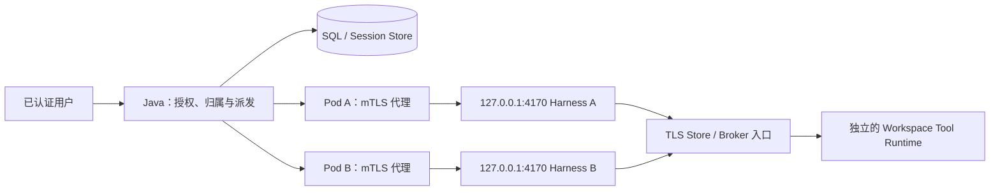
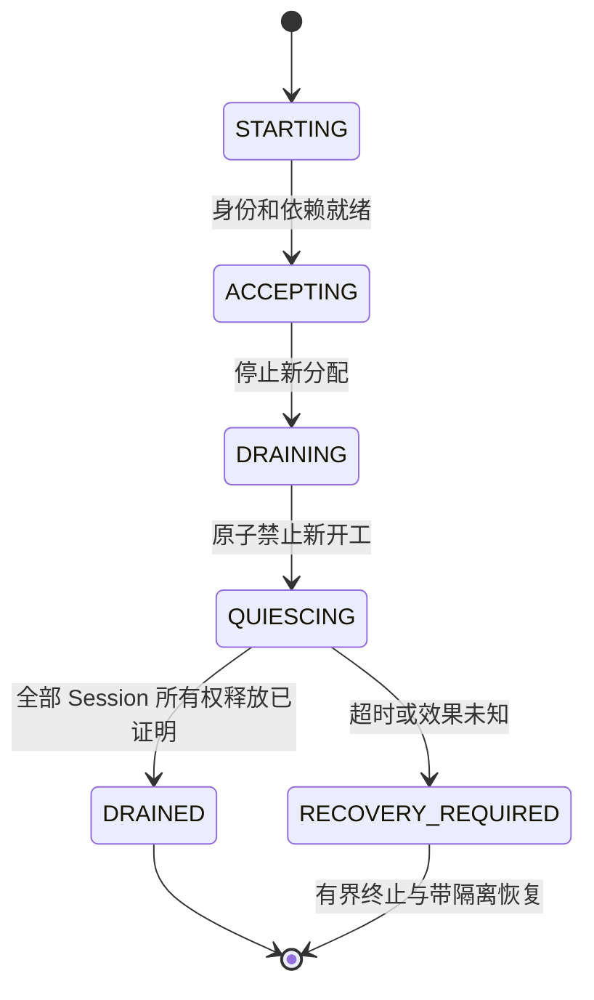

# Kubernetes 共享 Hosted Harness 服务池

[English](2026-10-21-managed-harness-kubernetes.md) | [简体中文](2026-10-21-managed-harness-kubernetes.zh-CN.md)

状态：实现候选，2026-10-23，已衔接 main `32b4234b84` 及其首发单 V1 契约。最初源码审计：`97567d5dd733ad905aacf61f1f61a1e71c6fcc72`。历史 ACK 空闲服务池验收早于本基线；当前提交 CI、前台/故障和自动扩缩容门禁仍待完成。本文细化[共享多租户 Harness](2026-10-21-managed-shared-harness.zh-CN.md)。

## 范围与决策

使用一个活跃的 Java 管控面和共享 Harness Deployment。每个 Harness Pod 可以服务多个租户和用户。Java 负责授权、持久归属和派发；Kubernetes 负责 Pod 生命周期和副本数量。复用已有 Agent loop、公共 Session API 和 Runtime Broker 边界。

首个服务池支持兼容实例、固定 Session 归属、手动扩容和严格的崩溃恢复。在开放正常缩容前，先增加资源空闲 Session 的非破坏性释放。随后增加应用指标和自动扩容；在所有已启用执行 profile 都通过任意目标 Pod 终止测试前，保持自动缩容关闭。

Java 高可用、新 Tool Runtime provisioner、通用热迁移、缩容到零、租户自带模型 Key 和动态配置热加载不在本文范围。上层方案中的同进程租户隔离仍是前提，不是 Kubernetes 自动提供的能力。

## 已验证的起点

| 审计提交中的发现                                                     | 源码与含义                                                                                                                                                                                                                                                                                                                                                                                  |
| -------------------------------------------------------------------- | ------------------------------------------------------------------------------------------------------------------------------------------------------------------------------------------------------------------------------------------------------------------------------------------------------------------------------------------------------------------------------------------- |
| Hosted 要求回环监听和 bearer 认证。                                  | [Profile:40](../../packages/cli/src/serve/hosted-harness-profile.ts)、[解析后地址检查:3539](../../packages/cli/src/serve/run-qwen-serve.ts)。Pod 不能直接将 Harness 暴露在 `0.0.0.0`。                                                                                                                                                                                                      |
| 回环请求有 Host 校验；远程 Store/Broker 默认要求 TLS。               | [Host 校验:340](../../packages/cli/src/serve/auth.ts)、[Broker URL:26](../../packages/cli/src/serve/managed-runtime-broker-url.ts)、[Store URL:844](../../packages/core/src/managed-runtime/http-managed-session-store.ts)。代理必须保留这些边界。                                                                                                                                          |
| Java 只有一个 SDK 客户端，并全局处理 boot 更替。                     | [连接器:63,1557,1591](../../packages/managed-agent-server/src/main/java/com/alibaba/qwen/code/managedagent/harness/QwenHostedHarnessConnector.java)。通过 Service 随机负载均衡，会使无关附件失效。                                                                                                                                                                                          |
| 所有者订阅使用单个 writer 身份。                                     | [订阅:130](../../packages/managed-agent-server/src/main/java/com/alibaba/qwen/code/managedagent/session/OwnerSubscriptions.java)、[连接器契约:200](../../packages/managed-agent-server/src/main/java/com/alibaba/qwen/code/managedagent/harness/HarnessConnector.java)。需要逐附件携带所有者身份。                                                                                          |
| 绑定 writer token 只覆盖租户、Workspace 和 Session，不覆盖实例归属。 | [凭据:57](../../packages/managed-agent-server/src/main/java/com/alibaba/qwen/code/managedagent/security/WriterCredentialPolicy.java)、[writer 获取:670](../../packages/managed-agent-server/src/main/java/com/alibaba/qwen/code/managedagent/persistence/ManagedSessionStore.java)。只更新路由 CAS，不能防止旧所有者重新获取资格。                                                          |
| 普通 Hosted 注册不返回排空句柄；SIGTERM 会在宿主清理的同时关闭监听。 | [注册:10816](../../packages/cli/src/serve/hosted-harness-session.ts)、[关闭:193](../../packages/cli/src/serve/serve-app-lifecycle.ts)。默认监听关闭超时为五秒，与 Pod 宽限期独立。                                                                                                                                                                                                          |
| Detach 会取消部分待处理业务输入，并排空 Runtime 资源。               | [Detach:10269,10443](../../packages/cli/src/serve/hosted-harness-session.ts)。它不是所有权移交操作。                                                                                                                                                                                                                                                                                        |
| Wake pump 可以独立于 HTTP 提交，启动已接受的积压输入。               | [Pump:213](../../packages/cli/src/serve/hosted-monitor-wake.ts)。只拒绝新建 Session，不能让 Pod 停止开工。                                                                                                                                                                                                                                                                                  |
| 已有 Session/队列指标统计 ACP bridge，不统计 Hosted Session Map。    | [指标:7313](../../packages/cli/src/serve/run-qwen-serve.ts)、[Hosted Map:3663](../../packages/cli/src/serve/hosted-harness-session.ts)。已有 daemon 指标不能直接驱动 Harness HPA。                                                                                                                                                                                                          |
| 当前首发 schema 使用单个 V1 基线。                                   | [Schema 初始化](../../packages/managed-agent-server/src/main/java/com/alibaba/qwen/code/runtimebroker/managedschema/ManagedSchema.java)、[Flyway 策略](../../packages/managed-agent-server/src/main/java/com/alibaba/qwen/code/managedagent/config/ManagedSchemaConfiguration.java)、[首发策略](2026-10-23-managed-first-release-contract.zh-CN.md)。旧开发库需要全新安装，不提供升级路径。 |

以上是源码观察。本轮读取了已有测试定义，没有执行这些测试。

## 拓扑与传输

保留 Hosted 仅回环监听的 profile。通过平台管理的 Pod 内 mTLS 反向代理暴露私有 Pod 端点，以 Envoy 作为参考打包选择。代理只接受获准的 Java 服务身份，保留 Harness bearer 认证，将上游 Host 改为 `127.0.0.1:4170`，拒绝浏览器 Origin，仅开放获准私有路由。保留协议/boot 请求头、事件 ID 和 epoch。禁用缓冲、缓存和变更请求自动重试；流式超时必须容纳已有的 15 秒 SSE keepalive。参见 [Envoy TLS](https://www.envoyproxy.io/docs/envoy/latest/intro/arch_overview/security/ssl)。

为 Java Store/Broker 提供真实 TLS 端点，或使用经过认证的本地出站代理。不开启非回环明文例外。为 Java Hosted SDK 增加明确、可选的 `SSLContext` 输入，由 Harness 配置用于服务池 mTLS；本地路径继续使用普通 JVM 默认值。保留主机名验证。从挂载文件读取客户端密钥和信任材料，首版通过受控替换轮换。参见 [JDK HTTP 客户端 TLS 契约](https://docs.oracle.com/en/java/javase/21/docs/api/java.net.http/java/net/http/HttpClient.Builder.html)。

各实例端点必须有有效的 TLS authority：直接连接 Pod IP，需要匹配的 IP SAN；使用 DNS 端点，需要匹配的证书及经过验证的 Pod 映射。不能假设 Deployment Pod 有 StatefulSet 式稳定 DNS，也不能通过关闭主机名验证来弥补。证书签发与 SAN 生命周期是明确的部署输入。反向代理是新增的受信任平台组件，不是不可信代码执行沙箱。

## 服务发现与实例身份

保留两种发现模式：默认使用现有静态单地址，显式配置后使用 namespace 范围的 Kubernetes 发现。静态多实例配置用于确定性测试。每个部署模式选择一种来源；Kubernetes 发现失败时不能回退到 localhost。

对配置的 Service 使用 `discovery.k8s.io/v1` EndpointSlice。校验 namespace、Service 名称和 UID、EndpointSlice 所有权、Pod 目标 UID 和端口。解析具体 HTTPS 端点，在选用前完成带认证的 boot/协议/能力协商。区分 Pod UID、进程 boot ID 和网络地址。复用 IP 或同一 Pod 内的新进程，都属于不同实例代次。

先 list，再从返回的 `resourceVersion` 开始 watch；对不同 Slice 和地址族中的端点去重。带类型的列表项可能省略 `kind` 和 `apiVersion`；接受这种表示，同时拒绝显式错误的 kind，并保留全部所有权校验。遇到 `410 Gone` 重新 list，watch 中断后有界退避重连，成功 list 后再发布完整替换快照。发现状态不确定时暂停新归属，保留现有绑定；可访问且认证通过的已有所有者可以继续运行。端点消失不能证明执行已经停止。终止中或未 ready 的端点不参与新分配，已有 draining 所有者仍可被定向访问。参见 [EndpointSlice 条件](https://kubernetes.io/docs/concepts/services-networking/endpoint-slices/)与 [watch 恢复](https://kubernetes.io/docs/reference/using-api/api-concepts/#efficient-detection-of-changes)。

只有 Java 获得服务发现的 ServiceAccount token。授予 namespace 范围的 EndpointSlice list/watch 和必要的指定 Service 读取；客户端标签过滤不是 RBAC 授权边界。Harness 和代理不需要 Kubernetes API 凭据。使用支持该能力的 CNI 落实入站/出站策略，将用户 Tool Runtime 放在 Harness Pod 之外。参见 [ServiceAccount 挂载](https://kubernetes.io/docs/tasks/configure-pod-container/configure-service-account/)与 [NetworkPolicy](https://kubernetes.io/docs/concepts/services-networking/network-policies/)。

## 持久归属与 Store 强制隔离

在现有 `ma_session` 根记录增加归属字段，不新增通用的持久 Pod 清单：

| 建议字段                  | 含义与读取方                                                                                               |
| ------------------------- | ---------------------------------------------------------------------------------------------------------- |
| `harness_instance_id`     | 已分配的静态实例身份或可信 Kubernetes Pod 身份；由路由和 Store 凭据校验读取。                              |
| `harness_owner_boot_id`   | 目标进程代次；由 SDK 和 Store 校验。已有 `harness_boot_id` 保持最后一次附件事件源观察值的含义。            |
| `harness_placement_epoch` | 单调递增的归属版本；用于 CAS、缓存、writer grant 和释放证明。                                              |
| `harness_placement_state` | `UNASSIGNED`、`ACTIVE`、`QUIESCING` 或终态 `RELEASED` 归属状态，不代表 Pod readiness 或公共 Session 状态。 |

增加有界的 owner/boot 索引，用于排空和重启时枚举归属，不能轮询扫描全部 Session。内存中的服务发现清单仍可丢弃。

未分配的既有本地记录没有服务池所有者。服务池模式下，Java 授权 Actor 及规范 Session/Workspace，选择兼容且接收工作的实例，在 create/load 前提交归属。每次重试都解析已有归属；RPC 失败不能直接选择另一个 Pod。归属作用于具备 Hosted 资格的根记录，包括明确准入的 CONTROL Session，并遵守各自类别的生命周期规则；没有 Harness 所有者的辅助 CONTROL 记录不分配实例。公共和 CONTROL Session ID 工厂必须保持私有 ID 全局唯一，或者在暴露缓存句柄前明确拒绝范围冲突。

使用新的实例归属绑定 writer grant，概念名称为 `qwp1`，复用已有 HMAC 机制，对租户、Workspace、Session、实例身份、boot ID 和 placement epoch 认证，由 Java 签发。Store 在 acquire、renew、commit、activation 和 seal，以及所有新工作授权路径中，针对当前持久归属校验 grant。已分配到服务池的记录拒绝旧的仅范围绑定 `qwt1` token。只有 token 内容、没有事务内当前归属校验，不足以隔离。普通数据读取保留已有认证和范围校验；公共调用方不能提供归属权限。

保留已有 writer generation/lease、activation 身份、Turn 派发租约和 Runtime 执行隔离。Placement epoch 不是另一套独立续期的租约。只有取得经过验证的非破坏性释放证明，或数据库证明 writer 已过期且满足现有恢复前提，才改变归属。归属更换后，即使处于 `SEALED` 或租约过期状态，也必须阻止旧 boot 重新取得资格。延迟到达的旧请求不能 seal、续租或写入继任者状态。

`QUIESCING` 仍允许已有活跃 writer 续租并提交截止前 Turn 的进度，也允许释放其 attachment activation；它不授权获取新 writer 或创建新 activation。终结性撤销从释放证明提交时开始，或由带隔离的崩溃路径改变归属时开始；不能仅因为标记 quiescing，就阻止已准入 Turn 完成。

受影响的 Store 事务必须遵循相同的先根后 head 规则：按需先取得已有 tenant/admission guard，然后锁 Session 根与归属，再锁 journal head，并保留既有依赖记录的锁顺序。Renew 当前从 head 开始，必须协调到该规则；不能持有 head 后再锁 Session 根。在真实 MySQL 中，对 acquire、renew、commit、wake claim、release、生命周期和 Runtime 隔离验证完整锁图。

## 路由与下游消费者

每个具体实例/boot 使用独立 SDK 客户端，并分别维护附件、heartbeat 和恢复缓存。每次操作只解析一次归属，直到响应结束都保持相同目标；boot 变化只使该代次失效。缓存键包含租户、Session 和 placement epoch。路由负责所有权，已有连接器继续实现 Hosted 协议。

| 消费者                                            | 必须遵循的归属行为                                                                    |
| ------------------------------------------------- | ------------------------------------------------------------------------------------- |
| `HarnessCoordinator`                              | Create/load、submit、stream、continue、取消和接管使用同一个受隔离目标。               |
| `ManagedAgentService`、`SessionRenameCoordinator` | 内联和后台标题操作保留相同目标与持久命令身份。                                        |
| `ActionResponseCoordinator`                       | 审批响应进入当前活跃 Turn 所有者，不能在另一个 Pod 重建 Action。                      |
| `ManagedAutomationService`、`AutomationScanner`   | Fire、reconcile 和 cancel 保留 Automation 自身的 principal 和所属 Session。           |
| `ManagedChannelService`、`SessionMessageRelay`    | Receive/consume/delivery 回执按各目标 Session 路由，回放已有命令身份。                |
| `ChildResultRelay`、`TaskCancelCoordinator`       | 分别解析父子 Session；两者可能位于不同 Pod。                                          |
| `SessionLifecycleCoordinator`                     | 业务 close/delete/resource 阶段与 Pod 所有权释放保持分离。                            |
| `WakeRecovery`、`TransportWakeActivator`          | 在启动后台工作前校验归属与 quiesce 状态。                                             |
| `OwnerSubscriptions`                              | 逐附件携带 writer 身份，按 writer 和租户分组查询 SQL，并保留活跃 writer 的 SQL 证明。 |

MCP 和 Hook pins 继续通过 Session create/load 及现有 Runtime 边界传递，不构成第二套路由权威。已有无 Session 参数的 `supports*` 判断，使用整个服务池统一要求的同构能力契约；每个被选 Pod 都必须满足。绑定 Session 的操作校验真实所有者，不能因某个副本支持某项能力就授权请求。首版采用单一 engine digest 和兼容的恢复读取器，不支持异构引擎路由。

## 新增私有生命周期契约

以下是 pool 实例通过显式配置启用的私有端点。前两个接口和指标属于进程全局范围，release 属于活跃 Session 所有者范围。它们只在 Hosted 模式启用，采用服务认证和版本化契约，不通过浏览器/公共路由开放。

| 建议路由                                          | 契约                                                                                                         |
| ------------------------------------------------- | ------------------------------------------------------------------------------------------------------------ |
| `GET /internal/hosted-harness/v1/instance`        | 返回可信实例/boot 身份、生命周期、能力身份及 Hosted 自身的容量计数。不获取 Session，不启动工作。             |
| `POST /internal/hosted-harness/v1/instance:drain` | 绑定操作 ID 和预期 boot 的幂等排空意图，停止参与新分配，并建立禁止新开工的截止点。不关闭公共 Session。       |
| `POST /session/:id/ownership:release`             | 校验规范范围、附件、placement epoch 和 writer generation；仅释放已证明资源空闲的 Session，不取消待处理输入。 |
| `GET /internal/hosted-harness/v1/metrics`         | 向获准监控提供有界的 Hosted 专属指标，不包含 Prompt、凭据或租户/Session 指标标签。                           |

启用服务池归属前，必须协商得到明确的 `harness-pool-owner/1` 和 `harness-instance-lifecycle/1` 能力。新增字段进入私有 DTO/schema/客户端 fixture 和共享契约测试；不重新解释已有 protocol-v1 envelope。旧 Harness 进程仍可用于明确配置的本地单地址模式，但不能进入服务池。

授权和精确已提交回执的回放，先于对新工作的拒绝。Drain 拒绝必须明确表示没有发生新的准入。已准入工作需要的状态、事件流、原始执行观察、审批和取消继续可用。截止点限制的是新的顶层工作；已经运行的 Turn 保留下文定义的续跑许可。没有既有许可的恢复，不能在 quiesce 实例上启动模型或工具工作。

如果准入在恢复等待持久化读取或 Runtime 获取期间关闭，派发守卫会在既有租约清理后返回 `409 hosted_harness_quiescing`。这仍属于执行重试预算之外的 pool 等待。驻留 writer 的写入已停止状态仍优先于 quiescing。`RecoveryDeclined` 继续只表示确定性的持久状态拒绝，其他恢复失败保留原有预算处理。

## Quiesce 与释放状态机

Java 可以将新授权输入保存在有界持久队列中，但不能派发到正在 quiesce 的所有者。在原子截止点，每个已经运行的 Turn 保留进程内续跑许可，绑定原 Prompt、activation 和 placement epoch；它可以执行结算同一个 Turn 所需的后续模型轮次、前台工具步骤和审批续跑。待处理输入、冷恢复、独立调度的子任务及自主 Channel/消息/Automation 工作不能继承该许可，也不能开工；持久身份和 wake 意图留给继任者。因此，运行中的 Turn 若依赖独立调度的子任务，可能直到截止时间都无法释放；首个释放验收使用有界前台 profile。仅返回没有活跃 Prompt，不是停止开工的证明。

首版仅释放没有执行中 Turn、在途变更、未解决工具/模型效果、持有 Runtime 操作、活跃 Hook/MCP 工作、存活后台 Shell/Monitor/子任务或待发布输出的 Session。空闲附件通常仍持有活跃 activation；协议应在禁止新开工的屏障内释放该 attachment activation，而不是要求它事先不存在。空闲但已配置的资源，也需要已证明的重连/释放契约；否则该 Session 不具备释放资格。冷加载需要的不可变资源必须已持久化且可读。静态 Skill 本身不要求执行进程。

通过已有私有 Session-record 机制，使用有界 `hosted_harness_release` domain 记录，持久化释放操作身份与证明，绑定 placement epoch、boot、writer generation 及 journal revision/sequence。释放 activation 并证明禁止新开工后，seal 与释放证明发布必须共享 Store 的受隔离事务。已提交的释放立即、终结性地撤销该 placement epoch 的 acquire 资格，即使 Java 尚未改变归属；否则在途旧 load 仍可能重新打开 sealed head。可以基于已有原语增加专用 Store 操作，不能假设 `ManagedSession.close()` 已实现完整契约。不产生业务 SessionEnd/Delete，不取消已接受的积压输入。

明确扩展 Java/TypeScript 封闭的 domain 和 resource-schema 注册、私有投影/保留与 CSI 闭包读取器。不能将该控制回执硬套成 task/run 记录，也不能公开为业务任务。已提交证明必须在旧进程退出后保留，直到归属对账和安全保留流程完成；无需增加通用持久化子系统。

ACK 丢失时，Java 用 SQL 和 sealed head 对账原释放身份，不能为了观察而在旧 Pod 重新获取 writer。继任者 CAS 必须在先根后 head 的锁顺序下，原子重新校验精确证明、sealed head/revision、当前归属和规范根记录适用的准入/生命周期规则；适用于具备资格的 PUBLIC 和 CONTROL 根。随后 `OwnerSubscriptions` 和附件缓存跟随新的 SQL 已证明 writer。RPC 成功或本地停止续租，不是释放证明。`DRAINED` 要求剩余常驻所有者和在途工作均为零；不具备释放资格的 Session 会让进程继续 quiesce，直到安全释放或到期转入崩溃恢复。

超时或效果未知时，不伪造释放证明。终止后经过隔离，使用现有带类型的崩溃恢复；不支持的状态继续阻塞。已有前台模型请求和审批恢复，覆盖部分不含 Hook/MCP 的 Checkpoint，但实时流和进程内存不能迁移。Harness 丢失与 Runtime 丢失具有不同的证据边界。

## Kubernetes 生命周期、探针与扩缩容

Harness 镜像需要专用 launcher、挂载 Secret 读取、探针 helper 和 preStop helper。当前根镜像是通用 CLI 镜像；Java 镜像没有 Node worker。镜像按 digest 固定，使用非 root 账号、固定的平台 HOME/配置和临时可写目录，不将用户 Workspace 挂载到 Harness Pod。加载 Broker 凭据时不将原始 secret 写进 Deployment 参数；当前 CLI argv token 路径是打包缺口，需要明确的 launcher/配置方案。

探针通过带认证的回环调用实现。Startup 验证 Hosted 能力已注册；readiness 综合兼容身份、依赖准入和 `ACCEPTING` 状态；liveness 只检测进程卡死，不因模型缓慢或数据库短暂故障而失败。普通 `/health` 在 Hosted 启动阶段就可能正常，不能替代 readiness。私有探针不能打印 bearer 材料。

在 SIGTERM 前运行应用 quiesce：当前监听关闭不是排空实现。代理必须在此期间继续承接已有 RPC/SSE。集群支持时优先采用原生 sidecar 退出顺序；普通 sidecar 的两条 preStop 路径必须在相同 drain barrier 上协调。声明支持的 Kubernetes 次版本并验证实际顺序，不要求未经验证的集群升级。Hook 时间计入 `terminationGracePeriodSeconds`；节点突然丢失仍需要崩溃恢复。参见 [sidecar](https://kubernetes.io/docs/concepts/workloads/pods/sidecar-containers/)与 [Pod 终止](https://kubernetes.io/docs/concepts/workloads/pods/pod-lifecycle/#pod-termination-flow)。

使用 Deployment 和发现用 Service/EndpointSlice，不能把单个 Session RPC 发往随机负载均衡地址。明确配置滚动发布的替代容量与兼容要求。PDB 有助于 eviction 路径，但不约束 Deployment 滚动更新，也不能让副本减少时自动选择资源空闲的 Pod。HPA 和手动缩容必须容忍任意被选目标；先排空某个指定 Pod，不保证随后减少副本数时删除的就是它。参见 [Deployment](https://kubernetes.io/docs/concepts/workloads/controllers/deployment/)与 [中断限制](https://kubernetes.io/docs/concepts/workloads/pods/disruptions/)。

增加 Hosted 自身的 attached/active/quiescing 计数、可开工输入积压、持有资源和待发布输出指标。复用实测的进程 RSS、heap 和事件循环信号。Java 的可执行队列排除等待审批、结果未知和受模型/Runtime 配额阻塞的工作。不使用当前 ACP bridge 指标，也不添加高基数租户标签。指标丢失代表容量未知，不代表工作量为零。

首版将 HPA `behavior.scaleDown.selectPolicy=Disabled`，保持非零最小副本数。只有自定义/外部指标适配器可用、最大副本数有界、每 Pod 容量已实测，才开放自动扩容。不增加第二个副本控制器。自动缩容必须通过全部已启用 profile 的排空/强制丢失矩阵，并具备稳定指标窗口。副本数量不能绕过租户/Actor 准入上限，也不会增加模型、SQL 或 Runtime 容量。参见 [HPA 指标与行为](https://kubernetes.io/docs/concepts/workloads/autoscaling/horizontal-pod-autoscale/)。

## Schema 发布与本地兼容

实现遵循[首发单 V1 契约](2026-10-23-managed-first-release-contract.zh-CN.md)。四个 placement 字段、精确归属约束和 owner/boot 索引直接进入 `V1__managed_schema.sql`；数据库版本保持 1，不保留运行时 V2–V18 迁移链。Server 的 Flyway 和 Broker 初始化使用相同基线。Schema projection/身份解码及 CSI inventory/恢复校验包含 placement 字段，默认保留 `UNASSIGNED` 本地语义。验证 Server 先启动、Broker 先启动的全新初始化、重启保留，以及不完整或不兼容 catalog 的拒绝。

旧开发数据库和状态不升级。需要历史访问时保留原产物和部署，或为本构建使用独立的全新数据库和状态目录。启用 pool 准入前，Server、Broker 和 Harness 必须使用匹配构建；旧二进制不执行 placement grant 校验。不能在该基线上运行旧校验器，也不能使用 Flyway repair、乱序迁移或历史编辑绕过拒绝。回退保留原部署及其独立状态，不对新数据库原地降级。

默认本地 base URL 继续表示一个静态实例，无需 Kubernetes token、服务发现、mTLS 配置或 Pod 元数据。共用正确性修复需要本地回归，但 `LocalProcessRuntimeProvisioner` 保留启动/ready/执行/取消/恢复契约。Kubernetes Harness 配合本地 Runtime，需要单独验证网络和存储：Harness 访问 Java/Store/Broker，同机 Broker 仍可消费本地 worker 回环端点。不能由此推断通用混合拓扑已经验收。

## 实施切片

| 切片                | 可审查交付物与退出条件                                                                                                            |
| ------------------- | --------------------------------------------------------------------------------------------------------------------------------- |
| K0：基线与契约      | 复现单地址假设，冻结生命周期/grant schema 和本地默认行为。不宣称已支持 Kubernetes 部署。                                          |
| K1：静态池与隔离    | 独立实例客户端、持久归属/grant、全部消费者路由和所有者订阅；使用两个本地 Harness 进程、真实 MySQL，证明旧所有者无法重新取得资格。 |
| K2：Kubernetes 连通 | 专用 Harness 镜像/launcher、mTLS 代理和 TLS 客户端配置、EndpointSlice 发现、探针及手动扩容。验证两个 Pod 和 IP/boot/证书变化。    |
| K3：非破坏性释放    | 全来源禁止新开工、资源空闲释放证明、有界 preStop，以及任意目标/手动缩容/滚动替换。对不支持的状态继续明确阻塞恢复。                |
| K4：实测自动扩缩容  | Hosted 指标和适配器驱动的自动扩容；自动缩容必须另行通过自身已启用 profile 验收。发布容量上限和运维恢复流程。                      |

实现提供静态池、Kubernetes 发现、专用 launcher/probe、私有实例指标以及保守的归属释放。分发产物位于 `packages/managed-agent-server/distribution/kubernetes/`。自动缩容保持关闭；部署文件需要运维提供镜像、TLS 材料、可达的 Store/Broker 地址和指标适配器。

## 实现决策，2026-10-22

刷新后的 main 增加了上下文压缩与不获取所有权的恢复观察。两类调用均通过归属路由；观察路径不会分配或接管所有者。每次 leaf 调用在完成前固定 tenant、Session、epoch、descriptor 和 writer grant。`OwnerSubscriptions` 按附件的 writer 和 tenant 分组验证 SQL 租约。

关闭/删除恢复使用携带规范 lifecycle operation 的独立归属路径。该路径先核验 Session pending 状态、operation kind/version、当前 claim owner/generation/expiry 和 journal lifecycle fence，再执行同样的 writer 过期或释放证明检查。普通归属仍只允许 `ACTIVE` Session。Turn 和 lifecycle 派发将 pool 容量、归属交接和进程 quiesce 等待排除在执行重试预算外；配置与凭证失败保留原有处理。

路由器按观测到的 instance/boot 记录准入资格，也记录成功发起的 drain 意图。如果原实例在首次获取 writer 前停止接纳，接受新工作的继任者仍必须通过既有 SQL takeover 校验才能获得归属。如果这次额外交接尝试明确返回 `409 harness_owner_still_live`，且原实例仍可达、SQL placement 仍为 `ACTIVE`，收尾、审批和取消调用继续携带原 descriptor 与 grant 访问原实例；进程准入仍拒绝新开工。其他拒绝不会回退。如果所有者已确认不可达且没有合格继任者，则在再次 RPC 前返回 `503 harness_pool_unavailable`，保留归属而不扣减执行重试预算。仅有发现不确定性，不会将缓存中仍可达的原所有者标为 quiescing 或不可达。

客户端回收区分业务终态 Session 与活动归属。关闭、归档或删除的根记录，仅在 SQL 证明仍有 active 且租约有效的 writer 时保留旧客户端；pending lifecycle 的根仍保留。这避免普通业务关闭只 seal writer、不产生归属释放回执时，在滚动更新中持续积累旧 boot 客户端。Lifecycle writer 校验在 claim/head 查询前显式锁住 Session 根。

Pool 模式要求 HMAC binding key 和显式实例身份。`qwp1` grant 绑定 scope、owner digest 和 placement epoch；凭证认证不会在 tenant guard 前查询 SQL，变更路径在锁住 root 后重新校验当前归属，再获取 head。V1 基线使本地行默认保持 `UNASSIGNED`。首版 pool 拒绝已有私有 CSI 配置，CSI closure inventory 也明确要求未分配归属。

自动化 gate 探测的释放债务计入持有资源，即使 fire 请求已经返回错误也不能交接。重试证明释放成功后，原本空闲的归属才可交接。如果有界释放键缓存溢出，该 Session 在关闭前始终不具备交接资格：遗忘键不代表对应 Runtime 已释放。

进程的禁止新开工截止点先于 SQL quiesce。忙碌的驻留 Session 可以保持 SQL `ACTIVE`，避免打断既有 Hook activation 转换；进程门禁仍拒绝新开工。只有通过保守的本地资源空闲检查后，Harness 才调用私有 Store `writers:quiesce-ownership`，停止 activation 续期、释放附件 activation，再调用 `writers:release-ownership`。后者在同一事务写入有界 `hosted_harness_release` 控制记录/资源、seal 精确 head，并将归属标为 `RELEASED`。这个终态标记在继任者 CAS 前就隔离所有旧 epoch 变更，也支持通过索引清理所有者客户端。不推进 journal、不产生业务生命周期事件。普通 domain commit 不能伪造这个保留回执。回执通过 `ma_resource_ref` 固定资源；即使继任者已经更新归属，精确重试也不会重新获取旧 writer。

SDK 保持 Java 11 兼容，并接受可选 `SSLContext`。Pool 配置从挂载文件读取 PKCS12 key/trust store；EndpointSlice 的 HTTPS 连接仍校验端点 SAN。静态回环端点支持确定性本地测试。发现 watch 有界，在不确定状态后重新 list，始终不会替换为本地默认地址。

PreStop 通过本地端点发起实例 drain，只尝试释放满足条件的归属。持久释放仍要求 Session Store 可达。不支持的驻留资源使实例保持 quiescing，直到有界期限；不会调用普通 detach。临时 ACK 验收已验证真实空闲 Session 释放、手动扩容、完整滚动替换及缩容至零。在途续跑、任意 Pod 丢失及接入指标适配器的 HPA 仍需各自的验收门禁。

## 验证计划

| 验收项          | 必须提供的证据                                                                                                                                                                                   |
| --------------- | ------------------------------------------------------------------------------------------------------------------------------------------------------------------------------------------------ |
| 本地兼容        | 无 Kubernetes 时，已有启动方式和单地址设置可用；创建、提交、事件、审批、取消、关闭和重启恢复通过。                                                                                               |
| 租户/用户隔离   | 两个租户及同租户两个用户共享各 Harness；拒绝跨范围 ID/句柄/事件/命令/审批。覆盖 CONTROL ID 和关闭 Session 的隔离。                                                                               |
| 服务池归属      | 两个同时存活的实例保持独立 boot/缓存和 SQL 已证明的事件订阅；路由表中的全部消费者都进入正确所有者。                                                                                              |
| Store 隔离      | 释放和租约过期后，恢复旧 Pod 并携带原 scope token/grant；acquire、renew、activation、commit 和 seal 全部失败，继任者仍正常。                                                                     |
| SQL 并发/基线   | 真实 MySQL 的 renew/commit/wake/生命周期/release/takeover 竞争及崩溃边界；Server 先启动、Broker 先启动的全新 V1 初始化、重启保留和不兼容 catalog 拒绝。                                          |
| TLS/代理        | 验证 Host 重写、浏览器拒绝、bearer/协议请求头、SSE 重连/epoch、有界请求体、不重试变更请求和可信 SAN。拒绝错误 CA/客户端/SAN 和过期 Pod 身份。                                                    |
| 服务发现        | List/watch 重连、`410 Gone`、重复/双栈端点、Service UID 变化、API 中断、ready/终止变化和 IP 复用；不回退 localhost。                                                                             |
| 停止开工        | 将截止点与所有开工来源并发竞争。截止前运行的 Turn 许可允许完成自身前台/模型步骤；已接受但未尝试的输入和独立子任务/自主工作保持 pending，在继任者只启动一次。                                     |
| 效果边界        | 空闲附件 activation 释放正例与 Hook/MCP/后台/子任务/发布负例；释放 ACK 丢失通过 SQL 对账。在 seal 与继任者 CAS 之间延迟到达的旧 load，不能重新获取已释放 epoch。不使用 detach/业务关闭实现迁移。 |
| Kubernetes 丢失 | 真实 preStop、SIGTERM、宽限期超时、OOM/节点丢失模拟、滚动更新和任意缩容目标；观察原始执行，未知结果继续阻塞。                                                                                    |
| 扩缩容          | HPA 读取 Hosted 而非 ACP 计数；区分可执行积压、外部瓶颈、指标缺失和等待审批。证明租户限制和受控扩容。                                                                                            |

复用已有打包 Harness 测试及三个根脚本 `npm run test:e2e:managed-harness-restart-failover`、`npm run test:e2e:managed-harness-restart-inflight-failover` 和 `npm run test:e2e:managed-harness-restart-continuation-failover`，作为回归基础，不当作 Kubernetes 支持证明。纳入 Java Hosted process/Hook/MCP 故障 profile、MySQL 集成、受影响包测试、build/typecheck/bundle 和重复 diff 自审。未来可执行计划保存在 `.qwen/e2e-tests/`，使用一次性数据库、namespace、凭据、存储和测试拥有的进程身份。

最初调研执行了文档检查和源码审阅。本地实现证据记录在 `.qwen/e2e-tests/managed-harness-kubernetes.md`。随后在本次新建、隔离的 ACK `1.35.7-aliyun.1` 集群上，使用 Terway `1.17.7`、Envoy `1.39.4` 和 MySQL `8.4.11`，通过空闲服务池链路。Java 验证了两个租户跨两台 Pod、mTLS 与跨范围拒绝、粘性归属、持久 drain 回执与旧 grant 拒绝、手动扩至三副本、完整滚动替换及 epoch 递增、缩容至零。最终独立 SQL 审计确认十个 ACTIVE Session、十个 RELEASED placement 和已 seal 的 writer head、十九份释放回执、零 Turn 及零生命周期 operation；Java 验收入口以零退出码结束。本地报告 `.qwen/e2e-tests/managed-harness-ack-20261022.md` 记录不可变镜像、仅用于测试的 Pod IP SAN 签发、部署适配、失败尝试及资源清理。这些合成空闲 Session 不构成前台/模型/工具执行、SSE 连续性、完整用户授权矩阵、崩溃恢复、生产证书签发、HPA 或生产容量测量的证明。完整 CI 门禁仍待完成。

## 部署输入与剩余限制

集群验证前，确定实际 Kubernetes 次版本及 sidecar 行为、namespace/Service 身份、mTLS issuer 与逐端点 SAN 签发、发现新鲜度与排空预算、CNI 限制、指标适配器及实测容量。确认 Java/Store/Broker 可达性和所选 Runtime 持久化范围。这些是已明确协议的部署输入，不是将方案视为已实现的理由。

首个支持的移交边界为资源空闲释放。继续支持 Hook/MCP/后台和混合版本续接，分别需要故障证据。Lifecycle 协议 1/2 的子任务清理使用独立 lifecycle 归属路径；带有子任务清理债务的历史协议 0 父 Session，需要单独证明可达性和恢复路径后才能将这种组合纳入服务池。共享 Harness 进程仍是受信任基础设施，进程内被攻破可能影响常驻租户；本文不提供 Java 管控面高可用，也不提供 Harness 内任意代码隔离。

当前衔接遵循 main `32b4234b84` 的首发单 V1 策略，用户已于 2026-10-23 明确授权。早期 placement V17 的 ACK 证据及后续 V18 的 CI 结果属于此前的 schema 版本线，均不能证明本次全新 V1 基线或当前合并提交已验收。当前提交仍需 Java、真实 MySQL/Hosted 和跨语言门禁。首版 pool 不开放 MCP 管理 API 或公开子代理能力，单实例模式沿用 main 行为。
