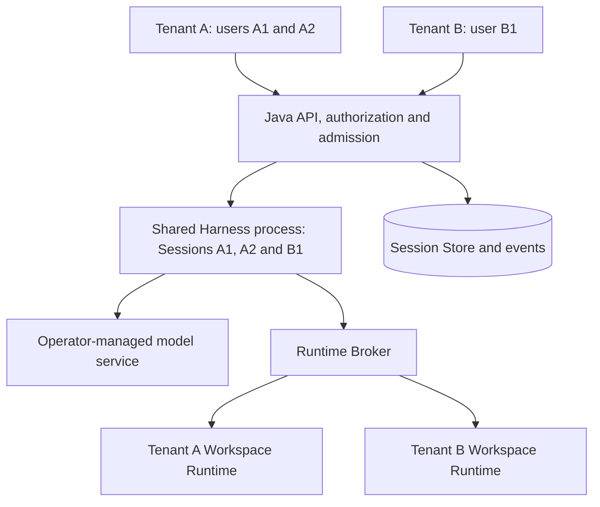

# Shared Harness for multiple tenants and users

[English](2026-10-21-managed-shared-harness.md) | [简体中文](2026-10-21-managed-shared-harness.zh-CN.md)

Status: Implementation candidate, 2026-10-22. The Kubernetes design records the implemented boundaries and temporary ACK idle-pool acceptance. Original current-state observations refer to `97567d5dd7`; implementation is based on `74c67c9e94`. Production multi-tenant isolation, full CI and the remaining foreground/fault/scaling acceptance remain gated.

## Goal and scope

One Java control plane serves multiple tenants and users through a shared Hosted Harness service. The same Harness process may concurrently host tenant A's and tenant B's Sessions. Additional Harness replicas belong to the same shared pool; a tenant does not need a dedicated process or deployment.

Share the Agent implementation, service configuration and compute capacity. Keep authorization, conversation state, model policy, execution authority and resource accounting scoped to their owning Sessions and tenants. Multiple users within one tenant still require explicit access to Sessions and Workspaces.

The first delivery uses one Harness endpoint and operator-managed model credentials. Multi-replica scheduling follows after same-process isolation is demonstrated. Tenant-provided model credentials, a new identity provider, billing, and stronger isolation from a compromised Harness process are separate work.

## Current implementation

| Area                | Observed behavior and remaining work                                                                                                                                                                                                                                                |
| ------------------- | ----------------------------------------------------------------------------------------------------------------------------------------------------------------------------------------------------------------------------------------------------------------------------------- |
| Java identity       | `AuthenticatedTenantActor` and `TenantContextFilter` bind an authenticated actor to a tenant. Public controllers pass both identities to services. Audit every exposed operation and replay path; a tenant header alone is insufficient authorization.                              |
| Harness Sessions    | `hosted-harness-session.ts` keeps multiple resident Sessions in one process. Normal resident load compares tenant, Workspace and Store address. This is an existing foundation, not proof that every lifecycle and recovery path has the same checks.                               |
| Durable identity    | Session Store identity contains `tenantId`, `workspaceId` and `sessionId`; Java attachment caches include tenant and Session. `WriterCredentialPolicy` can bind a writer credential to that scope. Writer lease and generation remain the execution fences.                         |
| Model configuration | Each Hosted model invocation constructs configuration from service settings and refreshes authentication. Skipping Workspace settings and environment loading helps, but reuse of general CLI configuration and authentication needs an audit for mutable process state and caches. |
| Harness routing     | Java configures one Harness base URL and one client. Sequential process replacement exists; concurrent replica selection and durable Session routing require further work.                                                                                                          |
| Runtime isolation   | Broker scope includes tenant and Workspace, with Workspace or Session isolation classes. These logical scopes do not by themselves establish OS-level isolation between untrusted users.                                                                                            |

Source references: [identity filter](../../packages/managed-agent-server/src/main/java/com/alibaba/qwen/code/managedagent/api/TenantContextFilter.java), [public controller](../../packages/managed-agent-server/src/main/java/com/alibaba/qwen/code/managedagent/api/PublicAgentController.java), [Hosted Sessions](../../packages/cli/src/serve/hosted-harness-session.ts), [Hosted model](../../packages/cli/src/serve/hosted-harness-model.ts), [writer credentials](../../packages/managed-agent-server/src/main/java/com/alibaba/qwen/code/managedagent/security/WriterCredentialPolicy.java), [connector](../../packages/managed-agent-server/src/main/java/com/alibaba/qwen/code/managedagent/harness/QwenHostedHarnessConnector.java), and [Runtime scope](../../packages/managed-agent-server/src/main/java/com/alibaba/qwen/code/runtimebroker/RuntimeScope.java).

## Deployment and trust boundary

Java, Harness, Broker and persistence are trusted platform services. Users access Java's authenticated public surface; private Harness, Store and Broker routes use service authentication and scoped execution credentials. User-supplied code, command Hooks, MCP processes and filesystem tools execute in the resolved Runtime, not in the shared Harness host. Static Skills are Session-scoped instruction resources, not host-executed extensions.

An arbitrary-code or memory compromise of a shared Harness process can affect its resident tenants. Logical Session isolation does not provide process-compromise containment. This deployment model assumes trusted service code and excludes loading user-supplied in-process plugins. The Runtime deployment must separately demonstrate filesystem, process, credential and network confinement; trusted local-process or SSH deployment evidence does not establish that boundary for mutually untrusted users.

## Identity and authorization

Java derives `tenantId` and `actorId` from trusted authentication. It authorizes the requested Session, Workspace, operation and model before admission or replay. Lists, event streams, artifacts, approvals, cancellation and background operations must preserve the same access policy. Revoked access must stop subsequent reads and mutations; active streams follow the API's documented revalidation policy.

The existing canonical Session scope is `(tenantId, workspaceId, sessionId)`. Actor identity records who requested an action; it does not replace Session identity or make every user in the tenant an owner. Authorized collaboration may share a Workspace without sharing all conversation histories. Child Sessions, channels and automations retain their persisted execution principal and grants; background execution never inherits the most recent HTTP caller.

Java supplies the canonical scope and existing Store and Runtime descriptors. Harness attachment, lifecycle, continuation and recovery validate them before returning resident handles or performing work. A private client handle is scoped to its attachment and cannot substitute for public user authorization. Require bound writer credentials for the shared deployment and retain writer lease/generation checks; binding keys and unrestricted Broker credentials stay outside user Runtimes.

Keep existing globally generated private Session IDs where sufficient. An in-memory map keyed by that ID may remain if conflicting scope is rejected at every boundary. Do not add a user ID to every storage key or rewrite unrelated caches merely to change key shape. Any cache shared across Sessions must use a proven scope or contain only immutable, operator-owned data.

## Session configuration and credentials

History, instructions, Skills, model selection, approvals, pending executions and event cursors belong to the Session. Accepted Turns retain their durable model and policy snapshots across retries and recovery. A later user's request or configuration change cannot mutate an already admitted Turn.

Service HOME, `QWEN_HOME`, cwd, environment, proxy and TLS settings are fixed by the operator. A request must not switch them to impersonate a tenant. Audit the Hosted call chain through general CLI configuration, authentication, provider caches, logging and cleanup; fresh configuration objects alone do not prove the absence of shared mutable state. Session close only disposes that Session's resources.

The first delivery shares operator-managed model credentials. Java restricts the published model catalog per tenant, and model calls and usage retain Session/Turn attribution. No new credential store or model gateway is required for this scope. Tenant-provided keys remain unsupported until a separately validated request-scoped resolver or model gateway can supply them without mutating shared environment or credential files. Model policy must be enforceable for autonomous and recovered work as well as user Turns.

Runtime credentials remain scoped to the authorized tenant, Workspace, Session and operation as required by the existing protocol. Prompt text, user settings and model-generated arguments cannot select another tenant's Store, Runtime or credential. Logs retain correlation IDs while excluding raw credentials and unscoped conversation dumps.

## Capacity, ownership and replicas

Java enforces bounded queued work and active Turn limits globally, per tenant and per actor. Dispatch queued work round-robin among eligible tenants, respecting actor limits within each tenant; tenants do not reserve permanent compute. Account background work and Runtime capacity separately so parked Turns, MCP connections and command processes cannot consume unlimited resources. Admission and durable work ownership must survive restart; counters must reconcile with durable records. Shared Node memory and event-loop capacity have process-wide limits, not a fictional hard memory boundary for each Session. Choose numeric limits from load measurements.

For the first delivery, reuse the existing single Harness endpoint. One live writer owns each Session; losing a request or heartbeat does not authorize parallel execution. Existing recovery uses the original durable execution identities, and unknown tool outcomes remain blocked without replay.

For replicas, persist Session-to-instance routing before dispatch and maintain an independent client and boot identity per instance. New Sessions may select any compatible healthy replica regardless of tenant; all operations for a resident Session follow its owner. A draining instance stops accepting new Sessions while existing work follows its declared completion or fenced handoff policy. Preserve existing writer and dispatch fences during replacement. Pool routing is separate from same-process tenant isolation and must not be implemented as random per-request HTTP balancing.

## Kubernetes horizontal scaling

The detailed [Kubernetes pool design](2026-10-21-managed-harness-kubernetes.md) specifies the source-verified constraints, placement-bound Store grants, non-destructive release protocol and implementation gates. Current Hosted binding is loopback-only: the proposed first Pod uses an authenticated mTLS proxy to that loopback listener, preserving application bearer/Host/Origin checks. Kubernetes discovery and Deployment configuration alone are insufficient.

Deploy Java and Harness as independent workloads so Harness capacity can grow without adding a Java instance for every replica. Use a Harness Deployment with replaceable Pods, each serving Sessions from multiple tenants. Keep authoritative history, checkpoints and resource references in the configured external Session Store; local caches and temporary files are disposable. Workspace storage and Runtime ownership belong to the separate execution layer. This is our proposed topology; Kubernetes supplies [Deployment replica and rollout management](https://kubernetes.io/docs/concepts/workloads/controllers/deployment/).

| Concern            | Proposed responsibility                                                                                                                                                                                                                                                  |
| ------------------ | ------------------------------------------------------------------------------------------------------------------------------------------------------------------------------------------------------------------------------------------------------------------------ |
| Replica count      | Kubernetes maintains the Harness Deployment; HPA can adjust its capacity after application lifecycle gates pass.                                                                                                                                                         |
| Instance discovery | Java discovers the selected Harness workload's endpoints and validates protocol and capability compatibility. Use EndpointSlice target identity and the Harness handshake to distinguish Pod UID, endpoint and process boot ID. A recycled IP is not the previous owner. |
| Session routing    | Java persists the selected instance identity and routes submit, approval, cancel, events, lifecycle and recovery calls to that owner. Discovery does not change an existing Session's ownership.                                                                         |
| Scaling signals    | Publish runnable queue depth, active Turns and measured per-Pod load. Account for memory and event-loop pressure and for model/Runtime bottlenecks. Waiting for a model can leave CPU low; blocked or approval-waiting work must not cause unlimited scale-out.          |
| Pod removal        | The application drains ownership and preserves durable work; Kubernetes manages the bounded container shutdown. Removing a Pod does not close or delete the user's logical Sessions.                                                                                     |

Java needs an individually addressable owner endpoint. A headless Service can expose Pod addresses without platform load balancing; the application still needs instance identity, compatibility and ownership validation. Use narrowly scoped discovery permissions. Readiness controls eligibility for new assignments; a draining but reachable owner must remain addressable for its existing work. See [Kubernetes headless Services](https://kubernetes.io/docs/concepts/services-networking/service/#headless-services).

Use the `autoscaling/v2` HPA API with an installed custom/external metrics adapter for application load. Start with automatic scale-out and `behavior.scaleDown.selectPolicy=Disabled`; enable automatic scale-in only after the drain and forced-termination gates pass. Set a nonzero minimum capacity for the first delivery. Application admission continues enforcing tenant and user limits regardless of Pod count. The metrics and autoscaler are proposed deployment work, not existing repository capabilities. See [HPA custom metrics and scaling behavior](https://kubernetes.io/docs/concepts/workloads/autoscaling/horizontal-pod-autoscale/).

A bounded application drain stops new assignments and establishes a cutoff for fresh top-level Turn/wake starts. Pre-cutoff running Turns retain scoped continuation permits; unattempted backlog and autonomous starts remain pending. Required status, cancellation and approval calls continue. Release the idle attachment activation and writer only after proving all relevant effects are safe, without cancelling pending inputs. A committed release revokes reacquisition for that placement epoch before successor CAS. Run this protocol through `preStop` before SIGTERM; current generic shutdown and detach are not safe handoff. `terminationGracePeriodSeconds` must cover the budget: Kubernetes counts hook execution within the grace period and can force termination afterward. A timed-out drain follows fenced crash recovery, preserving unknown outcomes. See [Pod termination](https://kubernetes.io/docs/concepts/workloads/pods/pod-lifecycle/#pod-termination-flow).

Scale-out initially places new Sessions on added Pods; it does not migrate resident Sessions automatically. Rebalancing and normal scale-in use the same proven handoff protocol. Validate mixed-version compatibility during rolling updates and keep eligible replacement capacity available. Scaling Harness does not expand model-provider quotas, database throughput or Workspace Runtime capacity; those remain separately measured and controlled. This design does not establish multi-replica Java control-plane readiness.

## Local process compatibility

Harness placement and Tool Runtime provisioning are independent choices. Keep `QWEN_MANAGED_AGENT_HARNESS_BASE_URL` as the existing single-address local path. Shared routing can represent that path as one configured instance without Kubernetes discovery, API access or cluster credentials. Keep Pod metadata inside the Kubernetes discovery integration; generic ownership and recovery must also work for a local process with its Harness boot identity.

| Scenario                                        | Required compatibility                                                                                                                                                                                                                                                                                                                                                 |
| ----------------------------------------------- | ---------------------------------------------------------------------------------------------------------------------------------------------------------------------------------------------------------------------------------------------------------------------------------------------------------------------------------------------------------------------- |
| Local Harness process                           | Reuse the same Hosted Agent loop and private HTTP protocol. Common fixes to Session scope, configuration, credentials and cleanup also affect this path and require regression coverage. Existing development and service startup must remain usable.                                                                                                                  |
| `local-process` Tool Runtime                    | Keep the existing Broker selection and `LocalProcessRuntimeProvisioner` launch, ready handshake, execution identity, cancellation and recovery contracts. Harness horizontal scaling does not require replacing this provisioner or installing Kubernetes locally.                                                                                                     |
| Kubernetes Harness with a local-process Runtime | Validate network reachability and storage ownership for the chosen topology. Harness must reach Java's Store and Broker addresses. A worker's loopback endpoint can remain local when consumed by its same-host Broker; callbacks and resource URLs need validation in their actual caller's network namespace. This mixed topology needs its own acceptance evidence. |

Reference: [local Runtime provisioner](../../packages/managed-agent-server/src/main/java/com/alibaba/qwen/code/runtimebroker/provisioning/LocalProcessRuntimeProvisioner.java).

The shared multi-tenant deployment requires its stricter actor, writer-credential and capacity prerequisites. Preserve the existing explicitly trusted single-user local deployment's authentication and trust contract; locality must not silently exempt a deployment that actually serves multiple tenants. Any optional discovery and pool-lifecycle behavior stays outside the default single-address path. Source compatibility is a design requirement, not evidence that future common-code changes have already passed local regression or that local processes provide an untrusted-user sandbox.

## Delivery plan

| Slice                    | Deliverable and completion boundary                                                                                                                                                                                                                                                                                                                                                          |
| ------------------------ | -------------------------------------------------------------------------------------------------------------------------------------------------------------------------------------------------------------------------------------------------------------------------------------------------------------------------------------------------------------------------------------------- |
| 1. Shared process        | One Java instance and one real Harness process concurrently serve two tenants and two distinct actors within one tenant. Audit public/private authorization, configuration and authentication state, callbacks, caches and cleanup. Patch demonstrated gaps, require bound credentials, and enforce bounded admission. Keep the existing Agent loop and durable protocols wherever possible. |
| 2. Shared pool           | Prove durable Session routing, per-instance clients, compatibility, health and bounded drain with two live Harness processes. Then discover the selected Kubernetes workload's endpoints while preserving instance identity and fenced replacement; tenants share the pool.                                                                                                                  |
| 3. Deployment acceptance | Demonstrate Runtime confinement, restart/recovery, noisy-neighbor limits and the packaged Kubernetes load envelope. Verify scale-out, rolling updates and forced termination before enabling automatic scale-in. Publish measured limits and outstanding gates.                                                                                                                              |

Before implementation, write the executable E2E plan and record the baseline through the repository's feature workflow. This design supplies acceptance cases, not a claim that the feature or test gates have run.

## Verification and acceptance

1. Run tenant A/users A1 and A2 and tenant B/user B1 concurrently through the same Java service and the same Harness PID/boot ID. Verify distinct histories, policies, events, checkpoints and Runtime owners. Process reuse is part of the evidence.
2. Attempt foreign Session, Workspace, artifact, approval, private handle, idempotency key and event cursor reuse. Include a deliberate private Session-ID collision and normal/lifecycle/recovery attachment paths. Unauthorized requests return no foreign data and cause no execution.
3. Verify permitted same-tenant collaboration and denied same-tenant access separately. Missing or mismatched authenticated actors fail before dispatch. Access revocation follows the documented read, stream and mutation semantics. Child, channel and automation work preserve their own grants.
4. Interleave distinct model selections and configuration under deterministic model fixtures. Confirm the right history and policy on every request, unchanged process environment/cwd and credential files, and correctly attributed usage. Closing one Session leaves the other tenant's requests, streams and resources intact.
5. Exercise configured per-actor, per-tenant and global admission limits. When multiple tenants have queued work, freed slots are dispatched fairly rather than monopolized by a flooding actor; rejected or queued requests do not start unaccounted work. Limits and ownership reconcile after restart, including parked and background work.
6. Restart the shared Harness while both tenants have durable work. Recover each Session only through its own writer and original execution identities. Unknown outcomes block; cancellation, lost replies and stale owners cannot replay effects or release another Session's resources. Repeat applicable cases with two live replicas for slice 2.
7. Demonstrate physical Runtime confinement with the selected deployment. A logical scope or separate cwd is insufficient evidence. Run affected package tests, Java verification and applicable MySQL/Hosted fault profiles, TypeScript build/typecheck, and full-diff audits before declaring implementation complete.
8. Scale the Harness Deployment from two to three Pods while both tenants execute. New Sessions can reach the new compatible Pod; existing Sessions retain their owner and one writer. Validate actual HPA metrics, identity after endpoint reuse, incompatible Pod exclusion, and pending work when model or Runtime capacity is the bottleneck.
9. Drain and remove a busy Pod through scale-in and rolling replacement, including pending approvals and autonomous wake inputs. Verify lossless durable ownership handoff where supported and explicit blocked recovery otherwise. Repeat with drain-budget expiry and abrupt Pod loss; prove that neither Kubernetes termination nor endpoint removal causes prompt/tool replay, logical Session deletion or release of a newer owner's Runtime.
10. With no Kubernetes API or credentials available, run the existing local startup path with one Harness address and a `local-process` Runtime. Verify create, submit, events, approval, cancel, restart/recovery and close; confirm no discovery dependency is introduced. Test local multiple-Harness routing separately when enabled, and record mixed-topology network/storage acceptance independently.

## Decisions still requiring deployment input

The trusted authentication adapter, Runtime confinement backend, metrics adapter, drain budget and numeric capacity limits must be supplied or measured for a concrete deployment. They do not change the decision to share Harness processes across tenants. Per-tenant model credentials, if later required, need a separate credential-lifecycle design before admission is enabled.
