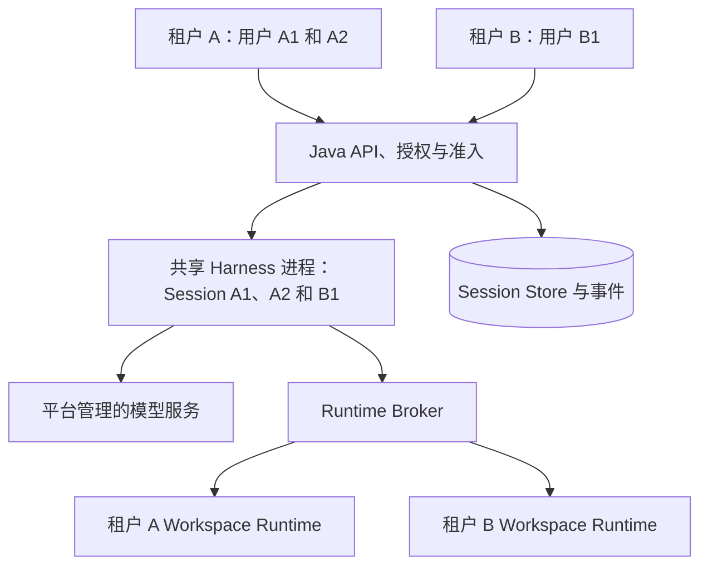

# 多租户、多用户共享 Harness

[English](2026-10-21-managed-shared-harness.md) | [简体中文](2026-10-21-managed-shared-harness.zh-CN.md)

状态：实现候选，2026-10-22。Kubernetes 设计记录了实现边界和临时 ACK 空闲服务池验收。最初当前状态观察基于 `97567d5dd7`，实现基于 `74c67c9e94`。生产级多租户隔离、完整 CI 及剩余前台/故障/扩缩容验收仍需门禁。

## 目标与范围

一个 Java 管控面通过共享的 Hosted Harness 服务承接多个租户和用户。同一个 Harness 进程可以同时承接租户 A 和租户 B 的 Session。增加的 Harness 副本属于同一个共享池；每个租户无需独占进程或部署。

共享 Agent 实现、服务配置和计算容量。授权、对话状态、模型策略、执行权限和资源计量分别归属于相应的 Session 和租户。同一租户内的不同用户仍需要明确的 Session 和 Workspace 访问授权。

首个交付使用一个 Harness 地址和平台管理的模型凭据。在证明同进程隔离之后，再增加多副本调度。租户自带模型凭据、新身份提供方、计费以及共享 Harness 进程被攻破后的更强隔离，分别作为后续工作。

## 当前实现

| 范围            | 已观察行为与剩余工作                                                                                                                                                                                         |
| --------------- | ------------------------------------------------------------------------------------------------------------------------------------------------------------------------------------------------------------ |
| Java 身份       | `AuthenticatedTenantActor` 和 `TenantContextFilter` 将认证用户绑定到租户。公共 Controller 将两个身份传给服务。需要逐一核查所有开放操作和回放路径；单独的租户请求头不足以授权。                               |
| Harness Session | `hosted-harness-session.ts` 在同一进程中保存多个常驻 Session。普通常驻加载会比较租户、Workspace 和 Store 地址。这是已有基础，不能证明每条生命周期和恢复路径都有相同校验。                                    |
| 持久身份        | Session Store 身份包含 `tenantId`、`workspaceId` 和 `sessionId`；Java 附件缓存包含租户和 Session。`WriterCredentialPolicy` 可以将 writer 凭据绑定到该范围。writer lease 和 generation 继续作为执行隔离机制。 |
| 模型配置        | 每次 Hosted 模型调用从服务设置构造配置并刷新认证。跳过 Workspace 设置和环境加载有帮助，但复用通用 CLI 配置和认证路径，仍需核查可变进程状态与缓存。                                                           |
| Harness 路由    | Java 配置一个 Harness 地址和一个客户端。已有进程顺序替换能力；并发副本选择和持久 Session 路由仍需补齐。                                                                                                      |
| Runtime 隔离    | Broker 范围包含租户和 Workspace，并区分 Workspace 或 Session 隔离类别。这些逻辑范围本身不能证明不可信用户之间的操作系统隔离。                                                                                |

源码参考：[身份过滤器](../../packages/managed-agent-server/src/main/java/com/alibaba/qwen/code/managedagent/api/TenantContextFilter.java)、[公共 Controller](../../packages/managed-agent-server/src/main/java/com/alibaba/qwen/code/managedagent/api/PublicAgentController.java)、[Hosted Session](../../packages/cli/src/serve/hosted-harness-session.ts)、[Hosted 模型](../../packages/cli/src/serve/hosted-harness-model.ts)、[writer 凭据](../../packages/managed-agent-server/src/main/java/com/alibaba/qwen/code/managedagent/security/WriterCredentialPolicy.java)、[连接器](../../packages/managed-agent-server/src/main/java/com/alibaba/qwen/code/managedagent/harness/QwenHostedHarnessConnector.java)和 [Runtime 范围](../../packages/managed-agent-server/src/main/java/com/alibaba/qwen/code/runtimebroker/RuntimeScope.java)。

## 部署与信任边界

Java、Harness、Broker 和持久化服务属于受信任的平台服务。用户通过 Java 的认证公共入口访问；Harness、Store 和 Broker 私有接口使用服务认证和限定范围的执行凭据。用户提供的代码、命令 Hook、MCP 进程和文件工具在解析得到的 Runtime 内执行，不在共享 Harness 宿主上执行。静态 Skill 是限定到 Session 的指令资源，不是宿主内执行的扩展。

共享 Harness 进程发生任意代码执行或内存泄露时，其常驻租户可能同时受影响。Session 逻辑隔离不提供进程被攻破后的隔离保证。该部署模型信任服务代码，不加载用户提供的进程内插件。Runtime 部署必须单独证明文件、进程、凭据和网络限制；可信 local-process 或 SSH 部署的证据不能证明互不信任用户之间具备这些边界。

## 身份与授权

Java 从可信认证获得 `tenantId` 和 `actorId`，在准入或回放之前校验目标 Session、Workspace、操作和模型权限。列表、事件流、产物、审批、取消和后台操作必须遵循同一访问策略。撤销权限后，后续读取和修改必须停止；存量事件流遵循 API 已声明的重新鉴权策略。

已有规范 Session 范围为 `(tenantId, workspaceId, sessionId)`。Actor 身份记录谁发起了操作，不替代 Session 身份，也不使租户内每个用户自动成为所有者。获得授权的协作可以共享 Workspace，而不必共享全部对话历史。子 Session、Channel 和 Automation 保留已持久化的执行身份和授权；后台执行不能继承最近一次 HTTP 请求的用户身份。

Java 提供规范身份范围和现有 Store、Runtime 描述。Harness 在返回常驻句柄或执行工作之前，校验附件、生命周期、续接和恢复请求的身份。私有客户端句柄限定于其附件，不能代替公共用户授权。共享部署必须使用绑定范围的 writer 凭据，并保留 writer lease/generation 校验；绑定密钥和未限定范围的 Broker 凭据不得进入用户 Runtime。

已有全局生成的私有 Session ID 在足够满足边界时继续使用。按该 ID 索引的内存 Map 可以保留，前提是每个边界都拒绝范围冲突。无需给所有存储键增加用户 ID，也无需仅为改变键形状而重写无关缓存。跨 Session 缓存必须使用经过证明的范围，或仅保存平台拥有的不可变数据。

## Session 配置与凭据

历史、指令、Skill、模型选择、审批、待执行操作和事件游标归属于 Session。已接受的 Turn 在重试和恢复时保留持久模型与策略快照。后续用户请求或配置变化不能修改已准入的 Turn。

服务 HOME、`QWEN_HOME`、cwd、环境变量、代理和 TLS 设置由平台固定。请求不能通过切换这些进程状态来模拟租户身份。需要沿 Hosted 调用链核查通用 CLI 配置、认证、Provider 缓存、日志和清理；每次创建新的配置对象不能单独证明不存在共享可变状态。关闭 Session 只释放该 Session 的资源。

首个交付共享平台管理的模型凭据。Java 按租户限制已发布的模型目录，模型调用和用量保留 Session/Turn 归属。本范围无需新增凭据库或模型网关。租户自带 Key 暂不支持，直到单独验证的请求级解析器或模型网关能在不修改共享环境变量或凭据文件的前提下提供它们。模型策略必须能约束自主执行和恢复工作，而不只约束用户 Turn。

Runtime 凭据根据现有协议要求，限定到已授权的租户、Workspace、Session 和操作。Prompt 文本、用户设置和模型生成的参数不能选择另一个租户的 Store、Runtime 或凭据。日志保留关联 ID，同时排除原始凭据和未限定范围的对话转储。

## 容量、所有权与副本

Java 对全局、租户和 Actor 分别限制排队工作量和活跃 Turn 数。在具备执行条件的租户间轮询派发排队工作，同时遵守每个租户内的 Actor 上限；租户不永久预留计算资源。单独计量后台工作和 Runtime 容量，使等待中的 Turn、MCP 连接和命令进程不能无限占用资源。准入和持久任务所有权必须在重启后继续成立；计数必须能与持久记录对账。共享 Node 内存和事件循环容量使用进程级限制，不虚构每个 Session 都有硬内存边界。具体数值通过压测选择。

首个交付复用现有单 Harness 地址。每个 Session 只有一个有效 writer；请求或心跳丢失不能授权并行执行。现有恢复继续使用原始持久执行身份，工具结果未知时保持阻塞，不重放。

增加副本时，在派发之前持久化 Session 到实例的路由，并为每个实例维护独立客户端和启动身份。新 Session 可以选择任何兼容且健康的副本，不按租户独占；常驻 Session 的所有操作跟随其所有者。进入 draining 的实例停止接收新 Session，已有工作按声明的完成或带执行隔离的移交策略处理。实例替换保留现有 writer 和派发隔离机制。服务池路由与同进程租户隔离分别实现，不能用逐请求随机 HTTP 负载均衡代替。

## Kubernetes 水平扩展

[Kubernetes 服务池详细设计](2026-10-21-managed-harness-kubernetes.zh-CN.md)明确了源码已核实的限制、绑定归属的 Store grant、非破坏性释放协议和实施验收项。当前 Hosted 只允许回环监听；首个 Pod 方案通过带认证的 mTLS 代理访问该监听，并保留应用 bearer/Host/Origin 校验。只有 Kubernetes 发现和 Deployment 配置不足以完成接入。

Java 与 Harness 使用独立工作负载部署，扩展 Harness 时无需为每个副本增加 Java 实例。Harness 使用 Deployment，每个可替换 Pod 都承接多个租户的 Session。历史、Checkpoint 和资源引用的权威状态保存在配置的外部 Session Store；本地缓存与临时文件可丢弃。Workspace 存储和 Runtime 所有权属于独立执行层。这是本方案提出的拓扑；Kubernetes 提供 [Deployment 副本和滚动发布管理](https://kubernetes.io/docs/concepts/workloads/controllers/deployment/)。

| 范围         | 建议职责                                                                                                                                                             |
| ------------ | -------------------------------------------------------------------------------------------------------------------------------------------------------------------- |
| 副本数量     | Kubernetes 维护 Harness Deployment；应用生命周期验收通过后，由 HPA 调整容量。                                                                                        |
| 实例发现     | Java 发现指定 Harness 工作负载的端点并校验协议、能力兼容性。结合 EndpointSlice 目标身份和 Harness 握手，区分 Pod UID、端点和进程 boot ID。复用的 IP 不代表原所有者。 |
| Session 路由 | Java 持久化选定实例身份，向该所有者发送提交、审批、取消、事件、生命周期和恢复调用。发现新端点不改变已有 Session 的归属。                                             |
| 扩容信号     | 暴露可执行排队量、活跃 Turn 和实测 Pod 负载，考虑内存、事件循环压力及模型/Runtime 瓶颈。等待模型时 CPU 可能很低；阻塞或等待审批的工作不能导致无限扩容。              |
| Pod 移除     | 应用排空并移交所有权、保留持久任务；Kubernetes 管理有时间上限的容器退出。移除 Pod 不关闭或删除用户的逻辑 Session。                                                   |

Java 需要能单独访问所有者端点。Headless Service 可以暴露 Pod 地址，不经过平台负载均衡；应用仍需校验实例身份、兼容性和所有权。服务发现权限限定到必要范围。Readiness 控制新分配资格；正在排空但仍可访问的所有者，必须继续承接已有工作的定向调用。参见 [Kubernetes Headless Service](https://kubernetes.io/docs/concepts/services-networking/service/#headless-services)。

使用 `autoscaling/v2` HPA API，通过已安装的自定义/外部指标适配器获取应用负载。先开放自动扩容，并设置 `behavior.scaleDown.selectPolicy=Disabled`；只有排空和强制终止验收通过后，才开放自动缩容。首个交付保持非零最小容量。无论 Pod 数量如何变化，应用准入始终执行租户和用户上限。指标与自动扩缩容属于计划中的部署工作，不是仓库已有能力。参见 [HPA 自定义指标与扩缩容行为](https://kubernetes.io/docs/concepts/workloads/autoscaling/horizontal-pod-autoscale/)。

有时间上限的应用排空流程停止新分配，并建立新的顶层 Turn/wake 开工截止点。截止前运行的 Turn 保留限定范围的续跑许可；未尝试的积压输入和自主开工保持 pending。必要的状态、取消和审批调用继续处理。只有证明全部相关效果安全，才释放空闲附件 activation 和 writer，不取消待处理输入。已提交释放必须在继任者 CAS 前撤销该 placement epoch 的重新获取资格。通过 `preStop` 在 SIGTERM 前执行此协议；当前通用关闭和 detach 不能安全移交。`terminationGracePeriodSeconds` 必须覆盖预算：Kubernetes 将 Hook 执行计入宽限期，超时后可能强制终止。排空超时转入带隔离的崩溃恢复，保留未知结果。参见 [Pod 终止流程](https://kubernetes.io/docs/concepts/workloads/pods/pod-lifecycle/#pod-termination-flow)。

扩容初期只将新 Session 分配到新增 Pod，不自动迁移常驻 Session。重平衡和正常缩容使用同一套已证明的移交协议。滚动发布必须验证混合版本兼容性，并保留具备接管资格的替代容量。扩展 Harness 不会增加模型提供方配额、数据库吞吐量或 Workspace Runtime 容量；这些仍需分别测量和控制。本文不证明 Java 管控面已具备多副本部署条件。

## 本地进程兼容性

Harness 部署位置与 Tool Runtime 的创建方式是独立选择。保留 `QWEN_MANAGED_AGENT_HARNESS_BASE_URL`，作为已有的本地单地址路径。共享路由可以将其表示为一个配置实例，无需 Kubernetes 发现、API 访问或集群凭据。Pod 元数据只进入 Kubernetes 发现集成；通用所有权和恢复逻辑，也必须能处理具有 Harness 启动身份的本地进程。

| 场景                                    | 兼容要求                                                                                                                                                                                                                   |
| --------------------------------------- | -------------------------------------------------------------------------------------------------------------------------------------------------------------------------------------------------------------------------- |
| 本地 Harness 进程                       | 复用同一套 Hosted Agent loop 和私有 HTTP 协议。Session 范围、配置、凭据和清理的共用修复同样影响此路径，必须回归验证。已有开发和服务启动方式继续可用。                                                                      |
| `local-process` Tool Runtime            | 保留已有 Broker 选择和 `LocalProcessRuntimeProvisioner` 的启动、ready 握手、执行身份、取消与恢复契约。Harness 水平扩展不要求替换该 provisioner，也不要求本地安装 Kubernetes。                                              |
| Kubernetes Harness 配合本地进程 Runtime | 针对所选拓扑验证网络可达性和存储归属。Harness 必须能访问 Java 的 Store 和 Broker 地址。同机 Broker 消费的 worker 回环端点可以继续本地使用；回调和资源 URL 必须按实际调用方的网络命名空间验证。此混合拓扑需要独立验收证据。 |

参考：[本地 Runtime provisioner](../../packages/managed-agent-server/src/main/java/com/alibaba/qwen/code/runtimebroker/provisioning/LocalProcessRuntimeProvisioner.java)。

共享多租户部署要求更严格的 Actor、writer 凭据和容量前提。保留已有明确受信任的单用户本地部署的认证与信任契约；不能仅因部署在本地，就悄然豁免实际服务多租户的部署。可选的发现和服务池生命周期行为不进入默认单地址路径。源码兼容是设计要求，不代表未来共用代码变更已经通过本地回归，也不代表本地进程提供了不可信用户沙箱。

## 交付计划

| 切片        | 交付物与完成边界                                                                                                                                                                                                                   |
| ----------- | ---------------------------------------------------------------------------------------------------------------------------------------------------------------------------------------------------------------------------------- |
| 1. 共享进程 | 一个 Java 实例和一个真实 Harness 进程同时服务两个租户，以及同一租户中的两个不同 Actor。核查公共/私有授权、配置和认证状态、回调、缓存与清理。修复已证明的缺口，要求绑定凭据，并落实有界准入。尽可能复用现有 Agent loop 和持久协议。 |
| 2. 共享池   | 用两个同时存活的 Harness 进程证明持久 Session 路由、独立实例客户端、兼容性、健康和有时间上限的排空。随后接入指定 Kubernetes 工作负载的端点发现，保留实例身份和替换时的执行隔离；租户共享服务池。                                   |
| 3. 部署验收 | 证明 Runtime 限制、重启恢复、单租户过载限制和 Kubernetes 打包部署的负载范围。验证扩容、滚动发布和强制终止，再开放自动缩容。发布实测容量与未完成的验收项。                                                                          |

实现前，通过仓库的功能开发流程编写可执行 E2E 计划并记录基线。本文提供验收用例，不代表功能已经实现或测试已经运行。

## 验证与验收

1. 让租户 A 的用户 A1、A2 和租户 B 的用户 B1，通过同一个 Java 服务及相同 Harness PID/boot ID 并发执行。验证独立的历史、策略、事件、Checkpoint 和 Runtime 所有者。进程复用必须纳入证据。
2. 尝试复用其他范围的 Session、Workspace、产物、审批、私有句柄、幂等键和事件游标。覆盖刻意构造的私有 Session ID 冲突，以及普通、生命周期和恢复附件路径。未授权请求不能返回其他范围的数据或触发执行。
3. 分别验证同租户内允许的协作和被拒绝的访问。缺失或不匹配的认证用户必须在派发之前失败。权限撤销遵循已声明的读取、流和修改语义。子 Session、Channel 和 Automation 保留各自的授权。
4. 使用确定性模型 fixture 交错运行不同模型选择与配置。检查每次请求的历史和策略正确、进程环境/cwd 及凭据文件不变、用量归属正确。关闭一个 Session 不影响另一个租户的请求、事件流或资源。
5. 验证配置的 Actor、租户和全局准入上限。当多个租户有排队工作时，释放的执行名额公平派发，不能被高频请求的 Actor 独占；被拒绝或排队的请求不能启动未计量工作。重启后限制和所有权可对账，覆盖等待与后台工作。
6. 两个租户都有持久任务时重启共享 Harness。各 Session 只能通过自己的 writer 和原始执行身份恢复。未知结果保持阻塞；取消、响应丢失和过期所有者不能重放副作用或释放其他 Session 的资源。切片 2 使用两个同时存活的副本重复适用用例。
7. 在选定部署中证明 Runtime 的物理限制。逻辑范围或独立 cwd 不足以作为证据。在声明实现完成前，运行受影响包的测试、Java 验证及适用的 MySQL/Hosted 故障测试、TypeScript build/typecheck，以及完整 diff 自审。
8. 两个租户执行期间，将 Harness Deployment 从两个 Pod 扩为三个。新 Session 可以分配到兼容的新 Pod；已有 Session 保留原所有者和单一 writer。验证实际 HPA 指标、端点复用后的身份、不兼容 Pod 的排除，以及模型或 Runtime 容量成为瓶颈时的排队行为。
9. 通过缩容和滚动替换，排空并移除忙碌 Pod，覆盖待审批和自主 wake 输入。已支持的边界验证持久所有权无损移交，其余边界明确进入阻塞恢复。使用排空预算超时和 Pod 突然丢失重复测试；证明 Kubernetes 终止或端点移除不会造成 Prompt/工具重放、逻辑 Session 删除，或释放新所有者的 Runtime。
10. 在没有 Kubernetes API 或凭据的环境，使用已有本地启动路径、一个 Harness 地址和 `local-process` Runtime，验证创建、提交、事件、审批、取消、重启恢复和关闭，并确认未引入服务发现依赖。显式启用本地多 Harness 路由时单独测试；混合拓扑的网络/存储验收分别记录。

## 仍需部署输入的决策

具体部署必须提供可信认证适配器、Runtime 限制后端和指标适配器，并确定排空预算、测量容量上限。这些选择不改变跨租户共享 Harness 进程的决定。后续如果需要租户独立模型凭据，必须先完成凭据生命周期设计，再开放准入。
