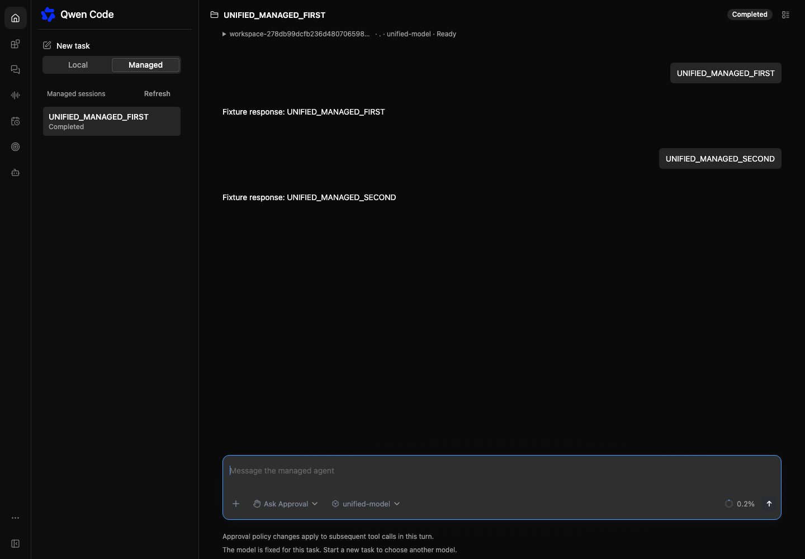
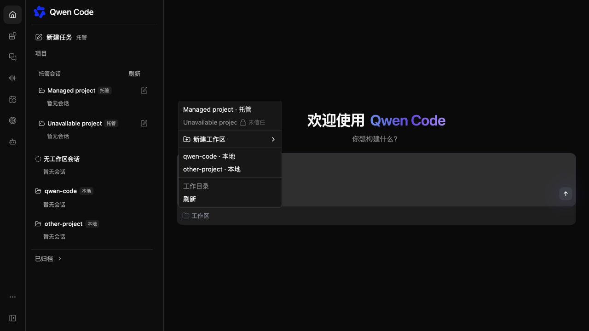
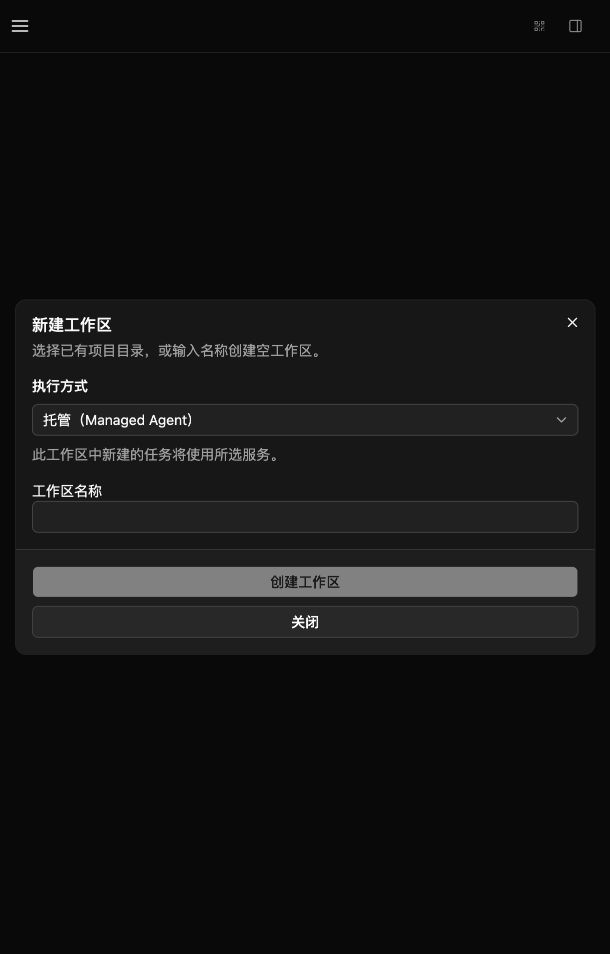
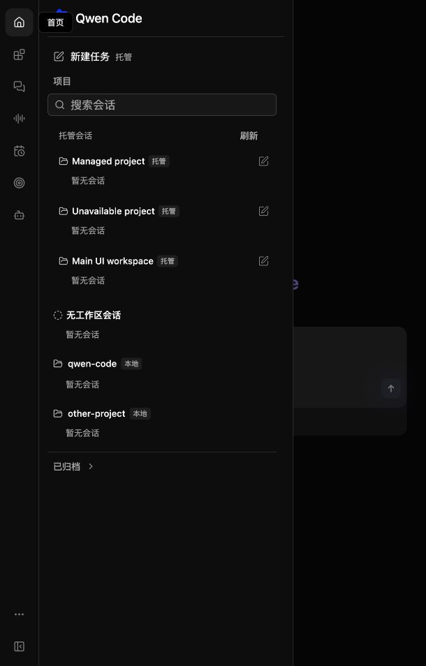

# 统一工作区导航

[English](2026-10-21-unified-workspace-navigation.md) | [简体中文](2026-10-21-unified-workspace-navigation.zh-CN.md)

状态：已实现。日期：2026-10-21。

## 问题与范围

完整 Web Shell 已经能够在 daemon 连接之外接收 Managed provider。本地/托管 tab 会隐藏另一服务的工作区，任务工作区菜单也无法选择两套目录中的目标。用户需要一个项目列表、按工作区归属新建任务，并在添加工作区时明确选择服务。

本改动独立基于 main，仅修改 Web Shell。宿主继续通过现有 `managedAgentProvider` 接入；现有 Java Vite 演示入口仍可使用 `?managedProvider=java&managedWorkspace=1`。CLI 启动器、runtime 安装/下载、代理鉴权、Java 服务、API 契约和存储 schema 均在本改动之外，不依赖 #14928。

## 共享导航与身份

移除运行方式 tab，将托管工作区分组放入现有项目列表，与 daemon 工作区同时显示。空工作区也可以选择。每个工作区名称旁紧接本地或托管标志，各工作区的新建任务操作使用相同的书写图标。顶部新建任务显示并继承当前会话或草稿的服务。

托管页面保留单一会话目录，通过侧栏插槽投射导航。侧栏将搜索词共享给该目录。工作区发现和两类目录分页继续使用现有 provider API 与明确的加载更多控件。工作区尚未出现在当前发现页的会话，仍可通过服务端工作区身份访问。

托管身份保留 provider 存储键和服务端工作区/会话 ID。daemon 身份保留原主机、cwd、信任和运行时选择。同名、相同目录或相同 ID 都不会合并目录。普通文件系统、Git、信任、删除和运行时操作仍归属其 daemon 所有者。daemon 会话不在前台时取消选中高亮，但其现有操作仍指向该会话。

## 新建任务与工作区选择

从工作区新建任务使用该工作区原有 provider。草稿的工作区菜单同时列出两套目录中可用的目标，并标注所属服务。选择目标只打开草稿，不创建工作区或会话。两类服务分别保留未发送草稿。创建前重新验证托管目标；明确目标不可用或尚未确认时，不得回退到其他托管工作区或 daemon 主工作区。

工作区解析区分等待确认、已确认绑定和已确认旧式无绑定会话。切换到不同历史条目时，先清除上一个工作区并解析新目标；同一会话的回放或完成保留已确认绑定。必要时，新建任务等待解析完成。

两类会话组件都保持挂载，以保留草稿和进行中的任务。明确选择历史会话会切换前台会话。后台托管创建或提交完成只记录结果，不会离开当前本地会话。继续沿用现有 URL 恢复契约；本改动不引入新的启动标记或启动器专用 provider 注入。

## 工作区创建

现有添加工作区入口提供本地（daemon）或托管（Managed Agent），默认继承当前会话的服务。切换服务只切换表单，不进行登记。本地保留现有位置、目录、信任和持久化控件。托管复用现有空目录创建、已授权目录选择和按能力开放的本地导入流程。服务端继续决定授权能力和路径。

复用现有托管创建器及其待确认命令回执、幂等性、已编辑目录确认和恢复机制。待确认或结果不确定的托管命令锁定运行方式，直至确认结果或明确放弃。取消时保留当前会话。在打开的弹窗中创建成功后选中新工作区；已关闭或后台操作不得抢走导航。

## 兼容性与边界

仅 daemon 的宿主保留现有控件，不显示运行方式标志或托管目录。仅托管的嵌入入口保留现有会话创建和历史行为。不迁移或转换工作区/会话，两类服务分别保留自己的存储和授权。现有 daemon SSH 位置继续使用 daemon 流程；本改动不增加托管 SSH 登记或跨主机托管路由。

## 验证与验收

1. 在完整 Web Shell 中配置现有 provider。确认两套目录同时显示且没有运行方式 tab，包含空工作区和分页工作区，服务标志紧接名称。
2. 从新建任务双向选择工作区，覆盖 daemon 主工作区和其他工作区。确认原有身份、独立草稿，并且提交前不创建工作区或会话。
3. 通过两类表单各创建一个一次性工作区。切换或取消不得登记工作区或切换会话；打开的弹窗创建成功后必须选中新工作区。
4. 检查搜索、历史、刷新、旧式无绑定会话和后台延迟完成。明确目标必须保留归属，不得在失败时回退。待确认回执必须能重试，并在结果不确定时阻止切换服务。
5. 验证仅 daemon 和仅托管宿主，包括对非前台 daemon 会话的操作。执行根目录 build/typecheck/bundle、受影响 Web Shell 测试、定向格式/lint 和隔离数据的浏览器检查。模拟后端检查与真实服务验收分别报告。

## 界面证据

当前基于 main 的浏览器截图使用现有 Vite Java provider、隔离的真实 daemon 和 Managed API fixture，验证前端选择和创建行为，不代表 Java 执行或 runtime 交付验收。改动前使用 #15040 中已有的融合前 fixture 截图。

## 开放问题

本 UI 范围没有必须解决的开放问题。一条命令启动本地服务和 runtime 发行仍属于 #14928 及其服务融合后续工作。
