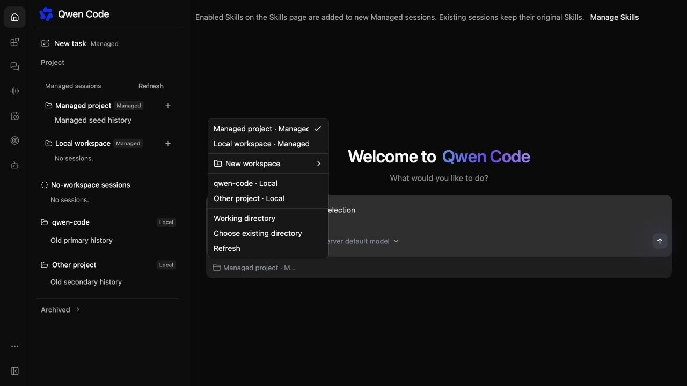
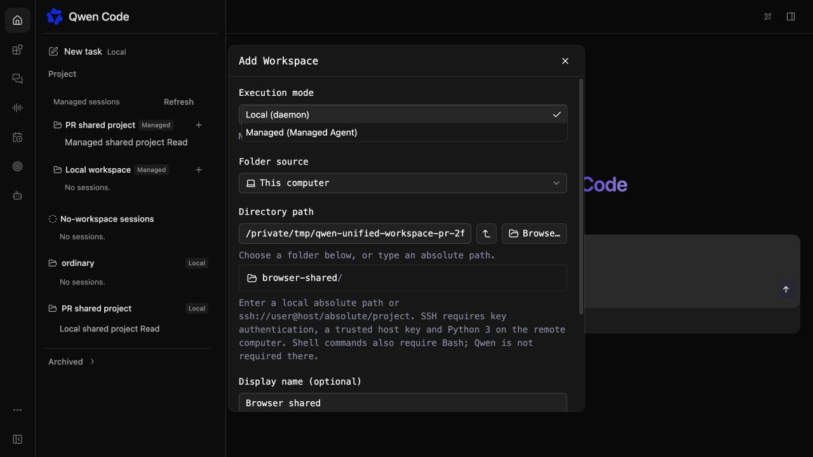
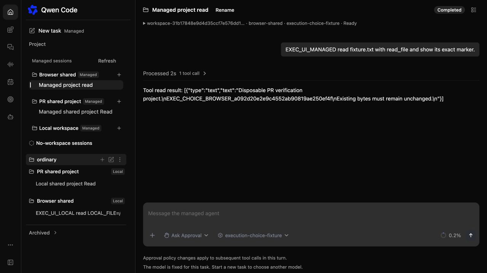

# 工作区运行方式选择

[English](2026-10-21-workspace-execution-choice.md) | [简体中文](2026-10-21-workspace-execution-choice.zh-CN.md)

状态：已实现，并在原生 macOS arm64 环境中通过确定性模型验证。日期：2026-10-21。

## 问题与当前状态

共享的项目导航已同时包含 daemon 和 Managed 工作区，没有运行方式页签。工作区创建仍有不同入口，用户无法明确选择新工作区归哪个服务管理。新建任务继承当前会话或草稿，但没有显示其运行方式。

## 预期行为

统一的添加工作区入口提供运行方式字段：本地（daemon）或托管（Managed Agent），默认跟随当前会话所属服务。已有目录弹窗和托管工作区创建弹窗都保留这个字段，提交前可以修改选择。托管保留已有的新建存储和导入目录流程；本地保留 daemon 的位置、目录、信任和持久化控制。切换方式只改变创建表单，用户提交前不会登记工作区。取消后保留原会话和运行目标。

已有后端目录持久化归属关系。daemon 工作区仍属于 daemon；Managed 工作区保留服务端工作区 ID 和 provider 身份。同一个物理目录可以分别登记在两个目录中，目录文本和页面 URL 都不会改变工作区类型。工作区行和新建任务显示本地或托管，托管输入框也在所选工作区名称旁显示类型。从工作区新建任务继续使用该工作区所属服务。

新建任务的工作区菜单也提供另一种服务已有的工作区，每个选项标明本地或托管。选择后打开对应服务的草稿，不重复登记或导入。各服务保留自己的未提交草稿和待确认操作回执。托管发现结果复用共享导航目录，保持 provider 作用域，仅提供已支持的工作区；创建时仍重新校验显式目标。daemon 选择保留主机、cwd 和信任校验。进行中或结果不确定的托管创建不能通过菜单切换运行方式。

## 组件与决策

在 AddWorkspaceDialog 和 WorkspaceBindingCreator 中复用一个小型运行方式字段。App 协调方式切换，通过 ManagedSessionsPage 控制工作区弹窗。现有托管创建组件也能在历史会话上方显示弹窗，不替换该会话。组件只在草稿或明确打开的历史会话创建弹窗中挂载，保留原有会话创建生命周期。这样继续使用现有的待确认命令凭据、幂等、校验和目录授权，而不复制创建实现。未提交的表单允许切换；进行中或结果不确定的托管操作锁定运行方式，直到操作解决或被明确放弃。本地登记成功后激活本地目标。托管后台完成继续使用已有的不导航回调。

WorkspaceSection 在 Managed 可用时接受用于本地行的展示标签。侧边栏通过已有的当前 provider 标记显示新建任务类型。仅有普通服务或仅有 Managed 的嵌入保留原有控件。无需修改 API、Java、存储结构、provider 转换或远程 Managed 路由。

## 验证与验收

定向测试覆盖无副作用的表单切换、取消时保留原会话、提交或托管操作待确认时禁止切换、按 provider 登记和新建任务继承路由。验证任务选择器双向切换、daemon 主工作区和其他工作区、独立草稿，以及提交前不登记工作区或创建会话。验证全局 CLI 基线后，构建、类型检查并打包本地 CLI。使用隔离的原生服务和一次性项目目录，通过两个服务登记同一个目录，核实不同目录身份和会话，并在重启后回读登记。主 agent 进行浏览器检查并留存截图，仅重启自有启动器后检查用户预览。测试不会登记用户的实际目录。

## 范围与待定事项

此次补齐工作区创建时的明确选择和共享任务目标选择，不迁移已有工作区或会话，也不合并存储。本范围没有待定决策。

## 已验证界面

后续 PR 基于本机启动器的最新上游，在原生 macOS 上使用新构建且匹配的 JAR 验证。通过两种浏览器表单登记同一个一次性目录，两种服务均实际读取文件；从各自历史新建任务均继承对应服务和工作区。取消后保留本地会话，托管改名在刷新后仍保留，新建会话的 Skills 控件仍可使用。浏览器没有控制台错误。build、typecheck、bundle、548 项 CLI 测试、406 项定向前端测试和 Maven 完整校验均通过（5,148 项 Java 测试，18 项跳过）。

共享任务选择器的后续修改通过 build、typecheck、bundle 和 334 项定向前端测试。浏览器双向选择保留独立草稿，提交前不创建工作区或会话。提交的三次文件读取分别落在 daemon 主工作区、daemon 其他工作区和托管工作区；独立 API/转录检查确认精确 ID、目录、真实工具结果及 fixture 文件未变。刷新后恢复所选任务和历史。Java runtime 没有变化。

