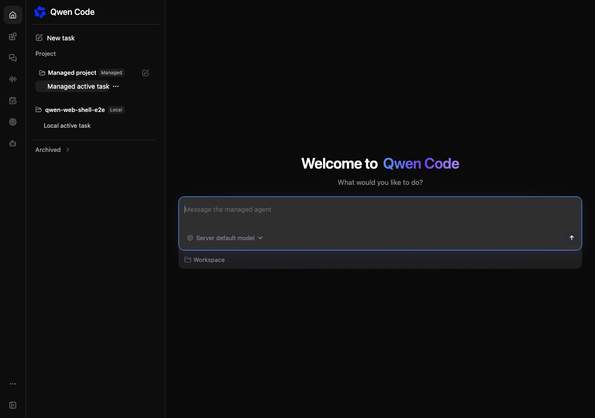
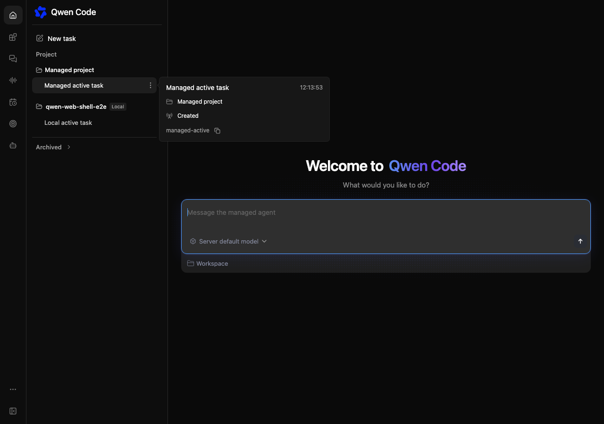

# 对齐托管侧栏与 daemon 导航

[English](2026-10-23-managed-sidebar-parity.md) | [简体中文](2026-10-23-managed-sidebar-parity.zh-CN.md)

## 目标

将托管首页导航与 daemon 现有侧栏对齐：复用搜索样式、简洁的新建任务文案、工作区标题、活动会话行及悬停详情。在统一 Web Shell 中恢复截图所示的单个底部「已归档」折叠入口。托管首页不再单独显示「会话 / 已归档」切换。

## 实现

复用侧栏现有的归档标题、展开状态、样式和本地历史。App 在该归档区域中提供第二个 portal 目标，托管页面通过独立的 `archiveState: 'archived'` 列表请求将归档历史渲染到这里；普通列表继续查询未归档历史。目标仅在首次展开时挂载，因此用户打开归档前不会发起托管归档查询。

一个小型归档列表组件负责分页、取消请求和显示请求错误，通过 App 上报已加载数量及加载、错误状态，使共用的归档数量和空状态覆盖两种来源。已有托管生命周期操作继续由托管页面持有，归档摘要会传回该页面，用于操作恢复和权限检查。现有列表版本号变化时也会刷新归档列表。独立托管页面保留原来的历史切换。

### 工作区和活动会话的外观

Managed 工作区标题复用 daemon 现有标题样式，不显示服务标签。新建操作在悬停或键盘焦点进入时显示，在触屏设备上保持可见。去掉 Managed 导航额外的内边距，使相邻的 Managed 和 Local 工作区标题对齐。

已绑定和未绑定工作区的 Managed 首页会话共用全宽行，复用 daemon 的标题、当前会话标记、运行指示器、右对齐操作区域和详情浮层。侧栏操作入口使用纵向圆点，其他 Managed 视图保留原有控件。保留操作权限，并阻止操作按钮事件触发会话选择。详情卡展示标题、更新时间、可用的工作区名称及相对目录、实际的 Managed 生命周期或阶段，以及可复制的会话 ID。共享浮层增加状态文案覆盖，避免虚构 daemon 客户端数量。不新增置顶控件或后端能力，此次补充不调整底部归档折叠入口。

## 约束

不修改 daemon 路由、服务端协议、本地归档的变更行为或共用 CSS。视图或 provider 被替换时取消请求。托管查询失败必须保持可见并可重试，不得回退到 daemon 历史。加载下一页归档不得替换普通会话或重复展示同一条归档记录。

## 验证与验收

在中英文界面确认仅有一个默认收起的底部归档入口，顶部不再显示历史切换。展开前不得发起托管归档查询。展开后普通及归档会话均可访问，收起时隐藏归档内容。验证分页、查询失败及重试、会话选择和取消归档后的刷新，确认本地归档历史、搜索筛选及新建任务仍可用。运行相关组件测试、构建和类型检查、格式检查及差异复核；浏览器证据使用生成的生产前端和模拟接口。真实服务、模型执行不在本次展示调整的范围内。

在同一侧栏比较 Managed 和 daemon 会话行的宽度、对齐及悬停操作。验证悬停详情、ID 复制、键盘选择、操作菜单事件隔离、长标题、运行状态更新和触屏访问。确认独立 Managed 视图及现有归档行为保留之前的控件。

## 视觉证据

截图使用生产前端和模拟的 daemon、托管接口响应。修改前：Managed 标签和新建按钮常显，操作入口紧跟短标题，悬停不显示详情。修改后：全宽会话行和右对齐的纵向操作入口与 daemon 一致，共用详情卡显示可用的托管元数据。

| 修改前                                                 | 修改后                                                |
| ------------------------------------------------------ | ----------------------------------------------------- |
|  |  |
