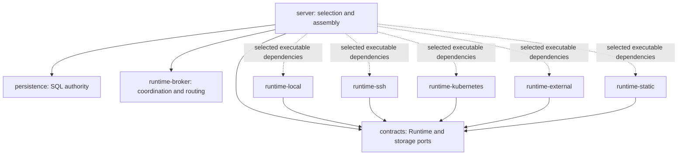

# Managed Runtime backend modules

[English](2026-10-31-managed-runtime-backend-modules.md) | [简体中文](2026-10-31-managed-runtime-backend-modules.zh-CN.md)

Status: implemented; acceptance pending. Rebased 2026-11-02 onto main `73474ef094ea1c6bb2a95a9a2a33a28b0ec58e9e`, preserving the existing [Local/External provider implementation](2026-10-31-managed-runtime-provider-plugins.md) and main's Store constructor injection. The existing shared local Java verification budget is exhausted at 599.048/600 seconds and is not reset by this extension. Earlier Local/External results do not certify this revised SPI, assembly or packaging; the new Java tests and all seven executable variants await CI.

## Objective and boundaries

Deliver five independently selectable Maven JARs and executable distributions containing only the selected backend implementations. Backend selection happens at build time. SSH-only, Kubernetes-only, Local-only and Local+SSH are supported configurations; the default complete distribution remains available. Including several backends in an artifact does not enable arbitrary concurrent composition or fallback.

Preserve persisted provider kinds, configuration keys, storage identities, protocol bytes, SQL authority and retirement authorization. This change does not enable Kubernetes scratch, change Session/Turn prewarm, download JARs at runtime, or support hot replacement. First-use Worker/Pod startup remains a separate change. Database, Harness, messaging and other shared dependencies are not trimmed.

Before extraction, server directly constructed SSH, Static and resident Kubernetes implementations. SSH assembly required a Local base provider, and local file exchange borrowed an SSH process helper. The implementation removes those compile dependencies and addresses three assembly defects: historical operations bypassing current backend selection, SSH connections surviving failed Spring startup, and SSH-only resolution falling back to historical Local directories.

## Module boundaries

All modules remain siblings under `packages/managed-agent-server`, with the same parent version and release process.

| Module               | Responsibility                                                                    | Internal dependencies                                                  |
| -------------------- | --------------------------------------------------------------------------------- | ---------------------------------------------------------------------- |
| `contracts`          | Runtime interfaces, settings, identities and construction/access ports            | None                                                                   |
| `runtime-local`      | Local Worker, persistent local state, factory and offline recovery                | `contracts`, `runtime-http`, `runtime-host`                            |
| `runtime-ssh`        | SSH Worker, connections/tunnels and factory                                       | `contracts`, `runtime-http`, `runtime-host`                            |
| `runtime-kubernetes` | Kubernetes client, resident/CSI provisioning, protection and reclamation evidence | `contracts`, `runtime-http`                                            |
| `runtime-external`   | External Runtime client, scratch/workspace providers and factory                  | `contracts`, `runtime-http`                                            |
| `runtime-static`     | Preconfigured endpoint/lease and factory                                          | `contracts`                                                            |
| `runtime-http`       | Shared HTTP transport                                                             | `contracts`                                                            |
| `runtime-host`       | Bounded process/file exchange and host identity/state utilities                   | `contracts`                                                            |
| `runtime-broker`     | Lease/execution coordination and backend-neutral routing                          | `contracts`                                                            |
| `adapters`           | Harness, filesystem and other non-provider adapters                               | Shared modules; no backend implementation                              |
| `server`             | Selection, authoritative storage wiring, HTTP and operator entry points           | Application/shared modules; five optional runtime backend dependencies |



The five backend artifacts have no dependencies on one another. [RoutingRuntimeProvisioner](../../packages/managed-agent-server/runtime-broker/src/main/java/com/alibaba/qwen/code/runtimebroker/routing/RoutingRuntimeProvisioner.java) belongs to `runtime-broker`. [HostCommandRunner](../../packages/managed-agent-server/runtime-host/src/main/java/com/alibaba/qwen/code/runtimebroker/host/HostCommandRunner.java) and [WorkspaceFileProcess](../../packages/managed-agent-server/runtime-host/src/main/java/com/alibaba/qwen/code/runtimebroker/host/WorkspaceFileProcess.java) belong to `runtime-host`; this shared code is not an installed Local backend.

Kubernetes extraction moves seven classes together into `com.alibaba.qwen.code.runtimebroker.provisioning.kubernetes`: `KubernetesRuntimeProvisioner`, `KubernetesHttpRuntimeClient`, `KubernetesCsiLogReader`, `WorkspaceCsiRuntimeProvisioner`, `WorkspaceCsiResourceGuard`, `ResidentWorkspaceProvisioner` and `ResidentWorkspaceReclamation`. Only `kubernetes-workspace` has a factory; `kubernetes-scratch` stays unregistered and `kubernetes` stays rejected. SSH and Static use distinct `.provisioning.ssh` and `.provisioning.staticruntime` packages. Package-private tests move with their classes.

SQL stores, reservation transactions, `ResidentWorkspaceRetirementService`, common identity/profile semantics and the shared CSI application-store bean remain in their original layers. Kubernetes Harness discovery remains a separate Harness responsibility. New modules directly declare their used Commons libraries and participate in Checkstyle, SpotBugs, source/Javadoc publication and aggregate verification.

## Factory and dependency contracts

Each backend publishes `META-INF/services/com.alibaba.qwen.code.runtimebroker.spi.RuntimeProviderFactory`. `RuntimeProviderRegistry` discovers factories, rejects duplicate/reserved kinds, validates selected factories and verifies each returned provider's kind. Factory construction and kind discovery must allocate no resources; validation performs configuration checks only.

The internal creation signature is `create(settings, transport, dependencies)`. [RuntimeProviderDependencies](../../packages/managed-agent-server/contracts/src/main/java/com/alibaba/qwen/code/runtimebroker/spi/RuntimeProviderDependencies.java) exposes exactly four named ports:

| Port                | Selected consumer                | Ownership                                                                  |
| ------------------- | -------------------------------- | -------------------------------------------------------------------------- |
| `bindings()`        | Kubernetes resident provisioning | Original Broker repository                                                 |
| `externalStorage()` | External workspace provisioning  | Original SQL storage adapter, constructed only when requested              |
| `csiReservations()` | Kubernetes resident provisioning | Original datasource/transaction authority; constructed only when requested |
| `ssh()`             | SSH provisioning                 | Borrowed node lookup, storage lookup and shared connections                |

Unavailable ports fail explicitly. Local, Static and External scratch do not request unrelated ports. Kubernetes creation checks the original JDBC repository and datasource, transaction manager and Workspace execution authority before requesting reservations. The reservation store continues to check datasource identity and own its transactions.

The already-discovered SSH factory also implements `SshRuntimeSupport` for connection creation. The Kubernetes factory implements `KubernetesRuntimeSupport` for client construction, operator Runtime construction and protection rendering. These are capabilities of the same factory, without another discovery mechanism or service locator. Operator construction uses the existing contracts and a typed `WorkspaceCsiRuntimeSpec`.

The SPI is internal: all backend artifacts must be rebuilt at the same version. There is no compatibility bridge for the old creation signature. Persisted kinds and database/protocol formats remain unchanged.

## Selection, admission and resource lifetime

[RuntimeBackendSelection](../../packages/managed-agent-server/contracts/src/main/java/com/alibaba/qwen/code/runtimebroker/spi/RuntimeBackendSelection.java) calculates the actual enabled backend set independently of discovery:

- Broker disabled: empty set; no factory discovery or SSH connections.
- SSH primary: SSH nodes are required; select only SSH.
- Local primary with SSH nodes: select Local and SSH.
- Other primary with SSH nodes: reject before creating resources.
- Otherwise: select the primary backend only.

Configuration and presence of every selected factory are checked before connections, clients, Worker state or providers are created. SSH-only does not require or construct Local state, a Local provider or the routing wrapper. Local+SSH retains the shared endpoint resolver and original node identity; the Local delegate uses its direct HTTP transport. SSH-only rejects unbound Session execution and Local workspace settings. Runtime scope, cwd-target and storage-root resolution refuse historical Local bindings before probing local paths.

`ssh.enabled` retains its full admission meaning: it governs new registrations, bindings, Sessions and file access through the existing Workspace registry checks. A configured SSH backend with this flag false can still execute, close and recover already-admitted work and perform allowed idempotent replay using the original node identity. Omitting SSH from the enabled set is different: pending registration queries/replays return the existing operation without claiming or dispatching it, and parked acceptance remains unknown rather than being converted to failure.

[WorkspaceFileUploadStore](../../packages/managed-agent-server/persistence/src/main/java/com/alibaba/qwen/code/managedagent/persistence/WorkspaceFileUploadStore.java) checks the backend required by the frozen target before online exchange or status reconciliation. A historical Local upload after switching to SSH-only stays pending, keeps its storage holder and does not execute the saved Local command. Restoring the original backend allows reconciliation to continue. This guard does not disable independent offline Local storage maintenance tools.

Spring exclusively owns the SSH connections bean through `destroyMethod="close"`. `SshWorkspaceService` and the SSH provider borrow it; the service closes only its executor. Spring cleanup covers failure before service construction as well as normal shutdown. Provider factories close partially constructed resources; resident assembly closes earlier delegates if a later registration fails. Tests must prove the same JVM can reacquire the SSH controller lock after failed startup.

Static retains local workspace and state-directory preflight. Kubernetes retains credential/path checks, resident registration and physical-retirement authorization. None of these changes removes automatic prewarm.

## Build and distribution

The server POM declares all five backend artifacts as `optional` with `runtime` scope. There are no five backend dependency profiles. [The build selector](../../scripts/build-managed-agent-runtime.mjs) sets a single [Spring Boot coordinate exclusion set](https://docs.spring.io/spring-boot/3.5/maven-plugin/packaging.html#packaging.repackage-goal.parameter-details.excludes), including the existing Lombok exclusion. Build machines may still resolve all five coordinates; the deployed `BOOT-INF/lib` must contain precisely the chosen backend artifacts. The selector inspects the built archive and refuses mismatched metadata/content.

The selector accepts `--backends=full`, a single backend or a comma-separated combination. Unknown/empty names fail. Names are deduplicated and sorted (`external,kubernetes,local,ssh,static`); the complete set becomes `full`.

```bash
node scripts/build-managed-agent-runtime.mjs --backends=kubernetes
node scripts/build-managed-agent-runtime.mjs --backends=ssh
node scripts/build-managed-agent-runtime.mjs --backends=local,ssh --verify
```

`--verify` adds packaged-artifact Java tests and requires the normal JDK/Maven prerequisites. It must not be run after the shared local verification budget is exhausted; CI runs it for every variant.

Full uses classifier `exec`; reduced variants use `exec-<sorted-backends>`, for example `exec-local-ssh`. The resource JAR and Boot repackage executions use the same classifier. `Qwen-Runtime-Backends` and `Qwen-Runtime-Variant` are written only to that executable's manifest and the distribution manifest. Ordinary library JARs/POMs do not change with the variant. Application YAML and main's Spring configuration metadata remain present.

The [reference packager](../../scripts/package-managed-agent-reference.mjs) accepts the same `--backends` selector, verifies the matching executable and embeds variant identity in stage/archive/manifest/checksum paths. Full keeps its existing operator classifiers and reference automation, subject to the existing Central-release policy. Reduced distributions ship only the main executable, with operator commands invoked by the existing admin `PropertiesLauncher` entry. They provide selected-backend examples, a manual systemd unit and manual deployment instructions; full-only bootstrap/upgrade and the separate recovery launcher are omitted. Distinct product names prevent the full upgrader from accepting a reduced archive as the same product.

Operator availability is checked per action: without Kubernetes, CSI Runtime `serve`, protection rendering and physical retirement actions fail before SQL/client side effects; CSI `text`/`retire` and SQL-only resident `inspect`/`begin` remain accessible. Local-specific operator actions require Local, while independent SQL/offline branches keep their existing support. Missing capabilities never fall back to another backend. Online provider validation belongs to `ManagedAgentConfiguration` and explicit preflight, not the shared properties initialization used by `WorkspaceRecoveryApplication`. The maintenance context retains resident/mapping and SQL checks without discovering online factories; the selected action alone requests a backend capability.

## Verification and acceptance

The implementation adds these tests; Java execution of this revision remains pending:

| Area                      | Required evidence                                                                                                                                                                                          |
| ------------------------- | ---------------------------------------------------------------------------------------------------------------------------------------------------------------------------------------------------------- |
| Actual dependency absence | Five single-backend executables, Local+SSH and full; inspect nested JARs/manifests/service registrations and attempt to load every excluded backend class in a child process using only the built artifact |
| Independent assembly      | SSH-only creates no Local state/process; Local-only creates no SSH connection; disabled Broker performs no discovery; unselected factories perform no validation or resource I/O                           |
| Admission and history     | Preserve `ssh.enabled` rejection; historical Local uploads retain pending state/holder; absent SSH stops registration/acceptance dispatch; restoring the original backend resumes the operation            |
| Lifecycle                 | Spring releases shared connections on normal and failed startup; the same JVM reacquires the lock; partial provider construction releases allocated delegates                                              |
| Compatibility             | Preserve kinds, SQL authority, CSI retirement and Static preflight; keep library JARs optional/unchanged, configuration metadata and applicable operator branches                                          |
| Real integration          | Actual selected SSH/Kubernetes services, MySQL concurrency/recovery, Hosted/fault profiles, cross-platform checks and complete CI                                                                          |

`RuntimeProviderPluginsTest` also compiles an independent contract-only provider and exercises isolated classpaths, but that does not replace the seven real executable checks. `ManagedAgentPackagingIT` launches the product with Broker disabled to verify packaging/startup absence and exercises operator branches; it does not certify an enabled SSH host or Kubernetes cluster. Mocked connection/SQL tests do not establish real infrastructure acceptance.

The SDK Java workflow builds/verifies/packages all seven variants, publishes their manifests/checksums and test reports, and keeps existing full unit/H2, Checkstyle, SpotBugs, MySQL, Hosted and fault gates. Root script tests verify selectors, archive rejection, launcher branching and workflow coverage without executing Java. Local results, failures, skips and unrun checks are recorded in `.qwen/e2e-tests/runtime-provider-plugins.md`; no earlier result is promoted to current full acceptance.

## Delivery and remaining risks

Implementation followed the reviewed sequence: align main while preserving Local/External work; introduce shared ports/host utilities; split SSH/Static and independent assembly; split Kubernetes/operator construction; add selective packaging and synchronized documentation. No schema migration, public API change or prewarm change is included.

The main remaining risk is unexecuted Java compilation and runtime acceptance of the revised module graph. The existing local budget is closed, so new Java tests, actual variant builds and real infrastructure checks must pass in CI before acceptance. A reduced artifact cannot drain work belonging to a removed backend: retain the owning backend during draining, or deliberately leave its pending operations and storage claims until that backend is restored.
