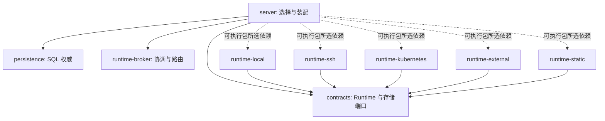

# Managed Runtime 后端独立模块

[English](2026-10-31-managed-runtime-backend-modules.md) | [简体中文](2026-10-31-managed-runtime-backend-modules.zh-CN.md)

状态：已实现，验收待完成。2026-11-02 已整合 main `73474ef094ea1c6bb2a95a9a2a33a28b0ec58e9e`，保留已有 [Local/External provider 实现](2026-10-31-managed-runtime-provider-plugins.zh-CN.md)及 main 的 Store 构造注入改动。原有共享本地 Java 验证预算已消耗 599.048/600 秒，本次扩展不重置预算。此前 Local/External 结果不能证明修订后的 SPI、装配或打包正确；新增 Java 测试和七种可执行变体均待 CI 验证。

## 目标与边界

交付五个可独立选择的 Maven JAR，以及只包含所选后端实现的可执行分发。后端在构建时选择。支持 SSH-only、Kubernetes-only、Local-only 和 Local+SSH 配置，保留默认完整分发。在产物中包含多个后端，不代表开放任意并行组合或回退。

保留持久化 provider kind、配置键、存储身份、协议字节、SQL 权威与退休授权。本次不开放 Kubernetes scratch、不改变 Session/Turn 预热、不在运行时下载 JAR，也不支持热替换。首次使用才启动 Worker/Pod 仍作为独立变更。数据库、Harness、消息及其他共享依赖不额外裁剪。

拆分前，server 直接构造 SSH、Static 和常驻 Kubernetes 实现；SSH 装配要求先有 Local 基础 provider，本地文件交换也借用了 SSH 进程辅助代码。本次移除这些编译依赖，并处理三个装配缺口：历史操作绕过当前后端选择、Spring 启动失败后 SSH 连接未释放、SSH-only 解析回退到历史 Local 目录。

## 模块边界

全部模块仍平铺在 `packages/managed-agent-server` 下，沿用同一个父版本与发布流程。

| 模块                 | 职责                                                       | 内部依赖                                      |
| -------------------- | ---------------------------------------------------------- | --------------------------------------------- |
| `contracts`          | Runtime 接口、配置、身份以及构造/访问端口                  | 无                                            |
| `runtime-local`      | Local Worker、本地持久状态、工厂与离线恢复                 | `contracts`、`runtime-http`、`runtime-host`   |
| `runtime-ssh`        | SSH Worker、连接/隧道与工厂                                | `contracts`、`runtime-http`、`runtime-host`   |
| `runtime-kubernetes` | Kubernetes 客户端、常驻/CSI 供给、保护与回收证据           | `contracts`、`runtime-http`                   |
| `runtime-external`   | External Runtime 客户端、scratch/workspace provider 与工厂 | `contracts`、`runtime-http`                   |
| `runtime-static`     | 预配置 endpoint/lease 与工厂                               | `contracts`                                   |
| `runtime-http`       | 公共 HTTP transport                                        | `contracts`                                   |
| `runtime-host`       | 有界进程/文件交换以及宿主身份/状态工具                     | `contracts`                                   |
| `runtime-broker`     | lease/执行协调与不依赖后端的路由组合                       | `contracts`                                   |
| `adapters`           | Harness、文件系统及其他非 provider 适配器                  | 共享模块，不依赖后端实现                      |
| `server`             | 选择、权威存储装配、HTTP 与运维入口                        | 应用/共享模块，五个 optional runtime 后端依赖 |



五个后端产物互不依赖。[RoutingRuntimeProvisioner](../../packages/managed-agent-server/runtime-broker/src/main/java/com/alibaba/qwen/code/runtimebroker/routing/RoutingRuntimeProvisioner.java) 属于 `runtime-broker`。[HostCommandRunner](../../packages/managed-agent-server/runtime-host/src/main/java/com/alibaba/qwen/code/runtimebroker/host/HostCommandRunner.java) 和 [WorkspaceFileProcess](../../packages/managed-agent-server/runtime-host/src/main/java/com/alibaba/qwen/code/runtimebroker/host/WorkspaceFileProcess.java) 属于 `runtime-host`；这些共享代码不代表安装了 Local 后端。

Kubernetes 的七个类一起移入 `com.alibaba.qwen.code.runtimebroker.provisioning.kubernetes`：`KubernetesRuntimeProvisioner`、`KubernetesHttpRuntimeClient`、`KubernetesCsiLogReader`、`WorkspaceCsiRuntimeProvisioner`、`WorkspaceCsiResourceGuard`、`ResidentWorkspaceProvisioner`、`ResidentWorkspaceReclamation`。只为 `kubernetes-workspace` 注册工厂；`kubernetes-scratch` 仍不注册，`kubernetes` 仍拒绝。SSH 和 Static 分别使用独立的 `.provisioning.ssh`、`.provisioning.staticruntime` 包。依赖包内构造器的测试随实现移动。

SQL Store、预留事务、`ResidentWorkspaceRetirementService`、公共身份/profile 语义及共享 CSI application-store bean 保持原有层归属。Kubernetes Harness discovery 仍是独立的 Harness 职责。新模块直接声明所用 Commons 库，并接入 Checkstyle、SpotBugs、源码/Javadoc 发布及聚合验证。

## 工厂与依赖契约

每个后端发布 `META-INF/services/com.alibaba.qwen.code.runtimebroker.spi.RuntimeProviderFactory`。`RuntimeProviderRegistry` 发现工厂，拒绝重复/保留 kind，校验所选工厂，并检查返回 provider 的 kind。工厂构造与 kind 发现不得分配资源，校验阶段只检查配置。

内部创建签名为 `create(settings, transport, dependencies)`。[RuntimeProviderDependencies](../../packages/managed-agent-server/contracts/src/main/java/com/alibaba/qwen/code/runtimebroker/spi/RuntimeProviderDependencies.java) 只暴露四个具名端口：

| 端口                | 所选使用方              | 所有权                             |
| ------------------- | ----------------------- | ---------------------------------- |
| `bindings()`        | Kubernetes 常驻供给     | 原 Broker repository               |
| `externalStorage()` | External workspace 供给 | 原 SQL 存储适配器，只在请求时构造  |
| `csiReservations()` | Kubernetes 常驻供给     | 原数据源/事务权威，只在请求时构造  |
| `ssh()`             | SSH 供给                | 借用的节点查询、存储查询及共享连接 |

不可用端口明确失败。Local、Static 与 External scratch 不获取无关端口。Kubernetes 创建在取得预留接口前，检查原 JDBC repository、数据源、事务管理器及 Workspace 执行权威。预留 Store 继续校验数据源身份并持有事务。

已发现的 SSH 工厂同时实现 `SshRuntimeSupport`，负责构造连接。Kubernetes 工厂实现 `KubernetesRuntimeSupport`，负责客户端构造、运维 Runtime 构造和保护对象渲染。这些都是同一个工厂的能力，不增加另一套发现机制或 service locator。运维构造使用已有契约以及类型明确的 `WorkspaceCsiRuntimeSpec`。

SPI 属于内部接口：全部后端产物必须以相同版本重编译。不为旧创建签名提供兼容桥接。持久化 kind 及数据库/协议格式不变。

## 选择、准入与资源生命周期

[RuntimeBackendSelection](../../packages/managed-agent-server/contracts/src/main/java/com/alibaba/qwen/code/runtimebroker/spi/RuntimeBackendSelection.java) 在发现机制之外计算实际启用的后端集合：

- Broker 停用：空集合，不发现工厂，不创建 SSH 连接。
- SSH 主后端：必须配置 SSH nodes，只选择 SSH。
- Local 主后端且配置 SSH nodes：选择 Local 和 SSH。
- 其他主后端与 SSH nodes 组合：创建资源前拒绝。
- 其余情况：只选择主后端。

先完成配置与所有所选工厂的存在性校验，再创建连接、客户端、Worker 状态或 provider。SSH-only 不要求或构造 Local 状态、Local provider 和路由包装。Local+SSH 保留共享 endpoint resolver 与原节点身份，Local delegate 使用直接 HTTP transport。SSH-only 拒绝未绑定 Workspace 的 Session 执行和 Local Workspace 配置。Runtime scope、cwd 目标及存储根解析在探测本地路径前拒绝历史 Local binding。

`ssh.enabled` 保留完整准入含义：通过原 Workspace registry 检查控制新注册、新绑定、新 Session 和文件访问。配置了 SSH 后端但此开关为 false 时，已经接纳的执行、关闭、恢复及允许的幂等重放仍可使用原节点身份。SSH 不在启用集合中是另一种状态：未决注册的查询/重放返回原操作，不 claim、不调度；parked acceptance 保持 unknown，不转为失败。

[WorkspaceFileUploadStore](../../packages/managed-agent-server/persistence/src/main/java/com/alibaba/qwen/code/managedagent/persistence/WorkspaceFileUploadStore.java) 在在线交换或状态恢复前检查冻结目标要求的后端。切换到 SSH-only 后，历史 Local 上传保持 pending，保留存储 holder，不执行已保存的 Local 命令。恢复原后端后可以继续恢复。该限制不禁用独立的离线 Local 存储维护工具。

Spring 通过 `destroyMethod="close"` 唯一拥有 SSH connections bean。`SshWorkspaceService` 和 SSH provider 只借用连接，service 只关闭自己的 executor。Spring 清理同时覆盖正常关闭和 service 构造前的启动失败。Provider 工厂清理部分构造资源；常驻装配在后续 registration 失败时关闭已构造的 delegate。测试必须证明启动失败后同一 JVM 可以重新取得 SSH controller lock。

Static 保留本地 Workspace 和状态目录预检。Kubernetes 保留凭据/路径校验、常驻注册及物理退休授权。这些变更都不取消自动预热。

## 构建与分发

server POM 固定声明五个后端为 `optional`、`runtime` 依赖。不引入五组后端依赖 profile。[构建选择器](../../scripts/build-managed-agent-runtime.mjs) 设置统一的 [Spring Boot 坐标排除集合](https://docs.spring.io/spring-boot/3.5/maven-plugin/packaging.html#packaging.repackage-goal.parameter-details.excludes)，包含原有 Lombok 排除项。构建机仍可能解析全部五个坐标；部署的 `BOOT-INF/lib` 必须精确包含所选后端产物。选择器检查成品归档，拒绝元数据与内容不一致。

选择器接受 `--backends=full`、单后端或逗号分隔组合。未知/空名称失败。名称去重并排序（`external,kubernetes,local,ssh,static`），完整集合规范化为 `full`。

```bash
node scripts/build-managed-agent-runtime.mjs --backends=kubernetes
node scripts/build-managed-agent-runtime.mjs --backends=ssh
node scripts/build-managed-agent-runtime.mjs --backends=local,ssh --verify
```

`--verify` 增加成品 Java 测试，要求正常的 JDK/Maven 前置条件。共享本地验证预算耗尽后不得运行，CI 为每个变体执行。

完整包使用 classifier `exec`，精简包使用 `exec-<排序后的后端集合>`，例如 `exec-local-ssh`。资源 JAR 和 Boot repackage 使用同一个 classifier。`Qwen-Runtime-Backends`、`Qwen-Runtime-Variant` 只写入该可执行包及发行清单。普通 library JAR/POM 不随变体改变。应用 YAML 和 main 新增的 Spring 配置元数据保留。

[参考分发打包器](../../scripts/package-managed-agent-reference.mjs) 接受同一个 `--backends` 选择器，校验对应可执行包，并在 stage、归档、manifest、校验文件路径中包含变体身份。完整包保留原 operator classifier 与参考自动化，继续服从原 Central-release 策略。精简包只分发主可执行包，运维命令通过现有 admin 的 `PropertiesLauncher` 入口调用。精简包提供所选后端示例、手动 systemd 单元和手动部署说明，省去 full 专用 bootstrap/upgrade 和独立 recovery launcher。不同产品名称阻止完整包 upgrader 把精简归档识别为同一个产品。

运维可用性按 action 校验：缺少 Kubernetes 时，CSI Runtime `serve`、保护对象渲染和物理退休操作在 SQL/客户端副作用前拒绝；CSI `text`/`retire` 和纯 SQL 的 resident `inspect`/`begin` 仍可访问。Local 专用运维操作要求 Local，独立 SQL/离线分支保持原支持范围。缺失能力不回退到其他后端。在线 provider 校验属于 `ManagedAgentConfiguration` 和显式 preflight，不放在 `WorkspaceRecoveryApplication` 也使用的共享 properties 初始化中。维护 context 保留 resident/mapping 和 SQL 检查，不发现在线工厂，只由选中的 action 请求后端能力。

## 验证与验收

实现增加以下测试；本修订的 Java 执行仍待完成：

| 范围           | 必需证据                                                                                                              |
| -------------- | --------------------------------------------------------------------------------------------------------------------- |
| 真实缺包       | 五种单后端成品、Local+SSH、full；检查嵌套 JAR、manifest、服务注册，在只使用成品的子进程中逐个尝试加载所有被排除后端类 |
| 独立装配       | SSH-only 不创建 Local 状态/进程；Local-only 不创建 SSH 连接；Broker 停用不发现工厂；未选工厂不校验、不执行资源 I/O    |
| 准入与历史操作 | 保留 `ssh.enabled` 拒绝；历史 Local 上传保留 pending/holder；SSH 缺席停止注册/acceptance 调度；恢复原后端后继续操作   |
| 生命周期       | Spring 在正常/失败启动时释放共享连接；同一 JVM 重新取得锁；provider 部分构造失败清理已分配 delegate                   |
| 兼容性         | 保留 kind、SQL 权威、CSI 退休和 Static 预检；保持 library JAR optional/内容不变、配置元数据及适用运维分支             |
| 真实集成       | 真实所选 SSH/Kubernetes 服务、MySQL 并发/恢复、Hosted/fault profile、跨平台检查及完整 CI                              |

`RuntimeProviderPluginsTest` 还编译独立的 contracts-only provider 并检查隔离 classpath，但不能替代七种真实可执行包检查。`ManagedAgentPackagingIT` 用 Broker 停用配置启动产品以验证打包/启动缺包边界，并执行运维分支；它不能证明启用了 SSH 主机或 Kubernetes 集群的真实启动。Mock 连接/SQL 测试不代表真实基础设施验收。

SDK Java workflow 构建、验证并打包全部七种变体，上传 manifest、校验文件和测试报告，保留原完整 unit/H2、Checkstyle、SpotBugs、MySQL、Hosted 和 fault gates。根目录脚本测试在不执行 Java 的情况下检查选择器、归档拒绝、launcher 分支及 workflow 覆盖。各本地结果、失败、跳过和未执行检查记录在 `.qwen/e2e-tests/runtime-provider-plugins.md`，不将旧结果升级为本修订的完整验收。

## 交付与剩余风险

实现按审查顺序推进：对齐 main 并保留 Local/External 改动；引入共享端口/host 工具；拆分 SSH/Static 和独立装配；拆分 Kubernetes/运维构造；增加选择性打包和同步文档。不包含 schema 迁移、公开 API 或预热变更。

主要剩余风险是修订模块图尚未执行 Java 编译与运行验收。原本地预算已关闭，新增 Java 测试、真实变体构建及基础设施检查必须在 CI 通过后才能验收。精简产物不能清理属于已移除后端的工作：排空期间保留原后端，或明确保留其未决操作和存储占用，直到重新部署原后端。
