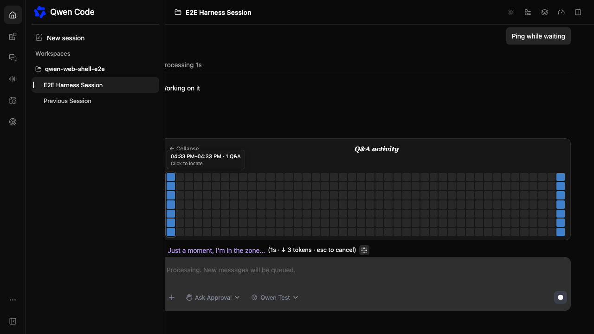
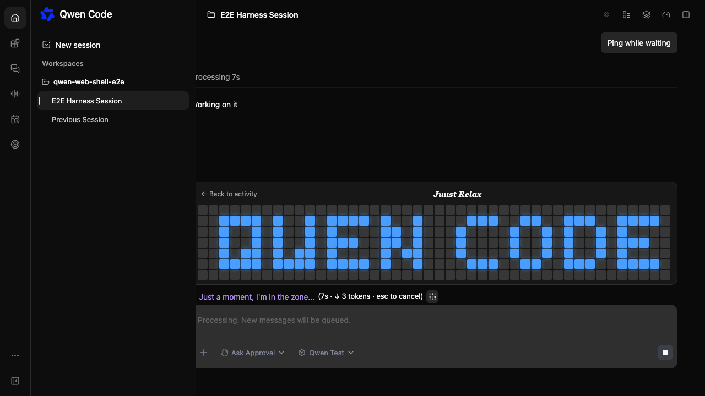
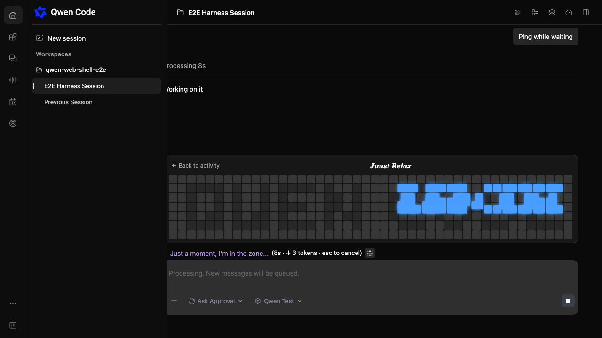
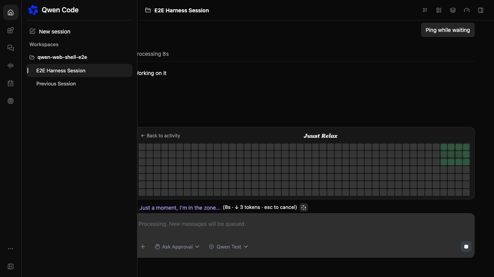
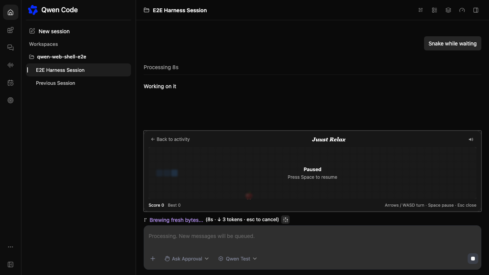
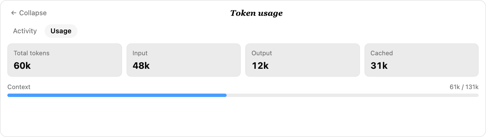
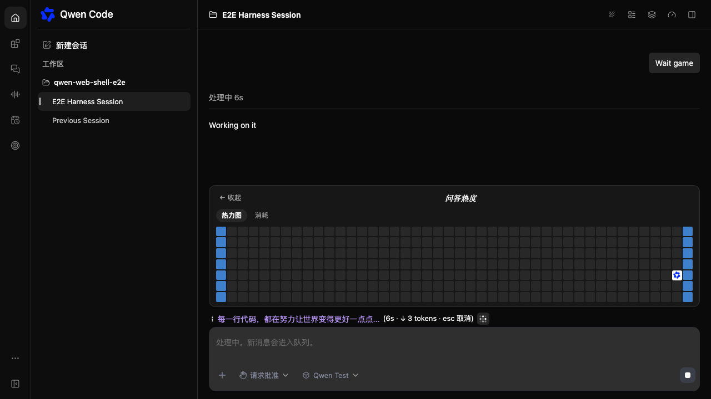

# Web Shell waiting card

[English](2026-11-01-web-shell-waiting-minigame.md) | [简体中文](2026-11-01-web-shell-waiting-minigame.zh-CN.md)

Status: implemented; runtime release verification pending.

## Problem

A streaming prompt can take minutes. The composer only shows a spinner,
elapsed time, token count, and a rotating loading phrase. Users have nothing
playful or interactive to do while they wait, and the Web Shell has no waiting
experience beyond passive status text.

## Current state

`StreamingStatus` renders above the main `ChatEditor` whenever
`streamingState !== 'idle'` or the daemon reports an active prompt. The Web
Shell owns the streaming state, transcript messages, token usage, composer
layout, i18n, theme tokens, and local storage patterns. Split panes and
side-task panes render their own `ChatPane` composers and keep a compact status
line.

## Goals

- Add a compact heatmap button at the end of the main composer's streaming
  status while a prompt is running.
- Open a waiting card above the status row:
  - the task's Q&A activity heatmap by default, with hover details and
    click-to-locate;
  - an `Activity` / `Usage` switch, where `Usage` shows task token consumption
    instead of a credits balance;
  - a Qwen mark on a random cold cell that appears after five seconds and
    starts a random game.
- Keep keyboard input and the composer usable; never hijack typing.
- Keep the feature local to the browser: no backend, daemon, transcript,
  telemetry, or model changes.

## Non-goals

- No welcome-page game, leaderboard, multiplayer, or cross-device scores.
- No game in split panes, side-task panes, or on coarse-pointer devices.
- No mobile touch controls in this change.

## Proposed solution

`WaitingMinigameButton` renders at the end of the `StreamingStatus` row while a
prompt is active. Clicking it mounts `WaitingMinigame` above the row:

1. The card opens on `Activity`: 44 time buckets across the task's own Q&A
   timeline, each bucket a column of seven cells colored by message density.
   Hovering a column shows its time range and Q&A count. Clicking a bucket with
   activity scrolls the transcript to the first Q&A in that bucket and
   highlights the message.
2. After five seconds, a white square with the blue Qwen mark appears on a
   randomly chosen cold cell (a bucket with the fewest messages). Clicking it
   starts either horizontal Tetris or Snake at random; there is no picker or
   switch control.
3. The `Usage` tab shows total tokens, input, output, cached, and context
   used/limit for the task. It replaces the credits view from the reference
   design.
4. A `QWEN CODE` pixel intro plays before the game. For Tetris, the letters
   appear cell by cell, then the blocks fly to the right edge and settle into
   the random start cluster that the game begins with. For Snake, the letters
   stay still and the game starts without moving blocks. Both games use the
   same 44×7 board. Tetris clears columns for 50 points; Snake eats an apple
   emoji and scores one point per apple. Both pause with Space and close with
   Escape.
5. When the prompt ends, the button and card unmount. Best scores and the sound
   preference stay in `localStorage`.
6. Inputs, textareas, contenteditable editors, and textboxes keep their
   keyboard behavior. The card ignores keys targeted at those elements.

The activity and token summaries live in framework-free
`utils/waitingActivity.ts`; the two games live in `utils/waitingMinigame.ts`
and `utils/waitingSnake.ts`, so engines can be tested without React, jsdom, or
timers.

## Design decisions

- **Inline trigger instead of a banner.** A full-width strip competed with the
  conversation. A single icon at the end of the status line costs no extra row;
  the card only appears on demand.
- **Activity first.** The expanded card starts with the task's own timeline
  rather than the game. It gives the card a useful reading state and makes the
  Qwen mark an intentional game entry.
- **Hover details and jump-to-message.** Each bucket exposes its time range and
  Q&A count, and a bucket that contains messages becomes a navigation target.
  The anchor prefers the first user question so the transcript lands at the
  start of the exchange.
- **Delayed entry on a cold cell.** Hiding the Qwen mark for five seconds keeps
  the heatmap useful during the first moments of a turn. Placing it on the
  coldest bucket keeps the busiest columns unobstructed.
- **Random game instead of a picker.** A single click starts one of the two
  games; removing the picker and switch keeps the waiting card compact.
- **Different intros for the two games.** Tetris uses the intro blocks as its
  starting pile, so the blocks fly to the right edge. Snake has no pile to
  inherit, so its intro stays still and yields directly to the game.
- **Tokens instead of credits.** The task already owns token and context data;
  a credits balance would introduce a second accounting surface.
- **Flow layout instead of an overlay.** Adding a normal footer child avoids
  DOM measurement, clipping, and z-index coupling with the editor. The
  trade-off is a transient transcript resize when opening the card.
- **Main composer only.** The App composer is the single-session surface.
  Split and side-task panes are separate `ChatPane` instances and do not
  render the card.
- **Coarse pointer hidden.** `isCoarsePointerDevice()` keeps the card out of
  phones and tablets; a narrow desktop window still gets the compact grid.
- **Immutable engines.** Each tick returns a new state object. React state
  updates stay predictable, and render grids can be derived without mutating
  boards.
- **Best-effort audio.** A Web Audio context is created inside the start
  gesture. Missing or blocked audio never blocks a game.

## Constraints

- No new dependencies.
- No changes to daemon routes, prompts, transcript blocks, or host props.
- Approval and question overlays render above the composer. The card stays
  inside the composer footer below them.

## Screenshots

Captured from the Chromium Web Shell harness with the mock daemon
(`client/e2e/waiting-minigame.spec.ts`); the usage screenshot uses the local
harness sample data.

| Activity heatmap with hover details                                | QWEN CODE intro                                       |
| ------------------------------------------------------------------ | ----------------------------------------------------- |
|  |  |

| Blocks flying to the right cluster                      | Settled start cluster                                   |
| ------------------------------------------------------- | ------------------------------------------------------- |
|  |  |

| Tetris                                                 | Snake with an apple                                   |
| ------------------------------------------------------ | ----------------------------------------------------- |
|  |  |

| Token usage (sample)                                   | Dark theme, Chinese heatmap                                            |
| ------------------------------------------------------ | ---------------------------------------------------------------------- |
|  |  |

## Validation plan

- Activity/token tests: empty timeline, bucket counts, single-message window,
  message anchors, usage sums and fallback.
- Tetris tests: spawn, gravity, movement bounds, rotation kicks, locking,
  column clears, score, speed floor, game over, pause, render grid, and the
  prefilled start cluster.
- Snake tests: spawn, movement, turn queue and reversals, food and score, wall
  and body collision, pause/restart, render grid, and the slower opening speed.
- Component tests: closed by default, activity first, hover details, bucket
  click, five-second Qwen entry, intro timings, Tetris flight and landing,
  static Snake intro, pause/resume, Escape, tab-hidden pause, trigger state.
- App regression suite (`client/App.test.tsx`) for the composer and streaming
  status.
- Chromium E2E: trigger → heatmap → hover details → five-second entry →
  QWEN CODE intro → Tetris flight/landing → pause; Snake intro without
  movement; dark theme and Chinese copy.
- Local harness: `client/e2e/waiting-minigame-harness.html` with synthetic
  activity/token data, selectable entry delay, and theme/language switches.

## Acceptance criteria

- The trigger appears only while a prompt is active; the card closes with the
  turn.
- The card opens on the 44-bucket activity heatmap, shows bucket details on
  hover, and locates a clicked bucket in the transcript.
- The Qwen mark appears after five seconds on a cold cell and starts a random
  game; both games run in the same 44×7 board.
- The Tetris intro blocks form the right-side start cluster; the Snake intro
  does not move its blocks.
- The game/card does not break composer input and never steals editor keys.
- Split panes, side-task panes, and coarse-pointer devices do not show the
  card.
- `localStorage` keeps the best scores and sound preference.

## Open questions

- Should a later change expose the card on the welcome page or on touch
  devices with on-screen controls?
- Should the host be able to disable the card through customization?
