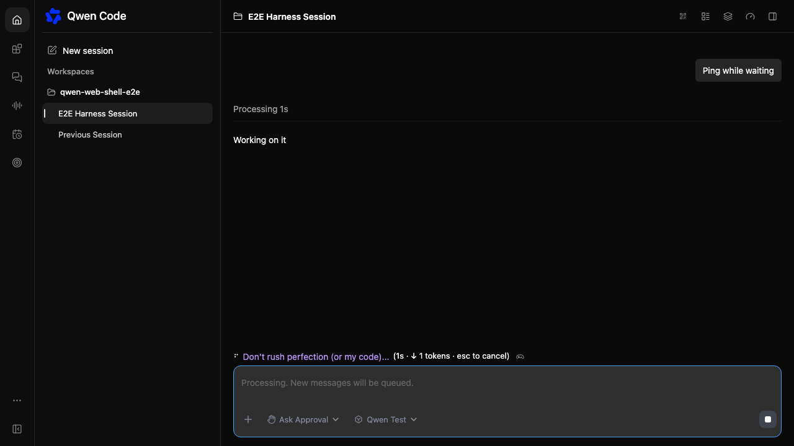
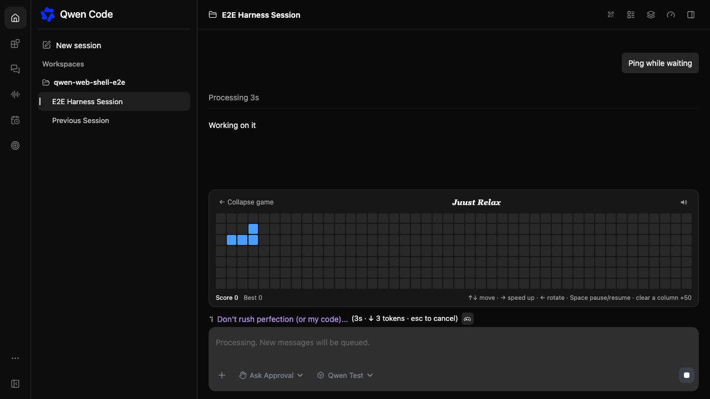
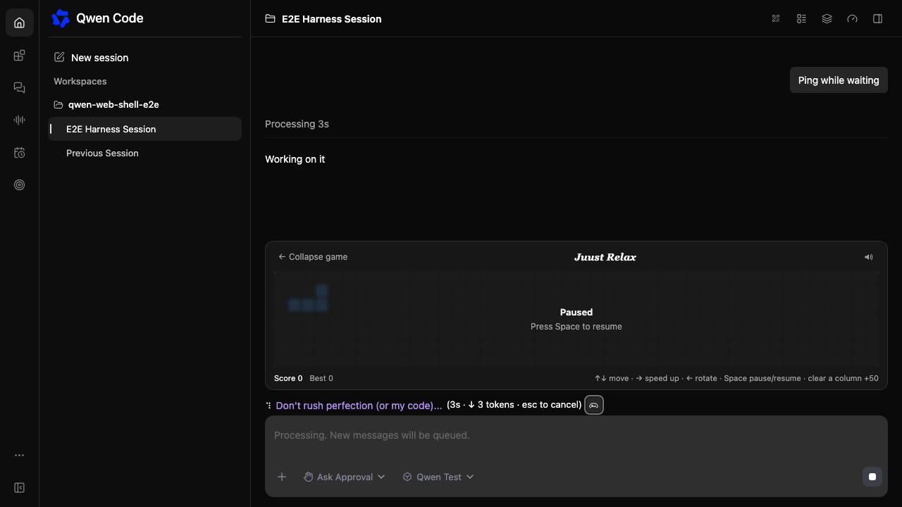
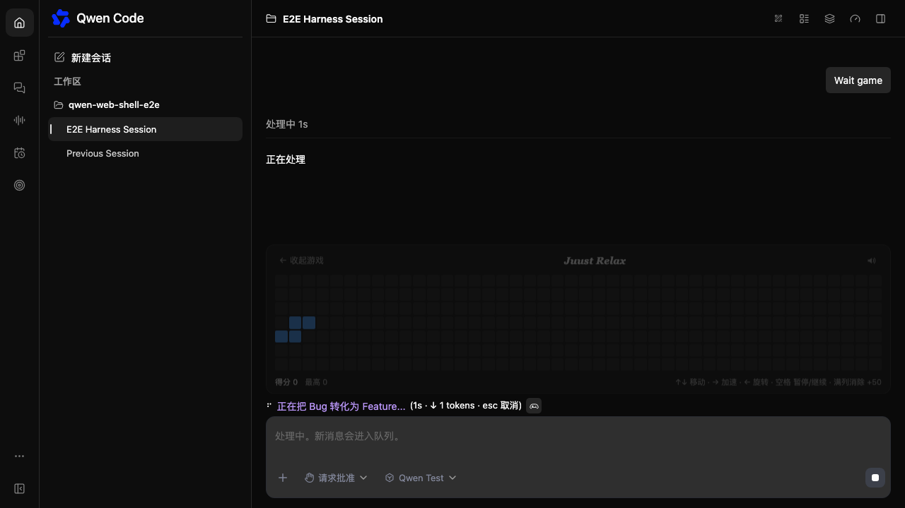

# Web Shell waiting minigame

[English](2026-11-01-web-shell-waiting-minigame.md) | [简体中文](2026-11-01-web-shell-waiting-minigame.zh-CN.md)

Status: implemented; runtime release verification pending.

## Problem

A streaming prompt can take minutes. The composer only shows a spinner,
elapsed time, token count, and a rotating loading phrase. Users have nothing
playful or interactive to do while they wait, and the Web Shell has no waiting
experience beyond passive status text.

## Current state

`StreamingStatus` renders above the main `ChatEditor` whenever
`streamingState !== 'idle'` or the daemon reports an active prompt. The Web
Shell already owns the real streaming state, the composer layout, i18n, theme
tokens, and local storage patterns. Split panes and side-task panes render
their own `ChatPane` composers and keep a compact status line.

## Goals

- Show a compact gamepad button at the end of the main composer's streaming
  status while a prompt is running.
- Open an inline horizontal Tetris board from that button without leaving the
  conversation.
- Keep keyboard input and the composer usable; never hijack typing.
- Keep the feature local to the browser: no backend, transcript, telemetry, or
  model changes.

## Non-goals

- No welcome-page minigame, leaderboard, multiplayer, or cross-device scores.
- No game in split panes, side-task panes, or on coarse-pointer devices.
- No mobile touch controls in this change.

## Proposed solution

A `WaitingMinigameButton` renders at the end of the `StreamingStatus` row
while a prompt is active, and the `WaitingMinigame` card mounts above that row
only when the button opens it:

1. The trigger is a 22px gamepad icon button after the elapsed time, token
   count, and cancel hint. Clicking it — or focusing it and pressing Enter or
   Space — opens the card; the collapse button, Escape, or another click closes
   it.
2. Opening expands a 44×7 board above the status row. The card grows upward by
   increasing the composer footer height; the transcript shrinks instead of
   being covered.
3. The game falls toward increasing columns. `↑`/`↓` move, `→` speeds up,
   `←` rotates, Space pauses, and Escape collapses. A full column clears and
   scores 50; the speed rises with cleared columns.
4. When the prompt ends, the button and card unmount and the game closes. The
   best score and sound preference stay in `localStorage`.
5. Inputs, textareas, contenteditable editors, and textboxes keep their
   keyboard behavior. The game ignores keys targeted at those elements.

The board state lives in framework-free `utils/waitingMinigame.ts` so the
engine can be tested without React, jsdom, or timers.

## Design decisions

- **Inline trigger instead of a banner.** A full-width strip above the composer
  competed with the conversation for vertical space. A single icon button at
  the end of the status line keeps the game secondary and costs no extra row.
- **Flow layout instead of an overlay.** The Web Shell owns the composer and
  transcript split; adding a normal footer child avoids DOM measurement,
  clipping, and z-index coupling with the editor. The trade-off is a transient
  transcript resize when opening the card.
- **Main composer only.** The App composer is the single-session surface.
  Split and side-task panes are separate `ChatPane` instances and deliberately
  do not render the game.
- **Coarse pointer hidden.** `isCoarsePointerDevice()` keeps the game out of
  phones and tablets; a narrow desktop window still gets the compact board.
- **Immutable engine.** Each tick returns a new state object. React state
  updates stay predictable, and the render grid can be derived without
  mutating the board.
- **Best-effort audio.** A Web Audio context is created inside the start
  gesture. Missing or blocked audio never blocks the game.

## Constraints

- No new dependencies.
- No changes to daemon routes, prompts, transcript blocks, or host props.
- Approval and question overlays render above the composer. The game stays
  inside the composer footer below them and does not move those overlays.

## Screenshots

Captured from the Chromium Web Shell harness with the mock daemon
(`client/e2e/waiting-minigame.spec.ts`).

| Waiting trigger                                                   | Expanded board                                                 |
| ----------------------------------------------------------------- | -------------------------------------------------------------- |
|  |  |

| Paused                                                  | Dark theme, Chinese                                                   |
| ------------------------------------------------------- | --------------------------------------------------------------------- |
|  |  |

## Validation plan

- Engine unit tests: spawn, gravity, movement bounds, rotation kicks, locking,
  column clears, score, speed floor, game over, pause, render grid.
- Component tests: closed by default, open board, cell count, pause/resume,
  Escape collapse, reopening resumes a paused board, and trigger
  `aria-expanded`/toggle behavior.
- App regression suite (`client/App.test.tsx`) to prove the composer and
  streaming status still render.
- Manual visual checks on the Web Shell harness at desktop width, light/dark
  theme, and English/Chinese copy. The Chromium E2E scenario lives in
  `packages/web-shell/client/e2e/waiting-minigame.spec.ts`.

## Acceptance criteria

- The trigger appears only while a prompt is active.
- The game opens and collapses without breaking composer input, and the
  trigger disappears with the status row when the turn ends.
- Keyboard controls work outside editors and never steal keys from editors.
- The game closes when streaming ends; localStorage keeps the best score and
  sound preference.
- Split panes, side-task panes, and coarse-pointer devices do not show the
  game.

## Open questions

- Should a later change expose the game on the welcome page or on touch
  devices with on-screen controls?
- Should the host be able to disable the game through customization, or is the
  coarse-pointer and main-composer scope enough?
