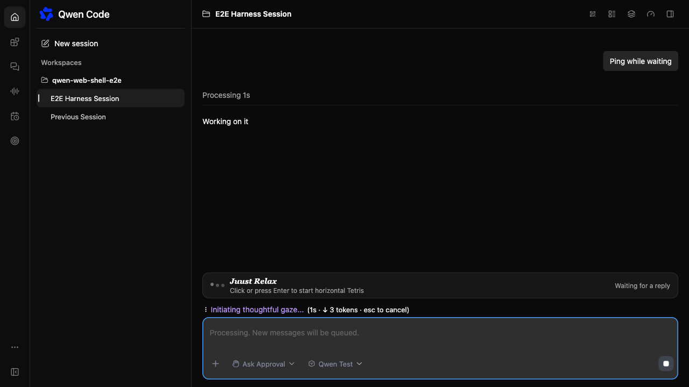
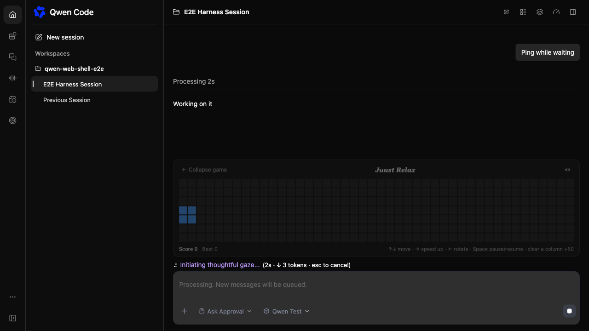
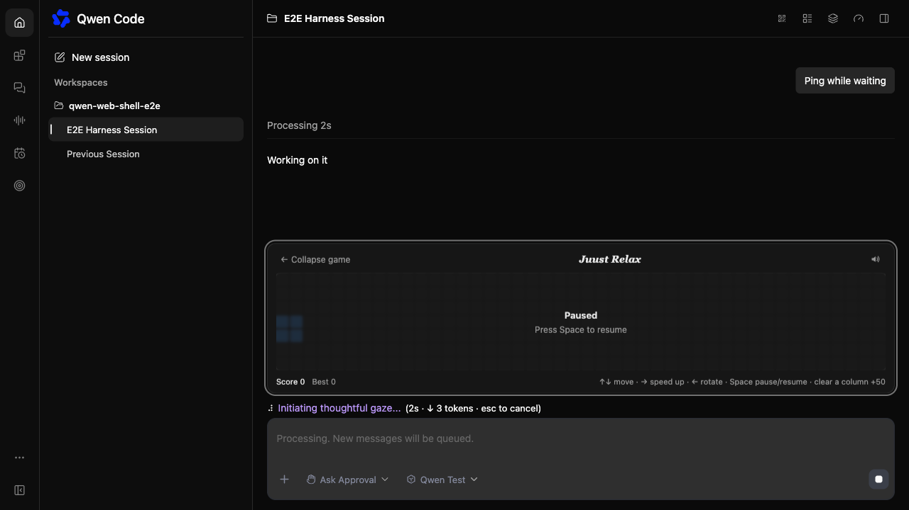
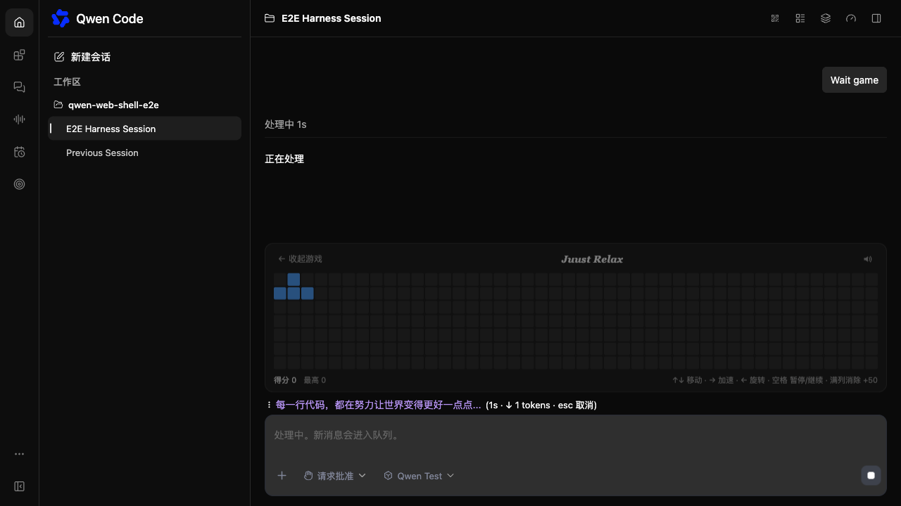

# Web Shell 等待小游戏

[English](2026-11-01-web-shell-waiting-minigame.md) | [简体中文](2026-11-01-web-shell-waiting-minigame.zh-CN.md)

状态：已实现；运行时发布验收待完成。

## 问题

一次流式提问可能持续数分钟。输入框上只显示转圈、耗时、token 数和轮换的加载文案，等待期间没有可交互的内容。Web Shell 目前只有被动的等待状态。

## 现状

`StreamingStatus` 在 `streamingState !== 'idle'` 或 daemon 报告存在活动 prompt 时显示在主 `ChatEditor` 上方。Web Shell 已掌握真实流式态、输入框布局、i18n、主题 token 和本地存储模式。分屏和侧边任务使用各自的 `ChatPane` 输入框，并保留紧凑状态行。

## 目标

- 提问运行期间，在主输入框上方显示一条可收起的小游戏浮条。
- 从浮条展开内联横向俄罗斯方块，不离开当前会话。
- 保持输入框和键盘可用，绝不抢占用户输入。
- 功能只发生在浏览器本地：不写后端、转录、埋点或模型请求。

## 非目标

- 不做欢迎页小游戏、排行榜、多人对战或跨设备分数。
- 分屏 pane、侧边任务 pane 和粗指针设备不展示游戏。
- 本次不做手机触控操作。

## 方案

把 `WaitingMinigame` 挂到主 App 输入框区域，位置紧挨 `StreamingStatus` 上方。组件只在 prompt 活动期间、经过短暂延迟后渲染：

1. 44px 浮条显示游戏标题、开始提示和等待状态。
2. 点击浮条后在同一布局槽展开 44×7 棋盘。卡片通过增加输入框底部区域高度向上生长，对话区缩小，不覆盖对话内容。
3. 方块向列增长方向下落。`↑`/`↓` 移动、`→` 加速、`←` 旋转、空格暂停、Esc 收起。满列消除并加 50 分；消除列数越多，下落越快。
4. 回复结束时组件卸载、游戏关闭。最高分和音效偏好保存在 `localStorage`。
5. 输入框、文本域、contenteditable 编辑器和 textbox 保留原有键盘行为；游戏忽略发往这些元素的按键。

棋盘状态放在与框架无关的 `utils/waitingMinigame.ts`，引擎测试不依赖 React、jsdom 或计时器。

## 设计决策

- **使用流式布局而非覆盖层。** Web Shell 自己管理输入框与对话区的分栏；把游戏作为普通 footer 子元素可以避免 DOM 测量、裁切和编辑器 z-index 耦合。代价是展开卡片时对话区会出现一次短暂尺寸变化。
- **只做主输入框。** App 输入框代表单会话主界面。分屏和侧边任务使用独立 `ChatPane`，本次不渲染游戏。
- **粗指针隐藏。** `isCoarsePointerDevice()` 让手机和平板不展示；窄桌面窗口仍可使用紧凑棋盘。
- **不可变引擎。** 每次 tick 返回新状态，React 更新可预测，渲染网格可由棋盘推导，不需要原地修改。
- **音效尽力而为。** Web Audio 上下文在开始手势内创建；音频缺失或被拦截不能阻塞游戏。

## 约束

- 不新增依赖。
- 不修改 daemon 路由、prompt、转录块或宿主 props。
- 授权或提问浮层位于输入框上方，游戏仍在输入框 footer 内、位于这些浮层下方，不覆盖审批 UI。

## 页面截图

来自 Chromium Web Shell harness 和 mock daemon
（`client/e2e/waiting-minigame.spec.ts`）。

| 等待浮条                                                 | 展开棋盘                                                 |
| -------------------------------------------------------- | -------------------------------------------------------- |
|  |  |

| 暂停                                                  | 深色主题 / 中文                                                  |
| ----------------------------------------------------- | ---------------------------------------------------------------- |
|  |  |

## 验证计划

- 引擎单测：生成、重力、移动边界、旋转踢墙、落定、满列消除、计分、速度下限、游戏结束、暂停、渲染网格。
- 组件测试：延迟出现、浮条文案、打开棋盘、格子数量、暂停/继续、Esc 收起、流式结束关闭。
- App 回归套件（`client/App.test.tsx`）证明输入框和流式状态仍正常渲染。
- 在 Web Shell harness 上人工核对桌面宽度、浅深主题和中英文文案。运行时 E2E 细节见 `.qwen/e2e-tests/` 下的配套计划。

## 验收标准

- 浮条只在 prompt 活动期间并经过延迟后出现。
- 游戏可打开、收起，且不破坏输入框输入。
- 编辑器外键盘控制可用，编辑器内按键不被游戏抢占。
- 流式结束关闭游戏；`localStorage` 保留最高分和音效偏好。
- 分屏、侧边任务和粗指针设备不显示游戏。

## 待确认

- 后续是否在欢迎页或触屏设备上增加入口和屏幕按键？
- 是否需要给宿主提供关闭开关，还是只保留粗指针与主输入框的范围限制？
