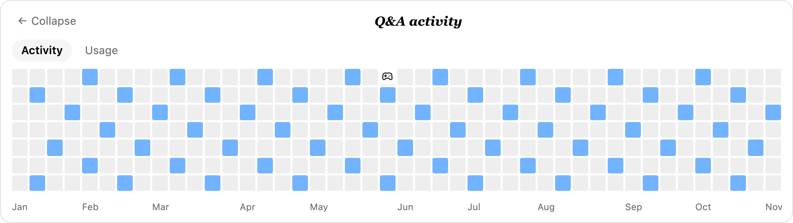

# Web Shell 等待卡片

[English](2026-11-01-web-shell-waiting-minigame.md) | [简体中文](2026-11-01-web-shell-waiting-minigame.zh-CN.md)

状态：已实现；运行时发布验收待完成。

## 问题

一次流式提问可能持续数分钟。输入框上只显示转圈、耗时、token 数和轮换的加载文案，等待期间没有可交互的内容。Web Shell 目前只有被动的等待状态。

## 现状

`StreamingStatus` 在 `streamingState !== 'idle'` 或 daemon 报告存在活动 prompt 时显示在主 `ChatEditor` 上方。Web Shell 已掌握真实流式态、转录消息、Token 用量、输入框布局、i18n、主题 token 和本地存储模式。分屏和侧边任务使用各自的 `ChatPane` 输入框，并保留紧凑状态行。

## 目标

- 提问运行期间，在主输入框的流式状态行末尾显示一个紧凑的热力图按钮。
- 点击后在状态行上方打开等待卡片：
  - 默认显示本任务的按天问答活动日历，支持悬停详情和点击定位；
  - 可在 `热力图` / `消耗` 之间切换，`消耗` 显示本任务 Token，而不是 Credits 余额；
  - 游戏入口是可配置的可选项，默认不显示。
- 活动和 Token 视图无需配置即可使用；只有显式开启配置后才展示游戏入口。
- 保持输入框和键盘可用，绝不抢占用户输入。
- 功能只发生在浏览器本地：不写后端、daemon、转录、埋点或模型请求。

## 非目标

- 不做欢迎页小游戏、排行榜、多人对战或跨设备分数。
- 分屏 pane、侧边任务 pane 和粗指针设备不展示卡片。
- 本次不做手机触控操作。

## 方案

`WaitingMinigameButton` 在 prompt 活动期间渲染于 `StreamingStatus` 状态行末尾。点击后，`WaitingMinigame` 卡片挂载到状态行上方：

1. 卡片默认打开 `热力图`：固定 44 周日历（44 列 × 7 行）。列是周一到周日的自然周，每个方格是一天；日历结束于当前周，今天之后的格子留空。颜色表示当天的问答数量，月份标签在日历下方；悬停方格显示日期和数量，点击有问答的日期会滚动到当天第一条问答并高亮消息。
2. 配置开启游戏入口后，白底深色游戏手柄图标的方块会在 5 秒后出现在随机一个冷门日期上。点击后随机开始横向俄罗斯方块或贪吃蛇，不提供游戏选择或换游戏。未开启配置时游戏手柄图标和所有游戏控件都不显示，卡片只展示活动和 Token。
3. `消耗` 页显示本任务总 Token、输入、输出、缓存以及上下文占用/上限，替代参考设计里的 Credits 视图。
4. 游戏开始前播放 `QWEN CODE` 像素入场。俄罗斯方块会把文字方块飞到右侧，落成随机开局堆；贪吃蛇没有开局堆，文字保持不动后直接进入游戏。两个游戏共用 44×7 棋盘。俄罗斯方块满列 +50；贪吃蛇吃苹果 emoji，每个苹果 +1；两者都支持空格暂停、Esc 关闭。
5. 回复结束时按钮和卡片一起卸载。最高分和音效偏好保存在 `localStorage`。
6. 输入框、文本域、contenteditable 编辑器和 textbox 保留原有键盘行为；卡片忽略发往这些元素的按键。

活动与 Token 摘要放在与框架无关的 `utils/waitingActivity.ts`；两个游戏分别放在 `utils/waitingMinigame.ts` 和 `utils/waitingSnake.ts`，引擎测试不依赖 React、jsdom 或计时器。

## 设计决策

- **使用行内按钮而非横幅。** 输入框上方的整条横幅会和对话内容争夺垂直空间；状态行末尾的单个图标按钮不额外占一行，卡片只在需要时出现。
- **热力图优先。** 展开卡片先展示本任务的按天活动日历，而不是直接开始游戏。它给卡片一个有用的阅读状态，也让游戏手柄图标成为明确的、可选的游戏入口。
- **活动为主，游戏可配置。** 卡片的产品目的是透出任务按时间的问答热度；游戏只是等待时的附加项。把游戏放在配置后面，避免默认向所有用户暴露一个意外的交互面。
- **悬停详情与点击定位。** 每个时间桶展示时间范围和问答条数；包含消息的桶可以点击定位。锚点优先选择第一条用户提问，让对话滚动到问答开始的位置。
- **延迟出现并放在冷门格子。** 游戏手柄图标前 5 秒不出现，让热力图在回合刚开始时保持干净；放在最冷门的日期上可以避免遮挡最活跃的格子。
- **固定日历格。** 每个方格固定代表一个自然日，而不是按任务时长拉伸出的时间桶。时间语义稳定，短任务只会点亮今天的格子，月份轴也和参考日历一致。
- **随机游戏替代游戏选择。** 单击直接随机开始两个游戏之一；去掉选择器和换游戏入口后，等待卡片更紧凑。
- **两个游戏使用不同入场。** 俄罗斯方块的入场方块会变成开局堆，所以方块飞到右侧落定；贪吃蛇没有可继承的开局堆，文字保持静止后直接进入游戏。
- **Token 替代 Credits。** 任务本身已有 Token 和上下文数据；Credits 余额会引入第二套计量口径。
- **使用流式布局而非覆盖层。** Web Shell 自己管理输入框与对话区的分栏；把卡片作为普通 footer 子元素可以避免 DOM 测量、裁切和编辑器 z-index 耦合。代价是展开卡片时对话区会出现一次短暂尺寸变化。
- **固定卡片框架。** 每个视图都保留头部、标签行、主体和底部行，主体保持日历高度。在活动、消耗、入场和游戏之间切换时，卡片不会改变尺寸，输入框也不会移动。
- **只做主输入框。** App 输入框代表单会话主界面。分屏和侧边任务使用独立 `ChatPane`，本次不渲染卡片。
- **粗指针隐藏。** `isCoarsePointerDevice()` 让手机和平板不展示；窄桌面窗口仍可使用紧凑网格。
- **不可变引擎。** 每次 tick 返回新状态，React 更新可预测，渲染网格可由棋盘推导，不需要原地修改。
- **音效尽力而为。** Web Audio 上下文在开始手势内创建；音频缺失或被拦截不能阻塞游戏。

## 约束

- 不新增依赖。
- 不修改 daemon 路由、prompt、转录块或宿主 props。
- 授权或提问浮层位于输入框上方，卡片仍在输入框 footer 内、位于这些浮层下方。

## 配置

活动和消耗视图始终可用。游戏入口默认关闭，可通过以下任一方式开启：

- Web Shell URL 增加 `?waitingGames=1`；`?waitingGames=0` 会强制关闭，即使本地存储或宿主开关已开启。
- `localStorage['qwen-code-web-shell-waiting-games'] = '1'`。
- 宿主注入 `window.__QWEN_CODE_WAITING_GAMES__ = true`。

本地 harness 使用 `Games: off/on` 开关模拟同一配置。本文档中的游戏截图均在开启游戏入口后截取。

## 页面截图

活动、消耗和深色主题截图使用本地 harness 示例数据，并关闭游戏入口；入场和游戏截图来自 Chromium E2E（`client/e2e/waiting-minigame.spec.ts`），且已开启游戏入口。

| 活动热力图（悬停详情）                                               | QWEN CODE 入场                                       |
| -------------------------------------------------------------------- | ---------------------------------------------------- |
|  |  |

| 方块飞向右侧堆                                        | 落定后的随机开局堆                                    |
| ----------------------------------------------------- | ----------------------------------------------------- |
|  |  |

| 俄罗斯方块                                                 | 吃苹果的贪吃蛇                                         |
| ---------------------------------------------------------- | ------------------------------------------------------ |
|  |  |

| Token 消耗（示例）                                          | 深色主题 / 中文热力图                                              |
| ----------------------------------------------------------- | ------------------------------------------------------------------ |
|  |  |

配置开启游戏入口后，冷门日期上会显示游戏手柄图标：

## 验证计划

- 活动/Token 单测：固定日历、按天归组、未来日期占位、消息锚点、Token 汇总与兜底。
- 俄罗斯方块单测：生成、重力、移动边界、旋转踢墙、落定、满列消除、计分、速度下限、游戏结束、暂停、渲染网格、预置开局堆。
- 贪吃蛇单测：生成、移动、转向队列与反向拦截、食物与计分、撞墙和撞身体、暂停/重开、渲染网格、更慢的初始速度。
- 组件测试：默认关闭、优先显示热力图、日期悬停详情、日期点击、游戏入口默认隐藏、配置开启后 5 秒出现、入场时序、俄罗斯方块飞行与落定、贪吃蛇静止入场、暂停/继续、Esc、切后台暂停、按钮状态。
- 配置测试：默认关闭、本地存储开关、URL 开关与覆盖、宿主注入全局变量。
- App 回归套件（`client/App.test.tsx`）证明输入框和流式状态仍正常渲染。
- Chromium E2E：按钮 → 热力图 → 悬停详情 → 默认无游戏入口 → 配置后游戏入口 → QWEN CODE 入场 → 俄罗斯方块飞行/落定 → 暂停；贪吃蛇不移动的入场；深色主题和中文文案。
- 本地 harness：`client/e2e/waiting-minigame-harness.html`，带合成活动/Token 数据、可选入口延迟和主题/语言切换。

## 验收标准

- 按钮只在 prompt 活动期间出现；回复结束时卡片随之关闭。
- 卡片默认打开固定 44 周日历，悬停显示当天详情，点击后定位到对应问答。
- 游戏手柄图标在配置开启后 5 秒出现在冷门日期上，点击随机开始游戏；两个游戏都在同一 44×7 棋盘运行。
- 游戏入口和游戏控件默认隐藏，只有配置开启后才出现。
- 俄罗斯方块入场方块会落成右侧开局堆；贪吃蛇入场不移动方块。
- 卡片不破坏输入框输入，编辑器内按键不被游戏抢占。
- 分屏、侧边任务和粗指针设备不显示卡片。
- `localStorage` 保留最高分和音效偏好。

## 待确认

- 后续是否在欢迎页或触屏设备上增加入口和屏幕按键？
- 是否需要给宿主提供关闭开关？
