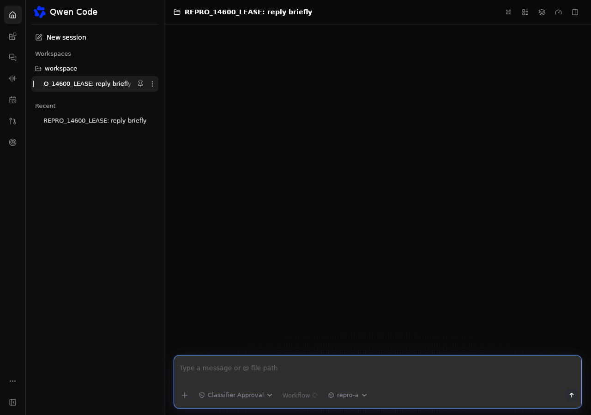
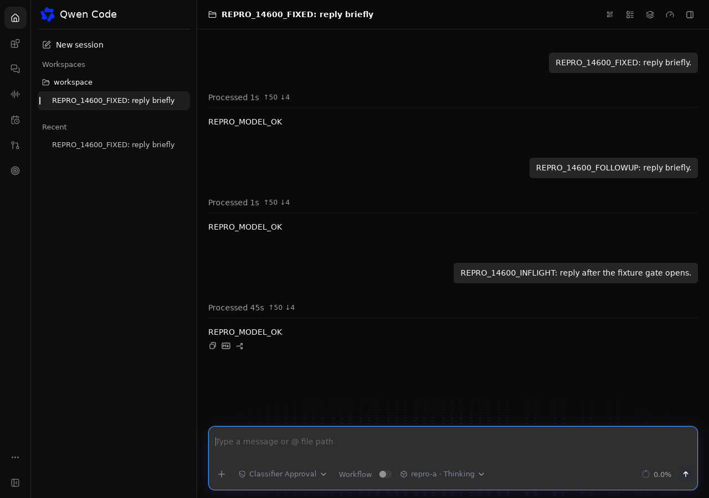

# Linux Desktop runtime recovery

[English](2026-11-04-desktop-runtime-recovery.md) | [简体中文](2026-11-04-desktop-runtime-recovery.zh-CN.md)

## Status

Proposed Linux-only repair for #14600, validated with synthetic credentials on
an isolated AWS Ubuntu instance. Credential persistence needs maintainer
agreement before merge.

## Problem and scope

A hard Desktop launcher crash can leave its daemon and live conversation writer
running. Relaunch currently starts a competing daemon. With
`experimental.sessionWriterLease=true`, loading the conversation there returns
`session_writer_conflict`. Reconnecting to the original daemon preserves its
writer, in-flight work, and conversation state.

The first repair covers Linux. Windows and macOS keep their existing behavior.
It does not reclaim writer locks, terminate the survivor to simulate recovery,
or broaden CORS. Old launchers that never saved a recovery credential cannot be
recovered automatically by this forward change.

## Design

Desktop writes a versioned recovery record under its application-data directory,
separate from `desktop-state.json` and project files. The directory is private
(`0700`) and records are private (`0600`). A record contains the canonical
workspace, storage namespace, loopback URL, bearer, PID, PID namespace, boot ID
and process start ticks. Publication happens before the native window receives
a ready URL.

The storage namespace captures only the requested `QWEN_HOME`,
`QWEN_RUNTIME_DIR` and `HOME` values, the resolved home-directory fallback,
the Desktop version and, when `QWEN_DESKTOP_RUNTIME_DIR` is supplied, the
canonical runtime entry. Combined with the canonical workspace, strict equality
preserves relative-path and home-fallback isolation without copying general
environment variables or secrets. A changed namespace is ignored before
process inspection or bearer use and its live record is retained. Equivalent
but differently spelled root overrides may therefore start a separate backend.
Bundled runtime paths are not stored because AppImage mount paths change on
relaunch. Prototype records without namespace identity fail closed.

Startup checks matching records before spawning. It opens a Linux pidfd and
checks process identity before sending any bearer to the loopback health
endpoint. Dead or reused processes have stale records; an inaccessible,
ambiguous, malformed or live-but-unreachable record fails closed. A recovered
window navigates directly to the existing daemon's authenticated URL, keeping
the daemon's own Origin.

The runtime distinguishes a spawned child from an adopted process. Cancelling
an unfinished adoption detaches its monitor without stopping the survivor.
Stopping an accepted adopted runtime sends SIGTERM through its pidfd and waits
up to five seconds for graceful daemon cleanup. It retains the recovery record
if the process does not stop; it never signals a recycled numeric PID. A fresh
start reconsiders the same live backend rather than manufacturing another,
or removes the stale record if the backend has since exited.

## Security and compatibility

Persisting a Desktop-owned bearer is a proposed policy change. The ordinary
CLI's token persistence remains opt-in and unchanged. Setting
`QWEN_DESKTOP_DISABLE_SETTINGS_PERSISTENCE=1` also disables recovery-record reads
and writes; automatic recovery is unavailable in that explicit stateless mode.
Records never appear in
logs, normal Desktop settings, URL queries or issue evidence. Symlinks, wrong
owners and group/world-accessible records are rejected. URLs must be plain
HTTP on `127.0.0.1`, with an explicit port and no credentials, query or fragment.

Linux pidfd support is required for recovery and record publication. The direct
`libc` dependency already exists transitively in the lockfile. A filesystem or
kernel that cannot support the safety checks produces an explicit startup
error rather than an unsafe fallback. No Core or CLI file format is changed.

The record is published after the daemon becomes healthy and before the UI can
create a conversation. A launcher killed before readiness may leave a daemon
without a recovery record; it cannot yet have accepted a prompt from that
window. Recovery of that pre-readiness interval is outside this first repair.

## Validation and acceptance

Use the actual Tauri binary under Xvfb with an isolated workspace and a local
mock provider. After a completed prompt, kill only the launcher and verify the
same daemon and writer remain. Relaunch must reuse the same daemon PID, URL and
conversation, without a second backend or a 409. Verify that in-flight work
completes and remains visible. Run a graceful-exit control.

Focused tests cover private permissions, wrong workspace, changed storage or
runtime namespaces, missing namespace identity, stale PID, changed process
identity, invalid URL, malformed and symlinked records, repeated recovery,
pidfd signaling and cancelled-start detach behavior. Build and test the Rust
application on Linux before claiming verification.

The AWS Ubuntu 24.04.4 x86_64 run used the actual native window under Xvfb with
the published Desktop 0.26.5 runtime and this repaired launcher. Two launcher
crash/relaunch cycles retained the same daemon, port and writer, including a
request held in flight. History, follow-up input and the held response were
verified without duplicate provider work. The release build and 56 Rust tests
passed. These are controlled launcher crashes, not a Fedora/KDE crash-rate study.

One adopted shutdown exceeded the five-second observation window and retained
its private record while the daemon completed graceful exit. A separate native
relaunch, without manual record deletion, pruned it, restored the unchanged
transcript and accepted a new prompt. Closing that fresh launcher left no
profile processes or recovery records. Immediate record removal is therefore
not an acceptance requirement when graceful drain exceeds the observation
window. A packaged fixed AppImage and independent-namespace native control
were not exercised; namespace checks have focused unit coverage.

The native screenshots below use synthetic conversations. Before: selecting
the original conversation after published-launcher relaunch left the pane
blank; the corresponding authenticated load returned 409 (the persistent
banner was not captured). After: the repaired launcher displays the original
history, a follow-up, and the response held across its second crash.

| Before                                                                                            | After                                                                                              |
| ------------------------------------------------------------------------------------------------- | -------------------------------------------------------------------------------------------------- |
|  |  |

## Open questions

Maintainers must review the Desktop-only credential-at-rest policy and whether
later work should extend recovery to other platforms or move credential storage
into an OS-backed secret store.
