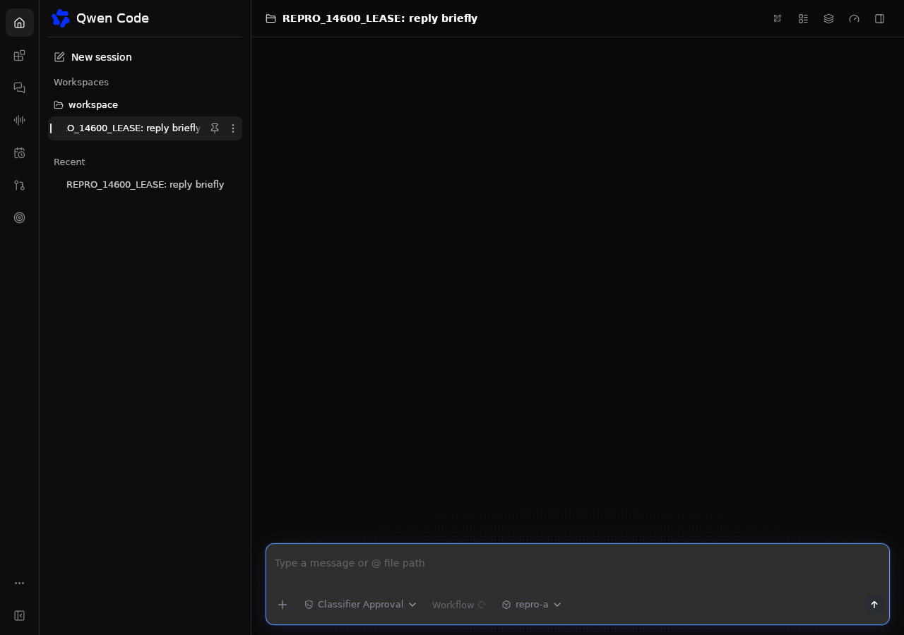
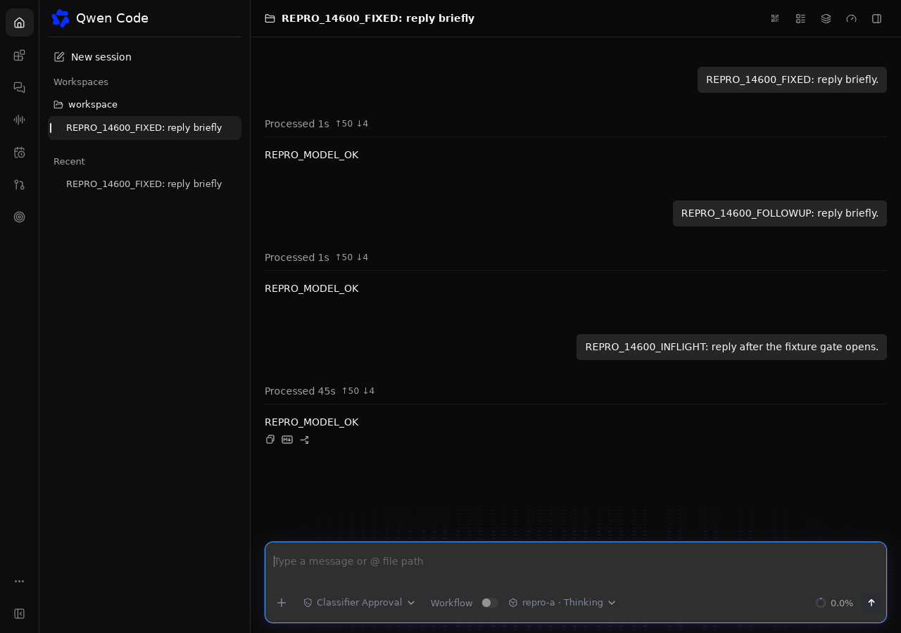

# Linux Desktop 运行时恢复

[English](2026-11-04-desktop-runtime-recovery.md) | [简体中文](2026-11-04-desktop-runtime-recovery.zh-CN.md)

## 状态

针对 #14600 的 Linux 专用修复提案，已在隔离的 AWS Ubuntu 实例上使用合成凭据验证。
凭据持久化策略需要维护者在合并前认可。

## 问题与范围

Desktop 启动器硬崩溃后，其 daemon 和存活的会话 writer 可能继续运行。目前重新启动
会创建竞争 daemon。开启 `experimental.sessionWriterLease=true` 时，从新 daemon
加载会话返回 `session_writer_conflict`。重新连接原 daemon 能保留其 writer、进行中的
工作和会话状态。

首个修复仅覆盖 Linux。Windows 和 macOS 保持现有行为。修复不抢占 writer 锁、不通过
终止幸存后端模拟恢复，也不扩大 CORS。没有保存恢复凭据的旧版启动器所遗留的后端，
不能由这个前向改动自动恢复。

## 设计

Desktop 在应用数据目录内写入带版本的恢复记录，与 `desktop-state.json` 和项目文件
分开。目录权限为 `0700`，记录权限为 `0600`。记录包含规范化工作区、存储命名空间、
loopback URL、bearer、PID、PID namespace、boot ID 和进程启动 ticks。在原生窗口收到
就绪 URL 之前完成记录发布。

存储命名空间仅保存请求的 `QWEN_HOME`、`QWEN_RUNTIME_DIR`、`HOME` 值、解析后的
home 目录回退值、Desktop 版本，以及显式指定 `QWEN_DESKTOP_RUNTIME_DIR` 时的规范化
运行时入口路径。结合规范化工作区，以严格相等检查保持相对路径及 home 回退的隔离，
不复制一般环境变量或秘密。命名空间不一致的记录在检查进程或使用 bearer 之前被忽略，
其存活记录保留。等价但写法不同的根目录覆盖值因此可能创建独立后端。
不保存打包运行时路径，因为 AppImage 的挂载路径会在重新启动时改变。
缺少命名空间身份的原型记录明确拒绝。

启动时先检查匹配记录，再创建进程。发送任何 bearer 到 loopback 健康检查端点之前，
先打开 Linux pidfd 并验证进程身份。已退出或 PID 被复用的记录属于过期记录；无法检查、
存在歧义、格式无效或存活但无法连接的记录均明确拒绝。恢复窗口直接导航到原 daemon
的认证 URL，保持该 daemon 自身的 Origin。

运行时区分新建子进程与接管进程。取消尚未完成的接管时，仅取消监测，不停止幸存后端。
停止已接受的接管运行时时，通过 pidfd 发送 SIGTERM，最多等待五秒让 daemon 优雅清理。
若进程没有退出，则保留恢复记录；绝不向复用后的数字 PID 发送信号。后续启动会
重新检查同一个存活后端，不会再创建竞争后端；若后端已经退出，则删除过期记录。

## 安全与兼容性

持久化 Desktop 所有的 bearer 属于待审查的策略变化。普通 CLI 的 token 持久化仍为
显式启用，行为不变。设置 `QWEN_DESKTOP_DISABLE_SETTINGS_PERSISTENCE=1` 也会禁用
恢复记录的读取和写入；这种显式无状态模式不提供自动恢复。记录不会进入日志、普通
Desktop 设置、URL query 或 issue 证据。
拒绝符号链接、错误 owner、允许组或其他用户访问的记录。URL 必须是 `127.0.0.1` 上
带显式端口的普通 HTTP，不能包含用户凭据、query 或 fragment。

恢复与发布记录需要 Linux pidfd 支持。新增的直接 `libc` 依赖已作为传递依赖存在于
锁文件中。文件系统或内核无法完成安全检查时，明确报告启动错误，不使用不安全回退。
不修改 Core 或 CLI 的文件格式。

记录在 daemon 健康检查通过之后、界面能够创建会话之前发布。启动器在就绪之前被杀死，
可能遗留没有恢复记录的 daemon，但该窗口此时尚不能提交 prompt。就绪前时间窗口的
恢复不属于首个修复的范围。

## 验证与验收

在 Xvfb 下运行实际 Tauri 二进制，使用隔离工作区和本地模拟 provider。完成一次 prompt
后，仅杀死启动器，并确认原 daemon 与 writer 仍存活。重新启动必须复用相同的 daemon
PID、URL 和会话，不出现第二个后端或 409。验证进行中的工作能够完成并显示结果。
另行执行优雅退出对照。

定向测试覆盖私有权限、错误工作区、存储或运行时命名空间变化、缺少命名空间身份、
过期 PID、进程身份变化、无效 URL、格式错误和符号链接记录、重复恢复、pidfd 信号发送，
以及取消启动时仅 detach 的行为。在宣称验证完成之前，
在 Linux 上构建并测试 Rust 应用。

AWS Ubuntu 24.04.4 x86_64 验证在 Xvfb 下操作实际原生窗口，使用已发布的 Desktop
0.26.5 运行时和修复后的启动器。两次启动器崩溃与重启均保留相同 daemon、端口和 writer，
其中一次发生在请求被保持于进行中状态时。历史、后续输入和进行中的回复均验证通过，
没有重复 provider 工作。release 构建和 56 项 Rust 测试通过。这是受控的启动器崩溃测试，
并非 Fedora/KDE 崩溃率研究。

一次接管后关闭超过五秒观察窗口，daemon 继续优雅退出，私有恢复记录保留。另一次原生
启动没有手动删除记录，自动清理该死记录、恢复未改变的 transcript 并接受新 prompt。
关闭这个新建启动器后，测试 profile 的进程和恢复记录均为空。因此，当优雅退出超过观察
窗口时，立即删除恢复记录不属于验收要求。未执行打包后的修复版 AppImage 或独立命名空间
原生对照；命名空间检查已有定向单元测试覆盖。

下列原生截图使用合成会话。修复前：已发布启动器重启后，选择原会话仍显示空白内容区；
对应的认证加载请求返回 409，未捕获持续 banner。修复后：启动器显示原历史、后续输入，
以及跨越第二次崩溃后完成的回复。

| 修复前                                                                        | 修复后                                                                         |
| ----------------------------------------------------------------------------- | ------------------------------------------------------------------------------ |
|  |  |

## 待确认事项

维护者需要审查 Desktop 专用的凭据落盘策略，以及后续是否扩展其他平台，或将凭据迁移
到操作系统提供的秘密存储设施。
