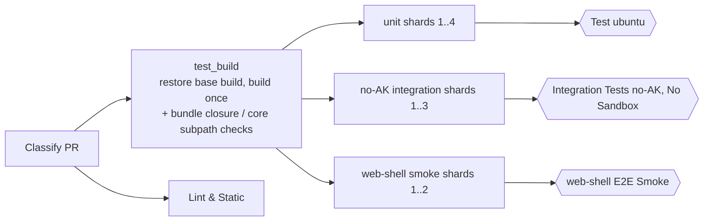

# Shorten the pull-request CI critical path

[English](2026-11-06-ci-pr-critical-path.md) | [简体中文](2026-11-06-ci-pr-critical-path.zh-CN.md)

Status: implemented in this change; measured results are to be recorded after
merge.

## Problem

A pull request waited about 28 minutes (median, ten successful runs) for the
four required checks of `Qwen Code CI`, and each run consumed 180–215 runner
minutes. Jobs queued for about 0.1 minutes, so capacity was not the limit. The
time went to work done more than once and to one serial lane:

| Lane                                     | Median         | Where the time went                                                                                                      |
| ---------------------------------------- | -------------- | ------------------------------------------------------------------------------------------------------------------------ |
| `Integration Tests (no-AK, No Sandbox)`  | 28.3 min       | `pnpm install` ran `prepare`, a full build and bundle (602 s); the ~50 files then ran one at a time on the pool (1035 s) |
| `web-shell E2E Smoke` (each of 4 shards) | 19.4 min       | each shard rebuilt every workspace (588 s)                                                                               |
| `Lint & Static`                          | 14.5 min       | the serve fast-path closure check built and bundled the CLI again (553 s)                                                |
| `Build unit-test tree`                   | 7.2 min (2–12) | depends on the build cache                                                                                               |
| unit shards                              | 7.6 min each   | shard 1 took 580 s, shard 4 173 s                                                                                        |

The same tree was built seven times per run.

The build cache rarely helped. Job logs showed
`Cached build restored; 29 of 29 workspaces changed` on most PRs, for three
reasons:

1. The `x64` / `ecs-qwen` pool contains ARM64 hosts (the `hz` group reports
   `runner.arch == ARM64`), so the arch-keyed cache split into two halves that
   each restored the other's misses.
2. `restore-keys` is a prefix match that returns the newest entry, not the
   base commit's, so the restored build was usually several `main` commits
   away. Any root-file or `scripts/` change between them invalidates every
   workspace.
3. The web-shell lane saved its ARM64 entry only when its restore found
   nothing, which after the first save never happened again, so it restored
   the same stale build on every run.

## Goals

- Halve the required path without changing any required check name (the
  branch ruleset stays as it is).
- Build once per run and test that tree everywhere.
- Skip the TypeScript lanes for changes that cannot affect them.

Out of scope: duration-based unit sharding (it needs timing data that only
`main` runs produce after this lands). Unit shard 1 is slow because Vitest's
path-hash split gives it the heaviest CLI files (576 s of CLI suite against
147 s on shard 4 for the same 181 files), not because it also runs the
standalone regression: that runs in the parallel side lane, off the shard's
critical path. Also out of scope: narrowing the build cache's global
inputs, and a single required aggregate check. Each is a follow-up.

## Design

### Build cache restores the base commit's build

`scripts/ci-build-cache.mjs key --at <commit>` hashes a commit's tree from
`git ls-tree`, which yields the same blob ids `git ls-files -s` gave that
commit's own run. `test_build` fetches the pull request's base commit
(`--depth=1 --filter=blob:none`; the key reads blob ids, never contents),
computes its key, and restores in this order: the head's exact key, the base's
exact key, then the newest entry. A failed fetch only falls back to the
prefix.

The key drops `runner.arch` and moves to `qwen-build-v2-<os>-<hash>`. Every
built path is JavaScript except `dist/opentui-assets/@opentui/core-<platform>-<arch>`,
which `copy_bundle_assets.js` copies from the installing host's
`node_modules`. `build` already rebundles after a restore; consumers run the
new `ci-build-cache.mjs host-assets` after unpacking to recopy it for their
host.

### One tree for every lane

- `integration_no_ak` needs `test_build`, installs with
  `QWEN_SKIP_PREPARE=1`, downloads and unpacks `unit-test-tree` the same way
  the unit shards do, and runs as three shards
  (`--shard=N/3`; `typecheck:integration` on shard 1). A new
  `integration_no_ak_result` job carries the required name
  `Integration Tests (no-AK, No Sandbox)` and passes only when the build and
  every shard pass.
- `web_shell_e2e_smoke` drops its hash/restore/build/pack/save steps, needs
  `test_build`, and unpacks the same tree.
- `test_build` builds with `DEV=true`, whose only effect is writing
  `dist/esbuild.json`, and then runs `Check serve fast-path bundle closure`
  and `Check core subpath exports resolve` against the built tree (under two
  seconds together), plus the settings-schema freshness check, whose
  generator imports core's `dist`. All three leave `Lint & Static`, which
  only had `dist` because the bundle check built it, and stay required
  through `Test (ubuntu-latest, Node 22.x)`.

### Smaller changes

- `java_only` profile: a change confined to `packages/managed-agent-server/`
  and `packages/sdk-java/`, except `managed-agent-server/contracts/`,
  `managed-agent-server/verification/src/test/resources/` and the Markdown in
  `TEST_READ_MARKDOWN`, skips the build, unit, integration and browser lanes.
  `Lint & Static` runs its whole payload plus the `scripts/tests` suites that
  name the Java trees (seventeen today, selected with `git grep` so new ones
  join automatically). The rest of `scripts/tests` reads the TypeScript
  build, which a `java_only` run never makes. The classifier
  runs from the base commit, so the profile takes effect for pull requests
  opened after this merges.
- Drafts skip the no-AK integration shards and the browser smoke. The
  workflow now also triggers on `ready_for_review`, which starts the run that
  gates the merge. A skipped required check does not block a draft, which
  cannot merge anyway.

## Decisions

| Decision                                                      | Rationale                                                                                                                              |
| ------------------------------------------------------------- | -------------------------------------------------------------------------------------------------------------------------------------- |
| Keep the four required check names                            | No ruleset change; the aggregate-job pattern already exists in `test_ubuntu`                                                           |
| Run the bundle checks in `test_build`, not in a new job       | A new job would duplicate the ~150-line pre-checkout prelude, which cannot be a local composite action because it runs before checkout |
| Drop the arch from the cache key instead of relabelling hosts | The mixed pool is intentional; the one native output is cheap to recopy                                                                |
| Restore by base commit, not merge-base                        | `pull_request.base.sha` is in the event payload and its `main` push saved exactly that key; merge-base needs history or an API call    |
| Three integration shards                                      | ~17 minutes of serial files become about 6 per shard; the unit lane was since re-sharded 8→4, so it no longer matches this             |

## Risks

- **Integration and the browser smoke now wait for `test_build`.** With the
  cache restoring the base build, `test_build` should take about 3–4
  minutes, less than the ~10 minutes each lane spent building.
- **The first runs after merge start cold**, because the key format changed.
  They stay cold until `main` pushes save `v2` entries.
- **Cross-arch trees** were already used before this change (ARM64-built
  trees fed x64 shards); `host-assets` now makes the one native difference
  explicit.

## Validation

- `scripts/tests/ci-build-cache.test.js`: `key --at` reproduces the
  worktree key of that commit, rejects a missing commit, and `host-assets`
  leaves an unbundled tree alone.
- `.github/scripts/ci/classify-profile.test.mjs`: `java_only` and its
  carve-outs.
- Workflow meta-tests (`ci-platform-lanes`, `no-ak-integration-ci`,
  `hosted-process-ci`, `package-scripts`) pin the new handoffs, the aggregate
  job, the moved checks and the draft and `java_only` gates.
- Locally on a full `DEV=true` build: the two bundle checks pass in 0.4 s and
  1.7 s, and the Chrome extension artifact scan passes with
  `dist/esbuild.json` present.
- On this pull request's own CI run: every required check passes; the
  integration, web-shell and unit lanes unpack the shared tree; `test_build`
  logs the base key it restored.

## Acceptance criteria

- The four required check names report on every non-draft pull request.
- The no-AK integration gate and the web-shell smoke no longer run a build.
- `Lint & Static` no longer builds or bundles.
- After `main` has saved `v2` entries, the required-path median drops below 15
  minutes over 20 runs. Superseded by the later shard reduction (unit 8→4,
  smoke 4→2) for lane reliability: the two-shard smoke lane is now the longest
  pole at ~25–30 minutes, so the critical-path target yields to reliability.
