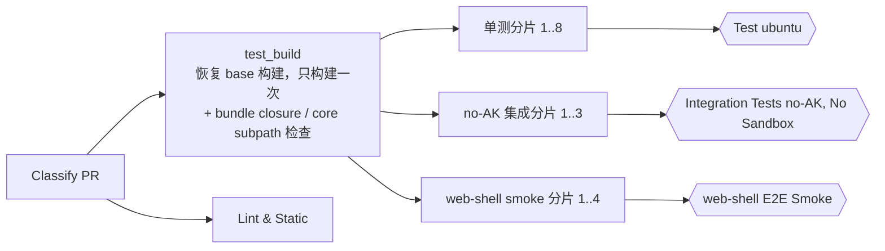

# 缩短 Pull Request CI 的关键路径

[English](2026-11-06-ci-pr-critical-path.md) | [简体中文](2026-11-06-ci-pr-critical-path.zh-CN.md)

状态：已在本次改动中实现；合入后补充实测结果。

## 问题

一个 pull request 等 `Qwen Code CI` 的 4 个 required check 跑完，中位数约 28 分钟（取 10 次成功 run），每次 run 消耗 180–215 runner 分钟。job 的排队时间约 0.1 分钟，说明瓶颈不在机器数量。时间花在两类地方：同样的工作被做了多次，以及一条串行的 lane：

| Lane                                    | 中位数          | 时间花在哪                                                                                                   |
| --------------------------------------- | --------------- | ------------------------------------------------------------------------------------------------------------ |
| `Integration Tests (no-AK, No Sandbox)` | 28.3 min        | `pnpm install` 触发 `prepare`，完整构建并打包一次（602 s）；约 50 个测试文件在 pool 上逐个串行执行（1035 s） |
| `web-shell E2E Smoke`（4 个分片，每个） | 19.4 min        | 每个分片都把所有 workspace 重建一遍（588 s）                                                                 |
| `Lint & Static`                         | 14.5 min        | serve fast-path closure 检查又构建并打包了一次 CLI（553 s）                                                  |
| `Build unit-test tree`                  | 7.2 min（2–12） | 取决于构建缓存是否命中                                                                                       |
| 单测分片                                | 每个 7.6 min    | shard 1 要 580 s，shard 4 只要 173 s                                                                         |

同一棵代码树，每次 run 要构建 7 次。

构建缓存很少起作用。大部分 PR 的 job 日志里都是 `Cached build restored; 29 of 29 workspaces changed`。原因有三：

1. `x64` / `ecs-qwen` pool 里有 ARM64 主机（`hz` 组报告 `runner.arch == ARM64`）。缓存 key 里带了架构，于是缓存被分成两半，每一半都在恢复另一半没存到的东西。
2. `restore-keys` 是前缀匹配，拿到的是最新的一条，不是 base 提交的那一条，所以恢复出来的构建通常和本 PR 隔着好几个 `main` 提交。这期间只要根目录文件或 `scripts/` 有任何改动，所有 workspace 都会失效。
3. web-shell lane 只在恢复不到任何缓存时才保存 ARM64 条目。第一次保存之后，这个条件再也不会成立，于是它每次 run 都恢复同一份过期构建。

## 目标

- required 路径缩短一半，且不改任何 required check 名称（branch ruleset 保持不变）。
- 每次 run 只构建一次，所有 lane 都测这同一棵树。
- 不可能影响 TypeScript 的改动，跳过 TypeScript lane。

不在本次范围内的：按耗时分配单测分片（需要耗时数据，而这份数据要等本改动合入后由 `main` 的 run 产生）。单测 shard 1 慢，是因为 Vitest 按路径哈希切分，把最重的 CLI 测试文件分给了它（同样 181 个 CLI 文件，shard 1 跑了 576 s，shard 4 只要 147 s）；跟它额外跑 standalone 回归无关，那部分在并行的 side lane 里，不在这个分片的关键路径上。同样不在范围内的还有：收窄构建缓存的全局输入、单一的 required 汇总 check。三项都留作后续。

## 设计

### 构建缓存恢复 base 提交的构建

新增的 `scripts/ci-build-cache.mjs key --at <commit>` 通过 `git ls-tree` 计算某个提交的树哈希。`git ls-tree` 给出的 blob id 和该提交自己那次 run 里 `git ls-files -s` 给出的一致，所以算出来的 key 相同。

`test_build` 会拉取 PR 的 base 提交（`--depth=1 --filter=blob:none`；计算 key 只读 blob id，不读文件内容），算出它的 key，然后按以下顺序恢复：

1. head 的精确 key
2. base 的精确 key
3. 最新的一条缓存

如果拉取 base 失败，只是退回到前缀恢复。

缓存 key 去掉了 `runner.arch`，格式改为 `qwen-build-v2-<os>-<hash>`。构建产物全是 JavaScript，只有 `dist/opentui-assets/@opentui/core-<platform>-<arch>` 例外，它是 `copy_bundle_assets.js` 从安装所在主机的 `node_modules` 里拷来的。`build` 在恢复缓存后本来就会重新打包。消费方在解包后执行新增的 `ci-build-cache.mjs host-assets`，按自己的主机重新拷一份。

### 所有 lane 共用一棵树

- **集成测试**：`integration_no_ak` 依赖 `test_build`，用 `QWEN_SKIP_PREPARE=1` 安装依赖，然后像单测分片一样下载并解包 `unit-test-tree`。测试分 3 片跑（`--shard=N/3`），`typecheck:integration` 只在 shard 1 执行。新增的 `integration_no_ak_result` job 沿用 required 名称 `Integration Tests (no-AK, No Sandbox)`，只有构建和每个分片都通过时才通过。
- **web-shell**：`web_shell_e2e_smoke` 去掉了 hash / restore / build / pack / save 这几步，改为依赖 `test_build` 并解包同一棵树。
- **test_build**：构建时设 `DEV=true`，它唯一的作用是写出 `dist/esbuild.json`。构建后直接在产物上运行 `Check serve fast-path bundle closure` 和 `Check core subpath exports resolve`，两项加起来不到 2 秒；settings schema 是否最新的检查也一起移过来，因为它的生成脚本要 import core 的 `dist`。这三项都从 `Lint & Static` 移出（`Lint & Static` 之所以有 `dist`，只是因为 bundle 检查顺带构建了一次），通过 `Test (ubuntu-latest, Node 22.x)` 保持 required。

### 较小的改动

- **`java_only` 档位**：
  - 适用范围：只改了 `packages/managed-agent-server/` 和 `packages/sdk-java/` 的改动。例外是 `managed-agent-server/contracts/`、`managed-agent-server/verification/src/test/resources/`，以及 `TEST_READ_MARKDOWN` 里列出的 Markdown，这些仍按 full 处理。
  - 跳过：构建、单测、集成测试和浏览器 lane。
  - `Lint & Static` 照常跑全部检查，另外执行 `scripts/tests` 里引用了 Java 目录的测试套件（目前 17 个）。这些套件用 `git grep` 选出，新增的会自动纳入。`scripts/tests` 的其余套件依赖 TypeScript 构建产物，而 `java_only` 的 run 不会构建。
  - 分类器从 base 提交运行，所以这个档位要等本改动合入后，对新开的 pull request 才生效。
- **草稿 PR**：跳过 no-AK 集成分片和浏览器 smoke。workflow 新增 `ready_for_review` 触发，转为 ready 时会启动决定能否合入的那次 run。被跳过的 required check 不会挡住草稿，反正草稿本来也不能合入。

## 决策

| 决策                                      | 理由                                                                                                                               |
| ----------------------------------------- | ---------------------------------------------------------------------------------------------------------------------------------- |
| 保留 4 个 required check 名称             | 不用改 ruleset；汇总 job 的写法在 `test_ubuntu` 里已有先例                                                                         |
| bundle 检查放进 `test_build`，不新开 job  | 新 job 要复制约 150 行 checkout 前的 prelude；这段在 checkout 之前执行，没法写成本地 composite action                              |
| 缓存 key 去掉架构，而不是给主机重新打标签 | 混合 pool 是有意的；唯一的 native 产物重新拷一次成本很低                                                                           |
| 按 base 提交恢复，而不是 merge-base       | `pull_request.base.sha` 就在事件 payload 里，而且 `main` push 正是用这个 key 保存的；merge-base 要么需要拉历史，要么需要额外调 API |
| 集成测试分 3 片                           | 约 17 分钟的串行执行变成每片约 6 分钟，和单测 lane 持平                                                                            |

## 风险

- **集成测试和浏览器 smoke 现在要等 `test_build`。** 缓存能恢复 base 构建之后，`test_build` 预计 3–4 分钟，少于这两条 lane 以前各自构建花的约 10 分钟。
- **合入后的头几次 run 是冷缓存。** key 格式变了，要等 `main` push 保存了 `v2` 条目之后才会命中。
- **跨架构使用产物。** 本改动之前就已经在发生（ARM64 上构建的树被 x64 分片使用）；现在由 `host-assets` 明确处理这个唯一的 native 差异。

## 验证

- `scripts/tests/ci-build-cache.test.js`：`key --at` 复现该提交在 worktree 里算出的 key；缺少提交参数时报错；`host-assets` 不会改动未打包的树。
- `.github/scripts/ci/classify-profile.test.mjs`：覆盖 `java_only` 及其例外路径。
- workflow 的 meta-test（`ci-platform-lanes`、`no-ak-integration-ci`、`hosted-process-ci`、`package-scripts`）固定了新的产物交接、汇总 job、移走的两项检查，以及草稿和 `java_only` 的门控条件。
- 本地完整执行一次 `DEV=true` 构建：两项 bundle 检查分别耗时 0.4 s 和 1.7 s，均通过；`dist/esbuild.json` 存在时 Chrome 扩展的产物扫描也通过。
- 本 PR 自己的 CI run 上需要确认：所有 required check 通过；集成测试、web-shell 和单测 lane 都解包了共享的树；`test_build` 日志里打印了它恢复的 base key。

## 验收标准

- 每个非草稿 pull request 上，4 个 required check 名称都会上报结果。
- no-AK 集成测试和 web-shell smoke 不再执行构建。
- `Lint & Static` 不再构建或打包。
- `main` 保存了 `v2` 缓存条目之后，取 20 次 run，required 路径中位数低于 15 分钟。
