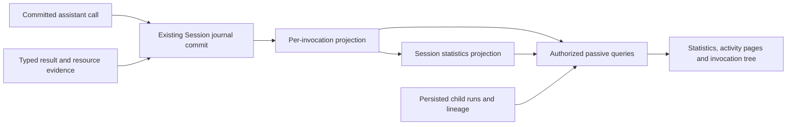
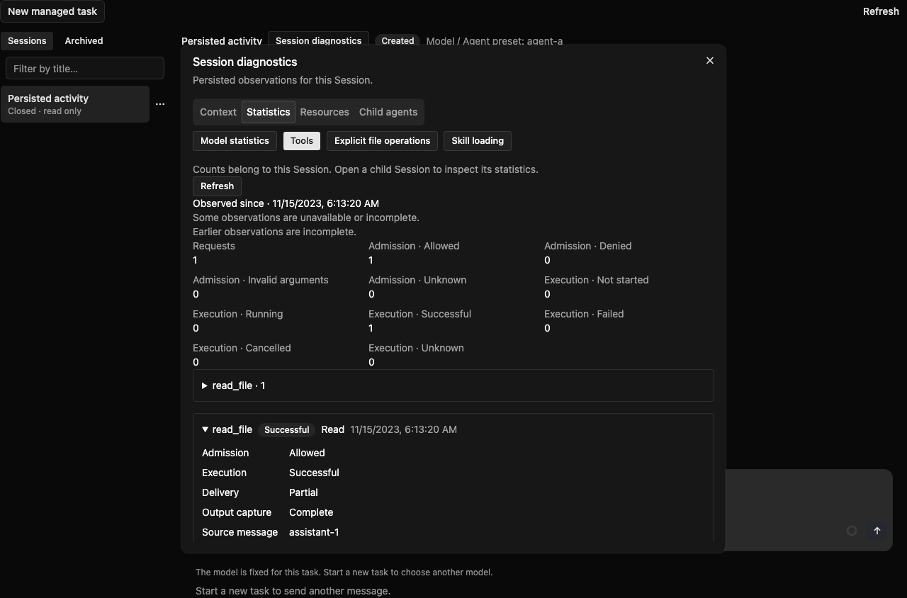
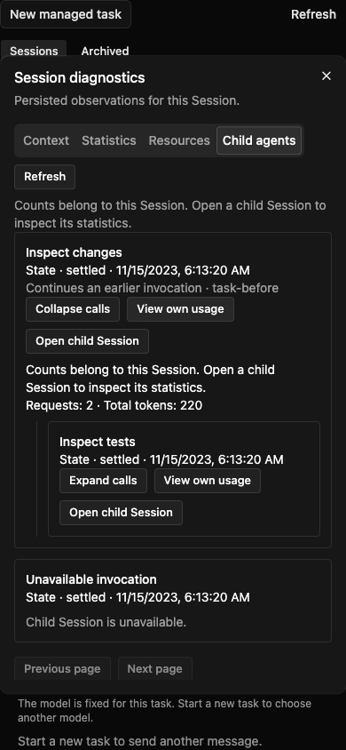

# Managed Session execution diagnostics

[English](2026-11-07-managed-session-execution-diagnostics.md) | [简体中文](2026-11-07-managed-session-execution-diagnostics.zh-CN.md)

Status: slices A/B/C implemented as a follow-up to [PR #16475](https://github.com/QwenLM/qwen-code/pull/16475). The original investigation and focused local checks used its reviewed head `42562a31bdd3779002504aeca569d381b0f7dd77`; the follow-up PR records its current dependency revision. Section 14 distinguishes implemented behavior and verification limits. Full CI, performance and platform acceptance remain pending. Date: 2026-11-07, Asia/Shanghai. This document does not claim either change has merged or deployed.

## 1. Recommendation and scope

Extend the persisted diagnostic surface from #16475 with **tool invocation statistics, explicit file operations, Skill instruction loads, and an expandable child invocation tree**. Use committed Session evidence as authority. Add small typed observations only where existing evidence cannot establish the requested fact.

Users should be able to answer: which calls failed or were refused, which files explicit tools read or changed, whether a Skill was loaded, and which child invocation owns a failure or model usage. All views must remain readable after the runtime stops.

Deliver this as follow-up slices. Keep #16475's Context, model totals, configured resources, and direct-child API semantics intact. Recursive visualization does not enable recursive execution: current Managed admission allows only one child level. A full model/tool waterfall, arbitrary Shell/MCP filesystem auditing, Skill-to-action causal attribution, and multi-level execution admission are outside this proposal.

## 2. Findings from the owning code

| Evidence                                                                                                                                                                                                                                         | Finding and design consequence                                                                                                                                                                                                                                    |
| ------------------------------------------------------------------------------------------------------------------------------------------------------------------------------------------------------------------------------------------------ | ----------------------------------------------------------------------------------------------------------------------------------------------------------------------------------------------------------------------------------------------------------------- |
| [#16475 design at the reviewed commit](https://github.com/QwenLM/qwen-code/blob/42562a31bdd3779002504aeca569d381b0f7dd77/docs/design/2026-11-06-managed-session-diagnostics-and-organization.md)                                                 | Four persisted diagnostic API pairs; model totals and recent samples, configured Skills/MCP, direct child calls. Tool/file/Skill statistics and recursive graphs are explicitly excluded. Recent model samples cannot reconstruct an unlimited per-call timeline. |
| [Hosted tool dispatch](../../packages/cli/src/serve/hosted-workspace-tool-turn.ts)                                                                                                                                                               | Refused batches and agent/message/team/command/plan/question/skill/todo/workflow calls can bypass native `tool.intent`. Count committed assistant function-call occurrences, then enrich them with intent, receipt and domain evidence.                           |
| [ChatRecord](../../packages/core/src/services/chatRecordingService.ts); [invocation bindings](../../packages/cli/src/serve/hosted-workspace-tool-turn.ts)                                                                                        | Message UUID, Session identity, prompt identity and call ordinal provide occurrence identity. Normalized function-call ID, original provider ID when retained, and Runtime execution ID are different associations.                                               |
| [Tool result protocol](../../packages/core/src/managed-runtime/managed-tool-result.ts)                                                                                                                                                           | Execution, output capture and delivery have separate states. A successful command with omitted output must not become an execution failure.                                                                                                                       |
| [Hosted file history](../../packages/cli/src/serve/hosted-workspace-tool-turn.ts)                                                                                                                                                                | Backup preparation precedes writes and is conditional. It neither proves successful mutation nor records every read.                                                                                                                                              |
| [Skill catalog](../../packages/cli/src/serve/hosted-skill-catalog.ts); [Skill dispatch](../../packages/cli/src/serve/hosted-workspace-tool-turn.ts)                                                                                              | A normal Skill loads instructions. The same `skill` tool can instead expand an extension command. Resource kind and selected pin must come from the resolver.                                                                                                     |
| [Child limits](../../packages/core/src/managed-runtime/managed-child-operations.ts); [child admission](../../packages/managed-agent-server/persistence/src/main/java/com/alibaba/qwen/code/managedagent/persistence/AgentSessionAdmissions.java) | Runtime admission is depth 1. The broader parser depth bound is not evidence that deeper public execution works.                                                                                                                                                  |
| [Daemon agent trace](../../packages/core/src/agents/agent-transcript.ts); [UI telemetry](../../packages/core/src/telemetry/uiTelemetry.ts)                                                                                                       | Daemon already has local metadata lineage and tool/Skill counters, but they use different ownership and evidence. Reuse presentation ideas and pure formatting, not its local-file reader or process aggregation as Managed authority.                            |

These are static source findings. No real user Session was inspected, no production workload was measured, and #16475's reported test results were not rerun for this design.

## 3. External references and choices

[OpenTelemetry's GenAI example](https://opentelemetry.io/blog/2026/genai-observability/) separates agent, model and tool operations. [Langfuse's data model](https://langfuse.com/docs/observability/data-model) distinguishes a multi-interaction Session from a request trace and its nested observations. These are useful modeling references, not evidence that qwen-code already persists those relationships.

Adopt the separation between an invocation, its owning Session and its related operations. Preserve explicit parent/association IDs so a later telemetry adapter can map them. Do not make an external collector, sampled spans, or a trace backend a prerequisite for product diagnostics. The [OpenTelemetry attribute registry](https://opentelemetry.io/docs/specs/semconv/registry/attributes/gen-ai/) also points to a moved GenAI specification; allocate and version our durable contract independently rather than treating evolving external names as a storage schema.

| Approach                                                        | Decision                                                                                                                      |
| --------------------------------------------------------------- | ----------------------------------------------------------------------------------------------------------------------------- |
| Parse visible transcript text or tool descriptions on each read | Reject: truncation, localization and free text cannot establish execution status or resource identity.                        |
| Reuse daemon telemetry totals                                   | Reject as authority: a different execution path and aggregation boundary do not prove Managed coverage or replay correctness. |
| Build a new tracing service or graph database                   | Defer: existing journal, resource, record and lineage stores support the proposed scope.                                      |
| Project committed facts, supplement missing typed metadata      | Recommend: durable identities, passive reads and explicit coverage can share existing lifecycle guarantees.                   |

## 4. Product surface

Keep one diagnostic dialog. Expand the statistics area with Tools, Files and Skill loads; keep the resource inventory separate. Upgrade Child agents to an expandable invocation tree with an accessible list representation. Use existing WebShell primitives, portal container, theme tokens and focus behavior.

| View         | Main information                                                                                                           | Interpretation                                                                                                                     |
| ------------ | -------------------------------------------------------------------------------------------------------------------------- | ---------------------------------------------------------------------------------------------------------------------------------- |
| Tools        | Requested calls, known execution outcomes, refusals, cancellations, unresolved calls, per-tool buckets and paginated calls | A request is not necessarily an execution. Output delivery problems have their own indicator.                                      |
| Files        | Explicit read/write/edit requests and outcomes; recorded workspace-relative path; link to the owning invocation            | The title is **Explicit file operations**. Search matches, directory listings and implicit filesystem activity are not file reads. |
| Skill loads  | Resolved Skill and pin, model/user origin, load requests and committed instruction results                                 | Configuration availability and loading are different facts. Extension commands are labeled separately.                             |
| Child agents | Invocation state, authorized child link, self usage, expandable descendants, continuation association                      | Repeated calls of the same agent are separate nodes. Missing children do not erase parent calls.                                   |

Default to the selected Session's own metrics. Opening a child shows its own metrics. Do not sum child usage into parent usage. If a visible-subtree subtotal is later added, it must deduplicate Session IDs and explicitly identify the loaded, authorized subset; it is not a root-session lifetime total.

Show coverage beside the value: “observed since …”, “execution outcome unavailable”, “older calls not recorded” or “additional names grouped into Other”. A known zero, no observations, stale state and incomplete history must have different renderings. Keep protocol versions and internal commit details in expandable diagnostic details.

## 5. Measurement rules

### 5.1 Tools

The unit is one function-call occurrence in a committed assistant message, including an explicitly synthesized user Skill call. Identify it by a versioned digest of tenant, owning Session, assistant message UUID and the function-call ordinal within that message. Retain `promptId`, normalized `functionCallId` (the persisted `functionCall.id`), original `providerCallId` only when separately recorded, native `executionCallId` and task ID as distinct associations. The internal `callId` is not necessarily the original provider ID; see [ToolCallRequestInfo](../../packages/core/src/core/turn.ts). The ordinal is not the index of an arbitrary content part. Never deduplicate by name, arguments or provider call ID alone. Headline counters cover conversation tool requests; Hook-internal commands and Broker operations are not silently included in that denominator.

Keep admission (`allowed`, `denied`, `invalid`, `unknown`), execution (`not_started`, `running`, `success`, `error`, `cancelled`, `unknown`) and result delivery separate. `running` requires execution evidence; an unmatched request is only pending while its owner is active, and otherwise unresolved. A restart or missing result does not prove that a side effect failed. Structured recovery evidence may explain interruption without asserting rollback.

Count `requested` once. Report execution-known and outcome-known denominators separately. Count refusal only with an explicit decision, and invalid input separately from refusal. Retransmission, checkpoint reload and terminal replay update the same occurrence. An explicit new request is a new occurrence. Physical attempts are a separate optional measure and remain unavailable if the producer cannot prove them.

Background launch success describes admission of the task, not completion of its work. Show eventual task status alongside the invocation without changing the meaning of launch success. Likewise, internal extension-command preprocessing steps are associated activities, not additional model-requested calls.

Do not label `tool.intent` to receipt commit time as execution duration: it includes waiting, transport and persistence. Some recovered result timestamps are reconstructed. Exact executor duration is nullable until measured at the executor boundary; any journal interval must be explicitly labeled. Averages use only known duration samples and show their count. Do not calculate a Session p95 from a capped recent sample list.

### 5.2 Files

Initially cover explicit `read_file`, `write_file` and `edit` operations supported by the Hosted profile. Store requested operation and verified outcome separately. File backup preparation is not a write receipt. Successful reading means the tool returned content; it does not prove the model used that content or read the whole file.

The resolved tool adapter supplies the normalized path and recorded working-directory context before execution; combine that with the recorded workspace identity. Show only authorized workspace-relative paths. Do not resolve paths against today's runtime, dereference symlinks during a diagnostic read, or merge paths from different workspaces. If safe normalization or workspace containment is not established, retain the call but hide its path and mark that field unavailable.

Exclude Shell, scripts, MCP internals and arbitrary subprocess I/O from file-access coverage. A glob match is discovery, and a search root is a selector. Add other file tools only when their adapter emits equivalent structured facts. Do not claim completeness from parsing Shell commands or MCP arguments.

Count successful operations, not unique files, in the cumulative summary. Paginated detail may repeat a path. Whole-session unique-file counts and net changes are deferred. If line-change information is later exposed, obtain it from recorded before/after evidence for that operation and label it cumulative edit churn; a live Git diff includes unrelated changes and is not suitable evidence.

### 5.3 Skills

Record `resourceKind: skill | extension_command`, resolved name, immutable catalog/bundle identity, and `origin: model | user | unknown` at dispatch. Key a Skill bucket by resource identity and pin, not display name alone. A successful instruction load means the resolved instruction result was committed; it does not prove a subsequent model request consumed it or followed it. Instruction completeness is separate: the existing response-budget finalizer can truncate Skill output before commit. Preserve `complete`, `partial` or `unknown` delivery coverage and recorded truncation provenance; do not label a partial result as full instruction delivery.

Join typed load metadata to the same tool occurrence so Tools and Skill loads are two views of one action. Do not add them together as independent work. Keep extension commands and their preprocessing steps distinct. Reuse existing `tool_stage` identities for those steps when association is available.

The configured catalog, path-triggered discoverability, an existing `skill_activation` domain name, and a literal read of `SKILL.md` are not proof of a Skill invocation. Historical records with ambiguous kind or missing pin remain unknown. Do not attribute later tools, tokens or child calls to a Skill merely because they happened after a load.

### 5.4 Agent relationships

Use the parent-owned child invocation as the node identity: parent Session plus child-run/task identity. A child Session is an optional, independently authorized target. Keep `parentSessionId`, `childRunId`, `childSessionId`, recorded depth and `predecessorChildRunId` distinct. Definition/agent names are labels, not identities.

Parent-child edges come only from mutually consistent persisted run and lineage records. Continuation is a separately labeled association, not a parenting edge. Detect cycles, duplicate targets and broken lineage, stop expansion and expose the relevant coverage reason. Do not infer links from descriptions, timing or a matching agent name.

Recursion is lazy composition of #16475's direct-invocation endpoint: each expansion reads that child as the next parent and each returned link receives the existing independent authorization/lineage checks. Every request remains Session scoped. Do not add a public “all descendants of arbitrary root ID” query in the first version. A verified deeper historical relationship can be displayed without changing creation admission; ordinary current Managed sessions normally show one level.

## 6. Evidence model and collection

Use a small typed diagnostic fact associated with an existing message, intent, result or extension record. The following table describes the implemented meaning; the closed leaf contract is specified below:

| Group       | Required meaning                                                                                                                        |
| ----------- | --------------------------------------------------------------------------------------------------------------------------------------- |
| Identity    | `schemaVersion`, `invocationId`, owning Session, assistant UUID and call ordinal; internal source sequence/reference                    |
| Correlation | Prompt, normalized function call, separately recorded provider call, Runtime execution and task identities; validated associations only |
| Tool        | Resolved public tool name, built-in/MCP/Hosted kind; MCP server and selected pin only when recorded                                     |
| State       | Admission, execution, capture/delivery observations and safe reason codes with independent known/unknown flags                          |
| Time        | Source observation time; executor duration only with a declared measurement source                                                      |
| File        | Typed operation, safe workspace-relative path and workspace association, result evidence                                                |
| Skill       | Actual resolved resource kind, pin and origin, instruction-result commitment and delivery completeness                                  |
| Coverage    | Missing fields, collection start, source revision and any explicit truncation                                                           |

Derive request occurrence from the durable assistant message. Enrich Runtime-backed calls through existing intent/binding/result associations. Enrich Hosted-only calls at their real validation and dispatch branches. Use typed outcomes from refusal, cancellation and result publication; never parse localized error prose. New Skill/file metadata is produced while the resolver still has attribution, before it is flattened into display text.

Metadata must share the existing durable source commit. If a source resource needs additional fields, introduce a versioned resource contract and reference closure; do not append unknown keys to a closed v1 parser. Keep large output, prompts, arguments, Skill body, file contents, environment, private resource locators and credentials out of diagnostic facts and public responses. Collector omission becomes a coverage gap; do not silently suppress an actual durable commit error. In particular, [resource-reference traversal](../../packages/core/src/managed-runtime/managed-session-resource-references.ts) deliberately skips opaque arguments/results and message Parts. Declare a supported reference position on a versioned source envelope and update both TypeScript and Java closure readers; putting a `diagnosticsRef` inside arbitrary response JSON does not retain it.

The graph is data flow. It does not introduce another execution engine or journal.

## 7. Persistence, replay and boundedness

Reuse `ma_session_record` and immutable `ma_resource` bodies. Derived projection domains are `hosted_tool_diagnostic`, `hosted_file_diagnostic`, `hosted_skill_diagnostic`, `hosted_tool_execution_link` and `hosted_activity_statistics`. These are internal read projections, not new executable extension domains. Give them their own typed projector/query path; existing extension-record readers validate a closed domain allowlist and cannot be reused unchanged. `record_kind` remains `DOMAIN`; `task_kind` and `delivery_state` remain null. A diagnostic projection must never appear as an executable Task.

Store one latest tool observation per invocation, plus file/Skill lookup entries referencing its typed evidence. File keys include a file ordinal if a future admitted tool has multiple targets. A Session summary at `latest` holds cumulative scalar counters and bounded named buckets. This does not duplicate transcript bodies or introduce a separate event ingestion service.

Update projections in the existing source commit transaction after its replay/fencing checks. For a new source revision, compute the difference between the old and new occurrence contributions, and update the summary once. Replaying the same committed bytes contributes zero. Same source identity/revision with conflicting content follows the existing conflict rules. Requested totals are monotonic; state-category totals may move from unknown/pending to a known outcome. Never repeatedly add a cumulative snapshot or sum each result-publication revision.

Keep projection resources under the existing record ownership/GC rules; reference replacement releases the previous ownership. Detail retention initially follows its Session's lifecycle, with no separate short TTL that destroys deduplication evidence. Deleting the Session removes the diagnostic projections under the same policy. Compression or display-history truncation does not reset counts.

Choose **rebuildable server projections**, not a second producer-owned cumulative snapshot. The existing [native snapshot census](../../packages/managed-agent-server/persistence/src/main/java/com/alibaba/qwen/code/managedagent/persistence/ManagedNativeJournalSnapshots.java) includes JOURNAL-owned resources; a server-generated summary with only record ownership is not automatically transferred. The new source facts and their collection anchor must be declared by the journal and included in its reference closure. After a full native restore, rebuild detail and summary projections from those ordered source commits with a deterministic, versioned reducer. This runs in the restore/rebuild lifecycle, in bounded batches, never in a diagnostic GET. Publish readiness only when the declared coverage has been rebuilt.

If a transfer/profile lacks the complete source interval or does not understand its version, return unavailable/partial diagnostics or reject that profile according to its contract. Do not promise retained lifetime totals across private-source truncation. Preserving totals with incomplete source would require a journal-anchored cumulative baseline, which is deferred. This limitation does not prevent passive reads of already committed SQL projections.

The first new fact-bearing source commit declares a durable collection epoch and reducer version; its committed sequence is the collection start. Subsequent facts reference that same start identity, and restart restores it instead of choosing the current service-start time. Rebuild uses the recorded version and pins, not current configuration. Summary coverage is the interval from that start through its applied source sequence. Only a Session observed from its first relevant event may claim lifetime coverage. Existing sessions do not gain invented historical totals; no automatic unbounded backfill runs on a GET. Historical backfill is a separate future operation if needed. A new request can join old persisted evidence only when its identity is proven; unmatched terminal evidence must not manufacture a missing request count.

Initial implementation budgets, subject to measurement:

- Each diagnostic resource stays within the existing 64 KiB UTF-8 inline limit. Do not put these fields into #16475's already budgeted model-statistics envelope.
- Summary: at most 64 named tool buckets and 64 named Skill buckets, plus an explicit Other bucket for each. Keep scalar totals exact for the covered interval. Admission to named buckets is deterministic and frozen; Other is not an exact top-N calculation. Enforce both entry counts and serialized bytes; large identifiers can cause earlier overflow.
- One fact contains at most one explicit file target and bounded identifiers. Omitted detail has a reason/count; if the producer does not know the omitted count, say so. Counters must not pretend unrecorded targets were measured.
- Activity pages default to 50 entries and cap at 100, with at most 512 candidate rows, an 8 MiB resource-read ceiling and 1 MiB of public output per request; the initial page implementation applies a stricter approximately 1 MiB resource budget, reserving 16 KiB for the response envelope. Byte/scan exhaustion returns partial coverage and a continuation from the last examined key rather than repeatedly visiting an oversized row.
- The tree caps a view at 200 invocation nodes, eight displayed levels and four concurrent reads (one root trace request and at most three subtree/usage requests). These are read budgets, not execution quotas. Show unloaded branches and a limit message instead of implying that the returned tree is complete.

Point reads use the existing Session/record key. Domain pages use the existing `(session_scope_key, domain, delivery_state, gmt_create, record_key)` index with a null delivery-state predicate and stable keyset ordering. No new table or DDL is proposed. Verify the actual MySQL plan and commit overhead before accepting this choice; add a targeted index only if measurements justify changing the design.

## 8. Read API and authority

Leave the four #16475 routes compatible. Add two Public/WebShell pairs backed by the same authorized application service:

| Public GET                                | WebShell POST                                          | Meaning                                                      |
| ----------------------------------------- | ------------------------------------------------------ | ------------------------------------------------------------ |
| `/v1/agents/sessions/{id}/activity-stats` | `/api/agent/web-shell/v1/session-activity-stats/query` | Session-only tool/file/Skill summary and coverage            |
| `/v1/agents/sessions/{id}/activity`       | `/api/agent/web-shell/v1/session-activity/query`       | Bounded detail pages; `kind` is `tools`, `files` or `skills` |

The `kind` selects a fixed typed projection domain, not an arbitrary SQL predicate or resource namespace. Do not offer arbitrary full-text/argument search. Reuse `agent-trace` for direct child pages and task details for task state. Model totals still come from `/stats`.

Each response carries `schemaVersion`, `sessionId`, `scope: self`, `readRevision`, `coveredThroughSequence`, `coverageStartSequence`, availability and coverage reasons. Unknown fields are null, with a measured denominator where relevant. Journal revisions and sequences use decimal strings and retain their different meanings. A source link resolves through an existing authorized message/task route; it never exposes a raw resource locator.

Use a short read-only `REPEATABLE_READ` transaction for each response. Bind opaque cursors to tenant, actor, Session, kind and query version, with a first-page membership upper sequence and the last examined `(gmt_create, record_key)`. Keep projection creation order immutable. Cursor pagination fixes membership, not every mutable outcome across multiple requests: each page reports its current read revision. Do not claim a globally atomic graph snapshot across child Sessions.

Ownership is **persisted Session, with its recorded Workspace authorization**. All routes call the existing readable-Session gate; child access receives its own check. Never fall back to a primary daemon runtime, another workspace or an in-memory process counter. Reads do not acquire, attach, resume, prewarm or start runtimes, perform discovery, or read the current filesystem.

Unavailable child targets expose only the already-readable parent invocation, with no child ID, link, metrics or descendant count. Missing and unauthorized targets share the existing non-disclosing behavior. Visible tree paths must refresh ancestor access before retaining newly refreshed descendant data. On a denied ancestor, clear its subtree; on root denial, clear the whole panel. Independently readable children can still be opened through their own authorized entry.

Use private/no-store responses. Poll the visible diagnostic view at #16475's five-second cadence, including stopped Sessions, so permission revocation clears persisted content. A stopped Runtime does not stop authorization checks; hiding or closing the view stops its reads. Cancel and ignore stale requests on Session/provider/actor changes, collapse or dialog closure. Distinguish temporarily unavailable reads from proof that the child has no descendants.

## 9. Compatibility and recovery

Deploy readers/projectors before enabling producers of new resource versions. Version any new typed resource or source reference explicitly in TypeScript and Java, including fixtures. The next required reader floor must be allocated against then-current main; do not assume that an unused number today remains available.

An older reader must either preserve the declared diagnostic resources correctly or be refused under the negotiated floor. Do not rely on silently ignoring new fields. Cover source-resource validation, reference census, native snapshot transfer, restore and projection rebuilding together. CSI profiles that cannot preserve this evidence remain unchanged or explicitly unsupported; a new diagnostic-capable profile must not gain additional execution privileges.

On process death after a request but before a durable terminal observation, retain the request with unresolved outcome. On reply loss after a committed result, replay must preserve counts. A stopped runtime does not prevent reading committed projections. Legacy, truncated, unsupported and interrupted coverage reasons survive reload. Rebuilding from incomplete source history must not replace a fuller existing summary with a smaller supposedly complete one.

## 10. Implementation ownership

| Layer                 | Owning area and work                                                                                                                                                                                                                                                                                                                                                                                     |
| --------------------- | -------------------------------------------------------------------------------------------------------------------------------------------------------------------------------------------------------------------------------------------------------------------------------------------------------------------------------------------------------------------------------------------------------- |
| Producer              | [Hosted tool turn](../../packages/cli/src/serve/hosted-workspace-tool-turn.ts), [Skill catalog](../../packages/cli/src/serve/hosted-skill-catalog.ts), [extension command](../../packages/cli/src/serve/hosted-extension-command.ts), applicable CSI/result adapters: stamp occurrence associations and typed facts at real decision points.                                                             |
| Shared contracts      | [Managed runtime](../../packages/core/src/managed-runtime/) and [Java persistence contracts](../../packages/managed-agent-server/contracts/src/main/java/com/alibaba/qwen/code/managedagent/contracts/persistence/): fact validation, version negotiation, reference closure and shared fixtures.                                                                                                        |
| Commit and projection | [JournalCommit](../../packages/managed-agent-server/persistence/src/main/java/com/alibaba/qwen/code/managedagent/persistence/JournalCommit.java), [record store](../../packages/managed-agent-server/persistence/src/main/java/com/alibaba/qwen/code/managedagent/persistence/ManagedExtensionRecordStore.java), recovery/GC owners: atomic projection delta, bounded summary and lifecycle integration. |
| Query and API         | #16475's diagnostic/trace services; [OpenAPI](../../packages/managed-agent-server/contracts/src/main/resources/openapi/managed-agent-public-api.openapi.json) and [SurfaceRegistry](../../packages/managed-agent-server/verification/src/test/java/com/alibaba/qwen/code/managedagent/api/SurfaceRegistry.java): Session-scoped queries and Public/WebShell parity.                                      |
| WebShell              | [#16475 diagnostic panel](https://github.com/QwenLM/qwen-code/blob/42562a31bdd3779002504aeca569d381b0f7dd77/packages/web-shell/client/components/managed/ManagedDiagnosticsPanel.tsx), its provider/hook and child viewer: new views, lazy tree and availability states. Regenerate OpenAPI-derived types.                                                                                               |

Avoid introducing a generic observer bus or graph framework for this feature. Share only the typed fact/reducer functions and existing presentation primitives that have concrete consumers.

## 11. Delivery slices

| Slice              | Deliverable                                                                                                                  | Exit condition                                                                                                           |
| ------------------ | ---------------------------------------------------------------------------------------------------------------------------- | ------------------------------------------------------------------------------------------------------------------------ |
| A: tool evidence   | Invocation identity, request/outcome projection, summary and Tools view; explicit unknown outcomes where evidence is missing | All dispatch branches covered; duplicate/replay and stopped-runtime reads proven; no fabricated execution timing         |
| B: resource use    | Typed file/Skill metadata, separate detail projections and UI                                                                | Real file outcomes, Skill/command distinction, user/model origin and pinned identity proven; old history remains partial |
| C: invocation tree | Lazy direct-child composition, self-usage drill-down, broken/restricted lineage handling                                     | Repeated calls, continuation, authorization revocation and read budgets proven; current execution-depth gate unchanged   |

Each slice includes its contracts, compatibility, targeted tests and UI; do not ship a producer before a reader can preserve its facts. Slice C can proceed independently after #16475; it does not wait for multi-level execution support. A whole-run model/tool waterfall or whole-subtree accounting requires a separate proposal, because #16475's recent samples and independently read child revisions do not establish either.

## 12. Validation and acceptance

| Scenario                                                                                                   | Required evidence                                                                                                                                                         |
| ---------------------------------------------------------------------------------------------------------- | ------------------------------------------------------------------------------------------------------------------------------------------------------------------------- |
| One successful read, one refused edit, one cancelled Shell, one successful Skill load                      | Four logical requests; refusal is not execution failure; known outcomes and unknowns have correct denominators; one explicit successful read and one committed Skill load |
| Successful execution with truncated, omitted or blocked output                                             | Execution success preserved; capture/delivery caveat visible                                                                                                              |
| Repeated identical calls, provider IDs reused across accepted messages, retry and lost commit reply        | Different message occurrences count separately; replay of the same occurrence does not increment                                                                          |
| Hosted-only tools and extension-command preprocessing                                                      | No omission from the requested-call denominator; internal steps associated and counted separately from model calls                                                        |
| Two same-named Skills at different pins; user versus model entry; extension command through `skill`        | Distinct resource identities/origins; no command misclassified as a Skill load; truncated instruction delivery remains partial                                            |
| Glob, Shell and MCP access a file; backup prepared but write fails                                         | No claimed successful explicit file access from those facts; no false write receipt                                                                                       |
| Process kill before/after terminal commit; close/load; compression; full or incomplete CSI source transfer | Full source rebuild preserves counts and epoch; incomplete source stays unavailable/partial; no fabricated failure or duplicate contribution                              |
| Runtime stopped and MCP discovery instrumented                                                             | Every diagnostic view reads persisted data with zero runtime acquisition/discovery calls                                                                                  |
| Parent P calls C twice and one invocation continues another                                                | Invocation nodes remain distinct; continuation is not nesting; Session usage not double-counted                                                                           |
| Valid historical nested fixture, orphan/cycle and inaccessible child                                       | Bounded expansion, explicit incomplete lineage; no unauthorized identity/metrics/descendants; fixture does not prove nested execution support                             |
| Permission revoked or Session changed during slow requests                                                 | Old panel/subtree cleared and late responses ignored                                                                                                                      |
| Large history, many tool/Skill names, long Unicode paths and concurrent commits                            | Byte/row/node budgets enforced; stable cursor progress; Other/partial coverage explicit; no unbounded GET scan                                                            |

During implementation, use focused TypeScript tests from their package directories, root build/typecheck for cross-language changes, and the affected API/SurfaceRegistry tests with regenerated types. Use real MySQL for projection concurrency, query plans and replay transactions; use the packaged Harness for kill/restart and passive-read checks. UI fixtures establish layout/interaction only. Follow the [Managed module verification budget and CI policy](../../packages/managed-agent-server/AGENTS.md); do not substitute fixture or H2 results for full acceptance.

This change requires formatting, reference checks and two clean self-audit passes. Focused test results are recorded in section 14; real-model runs, database performance qualification, deployment and full CI acceptance remain pending.

## 13. Remaining decisions and risks

The recommended first version has no external tracing dependency, no database DDL, no historical backfill and no exact executor timing claim. Confirm these choices with measured write overhead and MySQL plans in slice A. The main technical risk is changing durable resource/recovery contracts; that work must stay in the same delivery slice as new facts.

The proposed 64-bucket, 200-node and byte limits are initial engineering budgets, not measured capacity. Adjust only with workload evidence while preserving explicit overflow and partial coverage. Exact per-file unique counts, whole-tree totals, export/long-term analytics and executor timing can be prioritized separately if product demand justifies their additional storage and consistency contracts.

## 14. Implemented contracts and delivery constraints

### 14.1 Sources and producers

Only the closed payloads of `message.committed` and `tool.intent` gain optional `diagnosticsRef`, pointing to leaf resource `managed-execution-diagnostics` /1. Its body contains `schemaVersion: 1`, `reducerVersion: 1`, `epochId`, `startEventId`, `sourceEventId`, `observations`, `coverageReasons`, and `omittedObservationCount`. The Session-bound invocation identity is SHA-256 of JSON array `["managed-tool-invocation/1", tenant, session, assistantUUID, functionCallOrdinal]`. `sourceEventId` must match the carrier; the ordinal counts functionCall occurrences only. Normalized call, separately retained provider, execution and task IDs remain distinct.

The ordinary sink and atomic final model output share the collector; the latter still commits `model.attempt + message.committed` together. Atomic commands use `managed-final-output/2`; individual messages/intents use `managed-execution-commit/1` to bind original content/args digest and diagnostics digest. Committed message replays reuse the original reference, including its absence for legacy commits. Prepared references, epoch and bytes are frozen across retries; only the first committed source establishes the durable collection start.

Ordinary Runtime results use structured `executionStatus` and capture fields; Hosted success is recognized where results are actually constructed, with delivery completeness recorded after output budgeting. An intent does not set running; missing structured conclusions remain unknown. Receipts use execution ID point lookup in `hosted_tool_execution_link`, directly referencing the intent leaf. Repeated identical bindings are idempotent; binding another invocation is rejected. Missing legacy bindings record a gap without guessing history.

Files cover only builtin `read_file / write_file / edit`, with one target per request. Each file batch reads scope and `workspaceContext` from the same Workspace resolution through existing `/runtimes:capabilities`, freezing cwd; this adds no execution permission or route. Persist only workspace-relative logical paths, rejecting absolute paths, traversal, URLs, backslashes and control characters. Missing context or unsafe paths become null with `file_path_unavailable`. Recovery preserves the original recorded path. Skills capture kind, name, content/configuration digest pin and origin while the resolver holds the selected resource. `skillLoads` and `extensionCommands` are separate totals; `skills` combines both, and Tools and Skills share invocation identity.

### 14.2 Atomic projection and recovery

A dedicated DAO runs the deterministic reducer inside the existing journal transaction after fencing/replay/source validation and before head publication. Statistics use the difference between old and new invocation contributions; streaming deltas do not write statistics. Details use content-addressed `managed-activity-projection` resources with existing SESSION_RECORD ownership; execution links point directly to source leaves. Sources enter JOURNAL census and native snapshot closure. Close, compression and restart preserve totals; deletion follows Session resource collection.

Statistics retain at most 64 ownership/name tool buckets, 64 resource/pin Skill buckets and their respective Other. Named-bucket admission permanently closes at the serialized budget, preventing later state updates from moving Other contributions into new buckets. Unresolved tool ownership temporarily contributes to Other. Each source resource is at most 64 KiB, with omitted-observation counts; the request denominator still derives from the complete assistant message. Missing file/Skill metadata never invents resource counts.

The first writer admission after source restore rebuilds under the Session fence. Clearing removes at most 512 old derived records per batch; source replay handles at most 512 events or 8 MiB per separately committed batch, saving `rebuiltThroughSequence` and `rebuiltThroughRevision`. Ready is published only after catching the head; GET never starts rebuilding. A single source transaction above 8 MiB explicitly refuses this recovery path rather than claiming completeness. Declared missing source or digest mismatch is an integrity error. Old Sessions start at the new epoch; late outcomes before that start do not increase requests. An epoch with a missing start remains the same epoch and is marked incomplete.

### 14.3 API and UI

Public `GET /v1/agents/sessions/{id}/activity-stats` and `GET /v1/agents/sessions/{id}/activity`, and corresponding WebShell `POST /api/agent/web-shell/v1/session-activity-stats/query` and `POST /api/agent/web-shell/v1/session-activity/query`, share Session/Workspace authorization and a read-only REPEATABLE_READ service. Responses include version, Session, self scope, decimal-string revision/sequence (null when unknown), coverage start/bound, availability and reasons. Not-ready state never exposes a smaller apparently complete summary. GET does not acquire, attach or warm Runtime or discover MCP; responses are `private, no-store`.

A closed `kind=tools|files|skills` chooses the typed details. Pages default to 50 and cap at 100. Cursors bind tenant, actor, Session, kind, query version, first-page first_sequence upper bound and the last processed candidate ordering key; later file/Skill indexes cannot enter the fixed membership set. A page checks at most 512 candidates, uses the stricter approximately 1 MiB projection-resource budget (within the 8 MiB ceiling) and returns below 1 MiB; output-budget exhaustion reports partial with continuation. Each page reflects its own read snapshot, without frozen cross-page states. Known background tasks independently add taskState/taskRuntimeState without changing launch-success semantics.

Statistics subviews are Model, Tools, Explicit file operations and Skill loading. Coverage is displayed beside categories, and uncollected history is explicitly distinguished from a measured zero. The tree queries existing agent-trace one parent at a time, identifying nodes by parentSessionId+taskId, with independent child authorization and lineage validation. Continuations expose predecessorTaskId only after validation inside the readable parent. The view admits at most 200 nodes, eight levels and four concurrent reads (one root trace request and at most three subtree/usage requests); descendants are initially collapsed and only selected nodes fetch their own usage. Visible views refresh every five seconds, including stopped Sessions for authorization revalidation; closing, collapsing and identity changes cancel old reads. Subtree refresh revalidates ancestors and clears revoked data.

### 14.4 Compatibility, validation and remaining work

Interrupted-turn Skill and child-result recovery submit the same typed observations as normal dispatch. Skill pins share one resolver helper; response budgeting preserves partial delivery, and blocked capture never becomes complete tool-output delivery. File summaries include fixed `read`, `write`, and `edit` categories. Rebuild verifies contiguous revisions, event sequences, source Session, and predecessor digests, then matches the fenced head revision and digest before publishing ready. Named-bucket byte admission depends only on the two bucket arrays, so transient rebuild progress cannot change classification.

The implementation builds on #16475 floor 3 and allocates next floor **4**. TypeScript/Java closed events, resource validation, digest proof, reference enumeration, recovery allowlists, OpenAPI and generated types change together. New `csi-files-retirement/3` declares `diagnostics: model-v1` and `activityDiagnostics: activity-v1`, retaining the original file tools and permissions. `/1` and `/2` keep their semantics and existing Sessions do not implicitly upgrade; newly created private CSI Sessions select `/3`. Deploy compatible readers/projectors before producers; floor-4 Sessions must not return to older writers.

Local validation covers shared UTF-8 contracts, tool/Skill producers, API/SurfaceRegistry, real MySQL 8.4 transaction replay/passive reads/rebuild/pagination membership, and desktop/narrow WebShell interaction. Final outcomes, failures and corrected reruns are recorded in `.qwen/e2e-tests/managed-execution-diagnostics.md`. Native CSI inventory and packaged Harness checks use real local processes with a fake model and cannot establish online-model or platform acceptance. Full Java unit/H2, MySQL, Hosted/fault profiles, SpotBugs and cross-platform acceptance remain CI-owned. Commit overhead, EXPLAIN and extreme capacity still need measurement; 64 KiB, 64 buckets and 200 nodes are initial budgets. A complete waterfall, whole-tree totals, implicit file auditing, unique-file counts, Skill causal attribution and precise executor timing remain deferred.

The latest reviewed Java increments (recovery continuity, bounded paging candidates, predecessor degradation, resource ownership constraints, and file categories) have static review and regression tests, but were not rerun locally under the shared verification budget. Earlier focused MySQL, API and CSI passes establish only their tested states, not complete acceptance of the final revision; the final CSI rerun failed because concurrent rebuilding removed its dist dependency. These later Java increments, full profiles and platform acceptance explicitly remain for CI.

### 14.5 Browser fixture evidence

Before this change, the #16475 dialog exposes Context, model statistics, configured resources and direct child calls. The baseline Chromium fixture passed at 1280px and 390px; it has no activity endpoints or recursive expansion.

The following screenshots come from the review-fix Chromium fixture run after updating the dependency to `629b11470b035afc3b63a8624cd15bbf9486e94b`. They illustrate interface behavior with deterministic mock responses, not database, Runtime-inactivity or native-recovery acceptance. The desktop view separates successful execution from partial delivery; the narrow child view displays continuation, independently fetched child usage and an inaccessible invocation.

### 14.6 Submission against the updated dependency

The initial submission was stacked on #16475 at `37e9442f8100f4c975d5ae865eba907fed512c49`. Conflict resolution retains its specific coverage messages and previous-page navigation after a failed trace read, while adding activity views and the invocation tree. The shared cached CSI profile reader admits `/3`, with the existing history-binding regression extended to that profile.

After the dependency update, root build, typecheck and bundle passed; selected Core tests passed 443/443, WebShell provider/hook/panel tests passed 119/119, and desktop/390px Chromium fixtures passed 4/4. The packaged CLI passed three selected lifecycle cases with eight deliberately unselected, covering the new empty-call epoch/replay/load path, default floor-2 compatibility and the dependency's basic-tool reload consumer. The first root build found a duplicate translation key introduced by the merge; separating collection coverage from the individual-child message corrected it. The PR verification report records the additional CLI regression selection and all pending gates. Updating the dependency does not reset the exhausted local Java budget; Java merge resolutions and final service acceptance remain CI-pending.

### Review fixes and release ordering

The review fix is based on dependency head `629b11470b035afc3b63a8624cd15bbf9486e94b`. It preserves the dependency's early model-diagnostics storage gate and checks the activity profile's storage floor before publishing genesis. CSI text dispatch forwards refusal observations; recovery recognizes execution-diagnostic source resources; flattened Shell capture evidence preserves partial delivery; an oversized MCP request can still commit its refusal. Skill bucket resources contain only resource kind, name and pin: origin and delivery belong to individual calls, while delivery counts describe the aggregate. A delivery state uses a short state label; coverage warnings remain separate. Visible stopped-session views continue authorization polling.

The release operator coordinates #16475, #16498 and #16499. Upgrade and verify the CLI/Harness and CSI worker readers for storage 4 and `csi-files-retirement/3` first, then warm a compatible Server/Broker reader/projector pool. The new producer is enabled by its binary/profile selection, not a separate feature flag. Drain or isolate old readers and writers before directing producer traffic to the compatible pool; use a coordinated blue/green cutover rather than mixed rolling traffic that could send a storage-4 Session back to an old writer. Confirm the negotiated floor and profile before admission. Never roll a promoted Session back to an old writer; rollback requires routing it to the compatible pool or leaving it unavailable. These are release prerequisites, not a claim that deployment has occurred.

Targeted TypeScript and browser evidence for the review fix is recorded in the PR. Java test expectations, surface inventory and reducer regression assertions were updated statically; the feature's shared local Java budget remains exhausted, so compilation, Checkstyle, H2/MySQL, Hosted/fault, native CSI and SpotBugs on this revision remain CI responsibilities. Ordered recovery replay and the bounded per-page task lookup are retained; throughput optimization and the additional Java HTTP-context serialization matrix are deferred beyond this correctness round. No local Java test is reported as passing for these changes.
