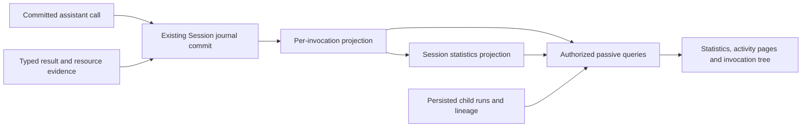
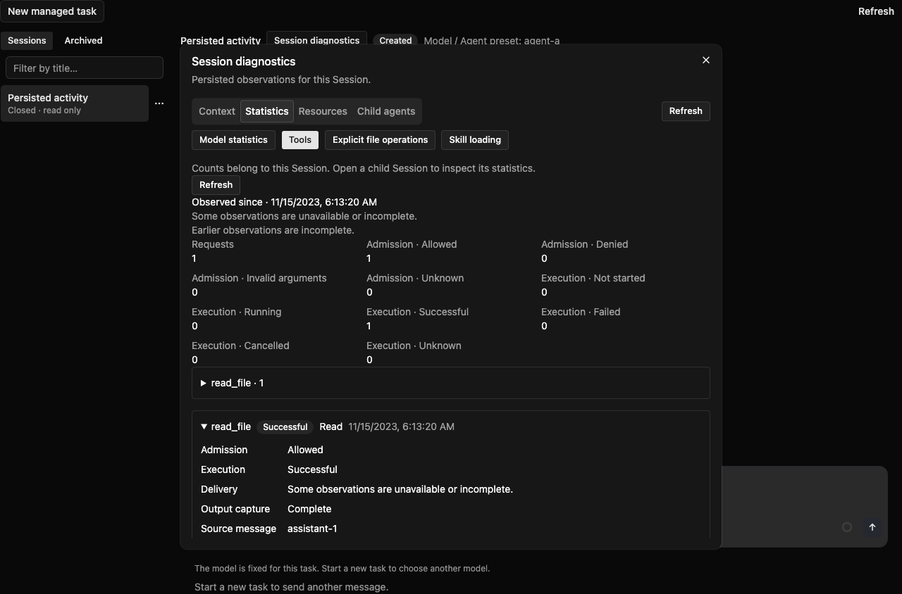
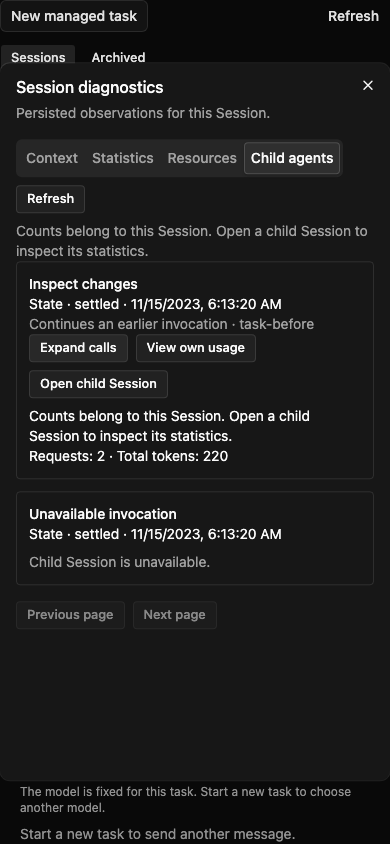

# Managed 会话执行诊断

[English](2026-11-07-managed-session-execution-diagnostics.md) | [简体中文](2026-11-07-managed-session-execution-diagnostics.zh-CN.md)

状态：已实现 A/B/C，作为 [PR #16475](https://github.com/QwenLM/qwen-code/pull/16475) 的后续改动。最初调研和本地定向检查基于其已审阅 head `42562a31bdd3779002504aeca569d381b0f7dd77`；后续 PR 记录当前依赖版本。第 14 节区分已实现行为与验证边界。完整 CI、性能与平台验收仍待完成。日期：2026-11-07，Asia/Shanghai。本设计不声称两项改动已合并或部署。

## 1. 建议与范围

在 #16475 的持久化诊断入口上补充**工具调用统计、显式文件操作、Skill 指令加载，以及可展开的子代理调用树**。以已提交的 Session 证据为权威；只有现有证据无法证明的事实，才补充小型类型化观察记录。

用户应能回答：哪些调用失败或被拒绝，显式工具读取或修改了哪些文件，某个 Skill 是否加载过，以及失败或模型用量归属哪次子代理调用。Runtime 停止后，这些视图仍应可读。

按后续切片交付，保持 #16475 的 Context、模型总量、配置资源和直接子调用 API 语义。递归展示不开放递归执行：当前 Managed 准入只允许一层子代理。本方案不包含完整模型/工具瀑布图、任意 Shell/MCP 文件系统审计、Skill 到后续动作的因果归因，以及多层执行准入。

## 2. 所属代码的调研发现

| 证据                                                                                                                                                                                                                                                            | 发现及设计影响                                                                                                                                                                                                   |
| --------------------------------------------------------------------------------------------------------------------------------------------------------------------------------------------------------------------------------------------------------------- | ---------------------------------------------------------------------------------------------------------------------------------------------------------------------------------------------------------------- |
| [已审阅提交中的 #16475 设计](https://github.com/QwenLM/qwen-code/blob/42562a31bdd3779002504aeca569d381b0f7dd77/docs/design/2026-11-06-managed-session-diagnostics-and-organization.md)                                                                          | 四组持久化诊断 API；模型总量和近期样本、Skills/MCP 配置、直接子调用。明确排除了工具/文件/Skill 统计和递归图。近期模型样本不能还原无限历史的逐调用时间线。                                                        |
| [Hosted 工具分发](../../packages/cli/src/serve/hosted-workspace-tool-turn.ts)，4995–5034、5135–5165 行                                                                                                                                                          | 被拒绝批次，以及 agent/message/team/command/plan/question/skill/todo/workflow 调用，可能不经过 native `tool.intent`。应以已提交 assistant functionCall 的每次出现为分母，再结合 intent、receipt 和 domain 证据。 |
| [ChatRecord](../../packages/core/src/services/chatRecordingService.ts)，412–428 行；[调用绑定](../../packages/cli/src/serve/hosted-workspace-tool-turn.ts)，5214–5228 行                                                                                        | 消息 UUID、Session 身份、prompt 身份和调用序号可建立出现身份。规范化 function-call ID、实际保留的原始 provider ID 和 Runtime execution ID 是不同的关联字段。                                                     |
| [工具结果协议](../../packages/core/src/managed-runtime/managed-tool-result.ts)，71–100、200–221 行                                                                                                                                                              | 执行、输出捕获和交付有独立状态。命令执行成功但输出被省略，不应变成执行失败。                                                                                                                                     |
| [Hosted 文件历史](../../packages/cli/src/serve/hosted-workspace-tool-turn.ts)，4947–4970、5817–5827 行                                                                                                                                                          | 备份准备发生在写入前，且有启用条件。它既不能证明修改成功，也不记录每次读取。                                                                                                                                     |
| [Skill 清单](../../packages/cli/src/serve/hosted-skill-catalog.ts)，266–332 行；[Skill 分发](../../packages/cli/src/serve/hosted-workspace-tool-turn.ts)，8632–8674 行                                                                                          | 普通 Skill 加载指令；同一个 `skill` 工具也可能展开 extension command。资源类型与选定 pin 必须来自解析器。                                                                                                        |
| [子代理限制](../../packages/core/src/managed-runtime/managed-child-operations.ts)，40–58 行；[子会话准入](../../packages/managed-agent-server/persistence/src/main/java/com/alibaba/qwen/code/managedagent/persistence/AgentSessionAdmissions.java)，471–483 行 | Runtime 准入深度为 1。解析器支持更深记录，不证明 public 多层执行已经可用。                                                                                                                                       |
| [Daemon agent trace](../../packages/core/src/agents/agent-transcript.ts)，198–361 行；[UI telemetry](../../packages/core/src/telemetry/uiTelemetry.ts)，172–206、894–940 行                                                                                     | Daemon 已有本地 metadata 谱系和工具/Skill 计数，但所属边界、证据来源不同。可复用展示思路和纯格式化，不把其本地文件读取或进程聚合当作 Managed 权威。                                                              |

以上均为静态源码发现。本次没有读取真实用户 Session，没有测量生产负载，也没有重跑 #16475 报告的测试。

## 3. 外部参照与方案选择

[OpenTelemetry 的 GenAI 示例](https://opentelemetry.io/blog/2026/genai-observability/)区分 agent、模型和工具操作。[Langfuse 数据模型](https://langfuse.com/docs/observability/data-model)区分包含多轮交互的 Session、单请求 trace 和嵌套 observation。它们可作为建模参照，不证明 qwen-code 已经持久化这些关系。

采用调用、所属 Session 和关联操作相互分离的思路，保留显式 parent/association ID，便于后续遥测适配器映射。产品诊断不依赖外部 collector、采样 span 或 trace 后端。[OpenTelemetry 属性注册表](https://opentelemetry.io/docs/specs/semconv/registry/attributes/gen-ai/)也已指向迁移后的 GenAI 规范；我们的持久化契约应独立分配版本，不把演进中的外部名称直接当作存储 schema。

| 方案                                   | 决定                                                                    |
| -------------------------------------- | ----------------------------------------------------------------------- |
| 每次读取时解析可见对话文本或工具描述   | 不采用：截断、本地化和自由文本不能证明执行状态或资源身份。              |
| 复用 daemon telemetry 总量             | 不作为权威：不同执行路径和聚合边界不能证明 Managed 覆盖率或重放正确性。 |
| 新建 tracing 服务或图数据库            | 暂缓：已有 journal、资源、record 和谱系存储足以支持本次范围。           |
| 投影已提交事实，并补齐缺失类型化元数据 | 推荐：持久身份、被动读取和明确覆盖状态可以沿用现有生命周期保证。        |

## 4. 产品入口

保留一个诊断弹窗，在统计区增加工具、文件和 Skill 加载视图，资源配置清单独立保留。将子代理页升级为可展开调用树，同时提供可访问的列表表示。沿用 WebShell 现有基础组件、portal container、主题 token 和焦点行为。

| 视图       | 主要信息                                                             | 含义                                                                       |
| ---------- | -------------------------------------------------------------------- | -------------------------------------------------------------------------- |
| 工具       | 请求次数、已知执行结果、拒绝、取消、未决调用、逐工具桶和分页调用明细 | 请求不一定执行；输出交付问题单独标记。                                     |
| 文件       | 显式读/写/编辑请求及结果、已记录的工作区相对路径、所属调用链接       | 标题为**显式文件操作**。搜索命中、目录枚举和隐式文件系统活动不算文件读取。 |
| Skill 加载 | 解析后的 Skill 与 pin、模型/用户来源、加载请求与已提交指令结果       | 配置可用和实际加载是不同事实；extension command 单独标识。                 |
| 子代理     | 调用状态、有权限的子会话链接、自身用量、按需展开后代、续接关系       | 同一种 agent 的多次调用是不同节点；子会话缺失不删除父调用。                |

默认只展示选定 Session 自身指标，进入子会话后查看其自身指标，不把子用量加进父用量。如果后续增加可见子树小计，必须按 Session ID 去重，并明确这是已加载、有权限的子集，不是根会话全生命周期总量。

覆盖状态与数值就近展示，例如“自某时刻起观察”“执行结果不可用”“较早调用未记录”“超出名称容量的项目合并为其他”。已知零值、没有观察、过期状态和历史不完整必须有不同展示。协议版本和内部提交细节放在可展开诊断信息中。

## 5. 统计口径

### 5.1 工具

统计单位是已提交 assistant 消息中的一次 functionCall 出现，包括显式合成的用户 Skill 调用。以 tenant、所属 Session、assistant 消息 UUID 和该消息内 functionCall 序号生成版本化摘要身份。`promptId`、规范化 `functionCallId`（持久化的 `functionCall.id`）、仅在另有记录时提供的原始 `providerCallId`、native `executionCallId` 和 task ID 是不同关联字段。内部 `callId` 不一定是 provider 原始 ID，见 [ToolCallRequestInfo](../../packages/core/src/core/turn.ts)。调用序号不是任意 content part 的数组下标。不能只按名称、参数或 provider call ID 去重。概要分母覆盖对话工具请求，不把 Hook 内部命令和 Broker 操作静默混入。

分别保留准入状态（`allowed`、`denied`、`invalid`、`unknown`）、执行状态（`not_started`、`running`、`success`、`error`、`cancelled`、`unknown`）和结果交付状态。`running` 必须有执行证据；没有配对结果的请求，在 owner 活跃时仅表示 pending，否则表示 unresolved。重启或结果缺失不能证明副作用失败。结构化恢复证据可以解释中断，但不能据此断言已回滚。

`requested` 只计一次，分别展示执行已知和结果已知的分母。只有明确决策才算拒绝，参数无效与拒绝分开。重传、checkpoint reload 和终态 replay 更新同一次出现；显式新请求是新调用。物理 attempt 是独立可选指标，生产者无法证明时保持不可用。

后台启动成功表示任务准入成功，不表示任务工作已经完成。调用旁展示最终 task 状态，不改变 launch success 的含义。同样，extension command 的内部预处理步骤是关联活动，不额外增加模型请求调用数。

不能把 `tool.intent` 到 receipt commit 的时间标成执行耗时，其中包含等待、传输和持久化；部分恢复结果时间戳还是重建值。在 executor 边界直接测量之前，精确执行耗时保持可空；展示 journal 区间时必须明确标签。平均值只使用已知耗时样本，并展示样本数。不从有界近期样本计算整个 Session 的 p95。

### 5.2 文件

首期覆盖 Hosted profile 支持的显式 `read_file`、`write_file` 和 `edit`。请求操作和已证明结果分开保存。文件备份 prepare 不是写入回执。读取成功表示工具返回了内容，不证明模型实际使用内容，也不证明读取了整个文件。

由解析后的工具 adapter 在执行前提供归一化路径和当时工作目录上下文，结合已记录 workspace 身份，仅展示有权限的工作区相对路径。不能按当前 Runtime 重新解析路径，不能在诊断读取时解引用符号链接，也不能合并不同工作区的同名路径。无法证明安全归一化或工作区边界时，保留调用，隐藏路径并标记字段不可用。

文件访问覆盖不包含 Shell、脚本、MCP 内部和任意子进程 I/O。Glob 命中是发现，搜索根目录是 selector。只有其他文件工具的 adapter 能发出同等结构化事实时，才扩展覆盖。不能解析 Shell 命令或 MCP 参数后宣称完整。

累计概要统计成功操作次数，不统计唯一文件数；分页明细允许路径重复。全会话唯一文件数和净变更暂缓。后续若展示行数变化，应来自该操作已记录的 before/after 证据，并标为累计编辑量；实时 Git diff 包含无关修改，不适合作为证据。

### 5.3 Skills

在分发时记录 `resourceKind: skill | extension_command`、解析后的名称、不可变 catalog/bundle 身份，以及 `origin: model | user | unknown`。Skill 桶按资源身份和 pin 区分，不能只按显示名称合并。指令加载成功表示解析后的指令结果已提交，不证明后续模型请求已消费或遵循指令。指令完整性单独表达：现有 response-budget finalizer 可以在提交前截断 Skill 输出。保留 `complete`、`partial` 或 `unknown` 交付覆盖及已记录的截断来源，不能把部分结果标为完整指令交付。

类型化加载元数据关联同一个工具出现，因此工具页与 Skill 加载页是同一动作的两种视图，不能相加为独立工作量。Extension command 与其预处理步骤保持独立。有关联证据时，预处理步骤复用现有 `tool_stage` 身份。

配置清单、路径触发的可发现状态、已有 `skill_activation` domain 名称，以及直接读取 `SKILL.md`，均不是 Skill 调用证据。历史记录无法区分类型或缺少 pin 时保持未知。不能仅因某次工具、token 消耗或子调用发生在加载之后，就将其归因给该 Skill。

### 5.4 代理关系

以父会话持有的子调用作为节点身份，即 parent Session 加 child-run/task identity。Child Session 是可选且独立授权的目标。区分 `parentSessionId`、`childRunId`、`childSessionId`、已记录 depth 和 `predecessorChildRunId`。Definition/agent 名称是标签，不是身份。

父子边只来自相互一致的持久化 run 和 lineage。续接是另行标识的关联，不是父子边。检测环、重复目标和损坏谱系，停止展开并显示相应覆盖原因。不能通过描述、时间或相同 agent 名推断关系。

递归采用 #16475 直接调用接口的惰性组合：每次展开以该 child 作为下一级 parent，返回的每个链接仍执行现有独立授权与谱系校验。每个请求保持 Session 作用域，首版不增加“任意 root ID 的全部后代”公开查询。可展示经过验证的更深历史关系，不修改创建准入；正常的当前 Managed Session 通常只有一层。

## 6. 证据模型与采集

使用关联现有 message、intent、result 或 extension record 的小型类型化诊断事实。下表描述已实施的语义；闭合叶子契约见第 14 节：

| 字段组 | 必须表达的含义                                                                                           |
| ------ | -------------------------------------------------------------------------------------------------------- |
| 身份   | `schemaVersion`、`invocationId`、所属 Session、assistant UUID 和调用序号；内部 source sequence/reference |
| 关联   | Prompt、规范化 function call、另有记录的 provider call、Runtime execution 和 task 身份；只接受已校验关联 |
| 工具   | 解析后的公开工具名、built-in/MCP/Hosted 类型；有记录时才提供 MCP server 和选定 pin                       |
| 状态   | 准入、执行、capture/delivery 观察及安全 reason code，各自表达已知/未知                                   |
| 时间   | 来源观察时间；executor duration 必须有明确测量来源                                                       |
| 文件   | 类型化操作、安全工作区相对路径和 workspace 关联、结果证据                                                |
| Skill  | 实际解析的资源类型、pin、origin、指令结果提交事实和交付完整性                                            |
| 覆盖   | 缺失字段、采集起点、source revision 和显式截断                                                           |

从持久 assistant 消息派生请求出现。Runtime 工具复用现有 intent/binding/result 关联补齐证据；Hosted-only 工具在实际验证和分发分支补齐。拒绝、取消和结果发布使用类型化结论，不解析本地化错误文案。新增 Skill/文件元数据应在解析器仍持有归因时采集，不能等到其被压平成展示文本之后。

元数据必须与已有持久来源共用提交。如果来源资源需要新增字段，应引入带版本的资源契约和引用闭包，不能向闭合的 v1 parser 随意追加未知字段。诊断事实和公开响应不包含大输出、prompt、参数、Skill 正文、文件内容、环境、私有资源定位符或凭据。采集遗漏要体现为 coverage gap；不能静默吞掉真正的持久化提交错误。特别是，[资源引用遍历](../../packages/core/src/managed-runtime/managed-session-resource-references.ts)刻意跳过不透明 arguments/results 和 message Parts。必须在版本化来源 envelope 上声明受支持的引用位置，并同步修改 TypeScript 与 Java 闭包读取器；把 `diagnosticsRef` 塞进任意 response JSON 并不能保留资源。

图中表示数据流：已提交调用与类型化结果进入现有 Session journal，形成逐调用及会话统计投影，再与持久化谱系一起供授权查询读取，最终驱动统计、明细和调用树。它不引入另一套执行引擎或 journal。

## 7. 持久化、重放与有界性

复用 `ma_session_record` 和不可变 `ma_resource` body。拟议派生投影 domain 为 `hosted_tool_diagnostic`、`hosted_file_diagnostic`、`hosted_skill_diagnostic`、`hosted_tool_execution_link` 和 `hosted_activity_statistics`。它们是内部读投影，不是新增可执行 extension domain。为其实现专属类型化 projector/query 路径；现有 extension-record reader 校验闭合 domain 白名单，不能原样复用。`record_kind` 仍为 `DOMAIN`，`task_kind` 和 `delivery_state` 均为空，诊断投影不能作为可执行 Task 出现。

每个 invocation 保留一条最新工具观察，另设引用其类型化证据的文件/Skill 查询条目。若未来准入的工具有多个文件目标，文件 key 包含 file ordinal。Session 的 `latest` 概要保存累计标量和有界具名桶，不复制对话正文，也不增加独立事件接入服务。

投影在现有来源提交事务中、通过 replay/fencing 检查后更新。新 source revision 计算该次出现的新旧贡献差值，并只更新一次概要。重放相同已提交 bytes 的贡献为零；同一来源身份/revision 的内容冲突沿用现有冲突规则。请求总量单调增长，状态分类计数可以从 unknown/pending 转入已知结果。不能反复累加累计快照，也不能把结果发布的每次 revision 都加一次。

投影资源沿用已有 record ownership/GC 规则，替换引用时释放旧 ownership。首期明细保留期跟随 Session 生命周期，不增加会破坏去重证据的独立短 TTL。删除 Session 时按相同策略删除诊断投影。压缩或展示历史截断不重置计数。

选择**可重建的服务端投影**，不再增加 producer 持有的另一套累计快照。现有 [native snapshot census](../../packages/managed-agent-server/persistence/src/main/java/com/alibaba/qwen/code/managedagent/persistence/ManagedNativeJournalSnapshots.java)纳入 JOURNAL-owned 资源，只有 record ownership 的服务端派生概要不会自动转移。新增来源事实及采集锚点必须由 journal 声明并进入引用闭包。完整 native restore 后，按来源 commit 顺序，通过确定、版本化 reducer 重建明细和概要。这在 restore/rebuild 生命周期中分有界批次执行，不在诊断 GET 中执行；只有声明覆盖区间重建完成后才发布 ready 状态。

如果转移/profile 缺少完整来源区间，或不理解相应版本，应按契约返回 unavailable/partial 诊断或拒绝该 profile，不能承诺私有来源截断后仍保留全生命周期总量。来源不完整时仍保留累计值，需要 journal 锚定的累计 baseline，本期暂缓。这不影响被动读取已有 SQL 持久投影。

首个携带新事实的来源 commit 声明持久 collection epoch 和 reducer version，以其 committed sequence 作为采集起点。后续事实引用同一起点身份，重启时恢复该身份，不能重新取服务启动时间。重建使用记录的版本和 pin，而非当前配置。概要覆盖从该起点到已应用 source sequence 的区间。只有从首个相关事件开始观察的 Session，才能宣称覆盖整个生命周期。旧会话不凭空得到历史总量；GET 不执行自动无界补扫。若需要历史回填，另立后续操作。新请求只有在身份可证明时才可关联旧持久证据；孤立终态证据不能虚构一条缺失请求来补分母。

首期实现预算如下，仍需实测：

- 每个诊断资源遵守已有 UTF-8 64 KiB inline 限制，不塞入 #16475 已分配预算的模型统计 envelope。
- 概要最多保存 64 个具名工具桶、64 个具名 Skill 桶，并各保留一个显式 Other 桶。覆盖区间内标量总量保持准确；具名桶准入确定且固定，Other 不代表精确 top-N。条目数和序列化 bytes 都要限制，较长标识可能提前触发 overflow。
- 每条事实最多携带 一个文件目标及有界标识。省略明细必须有原因/数量；生产者不知道省略数量时应明确说明。计数不能假装测量了未记录目标。
- 活动页默认 50 条，最大 100 条；单次请求最多检查 512 个候选行、读取 8 MiB 资源、返回 1 MiB 公开结果。触及 byte/scan 限制时返回部分覆盖，并从最后检查的 key 继续，避免反复访问同一超限行。
- 调用树单个视图最多 200 个调用节点、八层展示深度、四个并发读取。这些是读取预算，不是执行配额；未加载分支及限制提示必须可见，不能暗示返回的树已经完整。

点查复用 Session/record key。Domain 分页复用 `(session_scope_key, domain, delivery_state, gmt_create, record_key)` 索引，限定 delivery state 为空，并使用稳定 keyset 排序。本方案不新增表或 DDL。验收前必须验证真实 MySQL 执行计划和提交开销；只有实测证明需要时，才修改设计增加针对性索引。

## 8. 读取 API 与权威边界

保持 #16475 四组路由兼容，增加两组 Public/WebShell API，共用经过授权的应用服务：

| Public GET                                | WebShell POST                                          | 语义                                                 |
| ----------------------------------------- | ------------------------------------------------------ | ---------------------------------------------------- |
| `/v1/agents/sessions/{id}/activity-stats` | `/api/agent/web-shell/v1/session-activity-stats/query` | 仅当前 Session 的工具/文件/Skill 概要及覆盖状态      |
| `/v1/agents/sessions/{id}/activity`       | `/api/agent/web-shell/v1/session-activity/query`       | 有界明细分页；`kind` 为 `tools`、`files` 或 `skills` |

`kind` 选择固定类型化投影 domain，不接受任意 SQL 条件或资源命名空间，不提供任意全文/参数搜索。直接子调用仍使用 `agent-trace`，任务状态仍使用 task details；模型总量仍来自 `/stats`。

每个响应包含 `schemaVersion`、`sessionId`、`scope: self`、`readRevision`、`coveredThroughSequence`、`coverageStartSequence`、可用性和覆盖原因。未知字段为 null，适用时附测量分母。Journal revision 与 sequence 使用十进制字符串，并保留各自不同语义。来源链接通过已有授权 message/task 路由解析，不暴露原始资源定位符。

每个响应采用短只读 `REPEATABLE_READ` 事务。Opaque cursor 绑定 tenant、actor、Session、kind 和 query version，包含首页 membership upper sequence 及最后检查的 `(gmt_create, record_key)`，投影创建排序保持不可变。Cursor 固定成员集合，不保证跨多次请求的可变结果状态一致；每页返回自己的当前 read revision。不能宣称多个子 Session 的调用图是全局原子快照。

路由所属范围是**持久化 Session 及其已记录 Workspace 授权**。所有路由调用现有 readable-Session gate，读取 child 时独立校验。不能回退到 primary daemon runtime、其他 workspace 或进程内计数。读取不 acquire、attach、resume、预热或启动 Runtime，不执行 discovery，也不读取当前文件系统。

Child 目标不可用时，仅保留原本可读的父调用，不返回 child ID、链接、指标或后代数量。缺失和无权访问沿用现有不泄露存在性的行为。可见树路径在保留新刷新后代数据之前，应先刷新祖先读取权限；祖先被拒绝时清除对应子树，root 被拒绝时清空面板。独立可读的子会话仍可从其自身授权入口打开。

响应采用 private/no-store。只在视图可见且 Session active 时沿用 #16475 的五秒刷新；关闭的会话按需刷新。Session/provider/actor 变化、节点折叠或弹窗关闭时取消并忽略过期请求。暂时读取失败与“该 child 没有后代”必须区分。

## 9. 兼容与恢复

先部署 reader/projector，再启用新资源版本的 producer。新增类型化资源或来源引用必须同时在 TypeScript、Java 和 fixture 中显式版本化。所需下一 reader floor 应基于实施时 main 分配，不能假设今天尚未占用的编号届时仍可用。

旧 reader 必须能够正确保留声明的诊断资源，否则按协商 floor 拒绝，不能依赖静默忽略新字段。来源资源校验、引用 census、native snapshot 转移、restore 和投影重建必须一起覆盖。不能保存这些证据的 CSI profile 保持原状或明确不支持；新增诊断兼容 profile 也不能扩大执行权限。

请求已提交、终态观察尚未持久化时发生进程退出，应保留请求及 unresolved 结果。结果已提交但响应丢失时，重放必须保持计数。Runtime 停止不影响读取已提交投影。Legacy、truncated、unsupported 和 interrupted 覆盖原因在 reload 后保留。使用不完整来源历史重建时，不能以较小且伪称完整的概要覆盖原有更完整概要。

## 10. 实施所属模块

| 层次       | 所属区域与工作                                                                                                                                                                                                                                                                                                                                                            |
| ---------- | ------------------------------------------------------------------------------------------------------------------------------------------------------------------------------------------------------------------------------------------------------------------------------------------------------------------------------------------------------------------------- |
| Producer   | [Hosted tool turn](../../packages/cli/src/serve/hosted-workspace-tool-turn.ts)、[Skill catalog](../../packages/cli/src/serve/hosted-skill-catalog.ts)、[extension command](../../packages/cli/src/serve/hosted-extension-command.ts)、适用 CSI/result adapter：在真实决策位置记录出现关联和类型化事实。                                                                   |
| 共享契约   | [Managed runtime](../../packages/core/src/managed-runtime/) 与 [Java persistence contracts](../../packages/managed-agent-server/contracts/src/main/java/com/alibaba/qwen/code/managedagent/contracts/persistence/)：事实校验、版本协商、引用闭包和共享 fixture。                                                                                                          |
| 提交与投影 | [JournalCommit](../../packages/managed-agent-server/persistence/src/main/java/com/alibaba/qwen/code/managedagent/persistence/JournalCommit.java)、[record store](../../packages/managed-agent-server/persistence/src/main/java/com/alibaba/qwen/code/managedagent/persistence/ManagedExtensionRecordStore.java)、恢复/GC 所属模块：原子投影差量、有界概要和生命周期集成。 |
| 查询与 API | #16475 的 diagnostic/trace service；[OpenAPI](../../packages/managed-agent-server/contracts/src/main/resources/openapi/managed-agent-public-api.openapi.json) 与 [SurfaceRegistry](../../packages/managed-agent-server/verification/src/test/java/com/alibaba/qwen/code/managedagent/api/SurfaceRegistry.java)：Session 范围查询及 Public/WebShell 对齐。                 |
| WebShell   | [#16475 诊断面板](https://github.com/QwenLM/qwen-code/blob/42562a31bdd3779002504aeca569d381b0f7dd77/packages/web-shell/client/components/managed/ManagedDiagnosticsPanel.tsx)、其 provider/hook 和 child viewer：新增视图、惰性调用树和可用性状态；重新生成 OpenAPI 派生类型。                                                                                            |

不为此功能引入通用 observer bus 或图框架，仅共享已有明确消费者的类型化 fact/reducer 函数和展示基础组件。

## 11. 交付切片

| 切片        | 交付物                                                          | 完成条件                                                                                |
| ----------- | --------------------------------------------------------------- | --------------------------------------------------------------------------------------- |
| A：工具证据 | 调用身份、请求/结果投影、概要和工具视图；缺乏证据时明确 unknown | 覆盖全部分发分支，证明重复/replay 与停止 Runtime 后读取正确，不虚构执行耗时             |
| B：资源使用 | 类型化文件/Skill 元数据、独立明细投影和 UI                      | 证明真实文件结果、Skill/command 区分、用户/模型来源和固定资源身份；旧历史仍明确部分覆盖 |
| C：调用树   | 惰性组合直接子调用、查看自身用量、处理损坏/受限谱系             | 证明重复调用、续接、撤权和读取预算；现有执行深度准入不变                                |

每个切片包含自己的契约、兼容性、定向测试和 UI；reader 尚不能保留事实时，不先发布 producer。切片 C 在 #16475 之后可独立推进，不等待多层执行支持。整次运行的模型/工具瀑布图或整棵子树核算需要另行提案，因为 #16475 的近期样本和独立读取的 child revision 不足以证明这两项能力。

## 12. 验证与验收

| 场景                                                                   | 必需证据                                                                                            |
| ---------------------------------------------------------------------- | --------------------------------------------------------------------------------------------------- |
| 一次成功读取、一次拒绝编辑、一次取消 Shell、一次成功 Skill 加载        | 四个逻辑请求；拒绝不算执行失败；已知结果与未知项的分母正确；一次显式成功读取和一次已提交 Skill 加载 |
| 执行成功，但输出截断、省略或交付受阻                                   | 保留执行成功，显示 capture/delivery 限制                                                            |
| 重复相同调用、不同已接受消息复用 provider ID、retry 和 commit 回应丢失 | 不同消息出现独立计数；同一次出现 replay 不递增                                                      |
| Hosted-only 工具及 extension command 预处理                            | 请求分母不漏项；内部步骤保持关联，与模型请求调用分开统计                                            |
| 同名 Skill 不同 pin，用户/模型入口，经 `skill` 触发 extension command  | 资源身份/来源独立，不把 command 错算成 Skill 加载；截断指令交付仍标为 partial                       |
| Glob、Shell、MCP 访问文件，backup 已准备但写入失败                     | 不据此宣称显式文件访问成功，也不产生错误写入回执                                                    |
| 终态提交前后 kill，close/load，压缩，完整/不完整 CSI 来源转移          | 完整来源重建保留计数和 epoch，不完整来源保持 unavailable/partial；不虚构失败，不重复计入            |
| Runtime 停止，对 MCP discovery 加观察                                  | 所有诊断视图读取持久数据，Runtime acquire/discovery 调用数为零                                      |
| 父 P 两次调用 C，其中一次续接前次调用                                  | 调用节点独立，续接不是嵌套，Session 用量不重复累加                                                  |
| 合法多层历史 fixture、孤儿/环、无权读取 child                          | 展开有界，谱系不完整显式；不暴露无权读取身份/指标/后代；fixture 不证明多层执行支持                  |
| 慢请求期间撤权或切换 Session                                           | 清除旧面板/子树，迟到响应不恢复旧数据                                                               |
| 大历史、多工具/Skill 名称、长 Unicode 路径和并发提交                   | 遵守 byte/row/node 预算，cursor 稳定推进，Other/partial 明确，GET 没有无界扫描                      |

实施时从对应 package 目录运行定向 TypeScript 测试；跨语言变更运行根目录 build/typecheck，以及受影响 API/SurfaceRegistry 测试并重新生成类型。投影并发、执行计划和 replay 事务使用真实 MySQL，kill/restart 和被动读取使用打包 Harness。UI fixture 仅证明布局与交互。遵守 [Managed 模块验证预算及 CI 规则](../../packages/managed-agent-server/AGENTS.md)，不能用 fixture 或 H2 替代完整验收。

本变更需要格式、引用检查和连续两轮无问题自审。定向测试结果见第 14 节；真实模型运行、数据库性能验收、部署及完整 CI 验收仍待完成。

## 13. 待落实决策与风险

推荐首版不依赖外部 tracing，不增加数据库 DDL，不做历史回填，也不声称精确 executor timing。切片 A 应以写入开销实测和 MySQL 执行计划验证这些选择。主要技术风险在持久资源/恢复契约变化，必须与新增事实放在同一交付切片。

64 桶、200 节点及 byte 限制是初始工程预算，不是实测容量。仅基于工作负载证据调整，并保持 overflow 和部分覆盖显式。精确逐文件去重数、整树总量、导出/长期分析及 executor timing，可以在产品需求足以支持额外存储和一致性契约时单独排序。

## 14. 已实施的契约与交付约束

### 14.1 来源与生产者

仅在 `message.committed`、`tool.intent` 的闭合 payload 中增加可选 `diagnosticsRef`，引用叶子资源 `managed-execution-diagnostics` /1。正文包含 `schemaVersion: 1`、`reducerVersion: 1`、`epochId`、`startEventId`、`sourceEventId`、`observations`、`coverageReasons`、`omittedObservationCount`。绑定 Session 的调用摘要为 SHA-256(JSON 数组 `["managed-tool-invocation/1", tenant, session, assistantUUID, functionCallOrdinal]`)。`sourceEventId` 必须匹配承载事件；序号仅计算 functionCall。保留规范化调用 ID、确有记录的 provider ID、execution ID 和 task ID，互不替代。

普通 sink 与原子最终模型输出共用采集器；后者仍以 `model.attempt + message.committed` 一次提交。原子命令摘要为 `managed-final-output/2`；单消息/intent 使用 `managed-execution-commit/1` 将原 content/args digest 与诊断 digest 绑定。已提交消息重放直接复用原诊断引用，旧提交没有引用时也不追加。准备好的引用、epoch 和 bytes 在重试中冻结；仅首次已提交来源建立持久采集起点。

普通 Runtime 使用结构化 `executionStatus` 和 capture 字段；Hosted 成功在实际结果构造处分辨，并在输出预算处理后记录交付完整性。Intent 本身不设置 running；缺少结构化结论保持 unknown。Receipt 用 execution ID 点查 `hosted_tool_execution_link`，其记录直接引用 intent 的诊断资源；重复相同关联幂等，关联不同调用拒绝。缺少旧关联只标注缺口，不猜测历史。

文件解析仅覆盖内置 `read_file / write_file / edit`，每请求一个目标。每批文件操作在既有 `/runtimes:capabilities` 读取经过同次 Workspace 解析的 scope 与 `workspaceContext`，冻结 cwd；它不是新的权限或执行路由。只保存工作区相对逻辑路径，拒绝绝对路径、上级路径、URL、反斜线和控制字符。缺少上下文或不安全路径时保存 null 及 `file_path_unavailable`。恢复沿用原证据中的路径。Skill 在 resolver 持有选定资源时记录类型、名称、内容/配置摘要 pin 与来源；`skillLoads`、`extensionCommands` 分开汇总，`skills` 是二者合计，工具页与 Skill 页共享调用身份。

### 14.2 原子投影与恢复

专属 DAO 在现有 journal 事务通过 fencing/replay/source 检查后、发布 head 前运行确定性 reducer。按新旧调用贡献差更新统计，不把流式 delta 作为统计写入。明细使用内容寻址的 `managed-activity-projection` 资源与既有 SESSION_RECORD 引用；执行关联直接指向来源叶子。所有来源进入 JOURNAL census 与 native snapshot 闭包。关闭、压缩和重启不重置总量；删除跟随 Session 资源回收。

统计最多 64 个工具归属/名称桶、64 个 Skill 身份/pin 桶及各自 Other；命名桶到达序列化预算后永久关闭新准入，避免状态更新时把 Other 错移到新桶。尚未解析归属的工具暂列 Other。每份来源资源最多 64 KiB，省略的观察保留计数；请求分母仍从完整 assistant 消息派生。文件/Skill 缺少元数据时不虚构资源统计。

来源恢复后的首次 writer 准入按 Session fence 串行重建。清理每批最多 512 条旧派生记录；来源每批最多 512 个事件或 8 MiB，分别提交并保存 `rebuiltThroughSequence`、`rebuiltThroughRevision`。追上 head 才 ready；GET 不启动重建。单个来源事务超过 8 MiB 时明确拒绝该恢复路径，不能声称完整。已声明来源缺失或摘要不匹配是完整性错误。旧会话从新 epoch 起点开始，起点前的迟到结果不增加请求数；保留起点缺失的旧 epoch 并标注不完整。

### 14.3 API 与界面

Public `GET /v1/agents/sessions/{id}/activity-stats`、`GET /v1/agents/sessions/{id}/activity` 与 WebShell 对应 `POST /api/agent/web-shell/v1/session-activity-stats/query`、`POST /api/agent/web-shell/v1/session-activity/query` 共用 Session/Workspace 授权和只读 REPEATABLE_READ 服务。响应包含版本、Session、self scope、十进制字符串 revision/sequence（未知 null）、覆盖起点与上界、可用性和原因；未 ready 不暴露貌似完整的部分概要。GET 不 acquire、attach、预热 Runtime，也不 discovery MCP；`private, no-store`。

明细类型由 `kind=tools|files|skills` 闭合选择；默认 50、最多 100。Cursor 绑定 tenant、actor、Session、kind、查询版本、首页 first_sequence 上界及最后已处理候选的排序键，新增文件/Skill 索引不进入固定页集合。每页最多检查 512 个候选、读取 8 MiB 以内来源、返回 1 MiB 以内结果；触及输出预算返回 partial 及续页。状态来自各页独立读取快照，不承诺跨页状态冻结。已知后台任务单独补充 taskState/taskRuntimeState，不改变工具启动成功的含义。

统计子视图为模型、工具、显式文件操作、Skill 加载；覆盖提示与分类数值就近显示，缺少采集与已知零不同。调用树仍逐 parent 调用既有 agent-trace，节点以 parentSessionId+taskId 标识，child 身份独立授权与谱系验证。续接只返回同一可读父会话内验证的 predecessorTaskId。上限为当前视图已准入 200 节点、8 层、4 并发；默认不展开后代，仅选中节点读取自身用量。活动视图每 5 秒刷新，关闭、折叠和身份切换取消旧请求；子树刷新先重验祖先，撤权清空内容。

### 14.4 兼容、验证与剩余工作

中断后的 Skill 与子任务结果恢复路径提交与普通分发相同的类型化观察。Skill pin 共用一个 resolver 辅助函数；结果预算保留 partial 交付，被阻止的 capture 不会被显示为完整工具输出交付。文件概要包含固定的 `read`、`write`、`edit` 分类。重建校验 revision、事件 sequence、来源 Session 和前驱 digest 的连续性，并在发布 ready 前核对 fence 下的 head revision 与 digest。命名桶字节准入仅依赖两个桶数组，重建进度等瞬态字段不会改变分类。

本实现基于 #16475 的 floor 3，使用下一 floor **4**。TypeScript/Java 的闭合事件、资源验证、摘要证明、引用枚举、恢复 allowlist、OpenAPI 和生成类型一起更新。新增 `csi-files-retirement/3`：`diagnostics: model-v1`、`activityDiagnostics: activity-v1`，工具和权限仍为原文件 profile。`/1`、`/2` 语义不变，既有会话不隐式升级；新建私有 CSI 会话选择 `/3`。先部署兼容 reader/projector 再启用 producer；floor 4 会话不得交还旧 writer。

本地已执行共享 UTF-8 契约、工具/Skill 生产者、API/SurfaceRegistry、真实 MySQL 8.4 的事务重放/持久读取/重建/分页成员验证，以及 WebShell 桌面/窄屏交互测试；每次最终结果、失败原因和修复后的重跑记录在 `.qwen/e2e-tests/managed-execution-diagnostics.md`。CSI 原生库存与打包 Harness 使用真实本地进程和假模型验证，不能代替线上模型或平台验收。完整 Java 单元/H2、MySQL、Hosted/fault profiles、SpotBugs 及跨平台验收仍由 CI 完成。提交开销、EXPLAIN 与极限容量尚需实测；64 KiB、64 桶、200 节点均是首版预算。完整执行瀑布图、全树汇总、隐式文件审计、唯一文件数、Skill 因果归因及 executor 精确耗时继续暂缓。

最新审查后的 Java 增量（恢复连续性、分页候选上限、续接降级、资源归属约束和文件分类）已完成静态复核并补充回归测试，但受共享本地验证预算限制，尚未在本地重跑。此前 MySQL、API 和 CSI 的定向通过只证明各自当时的代码状态，不能视为最终版本完整验收；最终 CSI 重跑因与构建并发造成 dist 依赖缺失而失败。上述后续 Java 增量、完整 profiles 与平台验收明确交由 CI。

### 14.5 浏览器 fixture 证据

本次改动前，#16475 的弹窗提供 Context、模型统计、资源配置和直接子调用。基线 Chromium fixture 在 1280px 和 390px 通过；基线没有活动诊断接口或递归展开。

以下截图来自依赖更新至 `37e9442f8100f4c975d5ae865eba907fed512c49` 后通过的 Chromium fixture。它们使用确定性的模拟响应说明界面行为，不作为数据库、Runtime 不启动或 native 恢复验收。桌面视图区分执行成功与部分交付；窄屏子调用视图显示续接、独立读取的子会话用量和不可读调用。

### 14.6 基于更新后依赖的提交

本次提交以 #16475 的 `37e9442f8100f4c975d5ae865eba907fed512c49` 为 base。冲突合并在加入活动视图和调用树的同时，保留依赖的具体覆盖缺口提示及 trace 读取失败后的上一页入口。共用的 CSI profile 缓存读取器支持 `/3`，既有 history 绑定回归测试扩展覆盖该 profile。

更新依赖后，根目录 build、typecheck、bundle 通过；选定 Core 测试 443/443、WebShell provider/hook/panel 119/119、桌面/390px Chromium fixture 4/4 通过。打包 CLI 的三个选定生命周期用例通过，另八例刻意未选，覆盖新空调用 epoch/replay/load、默认 floor-2 兼容及依赖的基础工具 reload 调用方。首轮根 build 发现合并引入的重复翻译键，将集合覆盖提示与单个子调用提示分开后修正。PR 验证报告记录额外 CLI 回归选择和所有待验收项。依赖更新不重置已耗尽的本地 Java 预算；Java 冲突合并与最终服务验收仍待 CI。
