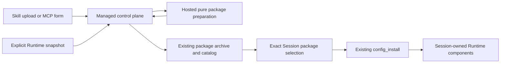

# Managed Skills and MCP Self-Service

[English](2026-11-07-managed-skills-mcp-self-service.md) | [简体中文](2026-11-07-managed-skills-mcp-self-service.zh-CN.md)

## Status and scope

Approved implementation design, 2026-11-07. This document specifies self-service Skill installation, explicit Session updates, MCP configuration authoring, and personal MCP OAuth for Managed Agent. Implementation and verification are tracked separately; this document does not establish runtime acceptance.

The approved plan was checked against main `8660f754305b9f003064d58c96d1116b68073552`; implementation refreshes that baseline to `06a0cb32500e42f08452dd4ea641a4f967eef2d3`. The research findings and open PR references below describe the investigation on 2026-11-07, rather than promises about subsequent PR state. This design extends the existing [Managed extension package design](2026-10-24-managed-extension-packages.md), [Session Skills design](2026-10-19-managed-session-skills.md), [creation Skills design](2026-10-20-managed-session-creation-skills.md), and [Session MCP management design](2026-10-22-managed-session-mcp-management.md).

The main recommendation is to normalize standalone Skills and authored MCP configurations into existing extension packages. Reuse package publication, immutable pins, and `config_install`; add an authoring/import path that does not depend on a daemon. Personal OAuth needs a separate actor-scoped credential flow because current extension settings are shared within a Workspace.

## Research findings

| Area                        | Behavior in the baseline                                                                                                                                                | Remaining gap                                                                                                                     |
| --------------------------- | ----------------------------------------------------------------------------------------------------------------------------------------------------------------------- | --------------------------------------------------------------------------------------------------------------------------------- |
| Static Skills               | Session creation can import instruction text from an explicitly selected trusted daemon Workspace. The snapshot remains fixed.                                          | Asset directories are not transported by this path; existing Sessions do not rediscover changed source files.                     |
| Extension Skills            | Packages already contain Skills and assets and support explicit versioned application to eligible idle Sessions.                                                        | A standalone Skill needs packaging, and the current WebShell preparation flow requires a daemon.                                  |
| MCP configuration           | The independent MCP manager selects published definition pins and manages their lifecycle. Extension packages already accept MCP launch/transport recipes and settings. | The independent manager has no direct recipe-authoring entry; managed-only users cannot prepare a package through the current UI. |
| Credentials                 | Immutable extension settings revisions are encrypted and scoped by tenant, Workspace, and extension.                                                                    | They are not private to the actor who entered them. Managed HTTP transports do not implement an interactive OAuth provider.       |
| Runtime directory discovery | The daemon has Skill discovery and refresh machinery. Managed Skills use static resources or exact package pins.                                                        | No managed import flow snapshots Skills from the selected execution Runtime.                                                      |

The relevant owning sources are the [creation importer](../../packages/web-shell/client/components/managed/managed-creation-skills.ts), [Hosted Skill catalog](../../packages/cli/src/serve/hosted-skill-catalog.ts), [package compiler](../../packages/core/src/extension/managed-package.ts), [Managed Extensions page](../../packages/web-shell/client/components/managed/ManagedExtensionsManagerPage.tsx), [daemon preparation route](../../packages/cli/src/serve/routes/managed-package-preparation.ts), [package/settings service](../../packages/managed-agent-server/control-plane/src/main/java/com/alibaba/qwen/code/managedagent/extensions/ManagedExtensionPackageService.java), and [Managed MCP transport](../../packages/cli/src/serve/managed-mcp-runtime.ts). The [local OAuth store](../../packages/core/src/mcp/oauth-token-storage.ts) is keyed for local use; it is not a tenant/Workspace/actor credential store.

Relevant open work does not close these gaps by itself:

- [#15650](https://github.com/QwenLM/qwen-code/pull/15650), open at head `47c9bab687b165b658b8c46319d67b86481dd982`, refreshes bearer-token use in the ordinary core MCP client. Its changed files do not add Managed credential ownership, callbacks, or the Managed transport adapter.
- [#16475](https://github.com/QwenLM/qwen-code/pull/16475) adds Managed diagnostic resource views. New package sources should appear there, while reads remain passive.
- [#15161](https://github.com/QwenLM/qwen-code/pull/15161), a draft, changes MCP selection accounting. This proposal retains main's limits until that work lands and is rechecked.
- [#16324](https://github.com/QwenLM/qwen-code/pull/16324), a draft, changes host UI provider injection; it does not supply the missing server-side preparation or authorization flow.

## Goals and deliberate boundaries

An authorized Workspace operator should be able to upload a Skill with its files, create an MCP connection from a form, and select exact revisions for a Session without running a local daemon. Updating Session A must leave Session B on its existing revisions. Recovery must reconstruct the selected bytes and configuration.

Directory discovery means an explicit import from the selected Runtime, followed by publication and application. It does not mean installing a watcher that silently changes active model instructions. “Update an existing Session” means applying a new configuration between turns while the Session is idle, not changing a running turn.

This work does not add a second package registry, installation journal, or generic credential vault. It does not import daemon OAuth tokens, synchronize global home directories, execute installation scripts during import, or promise full daemon Skill-frontmatter compatibility. Git/npm acquisition directly from Managed, private stdio credentials, and automatic background upgrades are outside the first delivery.

## Common ownership and flow

The control plane owns permissions, durable archives, revisions, and operation receipts. The existing Hosted process gains a bounded internal preparation operation that reuses the TypeScript compiler. It does not need a Session or start a Runtime, MCP server, Hook, model request, or package install script. A Java deployment must not assume Node.js or a shared temporary filesystem on the control-plane host.

The Runtime owns materialization and execution, validates the exact package again, and retains the existing owner/generation fences. Runtime directories and caches are reconstructible copies, never the only durable package copy. The UI displays source and selected revision and distinguishes “published,” “applied,” “authentication required,” and connection observations.

### Preparation without a daemon

Add one synchronous import-and-publish operation with three closed input variants: a Skill archive, an original extension archive, or an MCP recipe document. The default UI action is “Install into current Session”: one confirmation orchestrates publication, optional settings storage, and explicit application to the selected idle Session. Publication alone does not activate anything. Keeping preparation and publication in one request avoids a new durable preparation-job table or a browser-visible temporary archive handle. An optional publication-only path remains available for existing extension administration.

The control plane authorizes the Workspace operator and existing deployment allowlist before accepting bounded input, then passes bytes and an explicit target to an authenticated internal Hosted endpoint. Preparation returns a manifest, digest, and short-lived handle bound to that instance/boot ID; the control plane reads the bounded canonical archive from the same instance and never exposes this handle to the browser. The endpoint never accepts an arbitrary control-plane filesystem path. The control plane verifies the returned digest and invokes the existing idempotent package publication service. Partial temporary outputs are removed on failure or cancellation.

For normalized Skill/MCP input, use the existing `sourceType: snapshot`, with `sourceRevision` derived from the input digest. Do not add undocumented source-type values to the closed Java manifest. Package name, wrapper version, target, source digest, and compiler version determine repeatable normalized output; timestamps, temporary paths, and random names must not enter the canonical archive. A package update retains its `extensionId` and package namespace. A new source with the same display name does not silently replace an existing package.

Bind retries to the same input, normalization/compiler version, target, and idempotency key. After publication begins, reuse the existing operation query and receipt; a response loss must not produce a second revision. Before publication begins, preparation is safe to repeat from the same uploaded bytes. A compiler-version mismatch requires explicit preparation again, not a silent reinterpretation of a pending operation. This first delivery needs no import-specific durable schema.

Reuse archive containment checks and the current upper limits: 100 MiB compressed, 1 GiB expanded, and 100,000 entries. Bound concurrent preparation and aggregate temporary disk use before allocating work; per-request archive limits alone are insufficient. Retain a maximum ten-minute preparation deadline and expire temporary outputs after fifteen minutes. Reject symlinks, special entries, traversal, and unsupported package contributions. Remote source acquisition and its credentials are not added to this endpoint; the existing daemon-assisted source preparation remains available.

## Skills

### Install and use

A standalone Skill upload contains one `SKILL.md` and its relative assets. Normalize it into a minimal extension with `qwen-extension.json` and `skills/<name>/...`; use the existing parser and compiler, preserving supported Skill metadata. A multi-Skill distribution uses an ordinary extension archive. Reject unsupported frontmatter with a specific compatibility error instead of silently discarding hooks, permission rules, argument processing, or model overrides.

The Skills page presents a specialized view of package-backed Skills, alongside clearly labelled static Session snapshots. The user reviews a pure normalized preview, then confirms publication, optional settings storage, and exact Session application once. Continue using the compiler's qualified Skill identity and conflict rules. Do not silently alias an installed package Skill over a static Skill with the same authored name. A standalone upload has exactly one `SKILL.md`, at its root or inside one wrapper directory; nested additional Skills require a normal extension package.

Assets use the existing `extension://<extensionId>/<path>` namespace. Shell calls select `extension_context` and address package files through `$QWEN_EXTENSION_ROOT`; the working directory remains the Session directory. Uploading `scripts/check.py` does not make `python scripts/check.py` run from the package root or install Python. Import checks declared target compatibility, not arbitrary script dependencies. Missing executables or dependencies surface at the applicable target operation, with the original failure available to the user; the importer does not execute arbitrary setup code.

### Update and restore

Publishing Skill v2 only adds a catalog revision. A Session pinned to v1 keeps v1 until an authorized explicit apply succeeds. Show the proposed package and component changes before application; use `expectedConfigRevision` and reject stale selections. Busy Sessions return the existing busy/conflict result. Do not add a deferred mutation queue that might apply later without the user seeing the current configuration.

The existing static Skills snapshot stays immutable. Its original source directory often cannot be reconstructed, and its base Skill cannot be removed by package selection. The first delivery therefore does not claim to replace that snapshot in place: users can install a separately qualified package Skill or create a new Session with the desired initial selection. The UI must explain duplicate origins. General editing of base Session Skills would require a separate explicit contract and is not hidden inside this import feature.

Restoring an earlier package selection creates a new forward configuration revision through the existing recovery/apply path. It does not decrement revisions, delete history, or rerun SessionStart. Children keep the selection and restrictions established by their creation contract; this proposal does not add arbitrary package edits to read-only children.

### Discover in the execution Runtime

Add an explicit “Import from current Workspace” flow after upload-based installation works. Scan only supported project Skill roots under the selected Session's resolved Workspace, using the existing parser with global/user/extension discovery disabled. Return a bounded candidate list with source-relative paths and content digests; the user selects candidates before snapshotting their directories.

The operation requires the original ready Runtime owner, generation, Workspace trust/access, and the execution profile's file-read capability. Unknown, untrusted, draining, or replaced owners fail without falling back to a daemon, the primary Workspace, or the Hosted process home directory. Read-only discovery never activates Skills or starts a replacement Runtime.

Snapshot with containment checks and before/after file identity and digest checks; reject a changing input as `source_changed`. Bind publication to the copied snapshot bytes. This is a best-effort consistent import, not a filesystem transaction against arbitrary concurrent writers. Re-importing changed files produces a new package revision and still requires explicit application. Runtime snapshots use the same publication authorization as uploads.

## MCP authoring and Workspace credentials

Add “Create connection” and “Edit configuration” to the Managed MCP experience. Keep the existing “Select published definition” path. The form supports stdio, Streamable HTTP, and SSE using the closed compiler schema: stdio `command`/`args`/`env`, or HTTP `url`/`httpUrl`/`headers`/`type`, with supported timeout fields. Command and arguments are separate inputs and never implicitly interpreted as a Shell command. Reject mixed transports and unknown fields through a validator shared by preparation and Runtime.

Normalize one authored connection into one minimal extension package with one MCP server. Its stable runtime identity remains `extensionId:authoredName`. Editing publishes a new revision under the same extension identity. The UI identifies package-owned versus independent-definition servers: the former use package apply; the latter keep independent MCP lifecycle operations. It must not try to edit an extension-owned server through the independent-definition endpoint.

Credential fields become declared settings placeholders in the archive; values go through the existing encrypted settings operation. Standalone MCP documents and the form require every environment value and HTTP header value to reference a declared setting; headers also allow the `Bearer ${NAME}` form. Apply this rule regardless of the header name, before publication, rather than relying on preview redaction. Preview the resulting command/arguments or URL and declared credential keys without exposing values. Do not persist secret form fields in browser storage, archives, operation bodies, diagnostics, or logs. Existing arbitrary archive uploads retain their existing author responsibility and do not gain a claim of automatic secret detection; inspection redaction does not rewrite their contents.

Label these settings as **Workspace service credentials**: they can be used by authorized executions in the Workspace, not only by the actor entering them. Stdio receives only its selected settings, never the control-plane environment. Publication and use retain the existing deployment policy; an ordinary prompt permission is not permission to publish executable packages. Personal OAuth uses the separate flow below.

An unchanged credential selection retains its exact `settingsRevision`. Editing credentials submits a complete replacement settings collection, with a prompt to re-enter required secrets; the browser cannot read an existing secret back. Compound extensions remain whole-package edits. Their Skill/MCP views link to extension management instead of exposing misleading component-only writers.

Apply keeps the existing effective bundle, including unrelated packages, independent MCP selections, and base Hooks. Staging does not connect to the new server. Configuration activation and connection/authentication observations remain distinct; a published or bound revision is not proof that the server is reachable or authenticated. Keep current limits, including 32 packages per Session, 16 MCP servers and 128 declared settings per package, and 32 MCP servers in an effective extension bundle. The independent selection manager's current 32 historical selections and 16 enabled selections remain unchanged.

## Personal MCP OAuth

### Ownership and storage

Implement personal OAuth as a separate delivery for HTTP MCP. Do not copy daemon token files, OS keychain entries, browser cookies, or loopback callback state. Stdio continues to use its explicit configuration/Workspace service credentials; importing a Skill or package never imports authorization.

Add two narrowly scoped durable records: `ma_mcp_credential` for encrypted grants and refresh coordination, and `ma_mcp_oauth_attempt` for expiring single-use authorization attempts. Reuse `SecretProtector`. Bind each credential to tenant, Workspace, actor, logical server identity, canonical resource, issuer, registered client, and granted scopes. Store refresh state, credential generation, and revocation status with the grant. These are new records; the existing extension operation table only models publication/settings and is not an OAuth ledger.

Packages declare a nonsecret OAuth requirement. A separate Session configuration binding selects a credential reference; personal credential references are not embedded in a shareable archive or Workspace settings revision. Changes to transport endpoint, resource, issuer, client, or required scopes invalidate the old binding until explicitly revalidated. This extends closed TypeScript/Java package and effective-configuration schemas and requires negotiated capability support; older workers reject it rather than ignore the field.

All personal bindings in one Session must belong to the same actor, derived from authenticated identity rather than a caller-supplied owner field. While they are enabled, persist that actor as the Session's execution principal and require the same actor for turn-producing and execution-resuming admission. Workspace operator access alone must not let a different actor use that person's grant by sending a prompt, answering an execution approval, or resuming the Session. Enforce this in both command admission and token issuance, not just in the UI. A different authorized operator can inspect permitted metadata, cancel, or remove the personal binding through explicit configuration management; removal does not transfer the grant. Enabling another actor's personal binding requires an explicit idle configuration change authorized by that actor.

Owner/generation fencing is not operating-system isolation. Enable personal OAuth only where the deployment prevents other actors' Shell/MCP processes from reading the token-bearing Hosted process, credential-delivery channels, or its service identity. A shared same-UID worker cannot establish this boundary merely with per-Session directories. Until an execution profile proves this isolation, keep personal OAuth unsupported on it; do not claim cross-actor confidentiality based only on database keys. This requirement does not silently add a new sandbox to the extension installer.

The first OAuth delivery excludes child, channel, automation, and unattended wake paths unless they can prove the same execution principal end to end; expose them as unsupported for personally authorized Sessions until their delegation contract is implemented and tested. Do not implicitly inherit personal grants into a child. Workspace service credentials remain the explicit option for shared execution.

### Authorization and runtime use

Use the [MCP authorization specification, version 2025-11-25](https://modelcontextprotocol.io/specification/2025-11-25/basic/authorization), as the pinned interoperability baseline. Start with deployment-registered OAuth clients. Follow protected-resource and authorization-server metadata, use PKCE S256, bind the requested resource, and validate redirect/state and returned scope. Dynamic client registration is not required for the first release.

The control plane owns an expiring, single-use attempt bound to the initiating authenticated actor and browser authorization flow. A callback cannot choose another tenant, Workspace, credential, or resource. Validate the current actor and attempt before exchanging the code. Metadata, token, and redirect destinations follow the deployment's network policy; configured intranet providers are allowed explicitly. Prevent metadata requests from reaching unrelated private endpoints or cloud metadata through redirects or DNS changes, following the [MCP security guidance](https://modelcontextprotocol.io/docs/2025-11-25/tutorials/security/security_best_practices).

The Managed HTTP transport gains an auth adapter. For every HTTP request, including SSE requests, it obtains a current access token using a narrowly scoped internal grant for the exact Session, server, configuration revision, credential generation, and live Runtime owner. The control plane refreshes tokens; refresh tokens never go to the browser or Runtime. Do not reuse the daemon's global server-name token store. Token refresh changes credential state, not the package digest or Session configuration revision.

Serialize refresh per credential with database compare-and-set/lease ownership. The credential identity is stable for one actor/server/provider/resource connection. Each authorization attempt captures its credential generation; completing an older attempt after revocation or another authorization fails rather than resurrecting a grant. Revocation advances the credential generation so a late refresh cannot reactivate it. Deny future token issuance immediately after revocation and call provider revocation when supported; an already issued bearer token or open stream can remain valid until expiry, provider revocation, or connection termination. Do not claim immediate recall of a token already delivered to a worker.

An uncertain code exchange or rotating-refresh-token exchange must not be blindly retried after a crash; require reauthorization unless the provider offers a verifiable recovery mechanism. Authentication recovery must never replay an ambiguously completed MCP tool invocation. Show `authentication required`, `authorization unavailable`, and transport failures distinctly from a pending configuration operation.

## API and lifecycle integration

The implementation adds the following operations:

| Operation                                    | New work                                                               | Existing authority reused                                                                        |
| -------------------------------------------- | ---------------------------------------------------------------------- | ------------------------------------------------------------------------------------------------ |
| Import and publish Skill/extension/MCP input | Bounded public input and internal pure compiler request                | Package publication, archive storage, operation query, access policy                             |
| List/snapshot Runtime Skill candidates       | Owner-fenced, read-only project scan and snapshot transport            | Runtime binding, Workspace trust/file-read policy, same package import                           |
| Select/update installed content              | Specialized Skills/MCP UI and source labels                            | Exact extension pins, settings revisions, `expectedConfigRevision`, Session apply/query/recovery |
| Begin/callback/query/revoke OAuth            | Actor-bound grants, attempts, Session bindings, private token issuance | Existing identity, encryption, Runtime fencing; new OAuth records                                |

Workspace endpoints use `/v1/agents/workspaces/{workspaceId}/extensions`: `POST /imports`, `POST /imports/preview`, digest-pinned `GET /{extensionId}/packages/{packageRevision}/inspection`, and `POST /operations/lookup`. The pure preview returns a bounded nonsecret description before the final installation confirmation; it creates no package revision. Imports and preview stream uploaded bytes with bounded metadata (source kind, target, digest, compiler version and optional update `extensionId`), never a host path or arbitrary download URL. Session endpoints use `/v1/agents/sessions/{sessionId}/extensions`, including apply operation lookup and `/skills/` candidate/snapshot/import operations. Package inspection requires publication permission. Catalog and Session query expose service support, publication permission, and present apply eligibility separately; server checks remain authoritative.

The existing apply request retains `expectedConfigRevision` and exact `extensions` pins. OAuth adds explicit `selectionVersion: 2` with `mcpAuthBindings` (`serverId`, `credentialId`, `credentialGeneration`), and effective bundles use `formatVersion: 2`. Non-OAuth packages/bundles keep version 1. A version-1 writer cannot replace version-2 configuration. An explicit empty version-2 binding list makes the OAuth contribution dormant without discarding other package content. Initial Session creation does not accept OAuth packages; create a Session, authorize, then use the versioned apply flow.

Do not add separate `/skills/apply` or mutable raw-MCP writers beside `config_install`. Update public and WebShell adapters, SDK types, OpenAPI, and SurfaceRegistry together when implementing the new operations. Source/preparation reads must not accidentally activate a Runtime.

Preserve the existing transition: prepare and stage immutable inputs without execution; commit `config_install`/`config.bound` with the admission barrier; drain changed Session-owned components; enable and verify acknowledgements; publish the active revision. A precommit failure leaves the old configuration usable. An unknown result after commit keeps admission blocked while the original operation/owner is reconciled. Do not replay on a replacement owner or restart a whole worker to update one Session.

The first delivery is limited to currently supported lifecycle-v2 Shell/1 or MCP/1 package profiles. Instruction/file-only Sessions cannot currently apply packages, even Skill-only ones; importing a Skill must not silently promote them to Shell. A later data-only package capability would need separate admission and asset-access rules. SSH and other providers require their actual negotiated extension capabilities and acceptance evidence; unrelated Runtime PRs do not confer support. Preserve unsupported results for read-only children and other ineligible profiles.

## Delivery plan and acceptance

| Increment                     | Deliverable                                                                                                                                      | Exit criteria                                                                                                                                                                                                                             |
| ----------------------------- | ------------------------------------------------------------------------------------------------------------------------------------------------ | ----------------------------------------------------------------------------------------------------------------------------------------------------------------------------------------------------------------------------------------- |
| 1. Authoring without a daemon | Hosted pure preparation; upload-based Skill/extension publication; MCP form; Workspace service settings; specialized package selection/update UI | With no daemon connected, publish a Skill with assets and an MCP recipe, apply them to an eligible Session, use them, update only Session A, and restore earlier content as a new revision. No import-specific schema or OAuth is needed. |
| 2. Runtime Skill import       | Explicit candidate scan and immutable snapshot publication from the selected ready owner                                                         | A project Skill can be imported without a local daemon; changed/escaping sources and stale owners are rejected; discovery itself changes no Session configuration.                                                                        |
| 3. Personal HTTP OAuth        | Actor-scoped records, callback, refresh/revoke, schema/capability changes, admission checks, HTTP adapter                                        | Two actors in one Workspace cannot use each other's grants; replacement workers recover authorized bindings safely; refresh/revocation and uncertain-tool behavior meet the criteria below.                                               |

Implementation verification must cover:

1. **Preparation and compatibility:** identical normalized input produces the same bytes under the pinned compiler; retries after response loss return the same publication; malformed archives, links, oversized expansion, unsupported Skill metadata, and target mismatches fail before activation. Verify both Java and TypeScript parsers and all public/WebShell consumers.
2. **Real user path:** a Managed-only browser publishes, selects, and uses package assets and a real test MCP server. Check qualified names, explicit Shell asset roots, missing prerequisites, shared-setting labels, secret redaction, and independent/package-owned MCP editing. A fixture-only compiler test does not establish this acceptance.
3. **Isolation and recovery:** two Sessions stay on different revisions; stale `expectedConfigRevision` and busy apply cannot change configuration; base Hooks and independent MCP remain intact. Exercise stage, commit, drain, enable, and acknowledgement loss with real MySQL and worker restarts. Unknown outcomes remain blocked and old owners cannot mutate successors.
4. **Runtime import and profiles:** test the actual target Workspace, concurrent source changes, containment, permission loss, and owner replacement. File-only, read-only-child, and unqualified provider paths refuse without profile upgrades or fallback.
5. **OAuth:** use a controllable authorization server to test actor/state/resource binding, replayed callbacks, scope changes, SSRF restrictions, concurrent refresh, rotating-token response loss, revocation races, and a bearer-token change during a live connection. Cover cross-actor prompt/approval/resume and child/channel/automation entry points, not only token-store lookups. Verify process/channel isolation for each enabled profile, and reject personal OAuth on unqualified shared same-UID workers. Never automatically repeat a tool with an unknown result.

For implementation, follow the repository's affected-package TypeScript checks and the Managed server's Java verification budget; use the corresponding E2E plan for each behavioral increment. Documentation requires formatting, link/reference checks, and bilingual review. Local focused results, real-process/database acceptance and full CI must be recorded separately; this design does not certify any of those results.

## Tradeoffs and rollout decisions

Packaging independent Skills makes installation and recovery concrete but preserves package namespaces and static-snapshot limitations. Explicit updates trade daemon-style automatic file refresh for reproducible Session configuration. The UI must communicate both choices rather than advertise complete native Skill parity.

Personal OAuth is substantially larger than adding a login button: it changes who may cause an existing Session to execute. Ship increment 1 independently; keep personal OAuth disabled until the actor boundary and all admission paths are proven. Its new tables must follow the repository's current Managed schema policy and encrypted-storage configuration. Published revisions continue to use existing retention; archive garbage collection is separate work.

Before enabling each deployment, configure which service credentials may be shared within a Workspace, which OAuth providers/registered clients and network destinations are allowed, and which Runtime profiles have passed acceptance.

Self-service publication and Runtime Skill import have separate default-off switches. Personal OAuth is also default-off and requires `managed-mcp-oauth/1`, registered providers, a fixed callback and binding-scoped token proxy, and an explicit allowlist of proven isolated tool profiles. Turning off an installation entry point preserves already installed content. Turning off personal OAuth blocks new authorization and token delivery while preserving authenticated query, revocation and configuration repair. Pool capabilities must be homogeneous; installation cannot depend on randomly selecting an upgraded member. Existing tracing records public operation/phase/result identifiers and capacity, conflict, recovery and refresh failures without inputs, codes or tokens.

## Approved implementation contract

Implementation starts from main `06a0cb32500e42f08452dd4ea641a4f967eef2d3`. The user selected complete design with staged delivery, upload archives/MCP forms first, explicit idle updates, one-confirmation installation, personal OAuth restricted to its actor, and existing Workspace read visibility for history/results. Git/npm acquisition and a new execution-isolation platform remain outside this implementation.

The process-global Hosted capability is `managed-package-preparation/1`. Pool preparation selects an accepting capable member without acquiring Session placement; archive reads retain its instance and boot ID. Add Workspace import, digest-pinned inspection, and idempotency-key lookup for publication/settings; add Session apply lookup. Public apply retains `expectedConfigRevision` and `extensions`. Update OpenAPI, WebShell adapters/generated types, Java SDK, SurfaceRegistry and contract tests together. No ordinary inventory response gains executable recipes.

Installation freezes scope, input digest, target, compiler version, selected pins and operation identities. Persist only public pins, stages, expected revision and keys in the actor-scoped pending-command storage. After response loss query the original receipt. Changed input/target requires a new command. A successful publication followed by failed settings/apply is shown as saved but not applied; no deferred automatic apply is introduced. Package-backed and static Skills remain distinctly labelled.

Definitive apply failures (`mode: apply`) and the exact pre-admission `extension_config_revision_conflict` or `extension_selection_upgrade_required` responses permit an explicit new review. Generic conflicts, transport errors, missing receipts for submitted requests, `pending`, `recovery_required` and failed compensation preserve the original operation barrier. Review first checks the original key, then reads a fresh settled Session snapshot before rotating only the apply key; publication/settings keys, the published package pin and Runtime snapshot bytes remain fixed. OAuth binding review clears its pending request after that proof and keeps the fresh snapshot for the user's next explicit selection. Old OAuth journals without a submission flag are treated as submitted, with an unknown outcome.

Personal OAuth metadata query, status and revocation require the same Workspace operator and deployment publishing permission as the existing inspection boundary, including when OAuth is disabled. Ordinary Workspace read access continues to cover Session history and execution results. Query responses do not broaden access to package configuration. The Java SDK omits optional query `extensions` and start `pin` fields when their argument is null, preserving the server's current-pin fallback; an explicit empty list remains an empty selection.

The browser captures each initiating OAuth flow and validates its identity after awaited status/complete/start responses. A completed binding uses that captured flow's server identity. Replacing a flow or leaving its scope discards late results before they can affect the newer flow, independently of later abort cleanup.

Changing the input kind clears the selected update target. A successful edit returns to creation mode only after the exact installation is confirmed active; preview, publication and pending recovery do not complete the edit. A selection inherits personal bindings only for unchanged package revision, digest and settings revision. The installer can retain bindings for a replaced pin only after validating its current OAuth declarations and actor-owned credential references, and records the filtered submitted bindings in the recovery journal.

Session snapshots project effective pins and personal bindings from the same active bundle. Requested pins remain diagnostic during a failed update; retain the version 2 marker for explicit repair even if the active baseline has no personal bindings. Recovery compares the validated bundle contents with the latest active baseline, since Hosted republishes identical contents under a new resource ID; the successor contract still requires the exact failed operation's previous reference. Extension command verification accepts negotiated bundle versions 1 and 2 and validates the version 2 binding/principal relationship. Both queue admission paths block foreign-actor commands and pause the queue before dispatch when personal authorization is active.

Recovery preserves the execution actor of the most recent committed active baseline, even when a different operator submitted the failed removal. Keep that operator on the durable command for audit. Admission follows the committed configuration chain to validate restored bundle contents and personal execution identity and preserves all credential/owner checks; it does not grant ordinary apply commands a cross-actor exception. Only an empty initial revision zero may recover without an active baseline. HTTP token requests use the extension bundle revision; the MCP connection's independent configuration counter is not an authorization revision.

Runtime import scans only project `.qwen/skills` and `.agents/skills`, preserving precedence and showing duplicates. Candidate and snapshot requests are Session-owner scoped and include observed generation and digests. Use Broker file boundaries; a stale/unready owner fails without provisioning or fallback. Persist source-relative provenance in server-generated nonexecuting package metadata. A changed snapshot returns `source_changed`.

Each Runtime worker retains at most 256 Runtime Skill snapshots, with two concurrent preparations, a 512 MiB aggregate byte limit and fifteen-minute expiry. Reading the last chunk does not remove the snapshot: a lost response must remain retryable with the same descriptor. These limits bound retained state while allowing more than eight small imports during one retention window.

OAuth adds encrypted `ma_mcp_credential` and expiring single-use `ma_mcp_oauth_attempt` records to the shared V1 schema baseline. A fixed callback validates state/issuer and temporarily stores the encrypted code; an authenticated completion request verifies the initiating actor/browser nonce before exchanging it. Personal references live in a versioned Session configuration, with an explicit Runtime capability; old apply clients cannot silently discard bindings. Guard command admission, queued-command dispatch, approval/resume and token delivery using the committed execution actor. History/results retain Workspace read grants, with a clear authorization notice. Child/channel/automation/unattended paths without an identity delegation contract refuse personal bindings.

Runtime HTTP requests obtain current access tokens for exact Session/server/configuration/credential generation/owner. Refresh uses leases and compare-and-set outside long SQL transactions; unknown rotating exchanges require reauthorization. Revocation prevents future issuance and late refresh commits. Unknown MCP tool effects are never replayed for auth recovery. Personal OAuth remains disabled on execution profiles without demonstrated cross-actor process/channel isolation.

All schema consumers include the new OAuth storage and Session projection fields. Files-only CSI retirement requires a null personal execution actor and revision zero. Other Sessions' Workspace OAuth rows remain immutable context; they are not restored as retired Session content. The fixed OAuth callback is explicitly registered as an unauthenticated browser surface protected by state and authenticated completion. It remains outside the tenant/signature-header predicate used by ordinary APIs.

Implementation follows the existing class-size budgets: a dedicated Runtime token-request collaborator owns lease/owner validation before and after issuance, and SQL actor checks stay inside the existing locked-row/admission helpers. Model catalog and agent-revision validation remain with their model/policy owners. Public facade signatures, lock order and validation predicates are preserved. The action/store facade ceilings tighten to 825/1167 lines. The CSI inventory delegates its unchanged JDBC column-schema predicate to a package-private helper and tightens its ceiling to 3319 lines; no existing size limit is increased.

The behavioral acceptance plan is `.qwen/e2e-tests/2026-11-07-managed-skills-mcp-self-service.md`. Implementation increments are preparation/validation, APIs/contracts, installation UI, Runtime snapshots, OAuth records/admission, and HTTP authentication/recovery. Report local, real-MySQL/process, and full-CI evidence separately.
