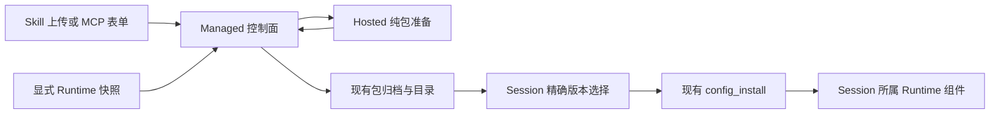

# Managed Skills 与 MCP 自助配置

[English](2026-11-07-managed-skills-mcp-self-service.md) | [简体中文](2026-11-07-managed-skills-mcp-self-service.zh-CN.md)

## 状态与范围

已确认的实施设计，2026-11-07。本文规定 Managed Agent 的 Skill 自助安装、Session 显式更新、MCP 配置编写和个人 MCP OAuth。实现和验证单独记录；本文不代表 Runtime 验收通过。

已批准方案核对到 main `8660f754305b9f003064d58c96d1116b68073552`；实现前将基线更新到 `06a0cb32500e42f08452dd4ea641a4f967eef2d3`。下文研究结论和 open PR 引用描述 2026-11-07 的调查，不代表后续 PR 状态。本方案扩展现有的 [Managed 扩展包设计](2026-10-24-managed-extension-packages.zh-CN.md)、[Session Skills 设计](2026-10-19-managed-session-skills.zh-CN.md)、[创建时 Skills 设计](2026-10-20-managed-session-creation-skills.zh-CN.md)和 [Session MCP 管理设计](2026-10-22-managed-session-mcp-management.zh-CN.md)。

核心建议是把独立 Skill 和用户编写的 MCP 配置转换成现有扩展包，复用包发布、不可变版本绑定和 `config_install`，补充不依赖 daemon 的编写与导入入口。个人 OAuth 需要单独按用户归属管理凭据，因为当前扩展 settings 在 Workspace 范围共享。

## 调研结论

| 领域             | 基线已有行为                                                                                     | 剩余缺口                                                                          |
| ---------------- | ------------------------------------------------------------------------------------------------ | --------------------------------------------------------------------------------- |
| 静态 Skills      | 创建 Session 时可从明确选中的可信 daemon Workspace 导入指令文本，之后快照固定。                  | 这条路径不搬运资源目录；已有 Session 不会重新发现源文件的变化。                   |
| 扩展包 Skills    | 包已能携带 Skills 和资源，并对符合条件的空闲 Session 显式应用新版本。                            | 独立 Skill 需要先打包，当前 WebShell 的包准备流程还依赖 daemon。                  |
| MCP 配置         | 独立 MCP 管理器选择已发布的定义版本并管理生命周期；扩展包已经接受 MCP 启动/传输配置和 settings。 | 独立管理器缺少直接编写配置的入口；只有 Managed 环境的用户无法通过当前 UI 准备包。 |
| 凭据             | 不可变的扩展 settings revision 已加密，按 tenant、Workspace、extension 隔离。                    | 它们不属于录入者个人私有；Managed HTTP transport 尚未实现交互式 OAuth provider。  |
| Runtime 目录发现 | daemon 已有 Skill 发现和刷新机制；Managed Skills 来自静态资源或精确包版本。                      | 缺少从所选执行 Runtime 为 Skills 制作快照的 Managed 导入流程。                    |

对应的实现依据包括[创建导入器](../../packages/web-shell/client/components/managed/managed-creation-skills.ts)、[Hosted Skill 目录](../../packages/cli/src/serve/hosted-skill-catalog.ts)、[包编译器](../../packages/core/src/extension/managed-package.ts)、[Managed Extensions 页面](../../packages/web-shell/client/components/managed/ManagedExtensionsManagerPage.tsx)、[daemon 包准备路由](../../packages/cli/src/serve/routes/managed-package-preparation.ts)、[包/settings 服务](../../packages/managed-agent-server/control-plane/src/main/java/com/alibaba/qwen/code/managedagent/extensions/ManagedExtensionPackageService.java)和 [Managed MCP transport](../../packages/cli/src/serve/managed-mcp-runtime.ts)。[本地 OAuth 存储](../../packages/core/src/mcp/oauth-token-storage.ts)的键面向本地使用，不是 tenant/Workspace/actor 凭据库。

相关 open PR 不会自动补齐这些缺口：

- [#15650](https://github.com/QwenLM/qwen-code/pull/15650) 当前 open，head 为 `47c9bab687b165b658b8c46319d67b86481dd982`，修复普通 core MCP client 使用最新 bearer token 的行为。其改动没有增加 Managed 凭据归属、回调或 Managed transport 适配。
- [#16475](https://github.com/QwenLM/qwen-code/pull/16475) 增加 Managed 诊断资源视图。新包来源应出现在该视图中，同时保持查询无激活副作用。
- [#15161](https://github.com/QwenLM/qwen-code/pull/15161) 为 draft，调整 MCP selection 的计数方式。本文在该工作合入并重新核对前保留 main 的限制。
- [#16324](https://github.com/QwenLM/qwen-code/pull/16324) 为 draft，调整宿主 UI provider 注入，不提供缺失的服务端包准备或授权流程。

## 目标与明确边界

获得授权的 Workspace operator 应能上传携带文件的 Skill、通过表单创建 MCP 连接，并为 Session 选择精确版本，全程无需运行本地 daemon。更新 Session A 后，Session B 应继续使用原有版本；恢复时必须重建已选定的包内容与配置。

目录发现指显式从所选 Runtime 导入，然后发布并应用，不意味着安装 watcher 后静默改变模型当前使用的指令。“更新已有 Session”指在两轮之间、Session 空闲时应用新配置，不改变正在运行的 turn。

本方案不增加第二套包注册表、安装 journal 或通用凭据库，不导入 daemon OAuth token、不同步全局 home 目录、不在导入时执行安装脚本，也不承诺完整兼容 daemon 的全部 Skill frontmatter。由 Managed 直接获取 Git/npm 源、个人 stdio 凭据和自动后台升级不属于首期交付。

## 共用的归属与流程

控制面负责权限、持久化归档、revision 和操作回执。在现有 Hosted 进程中增加有界的内部包准备操作，复用 TypeScript 编译器。它不需要 Session，不启动 Runtime、MCP server、Hook、模型请求或包安装脚本。Java 部署不能假设控制面主机安装了 Node.js，或与 Hosted 共享临时文件系统。

Runtime 负责物化和执行，再次校验精确包内容，并保留现有 owner/generation 隔离。Runtime 目录和缓存都是可重建副本，不能成为包的唯一持久化来源。UI 展示来源与所选版本，并区分“已发布”“已应用”“需要授权”和连接观测状态。

### 不依赖 daemon 的包准备

增加一个同步的导入并发布操作，接收三种封闭输入：Skill 归档、原始扩展归档或 MCP 配置文档。UI 默认操作是“安装到当前 Session”：一次确认后编排发布、可选 settings 保存和向所选空闲 Session 的显式应用。仅发布不激活组件。将准备和发布放在同一个请求内，避免新增持久化准备任务表或浏览器可见的临时归档句柄。现有扩展管理继续保留可选的仅发布路径。

控制面在接收有界输入之前，校验 Workspace operator 和现有部署 allowlist，再把输入字节及明确的目标平台传给经过认证的内部 Hosted 端点。准备返回 manifest、摘要和绑定实例/boot ID 的短期句柄；控制面从同一实例读取有界规范化归档，不把句柄暴露给浏览器。端点不接受任意控制面文件路径。控制面校验返回摘要并调用现有幂等包发布服务。失败或取消后清理临时半成品。

规范化后的 Skill/MCP 输入使用现有的 `sourceType: snapshot`，`sourceRevision` 由输入摘要导出，不向 Java 的封闭 manifest 增加未经定义的来源类型。包名、包装格式版本、目标平台、源摘要和编译器版本共同确定可重复的输出；时间戳、临时路径和随机名称不能进入规范化归档。更新包保留 `extensionId` 与包命名空间；显示名称相同的新来源不能静默替换旧包。

重试绑定相同输入、规范化/编译器版本、目标平台和幂等键。开始发布后复用现有操作查询与回执，响应丢失不能产生第二个 revision；开始发布之前可用相同上传字节安全重做准备。编译器版本不匹配需要显式重新准备，不能静默改变 pending 操作的解释。本期无需导入专用的持久化 schema。

复用归档路径约束和当前上限：压缩后 100 MiB、展开后 1 GiB、100,000 个条目。分配工作前限制并发准备数量和临时磁盘总占用，仅限制单个请求大小还不够。保留最多十分钟的准备期限，临时产物十五分钟后过期。拒绝符号链接、特殊条目、路径穿越和不支持的包贡献项。该端点不增加远程源获取及其凭据；现有 daemon 辅助准备源的方式继续可用。

## Skills

### 安装与使用

独立 Skill 上传包含一个 `SKILL.md` 及其相对资源文件。将其包装为包含 `qwen-extension.json` 和 `skills/<name>/...` 的最小扩展，复用现有解析器与编译器，保留受支持的 Skill 元数据。多个 Skill 的分发使用普通扩展归档。对不支持的 frontmatter 返回明确兼容性错误，不能静默丢弃 hooks、权限规则、参数处理或模型覆盖。

Skills 页面提供面向包内 Skill 的专用视图，并同时清楚标注静态 Session 快照。用户先检查纯规范化预览，再一次确认发布、可选 settings 保存和 Session 精确应用。继续使用编译器限定了来源的 Skill 标识和冲突规则，不能把安装的包 Skill 静默映射成同名静态 Skill 的覆盖项。独立上传的根目录或一层包裹目录中必须恰好只有一个 `SKILL.md`；额外的嵌套 Skill 使用普通扩展包分发。

资源沿用 `extension://<extensionId>/<path>` 命名空间。Shell 调用选择 `extension_context`，通过 `$QWEN_EXTENSION_ROOT` 定位包文件，工作目录仍为 Session 目录。上传 `scripts/check.py` 不代表 `python scripts/check.py` 会从包根目录运行，也不会自动安装 Python。导入检查声明的目标兼容性，不检测任意脚本的依赖。缺失的可执行文件或依赖在对应目标操作执行时暴露，并向用户保留原始失败信息；导入器不执行任意安装代码。

### 更新与恢复

发布 Skill v2 只增加目录 revision。固定在 v1 的 Session 继续使用 v1，直到经过授权的显式 apply 成功。应用前展示包和组件变化，使用 `expectedConfigRevision` 拒绝过期选择。忙碌 Session 返回现有 busy/conflict 结果，不增加一个可能在用户没有看到当前配置时自动生效的延迟变更队列。

现有静态 Skills 快照保持不可变。其原始来源目录通常无法重建，基础 Skill 也不能通过包选择移除。因此首期不声称能够原地替换静态快照：用户可安装带独立限定名的包 Skill，或按期望的初始选择创建新 Session。UI 必须说明重复来源。通用的基础 Session Skills 编辑需要另行定义显式协议，不能隐藏在导入功能里。

恢复较早的包选择时，通过现有 recovery/apply 路径生成新的、向前递增的配置 revision，不倒退版本、不删除历史、不重跑 SessionStart。子 Session 保持创建协议所规定的选择和限制；本方案不为只读子 Session 增加任意包编辑能力。

### 在执行 Runtime 中发现

上传安装可用后，增加显式的“从当前 Workspace 导入”。只扫描所选 Session 已解析 Workspace 内受支持的项目 Skill 根目录，复用解析器并关闭 global/user/extension 发现。返回有界候选清单，包含源相对路径和内容摘要；用户选定候选后再为目录制作快照。

操作要求原始 Runtime owner 处于 ready、generation 匹配、Workspace 信任/访问检查通过，且执行 profile 支持对应文件读取能力。owner 未知、不可信、draining 或已被替换时直接失败，不回退到 daemon、主 Workspace 或 Hosted 进程的 home 目录。只读发现不激活 Skill，也不启动替代 Runtime。

快照过程检查路径约束，以及复制前后的文件身份和摘要；发现变化时返回 `source_changed`。发布绑定实际复制的快照字节。这是尽力保持一致的导入，不是对任意并发写入者提供文件系统事务。重新导入变化的文件产生新包 revision，仍需显式应用。Runtime 快照与上传遵守相同的发布权限。

## MCP 配置与 Workspace 凭据

在 Managed MCP 体验中增加“创建连接”和“编辑配置”，保留“选择已发布定义”的现有路径。表单支持 stdio、Streamable HTTP 和 SSE，接受编译器的封闭 schema：stdio 的 `command`/`args`/`env`，或 HTTP 的 `url`/`httpUrl`/`headers`/`type`，以及已支持的 timeout 字段。命令和参数分别输入，不隐式解释为 Shell 命令。准备阶段与 Runtime 共用校验器，拒绝混合传输类型和未知字段。

把一个用户编写的连接转换为只包含一个 MCP server 的最小扩展包，稳定 Runtime 标识继续为 `extensionId:authoredName`。编辑时在相同 extension 身份下发布新 revision。UI 区分包所属 server 与独立定义 server：前者使用包 apply，后者继续使用独立 MCP 生命周期操作；不能用独立定义端点编辑扩展包所属 server。

凭据字段在归档中转为声明过的 settings 占位符，实际值通过现有加密 settings 操作保存。预览命令/参数或 URL 以及声明的凭据键，不展示值。秘密表单字段不得持久化到浏览器存储、归档、操作正文、诊断或日志。不能仅因字段不叫 `password` 就认定字面值不含秘密；编写 UI 必须允许显式标记秘密，并拒绝在已标为凭据的字段内直接嵌入值。现有任意归档上传保留原有作者责任，不宣称获得了自动检测所有秘密的能力。

将这些 settings 标为 **Workspace 服务凭据**：它们可由该 Workspace 内经授权的执行使用，并非录入者个人专属。stdio 只接收所选 settings，不继承控制面环境。发布和使用继续受现有部署策略限制；普通 prompt 权限不等于发布可执行包的权限。个人 OAuth 使用下一节的独立流程。

凭据未变化时沿用精确的 `settingsRevision`；修改时提交完整的新 settings 集合，提示重新填写必需秘密，浏览器无法读回旧秘密。复合扩展继续按整包编辑；其 Skill/MCP 视图跳转扩展管理，不提供具有误导性的单组件写入口。

apply 保留现有 effective bundle，包括无关扩展包、独立 MCP selections 和基础 Hooks。stage 不连接新 server。配置激活与连接/认证观测保持独立；已发布或已绑定 revision 不能证明 server 可达或已认证。保留当前上限，包括每个 Session 32 个包、每包 16 个 MCP server、一个 effective extension bundle 32 个 MCP server。独立选择管理器当前的 32 个历史 selections 和 16 个 enabled selections 限制保持不变。

## 个人 MCP OAuth

### 归属与存储

个人 OAuth 作为单独交付，面向 HTTP MCP。不复制 daemon token 文件、OS keychain 条目、浏览器 cookie 或 loopback callback 状态。stdio 继续使用显式配置/Workspace 服务凭据；导入 Skill 或包从不同时导入授权。

新增两个职责明确的持久化记录：`ma_mcp_credential` 保存加密 grant 及刷新协调信息，`ma_mcp_oauth_attempt` 保存有过期时间的一次性授权尝试。复用 `SecretProtector`。每份凭据绑定 tenant、Workspace、actor、逻辑 server 标识、规范化 resource、issuer、已注册 client 和已授予 scopes，同时保存刷新状态、credential generation 和撤销状态。这些是新增记录；现有扩展操作表仅建模发布/settings，不能当作 OAuth ledger 使用。

包只声明不含秘密的 OAuth 要求；单独的 Session 配置绑定选择凭据引用。个人凭据引用不进入可共享归档或 Workspace settings revision。传输端点、resource、issuer、client 或所需 scopes 变化后，旧绑定失效，必须显式重新验证。该设计扩展封闭的 TypeScript/Java 包与 effective-configuration schema，需要协商能力支持；旧 worker 应拒绝而非忽略字段。

一个 Session 内的全部个人绑定必须属于同一 actor，归属从认证身份推导，不能采信调用者提交的 owner 字段。启用绑定期间，将该 actor 持久化为 Session 的执行主体，并要求产生 turn 或恢复执行的准入来自同一 actor。其他用户不能仅凭 Workspace operator 权限，通过发送 prompt、回答执行审批或恢复 Session 来使用该人的 grant。命令准入和 token 发放都必须检查，不能仅在 UI 检查。其他获得授权的 operator 可按现有权限查看元数据、取消，或通过显式配置管理移除个人绑定；移除不转移 grant。启用另一个 actor 的个人绑定，需要由该 actor 授权、在空闲时显式变更配置。

owner/generation 隔离不等于操作系统隔离。只有部署能阻止其他 actor 的 Shell/MCP 进程读取持有 token 的 Hosted 进程、凭据交付通道或其服务身份时，才能启用个人 OAuth。共享同一 UID 的 worker 不能仅凭每个 Session 一个目录就建立该边界。执行 profile 证明这种隔离之前，个人 OAuth 在该 profile 上保持 unsupported；不能仅靠数据库键就宣称跨用户凭据保密。这个要求不意味着扩展安装器会顺带实现新的 sandbox。

首期 OAuth 不覆盖无法端到端证明同一执行主体的 child、channel、automation 和无人值守 wake 路径；在其委托协议实现并验证前，对使用个人授权的 Session 明确显示这些路径不受支持。个人 grant 不能隐式继承给子 Session。共享执行继续显式使用 Workspace 服务凭据。

### 授权与 Runtime 使用

采用 [MCP 授权规范 2025-11-25 版](https://modelcontextprotocol.io/specification/2025-11-25/basic/authorization)作为固定的互操作基线，先支持部署方预注册的 OAuth client。遵循受保护资源和授权服务器 metadata，使用 PKCE S256，绑定请求 resource，并校验 redirect/state 及返回 scope。首版不要求动态注册 client。

控制面持有带有效期、单次使用的 attempt，绑定发起认证的 actor 和浏览器授权流程。callback 不能自行选择另一个 tenant、Workspace、credential 或 resource。交换 code 前校验当前 actor 与 attempt。metadata、token 和 redirect 的目标遵循部署网络策略，明确允许已配置的内网 provider。参考 [MCP 安全指引](https://modelcontextprotocol.io/docs/2025-11-25/tutorials/security/security_best_practices)，阻止 metadata 请求通过重定向或 DNS 变化访问无关私网端点或云 metadata 服务。

为 Managed HTTP transport 增加 auth adapter。每个 HTTP 请求，包括 SSE 请求，都使用范围严格限定的内部 grant 获取当前 access token，grant 绑定精确的 Session、server、配置 revision、credential generation 和当前 Runtime owner。控制面刷新 token；refresh token 不发送给浏览器或 Runtime。不复用 daemon 按全局 server name 索引的 token store。token 刷新只改变凭据状态，不改变包摘要或 Session 配置 revision。

通过数据库 compare-and-set/lease ownership 串行化每份凭据的刷新。同一 actor/server/provider/resource 连接保持稳定凭据标识；每个授权 attempt 捕获 credential generation，撤销或另一次授权后完成旧 attempt 必须失败，不能复活 grant。撤销推进 credential generation，阻止迟到的 refresh 将其重新激活。撤销后立即拒绝后续 token 发放，并在 provider 支持时调用撤销接口；已发出的 bearer token 或打开的 stream 仍可能在到期、provider 撤销或连接结束前有效，不能承诺立即收回已交付 worker 的 token。

code 交换或轮换 refresh token 的交换结果不确定时，崩溃后不能盲目重试；除非 provider 提供可验证的恢复机制，否则要求重新授权。认证恢复绝不能重放结果不确定的 MCP 工具调用。区分显示 `authentication required`、`authorization unavailable`、传输失败与配置操作 pending。

## API 与生命周期集成

实现增加以下操作：

| 操作                           | 新增工作                                                         | 复用的现有权威来源                                                                        |
| ------------------------------ | ---------------------------------------------------------------- | ----------------------------------------------------------------------------------------- |
| 导入并发布 Skill/扩展/MCP 输入 | 有界的公共输入与内部纯编译请求                                   | 包发布、归档存储、操作查询、访问策略                                                      |
| 列举/快照 Runtime Skill 候选   | owner 隔离的只读项目扫描与快照传输                               | Runtime binding、Workspace 信任/文件读取策略、相同包导入流程                              |
| 选择/更新已安装内容            | Skills/MCP 专用 UI 与来源标注                                    | 精确扩展 pins、settings revisions、`expectedConfigRevision`、Session apply/query/recovery |
| 开始/callback/查询/撤销 OAuth  | actor 绑定的 grants、attempts、Session bindings、私有 token 发放 | 现有身份、加密、Runtime 隔离；新增 OAuth 记录                                             |

Workspace 端点使用 `/v1/agents/workspaces/{workspaceId}/extensions`：`POST /imports`、`POST /imports/preview`、精确 digest 的 `GET /{extensionId}/packages/{packageRevision}/inspection`、`POST /operations/lookup`。纯预览在最终安装确认前返回有界非秘密摘要，不创建包 revision。导入与预览流式接收上传字节及有界元数据（来源类型、目标、摘要、编译器版本和可选更新 `extensionId`），不接受主机路径或任意下载 URL。Session 端点使用 `/v1/agents/sessions/{sessionId}/extensions`，包含 apply 操作查询和 `/skills/` 下的候选、快照与导入。包 inspection 要求发布权限。catalog 和 Session query 分别表达服务支持、发布权限和当前可应用条件；服务端检查仍为权威。

现有 apply 保留 `expectedConfigRevision` 与精确 `extensions` pins。OAuth 增加显式 `selectionVersion: 2` 和 `mcpAuthBindings`（`serverId`、`credentialId`、`credentialGeneration`），effective bundle 使用 `formatVersion: 2`。无 OAuth 的包/bundle 保持版本 1；版本 1 writer 不能替换版本 2 配置。显式的空版本 2 绑定集合使 OAuth 贡献项休眠，同时保留包内其他内容。创建 Session 时不接受 OAuth 包；先创建 Session、授权，再走版本化 apply 流程。

不在 `config_install` 旁增加独立 `/skills/apply` 或可变的原始 MCP 写入口。实现新操作时同步更新 public 和 WebShell adapters、SDK types、OpenAPI 与 SurfaceRegistry。源/准备信息查询不能意外激活 Runtime。

保持现有状态转换：prepare 并 stage 不可变输入且不执行；提交 `config_install`/`config.bound` 及准入屏障；drain 变化的 Session 所属组件；enable 并校验回执；发布 active revision。commit 前失败保留旧配置可用；commit 后结果不确定则保持准入阻塞，核对原 operation/owner。不能在替代 owner 上重放，也不能为更新一个 Session 重启整个 worker。

首期限定在当前支持扩展包的 lifecycle-v2 Shell/1 或 MCP/1 profiles。纯指令/仅文件 Session 目前不能应用扩展包，即便包内只有 Skill；导入 Skill 不能静默把它升级为 Shell。未来若提供纯数据包能力，需要单独定义准入和资源访问规则。SSH 及其他 provider 需要真实协商的扩展能力与验收证据，无关 Runtime PR 不会自动带来支持。对只读子 Session 和其他不符合条件的 profile 保留 unsupported 结果。

## 交付计划与验收

| 阶段                    | 交付内容                                                                                    | 出口条件                                                                                                                                                                  |
| ----------------------- | ------------------------------------------------------------------------------------------- | ------------------------------------------------------------------------------------------------------------------------------------------------------------------------- |
| 1. 无 daemon 的配置编写 | Hosted 纯准备；上传式 Skill/扩展发布；MCP 表单；Workspace 服务 settings；包选择/更新专用 UI | 无 daemon 连接时发布携带资源的 Skill 和 MCP 配置，在符合条件的 Session 中应用并使用，只更新 Session A，并将旧内容恢复为新 revision。无需导入专用 schema，也不依赖 OAuth。 |
| 2. Runtime Skill 导入   | 从所选 ready owner 显式扫描候选并发布不可变快照                                             | 无本地 daemon 也能导入项目 Skill；拒绝变化/越界的源及过期 owner；发现本身不改变 Session 配置。                                                                            |
| 3. 个人 HTTP OAuth      | actor 隔离记录、callback、refresh/revoke、schema/能力变更、准入检查、HTTP adapter           | 同一 Workspace 的两个 actor 无法使用对方 grant；替代 worker 安全恢复授权绑定；刷新/撤销与结果不确定的工具调用符合下述要求。                                               |

实现阶段必须覆盖以下验证：

1. **准备与兼容性：**相同规范化输入在固定编译器下产生相同字节；响应丢失后的重试返回同一发布；畸形归档、链接、过量展开、不支持的 Skill 元数据、目标不匹配在激活前失败。同时验证 Java/TypeScript 解析器及所有 public/WebShell 消费方。
2. **真实用户路径：**只有 Managed 的浏览器可以发布、选择并使用包资源和真实测试 MCP server。检查限定名、显式 Shell 资源根目录、缺失前置条件、共享 settings 标注、秘密脱敏，以及独立/包所属 MCP 的编辑。只有编译器 fixture 测试不足以完成此项验收。
3. **隔离与恢复：**两个 Session 保持不同 revision；过期 `expectedConfigRevision` 和忙碌 apply 不改变配置；基础 Hooks 和独立 MCP 保留。使用真实 MySQL 和 worker 重启覆盖 stage、commit、drain、enable、回执丢失。结果未知保持阻塞，旧 owner 不能修改后继配置。
4. **Runtime 导入与 profiles：**测试实际目标 Workspace、并发源变化、路径约束、权限丢失和 owner 替换。仅文件、只读子 Session 和未经验证 provider 路径拒绝操作，不升级 profile，也不回退。
5. **OAuth：**通过可控制的授权服务器验证 actor/state/resource 绑定、callback 重放、scope 变化、SSRF 限制、并发刷新、轮换 token 响应丢失、撤销竞态，以及连接存续期间 bearer token 变化。覆盖跨 actor 的 prompt/approval/resume 和 child/channel/automation 入口，不仅验证 token store 查询。验证每个启用 profile 的进程/通道隔离，拒绝在未经验证的共享同 UID worker 上使用个人 OAuth。绝不自动重复结果未知的工具调用。

实现时遵循仓库对应包的 TypeScript 检查和 Managed server 的 Java 验证预算，每个行为阶段使用对应 E2E 计划。文档需要格式、链接/引用检查和双语核对。本地专项结果、真实进程/数据库验收和完整 CI 分开记录；本文不证明其中任何一项通过。

## 取舍与发布决策

将独立 Skill 包化，使安装和恢复有明确依据，但保留包命名空间和静态快照限制。显式更新用可复现的 Session 配置替代 daemon 式自动文件刷新。UI 必须说明这两项选择，不能宣称完整的原生 Skill 对齐。

个人 OAuth 的工作量明显大于增加一个登录按钮，因为它改变谁可以驱动已有 Session 执行。阶段 1 可独立交付；用户归属和全部准入路径验证完成前，个人 OAuth 保持关闭。新增表遵循仓库当前 Managed schema 策略及加密存储配置。已发布版本继续使用现有保留策略，归档垃圾回收另行处理。

每个部署启用前需要配置：哪些服务凭据可以在 Workspace 内共享，允许哪些 OAuth provider/预注册 client 和网络目标，以及哪些 Runtime profile 已完成验收。

自助发布与 Runtime Skill 导入分别提供默认关闭的开关。个人 OAuth 同样默认关闭，要求 `managed-mcp-oauth/1`、已注册 provider、固定 callback 与绑定级 token 代理，以及已证明隔离的 tool profile allowlist。关闭安装入口保留已安装内容；关闭个人 OAuth 拒绝新授权和 token 发放，保留经过认证的查询、撤销和配置修复。池内能力必须一致，安装不能依赖随机选到升级后的成员。现有 tracing 记录公开 operation/阶段/结果，以及容量、冲突、恢复和刷新失败，不记录输入、code 或 token。

## 已确认的实施约定

实现从 main `06a0cb32500e42f08452dd4ea641a4f967eef2d3` 开始。用户选择完整设计、分阶段交付，首期上传归档/MCP 表单，空闲时显式更新，一次确认安装，个人 OAuth 仅本人驱动，历史/结果沿用 Workspace 阅读权限。Git/npm 获取和新执行隔离平台仍在本次范围之外。

进程级 Hosted 能力为 `managed-package-preparation/1`。池模式选择 accepting 且支持能力的成员，不申请 Session placement；归档读取保持同一 instance 与 boot ID。新增 Workspace 导入、精确 digest inspection、发布/settings 幂等键查询，以及 Session apply 查询。公共 apply 保留 `expectedConfigRevision` 与 `extensions`。同步更新 OpenAPI、WebShell adapters/生成类型、Java SDK、SurfaceRegistry 和契约测试。普通 inventory 响应不增加可执行配置。

安装冻结作用域、输入摘要、目标平台、编译器版本、所选 pins 和操作身份。按 actor 隔离的 pending-command 存储只保存公开 pins、阶段、预期 revision 和键。响应丢失后查询原回执；输入/目标变化需要新命令。发布成功而 settings/apply 失败显示已保存、未应用，不引入延迟自动 apply。包 Skills 与静态 Skills 分别标注。

Runtime 导入只扫描项目 `.qwen/skills` 和 `.agents/skills`，保留优先级并显示重复项。候选与快照请求属于 Session owner 作用域，携带观察到的 generation 和摘要。使用 Broker 文件边界；owner 过期/未 ready 时失败，不 provisioning、不回退。在服务端生成的非执行包元数据中记录源相对路径。快照变化返回 `source_changed`。

OAuth 在共享 V1 schema 基线中增加加密的 `ma_mcp_credential` 和过期、单次使用的 `ma_mcp_oauth_attempt`。固定 callback 校验 state/issuer 并临时加密保存 code；经过认证的 complete 请求校验发起 actor/浏览器 nonce 后才交换 code。个人引用进入版本化 Session 配置，并有明确 Runtime 能力；旧 apply 客户端不能静默移除绑定。使用已提交的执行 actor 检查命令准入、排队命令分发、审批/恢复及 token 发放。历史/结果仍按 Workspace 阅读权限开放，并在授权时明确提示。缺少身份委托协议的 child/channel/automation/无人值守路径拒绝个人绑定。

Runtime HTTP 请求为精确 Session/server/配置/凭据 generation/owner 获取当前 access token。刷新使用 lease 与 compare-and-set，不持有长 SQL 事务；轮换交换结果未知时重新授权。撤销阻止后续发放及迟到刷新提交。认证恢复不重放结果未知的 MCP 工具副作用。未证明跨 actor 进程/通道隔离的执行 profile 保持个人 OAuth 关闭。

实现遵守现有类大小预算：独立的 Runtime token 请求 collaborator 负责发放前后的 lease/owner 校验，SQL actor 检查保留在现有带行锁的记录/准入 helper 内。模型目录和 agent revision 校验由模型/策略的现有责任方承担。公共 facade 签名、锁顺序和校验条件保持一致。action/store facade 上限收紧为 825/1167 行，不提高任何现有大小限制。

行为验收计划位于 `.qwen/e2e-tests/2026-11-07-managed-skills-mcp-self-service.md`。实现增量为准备/校验、API/契约、安装 UI、Runtime 快照、OAuth 记录/准入和 HTTP 认证/恢复。本地、真实 MySQL/进程及完整 CI 证据分别报告。
