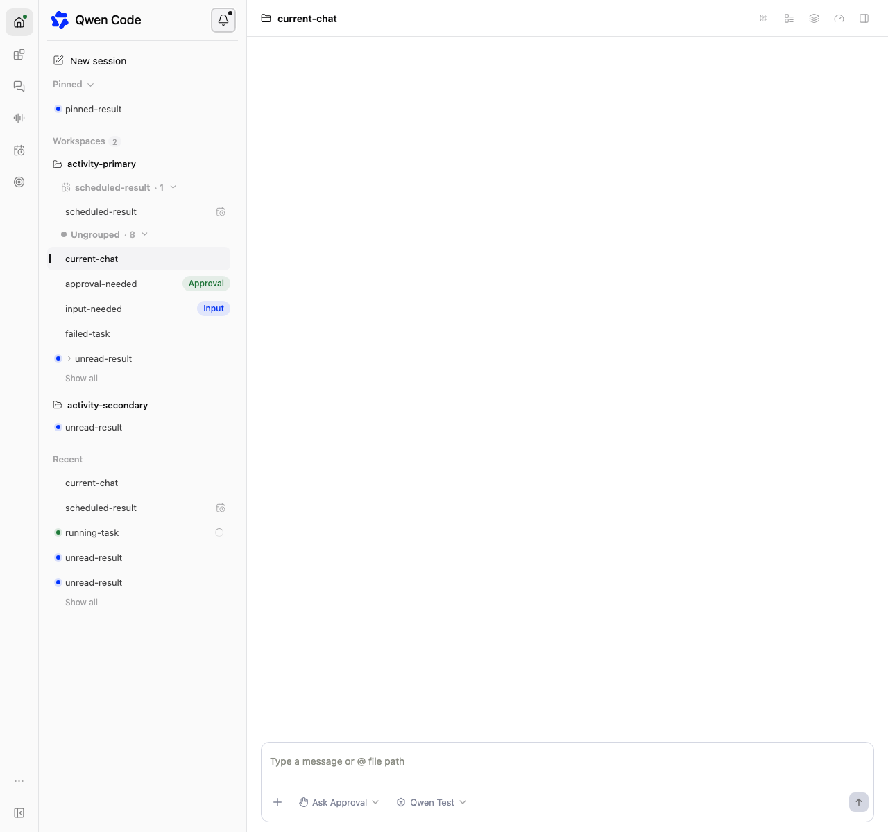
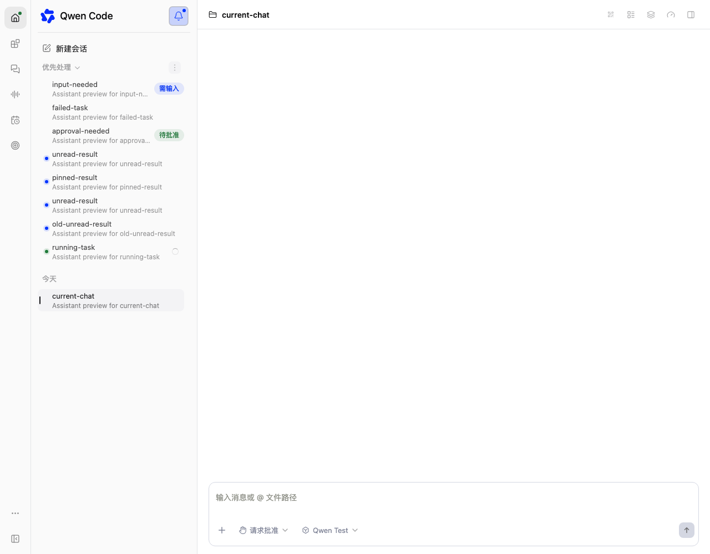

# 查看活动

[English](activity-view.md) | [简体中文](activity-view.zh-CN.md)

## 问题与证据

侧栏目前展示项目和会话，但缺少统一处理审批、输入、错误、未读更新和运行中任务的
入口。完成提示点只保存在内存中。参考桌面应用使用活动快照，而不是持续重排的过滤
列表。已结合交接报告和截图反编译并检查其打包代码；这些材料仅作为行为参考，不作为依赖，
也不直接复制代码。

## 范围与决策

为 Web Shell 的 daemon 工作区会话实现完整活动模式，遵守已有主机、锁定工作区和
信任边界。活动目录跟随当前选中的 daemon 主机，不聚合其他主机或无工作区的独立
会话。Managed-agent 和实时语音保留自身导航。不把不支持的来源偷偷当成工作区
会话。Qwen 没有 ChatGPT 账号历史或明确的静默心跳标记，因此不虚构这些来源，也不
隐藏普通后台任务。

复用既有目录、实时状态、会话记录分页和归档接口，不新增目录数据库、模型摘要或
逐行轮询。未读状态复用侧栏原有的内存集合 `completedUnreadIds`。页面观察到非当前
会话从运行中变为结束时，将它记为未读。活动条目和原有蓝点共享这份状态；历史会话
不会因为没有已读记录而默认未读。不新增后端已读字段、能力声明或写入请求。刷新
页面或重新挂载侧栏会清空记录，无法还原页面关闭期间的完成情况，不同标签页或客户端
之间也不同步已读。这些限制是保留原有完成提示点语义的明确选择。预览读取不改变
未读状态。

## 与此前持久化已读方案的比较

当前方案保留原有完成提示点的行为，复用 daemon 已有的会话组织能力，不新增已读状态
所需的后端版本门槛。标为已读只更新本地状态，不涉及回执请求失败、重试或跨客户端
同步竞争。其限制是明确的：刷新后丢失未读记录，无法还原离线期间的完成情况，每个
标签页或客户端独立维护已读状态。

此前方案增加了 `lastReadActivityAt`，要求新增的 `session_activity_read_state`
能力及升级后的 daemon。它可以在刷新后保留已读状态，并通过目录刷新共享状态。
回执使用已观察到的 `updatedAt`，通过单调写入防止旧请求覆盖较新的确认。但这些保护
并不能让会话更新等同于助手回合完成，单靠持久化也无法恢复所有离线完成事件。将没有
回执的历史会话视为未读，还不必要地改变了原有行为。回执失败、重试和延迟响应增加了
异步状态处理，本次修订将这些逻辑移除。

保留的可选实时状态字段 `hasTurnError` 与未读状态无关。旧 daemon 仍可凭已有能力
支持活动视图，但缺少该字段时错误展示只能尽力提供：错误可能未显示，或直到其他
会话数据刷新前仍然过期。未来如果重新设计持久化，可以通过明确完成事件或回合身份、
未知历史已读状态的迁移，以及已读状态属于用户还是共享 daemon，改善跨页面连续性。
这些决策不在本次修订范围内。

## 交互与状态

- 铃铛和 Cmd/Ctrl+Alt+U 切换活动模式，Escape 关闭。铃铛提示未读或需要处理的状态，
  单纯运行中不会点亮关注提示。
  激活时使用既有主题蓝色图标和淡蓝背景，展开侧栏与导航栏入口保持一致。
  两个入口在激活和未激活时均使用手形指针。
- 更多入口复用工作区的竖向三点图标、按钮和右侧间距，下拉菜单使用普通菜单的
  自适应宽度，不定义活动专用的更多菜单样式。
- 列表直接从首个分类开始，不单独显示固定的“活动”标题。选项按钮只出现一次，位于
  首个显示分类的标题上：启用优先事项时位于优先事项，否则位于置顶或首个最近日期。
  空列表使用“今天”标题，确保选项仍可访问。选项按钮复用既有工作区菜单的竖向省略号、
  右侧缩进和标准自适应宽度下拉菜单，不使用活动专用菜单样式。分类标题沿用普通侧栏
  的间距、文字样式和控件。活动视图直接参与既有会话列表布局，不增加带内边距的外层
  容器；分组复用普通置顶会话列表，使标题、行文本、状态标识和操作按钮与普通模式
  对齐。展开的空分类也使用同一列表容器及底部间距，优先事项的空状态提示放在该容器内。
  置顶与普通侧栏共享展开状态及箭头交互。优先事项同样支持折叠，其展开状态
  保留在本次打开的活动视图内；日期标题不折叠。折叠后的分类行不渲染、不加载预览，
  也不占用可见行预算。置顶沿用普通侧栏的排序，新置顶会话追加在末尾，而非排在最前。
- 初始优先顺序为输入/审批/错误、未读、运行中、空闲，同级按活动时间降序和稳定身份
  排序。子会话除非置顶否则排除；归档和无权访问的会话排除。
- 打开时建立快照，已有优先条目保持相对顺序，阅读或完成后暂留，新符合条件的条目
  增量合并。关闭清除快照。“清除已读”仅移除已经结束且已读的条目。
- 默认显示优先事项，不单独显示置顶，不包含定时任务。偏好持久化，可恢复默认。
  选项菜单顶部显示“显示”标签。偏好偏离默认值时，标签右侧出现具有无障碍名称的
  重置图标，不再单独占用重置菜单行。重置后菜单保持打开并重新计算活动快照，不改变
  已读状态或置顶展开状态。
- 最近会话包含今天在内的七个本地自然日，按日期分组。优先事项不受时间窗口限制。
  各分区不重复。共享首屏预算为十条，每次增加十条。
- 会话行直接复用普通侧栏的 `renderSessionRow`，保留相同能力检查下的选择、键盘、
  状态标识、行内操作、上下文菜单、重命名、置顶和归档行为。不另建活动行布局或
  样式，不添加空闲状态点，也不常驻显示工作区后缀。时间、工作区和其他可用上下文
  通过既有悬浮详情展示，包括分支、PR 和会话身份。助手预览最多 600 个 Unicode
  码点，复用普通行已有的摘要槽位及样式。可见行按需读取有界会话记录页，不附加或
  启动会话。预览失败复用通用提示布局并支持重试；加载中和部分失败不能伪装成空列表。
- 选择会话时，通过侧栏共享状态清除原有完成提示点。“全部标为已读”从同一内存集合
  中移除优先分区的未读身份，不清除快照，也不改变无关会话。关闭活动视图只丢弃
  活动快照，不清空侧栏的未读集合。
- 批量归档仅作用于优先事项，不影响最近会话和仅在置顶分区的条目。确认框明确提示
  运行中的工作将停止，复用现有原子关闭并归档接口。成功项移除，失败项保留，撤销
  恢复成功归档的会话但不重启任务。最多八个请求并发。当前会话确认归档成功后才
  导航离开。

## 实现边界

未读状态保留在既有侧栏组件中，活动模型接收由其派生的未读标记，目录控制器负责目录
读取、预览和归档。每个会话身份只有一个完成状态观察器：原有观察器跳过活动目录当前
覆盖的会话，避免延迟响应重新标记已经清除的未读。Core 组织元数据、Bridge 摘要和
daemon 组织修改路由不增加已读
字段。实时状态补充回合错误。既有工作区路由的所有路径（包括失败）都使用已解析
运行时的存储。Web Shell 在 `components/sidebar` 下新增活动模型、控制器和视图，
复用共享 UI 基础组件，并在侧栏接入铃铛。活动视图负责分组、预算和预览加载，侧栏
提供既有会话行渲染器，使普通行的功能与样式只有一份实现。中英文文案保持一致。

## 验证与验收

覆盖排序、快照稳定性、日期边界、过滤、身份、分页、首分类菜单位置与空态回退、优先
事项折叠、共享置顶折叠状态与排序、折叠行预算、普通与活动模式的标题及行对齐、共享
行操作与悬浮上下文、重置图标显示及键盘访问、观察到的
完成状态转换、蓝点与
已读行为共享、刷新重置、不发送已读写入、过期异步结果、部分失败、归档范围和撤销。
实现前对全局 `qwen` 和浏览器夹具记录基线；
实现后运行针对性测试、浏览器 E2E、build、typecheck 和 bundle。完整 diff 进行两轮
连续干净自查，并独立审查。仅操作隔离测试会话，不归档用户真实参考聊天。目前没有
等待用户批准的产品决策；实现和验证结果可以进一步修订本文。

## 相关工作与界面证据

Issue [#16020](https://github.com/QwenLM/qwen-code/issues/16020) 跟踪本功能。
既有未读持久化工作
[#11451](https://github.com/QwenLM/qwen-code/issues/11451) 和
[#12672](https://github.com/QwenLM/qwen-code/pull/12672) 保持独立；本功能不解决
离线或刷新后的连续性。后者提出浏览器 localStorage 方案，而非后端读回执；若其先合入，
需要协调重叠的侧栏改动。

以下截图使用模拟 daemon 数据，不包含个人会话。

