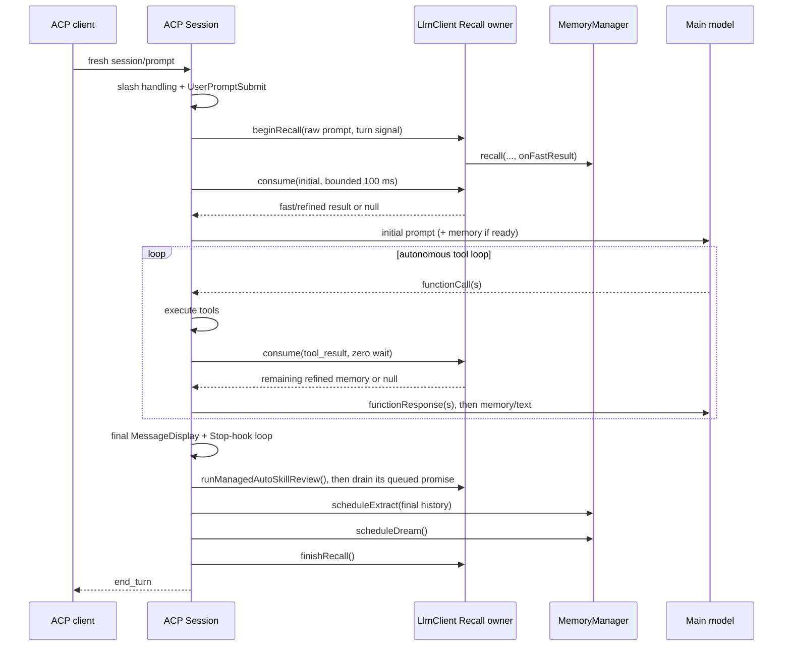

# ACP 托管记忆生命周期

[English](acp-managed-auto-memory.md) | [简体中文](acp-managed-auto-memory.zh-CN.md)

**状态：** 已实现

**目标基线：** `QwenLM/qwen-code@43d46be912f41e797e6a5aaa34bfaf4a16e06efa`（`0.22.0`）

**Issue：** [#9658](https://github.com/QwenLM/qwen-code/issues/9658)

**相关设计：** [记忆系统](./memory-system.md)、[异步记忆召回](../2026-05-15-async-memory-recall-design.md)

## 概要

ACP 会话应当使用现有的托管记忆实现：召回的投递语义与交互式会话相同，提取与 Dream 在一个完整且成功、且不是已认证 channel prompt 的逻辑用户轮次之后各调度一次。

本设计刻意**不**新增协调器类。每个 ACP `Session` 已经有一个按会话创建的 `Config`，而该 `Config` 已经持有一个 `LlmClient`。因此，`LlmClient` 本就是以下状态的正确归属方：待定的召回句柄、已展示文档的去重、最近工具上下文、取消，以及召回投递遥测。ACP `Session` 调用这个现有对象上的一小组公开生命周期 API。

ACP `Session` 仍是其逻辑轮次边界的归属方。它在自主工具循环与 Stop hook 循环结束后，紧接着调度现有的 `MemoryManager.scheduleExtract()` 与 `scheduleDream()` 方法。召回状态是共享的；提取/Dream 的算法不做复制。

无需任何 ACP 协议扩展、代理改动、设置项、存储格式或新的后台任务抽象。

## 基线与问题

目标分支必须先基于 `43d46be` 或更新的上游提交。下文描述的是 `0.22.0` 的行为；不得先在更旧的代码树上实现，再机械地套用到目标分支。

在目标基线上：

- `LlmClient.sendMessageStream()` 持有完整的托管召回状态机。
- 一次全新的交互式 `UserQuery` 在 `UserPromptSubmit` 放行请求之后才启动召回，但查询使用的是 hook 处理前的原始 prompt 文本。
- 初始召回有 100 ms 的有界等待上限。确定性的快速结果到达时，等待提前结束；由模型挑选的精修结果仍保持待定。
- 精修召回可以在之后的某次 ToolResult 发送中被消费。快速阶段已经投递的文档会在精修投递之前被移除。
- 待定召回会在以下情况被取消：新查询、父级中止、重置、关闭，或该轮次之后再无安全投递点。
- `LlmClient` 记录已展示的记忆路径，用于会话级去重；并记录最近完成的工具名，用于召回相关性过滤。
- 提取与 Dream 已经实现，并由 `MemoryManager` 把关；它们的游标、尾随请求合并、锁、压力闸门与 Dream 阈值都不依赖 UI。

ACP 从 `Session.#sendMessageStreamWithAutoCompression()` 直接调用 `LlmChat.sendMessageStream()`，从而绕过了上述编排。`Session.#buildInitialSystemReminders()` 上方的注释明确记录了托管召回的缺失。ACP 在其完整的工具循环与 Stop hook 循环之后，也从不调度提取或 Dream。

因此，缺失的是生命周期接线，而不是某个记忆算法。

## 目标

1. 让每个全新的 ACP 用户轮次都获得现有的快速/精修召回行为。
2. 保留 hook 处理前的原始 prompt 作为召回查询。
3. 保持 provider 的要求：所有位于开头的 `functionResponse` 部分都必须排在注入的提醒文本之前。
4. 在不是已认证 channel prompt 的成功逻辑用户轮次之后，使用最终的完整聊天历史，恰好调度一次提取与 Dream。
5. 复用现有的取消、去重、遥测、游标、队列、锁与压力语义。
6. 让生产代码改动足够小，以便逐项完整审计。

## 非目标

- 在 ACP、hook、sidecar 或代理中重新实现召回、提取或 Dream。
- 新增用于报告记忆任务进度的 ACP 方法或通知。
- 把 `LlmClient` 的全部后台工作（包括 auto-skill）重构到一个新的共享调度器中。
- 改变记忆路径、工作区作用域、文件格式、设置默认值或 Dream 阈值。
- 在本 PR 中为 ACP Cron、后台通知或 runtime 发起的 Goal 轮次启用召回。若 Cron 的对齐确有独立需求，以后可使用同一 API 添加。
- 保证立即关闭的 ACP 会话会等待后台提取/Dream 完成。本 PR 保留它们现有的后台语义。
- 改变 `chrome-acp-v2` 的镜像持久化或启动顺序。这些属于下文所述的下游部署问题。

## 归属

| 关注点                                 | 归属方                 | 理由                                                                            |
| -------------------------------------- | ---------------------- | ------------------------------------------------------------------------------- |
| 待定召回的 promise 与 abort controller | 按会话的 `LlmClient`   | 它已经为交互式轮次持有这些状态，并由 ACP `Session` 共享。                       |
| 快速/精修仲裁、已展示路径去重、遥测    | 按会话的 `LlmClient`   | 这些不变量不得复制到 ACP 中。                                                   |
| 全新/重试/继续/runtime 轮次分类        | ACP `Session`          | 只有 `Session` 知道 ACP 准入元数据与 Goal 来源。                                |
| ToolResult 的 provider 发送顺序        | ACP `Session`          | 它持有自主工具循环和最终发出的 `Part[]`。                                       |
| 逻辑轮次的成功完成                     | ACP `Session`          | 只有它覆盖模型调用、工具、轮次中途输入、Stop hook 以及 todo-stop 续发的全过程。 |
| 提取/Dream 任务与持久状态              | 现有的 `MemoryManager` | 它已经持有游标、合并、锁、闸门与任务记录。                                      |

这种归属划分避开了两个糟糕的极端：一是把召回状态机复制进 `Session.ts`，二是引入一个通用协调器，而它只会包装那些已经具备正确生命周期的对象。

### 并发边界

`Config` 目前为每个会话构造一个 `MemoryManager`。因此，其提取尾随请求合并按 `Config` 进行，而不是 daemon 全局锁或跨进程锁。两个同时活跃、指向同一记忆根目录的会话，属于记忆子系统中一个已有的、更宽泛的并发边界；本设计不得仅因二者都调用 `scheduleExtract()`，就声称它们已被串行化。

改变 manager 的归属或新增文件系统级的提取锁，会影响交互式多进程使用、runtime-output-dir 隔离以及 manager 清理。这有意留给另一份单独的设计，而不是作为推测性范围放进 ACP 生命周期对齐工作。本 PR 既不削弱、也不试图扩展现有保证：在同一个 ACP `Session`/`Config` 内，尾随提取请求与 Dream 闸门保持现有行为。

## 逻辑轮次契约

只有全新的、发往模型的用户轮次才会开启这一生命周期。

| ACP 输入                                 |           召回 | 提取/Dream | 说明                                               |
| ---------------------------------------- | -------------: | ---------: | -------------------------------------------------- |
| 普通 `session/prompt`                    |             是 |   是，一次 |                                                    |
| 已认证的 channel prompt                  |             是 |         否 | 它转发 channel 中的消息，往往不是用户本人发出的。  |
| 发往模型的斜杠命令或 skill               |             是 |   是，一次 | 本地处理的斜杠命令会在召回开始之前返回。           |
| 用户发起的 Goal 轮次                     |             是 |   是，一次 | `goalTurn.origin === 'user'`。                     |
| 重试                                     |             否 |         否 | 它是同一逻辑轮次的另一次尝试。                     |
| 中断轮次的续发                           |             否 |         否 | 它基于已持久化的历史继续执行，不产生新的用户轮次。 |
| 恢复的 `ask_user_question` 回答          |             否 |         否 | 它恢复工具循环，不产生新的用户轮次。               |
| runtime 发起的 Goal 续发                 |             否 |         否 | 由机器生成的续发。                                 |
| Stop hook、todo-stop、工具或轮次中途续发 |   复用待定召回 | 不额外调度 | 它们都处于原始逻辑轮次之内。                       |
| 被 hook 拦截或本地处理的请求             |             否 |         否 | 召回只在这些提前退出之后才开始。                   |
| 已取消、API 出错或循环失败的轮次         | 待定召回被终结 |         否 | 不对不完整的历史做提取。                           |
| Cron 或后台通知                          |             否 |         否 | 明确不在首个 PR 的范围内。                         |

因此，`Session.#executePromptInner()` 中的判定基于既有事实，而不是新的轮次类型：

```ts
const isFreshUserTurn =
  !isRetry &&
  !isContinue &&
  !isRestoreAskUserQuestion &&
  goalTurn?.origin !== 'runtime';
```

本地斜杠命令路径与 hook 拦截路径已经在 begin 调用之前返回，因此无需额外的标志。

## 设计

### 1. 在 `LlmClient` 上公开现有的召回生命周期

把当前内联/私有的编排抽取为已导出的 `LlmClient` 上的三个公开方法：

```ts
beginManagedAutoMemoryRecall(query: string, signal: AbortSignal): void;

consumeManagedAutoMemoryRecall(
  deliveryPoint: 'initial' | 'tool_result',
): Promise<RelevantAutoMemoryPromptResult | null>;

finishManagedAutoMemoryRecall(): void;
```

这些方法不引入新的状态或策略：

- `beginManagedAutoMemoryRecall()` 执行当前的启用/可用性闸门检查，以 `new_query` 取消之前的句柄，桥接父级 signal，启动 `MemoryManager.recall()`，发布确定性的快速结果，并安装同样的 `MemoryPrefetchHandle`。
- `consumeManagedAutoMemoryRecall('initial')` 使用现有的 100 ms 有界快速结果等待。
- `consumeManagedAutoMemoryRecall('tool_result')` 以零等待方式消费已就绪的精修结果。
- 两条消费路径都会更新已展示路径状态，去除快速/精修结果之间的重叠，并发出现有的投递遥测。
- `finishManagedAutoMemoryRecall()` 以 `no_safe_delivery_point` 幂等地关闭任何剩余的句柄。父级中止仍然优先，因为它的监听器会先以 `abort` 取消句柄。

当前更底层的辅助函数可以保持私有，让交互式 Cron 路径保留其现有的零等待初始轮询。不导出任何等待常量或新的召回类型。

`LlmClient.sendMessageStream()` 在同一变更中迁移到这些方法上，因此交互式路径会继续覆盖这组共享 API。这样，现有的召回测试会同时保护两个调用方，而不会让新的公开路径只供 ACP 使用、测试薄弱。

新方法的完整下游使用方列表有意保持很小，只包括三个归属方法：

1. `LlmClient.sendMessageStream()`，用于交互式/headless 的 UserQuery 与 ToolResult 发送。
2. `Session.#executePromptInner()`，用于 ACP 的 begin、初始消费与最终清理。
3. `Session.#sendMessageStreamWithAutoCompression()`，用于 ACP 的精修 ToolResult 消费。

不新增协调器文件、类、接口、设置或 barrel 导出。把这些方法标为 `@internal`：它们是已导出类上的跨包 CLI 实现接口，不是新的受支持 SDK 契约。

### 2. 在 prompt 准入之后启动 ACP 召回，使用 hook 处理前的文本

在 `Session.#executePromptInner()` 中：

1. 与现在一样，从原始 ACP 请求中解析 `promptText`。
2. 与现在一样，解析本地斜杠命令。
3. 与现在一样，运行 `UserPromptSubmit`。被拦截或出错时直接返回，不启动召回。
4. 对 `isFreshUserTurn`，调用：

```ts
this.config
  .getLlmClient()
  .beginManagedAutoMemoryRecall(promptText, pendingSend.signal);
```

该调用发生在 hook 做出决定之后，但仍使用 `promptText`，而不是 hook 添加的 `additionalContext`，也不是解析后的文件/编辑器内容。这与交互式路径一致，同时让召回与快照及提醒的准备工作并发运行。

重试、中断轮次续发、恢复的 `ask_user_question` 以及 runtime 发起的 Goal 路径都不调用 `beginManagedAutoMemoryRecall()`。

### 3. 随现有提醒一起注入初始结果

对于全新用户轮次，在 `#buildInitialSystemReminders()` 返回后立即消费初始结果：

```ts
const memory = await this.config
  .getLlmClient()
  .consumeManagedAutoMemoryRecall('initial');

if (memory?.prompt) {
  systemReminders.unshift({ text: memory.prompt });
}
```

现有的 `insertAfterFunctionResponses()` 调用仍是提醒组唯一的插入规则。必须满足的不变量是：

```text
leading functionResponse parts
→ one-shot/session reminders, including memory
→ user or continuation content
```

对于普通的全新 prompt，开头没有 function response。但这一通用顺序对将来的复用仍然重要，并能防止意外的协议回归。

### 4. 在最终 provider 发送边界消费精修召回

**不要**在 `#buildNextMessageAfterToolRun()` 内消费精修召回。该方法构造的消息之后可能被循环保护、todo-stop 校验、取消或发送前准备丢弃。在那里消费，可能会在消息从未到达 provider 发送时，就把记忆标记为已投递。

改为扩展 `Session.#sendMessageStreamWithAutoCompression()`，在其所有显式的丢弃发送闸门都通过之后进行：`prepareBeforeCompression`、自动压缩、会话 token 上限、压缩诊断、`beforeSend` 以及最后的中止检查。紧接在构造请求并调用 `LlmChat.sendMessageStream()` 之前：

1. 检测发出的消息是否以一个或多个 `functionResponse` 部分开头。
2. 零等待消费 `tool_result` 召回。
3. 用 `insertAfterFunctionResponses()` 插入返回的提醒。
4. 直接继续执行现有的 provider 发送。

这是普通工具、Stop hook 工具、todo-stop 工具与轮次中途工具共同的、范围最窄的安全点。当前的压缩与会话 token 检查查看的是聊天状态，而不是尚未发送的 `message`，因此把这次插入移到这些检查之后，不会改变它们的计量。它确实能防止一个已知的发送前决定在没有尝试 provider 请求时，就把记忆标记为已展示。provider 发送仍可能同步失败，这与交互式路径在消费之后的情况相同。

发出的顺序始终是：

```text
functionResponse[0..n]
→ relevant memory, if the refined result settled
→ active-todo/repeated-failure/mid-turn text
```

如果召回尚未就绪，调用会立即返回 `null`，之后的工具发送会再次尝试。没有任何模型请求会等待精修选择器。

### 5. 在每个 ACP 出口终结召回

在 `Session.#executePromptInner()` 中，给 `Storage.runWithRuntimeBaseDir()` 的 promise 挂上一个 `finally`，并在该轮次启动过召回时调用 `finishManagedAutoMemoryRecall()`。链式 `finally` 保留现有方法体，避免产生只有缩进变化的 diff。

这覆盖了正常的无工具完成、API 异常、循环退出以及将来的提前返回，而无需在每个 return 语句处添加清理。取消与会话销毁已经会中止 `pendingSend.signal`；召回的 signal 桥接会在幂等的最终关闭运行之前，把这些情况记录为 `abort`。

由于 ACP 在一次 `prompt()` 调用内执行完整的工具循环，待定召回句柄会在所有 ToolResult 发送期间保持存活，只在真正的逻辑轮次边界才被终结。

### 6. 在成功的逻辑轮次边界调度提取与 Dream

在 `#handleStopHookLoop()` 返回之后、返回成功的 ACP prompt 响应之前，仅在满足以下条件时调度后台记忆：

- 结果为 `stopReason === 'end_turn'`；
- 结果不是平稳的循环保护停止；
- 本次调用是全新用户轮次；
- 本次调用不是已认证的 channel prompt；
- 托管记忆已启用。

channel prompt 仍会运行召回与结构化召回的元数据迁移；只跳过提取与 Dream。与托管记忆无关，daemon 在这样的轮次之后也不生成后续建议。在实验性的共享 agent loop 上，会话在 channel 轮次的每个模型轮上都设置 `skipMemoryExtraction`；无论该轮次在哪个模型轮的 stop 处结束，`LlmClient` 都会在那个模型轮跳过提取与 Dream。若会话也接收用户本人的 prompt，下一个全新 prompt 的提取会读取最近的对话尾部；被转发的消息只要仍在其中，也会一并被读取。用户本人在 channel 轮次运行中、于工具边界发来的输入会并入该轮次并一起跳过；上述提取仍可从对话尾部读到它。

前台用户 prompt 在检测到循环时会抛出异常，本就绕过了这个点。已认证的 channel prompt 与 Goal 轮次会有意把同一情况转换为平稳的 `end_turn`，因此仅凭 `stopReason` 并不足够。在现有的内部 `StopContinuationResult`/Stop 循环结果上新增一个可选字段 `loopProtectionStopped`，并且只从两个现有的循环保护出口（`toolRun.loopDetected` 与 `stoppedByRepeatedToolFailure`）传递它。这是结果的来源信息，而不是第二套轮次状态机。

此时，每个模型流与 `MessageDisplay` 都已结束，工具循环没有待处理的调用，消息改写已排空，Stop hook/todo-stop 循环也已做出最终决定。

提取使用一份最终的历史快照：

```ts
const memoryManager = this.config.getMemoryManager();
const projectRoot = this.config.getProjectRoot();
const sessionId = this.config.getSessionId();
const history = this.#getCurrentChat().getHistoryShallow();

void memoryManager
  .scheduleExtract({ projectRoot, sessionId, history, config: this.config })
  .catch((error: unknown) => {
    debugLogger.warn(
      'Failed to schedule ACP managed auto-memory extraction.',
      error,
    );
  });

void memoryManager
  .scheduleDream({ projectRoot, sessionId, config: this.config })
  .catch((error: unknown) => {
    debugLogger.warn(
      'Failed to schedule ACP managed auto-memory dream.',
      error,
    );
  });
```

两个任务都不要 await。`MemoryManager` 已经跟踪这些工作。这两个 rejection 处理器是必需的，用于防止出现未处理的后台 rejection，而不是为了增加回退路径。

`runManagedAutoSkillReview()` 入队的 skill 评审是唯一会经过 `LlmClient.pendingMemoryTaskPromises` 的例外：它由同一个 client 入队，ACP 分支在调度之后立即消费并 await 这个队列。留在队列里会让 promise 在长期运行的 `qwen serve` 进程里一直驻留，而 ACP 没有 TUI 的 `memory_saved` 条目来消费它。

不新增 "once" 字段。调度代码恰好只有一个可达的调用点，位于结束全新逻辑轮次的那一次 `#handleStopHookLoop()` 之后。工具续发与 Stop hook 续发从不会独立经过这个调用点。

### 7. 从 ACP 填充现有的最近工具状态

ACP 目前执行工具时，不会调用已经公开的 `LlmClient.recordCompletedToolCall()`。利用 `Session.runTool()` 现有的外层 `finally`（此处 `terminalStatus` 与生效的 `args` 都已知），在已注册工具到达非取消的终止状态时调用一次：

```ts
this.config.getLlmClient().recordCompletedToolCall(toolName, args);
```

这让召回的最近工具噪声过滤与交互式会话保持一致。由重复历史提供结果的调用不会进入 `runTool()`，因此不计数；已取消的调用仍被排除。成功终止与以错误终止的工具都计数，与交互式路径一致。不新增 ACP 专用的最近工具收集。

这也会更新该方法现有的工具调用计数与 skill 写入标记。共享模型轮次把 auto-skill 评审交给 `LlmClient`，由它在自己的工具轮次里执行；legacy 轮次不经过那条路径，因此由持有轮后工作的 ACP 分支自行调用 `runManagedAutoSkillReview()`，并取走它入队的 promise。

## 端到端流程



## 文件级变更集

### 生产代码

| 文件                                                  | 变更                                                                                                                                                                                          |
| ----------------------------------------------------- | --------------------------------------------------------------------------------------------------------------------------------------------------------------------------------------------- |
| `packages/core/src/core/client.ts`                    | 把现有的召回 begin/consume/finalize 操作抽取为公开方法，并把当前的 UserQuery/ToolResult 调用点迁移到这些方法上。交互式使用的行为不变。                                                        |
| `packages/cli/src/acp-integration/session/Session.ts` | 对全新用户轮次分类，调用共享召回 API，在安全的发送点注入初始/精修结果，终结召回，保留平稳循环停止的来源信息，记录已完成的工具，调度 auto-skill 评审并取走它入队的 promise，并在不是 channel prompt 的轮次干净完成后各调度一次提取/Dream。 |

不应需要其他生产文件。特别是，不要在 `packages/core/src/memory/` 下新增文件：记忆算法与 manager API 都已存在。

### 测试

| 文件                                                       | 目的                                                                                                                                             |
| ---------------------------------------------------------- | ------------------------------------------------------------------------------------------------------------------------------------------------ |
| `packages/core/src/core/client.test.ts`                    | 通过新的公开生命周期方法，让当前所有快速/精修、超时、取消、去重与遥测测试继续通过。只新增尚未经由 `sendMessageStream()` 覆盖的直接生命周期断言。 |
| `packages/cli/src/acp-integration/session/Session.test.ts` | 固定 ACP 轮次分类、hook 处理前的原始查询、注入顺序、清理、轮次后恰好一次的调度、最终历史快照、错误/取消排除，以及最近工具记录。                  |
| `integration-tests/cli/acp-integration.test.ts`            | 通过打包后的 CLI 与假 OpenAI 服务器进行的确定性真实 ACP 召回测试。                                                                               |

生产代码范围是一次小规模的跨包变更。评审前，grep 每个新的公开方法，确认其使用方仍限于上面列出的三个归属方法。

## 测试计划

### Core 单元测试

保留以下现有断言：

- 确定性快速结果在 100 ms 上限内返回；
- 慢速的精修选择器不阻塞初始主请求；
- 精修结果在 function response 之后投递；
- 快速/精修路径去重；
- 新查询、中止、重置、关闭与无安全点时的取消；
- 召回投递遥测。

只有当这些测试经由交互式调用方覆盖抽取出的公开方法时，此次重构才可接受。不要在仅供测试的 mock 中复制召回状态机。

### ACP 单元测试

为以下可观察的契约添加聚焦测试：

1. 普通 prompt 以原始 ACP 文本调用 `beginManagedAutoMemoryRecall()`，即使 `UserPromptSubmit` 追加了上下文也是如此。
2. 被拦截的 hook 与本地处理的斜杠命令永远不会启动召回。
3. 重试、中断轮次续发、恢复的 `ask_user_question` 以及 runtime 发起的 Goal 轮次，既不启动召回，也不调度提取/Dream。
4. 初始记忆结果出现在第一个模型请求中。
5. 在下一次实际的工具结果 provider 发送中，精修结果出现在每个开头的 `functionResponse` 之后、后续文本之前。
6. 尚未就绪的精修结果不增加延迟，并会在之后的工具发送时重试。
7. 取消、销毁、provider 错误与循环失败都会终结召回，并且不调度提取/Dream。
8. 一次完整的工具循环加上一次或多次 Stop hook 续发，会用最终的浅拷贝历史各调度一次提取和一次 Dream。
9. 前台的以及平稳的 channel/Goal 循环保护退出，都不调度提取或 Dream。
10. 未被取消的 ACP 工具会调用一次现有的已完成工具记录器；重复工具与已取消工具不会调用。
11. 已认证的 channel prompt 在原生路径与共享 agent loop 路径上都不调度提取或 Dream，但其元数据迁移仍会运行。

### ACP 集成测试

在现有的 ACP 集成测试套件中添加一个确定性用例，使用 `startFakeOpenAIServer()` 与真实的打包 `qwen --acp` 进程：

1. 隔离 `QWEN_HOME`，并设置 `QWEN_CODE_MEMORY_LOCAL=1`，使测试路径透明可查。
2. 预置一个包含唯一标记的有效项目主题文件。
3. 把召回选择器的响应延迟到超过 100 ms。
4. 提交一个存在词法匹配的查询，检查假服务器收到的第一个匹配的流式主模型请求。
5. 断言唯一标记已经存在，从而证明真实的 ACP 传输、召回，以及不受选择器延迟影响的确定性快速投递。

提取、持久化记忆扫描与 Dream 执行已有聚焦的 `MemoryManager` 生命周期集成测试；ACP 单元测试证明 `scheduleExtract()` 与 `scheduleDream()` 收到了正确的最终边界。在 ACP 传输测试中重新运行完整的提取 agent，会与那些测试重复，并让边界测试依赖一个与 ACP 无关的脚本化 agent 工具循环。

从各自的包目录运行聚焦测试，然后运行必需的构建与类型检查：

```bash
cd packages/core && npx vitest run src/core/client.test.ts
cd packages/cli && npx vitest run src/acp-integration/session/Session.test.ts
npm run build && npm run bundle
cd integration-tests && QWEN_SANDBOX=false npx vitest run cli/acp-integration.test.ts -t "managed auto-memory"
cd .. && npm run typecheck
```

## 正确性不变量

只有以下各项全部成立，实现才算完成：

1. 召回查询文本从不包含 `UserPromptSubmit` 的附加上下文。
2. 一个全新的 ACP 逻辑用户轮次最多持有一个待定召回句柄。
3. 重试与机器续发从不创建新句柄。
4. 初始 provider 请求的等待时间不超过现有的有界快速召回上限。
5. 精修召回从不排在开头的 `functionResponse` 之前。
6. 在一个 ACP 会话中，无论跨快速与精修结果，还是跨后续用户轮次，一个记忆路径最多被展示一次。
7. 每个已启动的 ACP 召回在所有出口上都会被消费或终结。
8. 提取看到的是最后一个工具与 Stop hook 续发之后的历史。
9. 每个全新且成功的用户轮次，提取与 Dream 各最多调度一次；已取消、失败、经循环保护平稳停止的轮次，以及已认证 channel prompt 的轮次，从不调度。
10. ACP prompt 响应不等待提取或 Dream 完成。

## 被否决的替代方案

### 新增 `ManagedMemoryTurnCoordinator` 类

本 PR 不采用。它会把同样的字段移出 `LlmClient`，新增一个导出实体，并强制引入构造函数/生命周期的传递链路，而 ACP 其实已经共享同一个 `LlmClient` 实例。在现有的状态归属方上提供公开生命周期方法，能以更小的验证面实现复用。

只有当将来某个 runtime 不持有 `LlmClient`、却仍需要同一套召回状态机时，独立的协调器才有理由。

### 把召回状态复制进 `Session.ts`

否决。它会重复快速/精修仲裁、路径去重、取消监听器、终态遥测，以及今后的每一次召回改动。

### 把全部轮次后调度放进 `LlmClient`

否决。ACP 持有权威的完整轮次边界，而 `LlmClient.sendMessageStream()` 在交互式流程中是一个物理的模型发送边界。强制 ACP 调用交互式的后台任务方法，还会让仅供 TUI 使用的通知 promise 入队，并让 Extract 与 Dream 和 auto-skill 调度耦合。auto-skill 评审改由它自己的公开方法调度，两者保持独立。

### 在 `#buildNextMessageAfterToolRun()` 中消费精修召回

否决。构建出的消息不一定会被发送。在最终 provider 发送边界消费，既更晚，又被所有 ACP 工具续发共享。

### 用 hook 或代理实现

否决。若不在归属方之外重建 Qwen Code 的内部机制，它就无法保留现有的快速/精修投递、会话去重、中止传播与遥测。

## 下游镜像与持久化工作

本上游 PR 让 Qwen Code 内部的 ACP 记忆行为正确，但不会让容器的文件系统变得持久。`chrome-acp-v2` 的上线仍需要一项单独的、由部署方负责的变更：

1. 用打过补丁的 Qwen Code 版本构建镜像。
2. 如果镜像策略要求固定默认值，在生产设置中显式启用托管记忆与 Dream。
3. 同时持久化项目的 runtime 状态与用户级 `memories` 目录。
4. 在启动 ACP 代理之前完成恢复，或明确声明一项降级的首轮一致性策略。
5. 在共享 NAS 存储之前，按已认证的用户/租户为用户级记忆划分命名空间。
6. 在部署的镜像中验证 `write -> sandbox restart -> new ACP session first-turn recall`。

ACP/WebSocket 代理仍只负责传输，不需要任何记忆逻辑。

## 实施顺序

1. 把 fork 分支 rebase 到目标基线 `43d46be` 或更新的上游提交，并重新核对文中提到的符号。
2. 把 `LlmClient` 的召回重构为公开生命周期方法，不改变行为；运行 core 测试。
3. 添加 ACP 的 begin/initial/refined/finalize 接线以及聚焦的 Session 测试。
4. 添加恰好一次的提取/Dream 调度与最近工具记录测试。
5. 添加真实进程的 ACP 集成测试。
6. 在开 PR 之前，运行构建、类型检查、聚焦测试，并完成两轮结果干净的 diff 审计。
