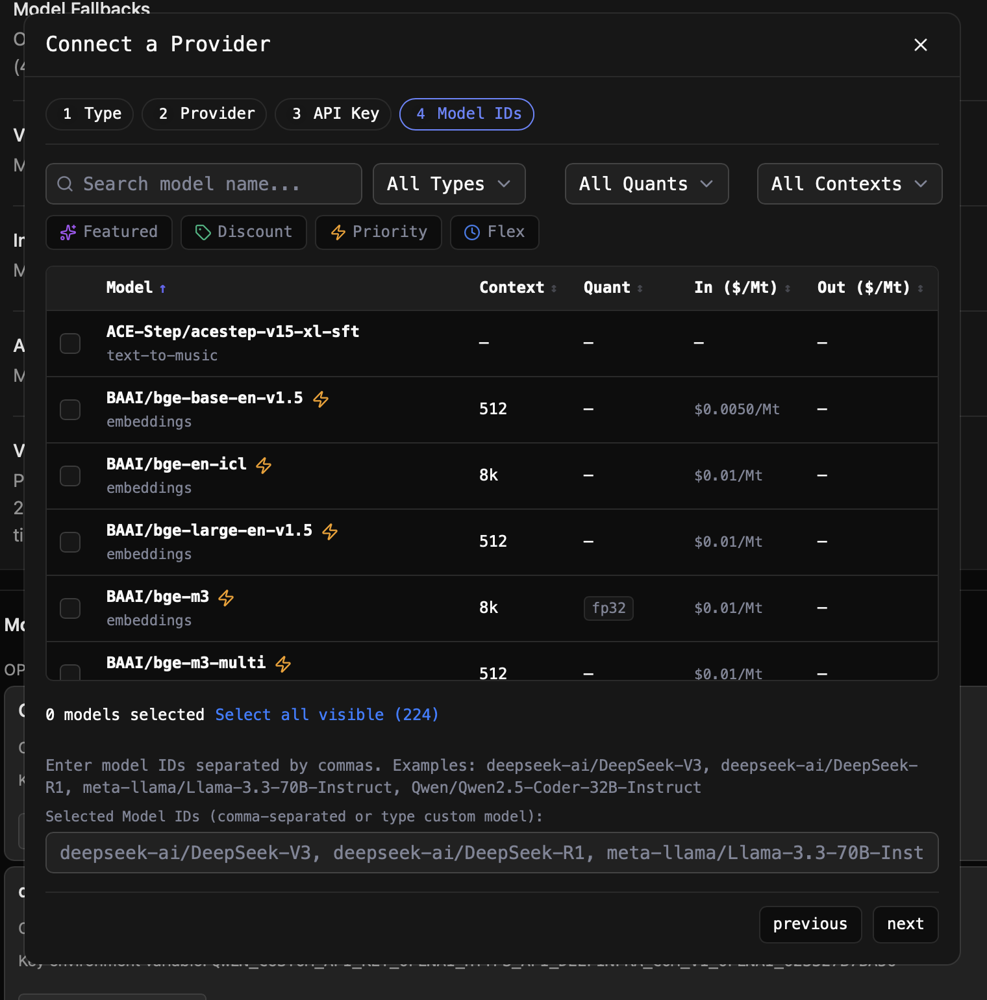
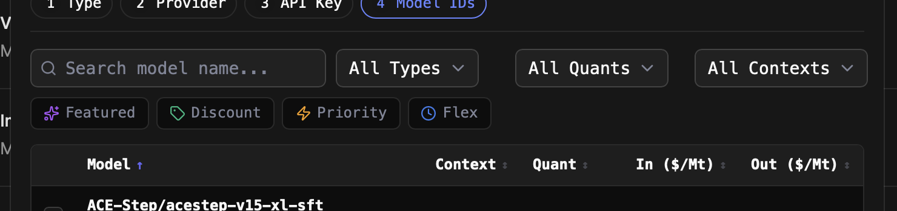
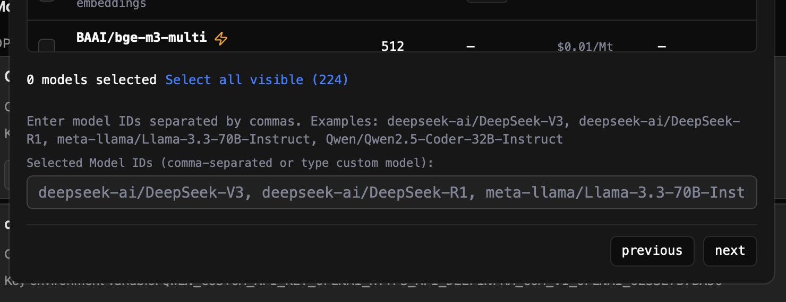

# DeepInfra Provider Preset and Service Tier Support

[English](deepinfra-provider-and-service-tier.md) | [简体中文](deepinfra-provider-and-service-tier.zh-CN.md)

## Context and Problem Statement

DeepInfra is a serverless AI inference platform offering fast, cost-effective access to popular open-source LLMs (such as DeepSeek-V3, DeepSeek-R1, Llama 3.3, and Qwen 2.5) via an OpenAI-compatible API. In addition to standard real-time inference, DeepInfra provides a **Flex** service tier that runs workloads at a 20% discount (0.8× pricing) using best-effort scheduling with up to 10 minutes wait time, returning HTTP 429 without charge if capacity is unavailable.

Previously, Qwen Code lacked:

1. A built-in provider preset for DeepInfra in the third-party providers registry.
2. First-class support for specifying a `service_tier` (such as `flex` on DeepInfra, or `priority`/`auto`/`default`/`flex` on OpenAI) through configuration (`generationConfig`), provider presets, environment variables, and CLI arguments.

## Goals

- Add DeepInfra as a first-class third-party provider preset using its OpenAI-compatible endpoint (`https://api.deepinfra.com/v1/openai`) and `DEEPINFRA_API_KEY`.
- Enable configuration of `service_tier` (including `flex`) across `modelProviders[].generationConfig`, `model.generationConfig`, provider presets/specs, environment variables (`OPENAI_SERVICE_TIER`, `DEEPINFRA_SERVICE_TIER`), and the CLI (`--service-tier`).
- Wire `service_tier` to outgoing OpenAI Chat Completions and OpenAI Responses API requests.
- Provide full test coverage and documentation updates.

## Non-Goals

- Implementing provider-specific offline batch asynchronous APIs (DeepInfra Flex is a synchronous API call).
- Overriding user-specified custom request parameters when explicit parameters are provided.

## Proposed Solution & Architecture

### 1. DeepInfra Provider Preset

DeepInfra is registered as an OpenAI-compatible provider:

- **Provider ID**: `deepinfra`
- **Label**: `DeepInfra`
- **Protocol**: `AuthType.USE_OPENAI`
- **Base URL**: `https://api.deepinfra.com/v1/openai`
- **Env Key**: `DEEPINFRA_API_KEY`
- **Models**: Curated starter models (`deepseek-ai/DeepSeek-V3`, `deepseek-ai/DeepSeek-R1-0528`, `meta-llama/Llama-3.3-70B-Instruct-Turbo`, `Qwen/Qwen2.5-72B-Instruct`) with `modelsEditable: true`.
- **Ownership Gate**: Dual-gate requiring `model.envKey === DEEPINFRA_ENV_KEY` and host ending in `.deepinfra.com` or equal to `api.deepinfra.com`.
- **Attribution Headers**: `HTTP-Referer` and `X-Title` set for request attribution.
- **UI Group**: `third-party`.

### 2. Service Tier Configuration and Wire Propagation

The `service_tier` parameter is supported end-to-end:

1. **Config Layer**: Added `service_tier` to `ContentGeneratorConfig`, `ModelGenerationConfig`, and `MODEL_GENERATION_CONFIG_FIELDS`.
2. **Provider Presets**: Added `service_tier` to `ModelSpec`, `ProviderConfig`, and `ProviderSetupInputs.advancedConfig`. Providers and model specifications can declare a default `service_tier`.
3. **Model Configuration Resolver**: Resolves `service_tier` from CLI (`--service-tier`), `modelProviders[].generationConfig.service_tier`, `model.generationConfig.service_tier`, or environment variables (`OPENAI_SERVICE_TIER`, `DEEPINFRA_SERVICE_TIER`).
4. **Chat Completions Wire**: `openaiContentGenerator` includes `service_tier` on `baseRequest` and preserves it through `DefaultOpenAICompatibleProvider.buildRequest`, allowing `extra_body.service_tier` overrides.
5. **Responses Wire**: `openaiResponsesContentGenerator` includes `service_tier` on `ResponsesApiRequest` and broadens `ResponsesApiServiceTier` to allow `'flex'`.

### 3. Interactive Model Selection Panel and Daemon Proxy Endpoint

Rather than requiring users to manually lookup and enter model identifiers into a plain text input, an interactive model selection panel (`ModelSelectionPanel`) is integrated into Step 4 ("Model IDs") of the provider setup dialog:

1. **Daemon Proxy Endpoint (`/workspace/auth/deepinfra-models`)**:
   - Queries `https://api.deepinfra.com/models/list` with an in-memory cache (TTL: 1 hour) to retrieve the full catalog of ~170 models.
   - Extracts metadata including model name, task type (e.g. `text-generation`, `embeddings`), context length (`max_tokens`), quantization variants (`fp32`, `fp8`, `int4`, etc.), pricing (`cents_per_input_token`, `cents_per_output_token` converted to `$/Mt`), and tier tags (`flex`, `priority`).
   - Automatically excludes `anthropic/*` models from being returned.
2. **Interactive UI Controls**:
   - **Real-Time Search**: Instant filtering across model names and task descriptions.
   - **Filter Dropdowns**: Filter by Type (`text-generation`, `embeddings`, etc.), Quantization (`fp16`, `fp8`, `int4`, `bf16`, etc. dynamically gathered from loaded models), and Context length (including `1024k` common in modern models).
   - **Subline Toggle Filter Buttons with Icons**:
     - `✨ Featured`: Filters to recommended benchmark models.
     - `🏷️ Discount`: Filters to discounted pricing models.
     - `⚡ Priority`: Filters to models supporting priority real-time routing.
     - `⏱️ Flex`: Filters to models supporting the 20% discounted flex routing tier.
   - **Separate In & Out Pricing Sort Headers**: Explicit `In ($/Mt) ↕` and `Out ($/Mt) ↕` columns allow independent ascending/descending sorting without confusion from mixed missing values.
   - **Multi-Selection & Manual Override**: Checkboxes toggle selection state with a visible counter. Chosen model IDs synchronize immediately to the comma-separated `Selected Model IDs` text input, where custom models can still be typed or modified.

### Visual Design & UI Narrative Walkthrough

_Figure 1: Full interactive Model Selection Panel embedded in Step 4 ("Model IDs") of the provider setup dialog, displaying available models with context length, quantization, and pricing in $/Mt._

_Figure 2: Search input, Type/Quant/Context dropdown filters, four toggle buttons (Featured, Discount, Priority, Flex) with inline SVG icons, and sortable In/Out pricing headers._

_Figure 3: Selection summary counter ("Select all visible"), model ID guidance examples, and synchronized comma-separated input field._

## Validation Plan

- Unit tests for `deepinfraProvider` preset ownership checks, URL validation, and attribution headers.
- Unit tests for `service_tier` resolution in `modelConfigResolver.test.ts`.
- Unit tests for `service_tier` propagation in `DefaultOpenAICompatibleProvider` and `openaiResponsesContentGenerator`.
- Unit tests for `/workspace/auth/deepinfra-models` daemon route caching and model filtering in `workspace-auth.test.ts`.
- Component unit tests for `ModelSelectionPanel` covering search, filters, pricing sorting, toggles, and model exclusion.
- Auth command and CI environment snapshot tests.

## Acceptance Criteria

- DeepInfra appears in `/auth` and the desktop UI under Third-Party Providers.
- Step 4 displays the interactive ModelSelectionPanel with live catalog, search, type/quant/context filters, 4 toggle buttons, and split In/Out pricing sort headers.
- Setting `service_tier: "flex"` (via settings, env var, or `--service-tier flex`) emits `"service_tier": "flex"` in the request payload.
- All unit and type tests pass without regressions.
