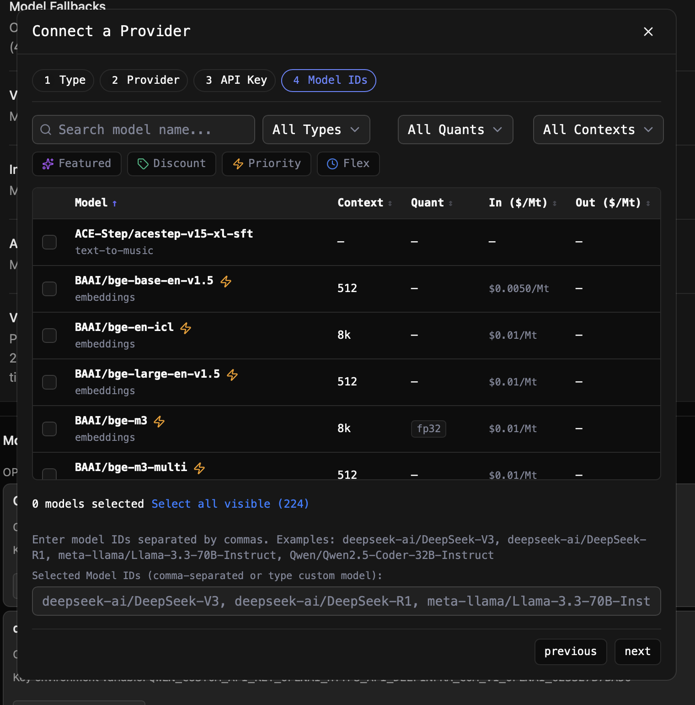
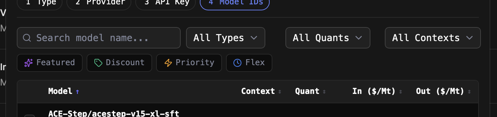
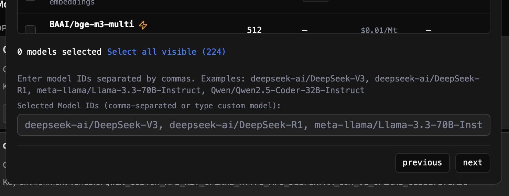

# DeepInfra 服务商预设与 Service Tier 支持设计

[English](deepinfra-provider-and-service-tier.md) | [简体中文](deepinfra-provider-and-service-tier.zh-CN.md)

## 背景与问题陈述

DeepInfra 是一家 Serverless AI 推理平台，通过 OpenAI 兼容 API 托管热门开源大语言模型（如 DeepSeek-V3、DeepSeek-R1、Llama 3.3 和 Qwen 2.5 等）。除标准实时推理之外，DeepInfra 还提供了 **Flex** 服务层级（service tier）：通过尽力而为调度（最多排队等待 10 分钟，若容量不足返回 HTTP 429 且不扣费），以 0.8× 价格（立减 20%）运行对延迟不敏感的工作负载。

在本次改动之前，Qwen Code 缺少：

1. 第三方服务商注册表中的 DeepInfra 内置预设。
2. 通过配置（`generationConfig`）、服务商预设、环境变量以及 CLI 参数原生指定 `service_tier`（例如 DeepInfra 的 `flex`，或 OpenAI 的 `priority`/`auto`/`default`/`flex`）的能力。

## 目标

- 将 DeepInfra 添加为第三方内置服务商预设，使用其 OpenAI 兼容端点（`https://api.deepinfra.com/v1/openai`）与 `DEEPINFRA_API_KEY`。
- 支持在 `modelProviders[].generationConfig`、`model.generationConfig`、服务商/模型预设、环境变量（`OPENAI_SERVICE_TIER`、`DEEPINFRA_SERVICE_TIER`）和命令行参数（`--service-tier`）中配置 `service_tier`（包含 `flex`）。
- 将 `service_tier` 透传至发往底层 OpenAI Chat Completions 及 OpenAI Responses API 的请求体中。
- 提供完备的单元测试覆盖与文档更新。

## 非目标

- 实现服务商特定的离线批量异步 API（DeepInfra Flex 仍然是同步 API 调用）。
- 在用户显式传入覆盖参数时强制修改用户参数。

## 方案与架构设计

### 1. DeepInfra 服务商预设

DeepInfra 注册为 OpenAI 兼容服务商：

- **服务商 ID**：`deepinfra`
- **显示名称**：`DeepInfra`
- **协议**：`AuthType.USE_OPENAI`
- **基地址**：`https://api.deepinfra.com/v1/openai`
- **环境变量名**：`DEEPINFRA_API_KEY`
- **预置模型**：精选热门模型（`deepseek-ai/DeepSeek-V3`、`deepseek-ai/DeepSeek-R1`、`meta-llama/Llama-3.3-70B-Instruct`、`Qwen/Qwen2.5-Coder-32B-Instruct`），配置 `modelsEditable: true`。
- **归属判断门禁**：双重检查，要求 `model.envKey === DEEPINFRA_ENV_KEY` 且主机名为 `api.deepinfra.com` 或以 `.deepinfra.com` 结尾。
- **归属标头**：配置 `HTTP-Referer` 与 `X-Title` 进行请求归属标识。
- **界面分组**：`third-party`。

### 2. Service Tier 配置与请求透传

`service_tier` 参数在整条调用链路中得到完整支持：

1. **配置层**：将 `service_tier` 纳入 `ContentGeneratorConfig`、`ModelGenerationConfig` 与 `MODEL_GENERATION_CONFIG_FIELDS`。
2. **服务商预设**：在 `ModelSpec`、`ProviderConfig` 和 `ProviderSetupInputs.advancedConfig` 中增加 `service_tier`，允许服务商与模型声明默认服务层级。
3. **模型配置解析器**：支持从 CLI（`--service-tier`）、`modelProviders[].generationConfig.service_tier`、`model.generationConfig.service_tier` 或环境变量（`OPENAI_SERVICE_TIER`、`DEEPINFRA_SERVICE_TIER`）解析 `service_tier`。
4. **Chat Completions 调用链路**：`openaiContentGenerator` 在 `baseRequest` 中包含 `service_tier`，并在 `DefaultOpenAICompatibleProvider.buildRequest` 中妥善保留，允许通过 `extra_body.service_tier` 进行覆盖。
5. **Responses 调用链路**：`openaiResponsesContentGenerator` 在 `ResponsesApiRequest` 中携带 `service_tier`，并扩展 `ResponsesApiServiceTier` 类型以支持 `'flex'`。

### 3. 交互式模型选择面板与守护进程代理端点

为避免用户在纯文本框中手动查找和输入复杂的模型标识符，在服务商接入对话框第 4 步（“Model IDs”）中集成了交互式模型选择面板（`ModelSelectionPanel`）：

1. **守护进程代理端点（`/workspace/auth/deepinfra-models`）**：
   - 请求 `https://api.deepinfra.com/models/list` 并设置内存缓存（TTL: 1 小时），获取约 170 个全量模型。
   - 解析模型元数据，包括模型名称、任务类型（例如 `text-generation`、`embeddings`）、上下文长度（`max_tokens`）、量化版本（`fp32`、`fp8`、`int4` 等）、价格（`cents_per_input_token`、`cents_per_output_token` 换算为 `$/Mt`）以及服务层级标签（`flex`、`priority`）。
   - 自动过滤并剔除 `anthropic/*` 模型。
2. **交互式控制项**：
   - **实时搜索**：按模型名称和任务类型即时过滤。
   - **下拉筛选框**：按任务类型（`text-generation`、`embeddings` 等）、量化格式（从加载的模型动态提取 `fp16`、`fp8`、`int4`、`bf16` 等）和上下文长度（包含常见的 `1024k`）进行过滤。
   - **带图标的次级快速过滤按钮**：
     - `✨ Featured`：筛选推荐基准模型。
     - `🏷️ Discount`：筛选享受折扣优惠的模型。
     - `⚡ Priority`：筛选支持 Priority 实时高优先级的模型。
     - `⏱️ Flex`：筛选支持 Flex 20% 优惠服务层级的模型。
   - **独立的输入/输出计费排序表头**：提供清晰的 `In ($/Mt) ↕` 与 `Out ($/Mt) ↕` 排序列，可分别升序或降序排序，避免因缺失值混杂导致的困惑。
   - **多选与手动覆盖**：复选框切换选中状态，并显示已选数量统计。选中的模型 ID 即时同步到底部的逗号分隔输入框中，用户仍可在输入框中补充或修改自定义模型。

### 界面设计与交互演示

_图 1：集成在服务商接入第 4 步（“Model IDs”）中的交互式模型选择面板，展示模型列表、上下文长度、量化规格及以 $/Mt 计费的价格信息。_

_图 2：搜索框、类型/量化/上下文下拉筛选、四个带 SVG 图标的快速切换按钮（Featured、Discount、Priority、Flex）以及独立的 In/Out 计费排序表头。_

_图 3：选中数量统计（“Select all visible”）、模型 ID 示例提示以及同步更新的输入框。_

## 验证计划

- `deepinfraProvider` 预设的归属判断、URL 校验与请求头单元测试。
- `modelConfigResolver.test.ts` 中针对 `service_tier` 解析优先级的单元测试。
- `DefaultOpenAICompatibleProvider` 与 `openaiResponsesContentGenerator` 中针对 `service_tier` 透传的单元测试。
- `workspace-auth.test.ts` 中针对 `/workspace/auth/deepinfra-models` 守护路由缓存与模型过滤的单元测试。
- `ModelSelectionPanel.test.tsx` 涵盖搜索、筛选、计费排序、快速按钮与模型过滤的组件测试。
- Auth 命令与 CI 环境变量快照测试。

## 验收条件

- DeepInfra 正常显示在 `/auth` 和桌面 UI 的第三方服务商列表中。
- 第 4 步呈现交互式 ModelSelectionPanel，支持在线模型获取、搜索、类型/量化/上下文过滤、4 个快速过滤按钮以及独立的 In/Out 价格排序。
- 设置 `service_tier: "flex"`（无论是通过 settings、环境变量还是 `--service-tier flex`）后，请求体中包含 `"service_tier": "flex"`。
- 所有单元测试和类型检查均能顺利通过，无任何回归问题。
