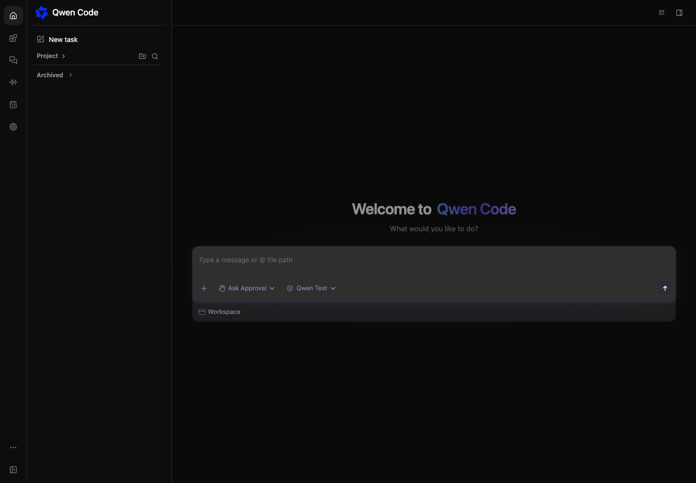
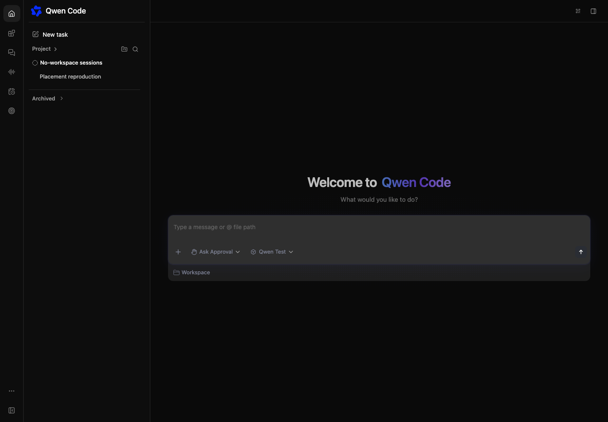

# No-workspace session placement

[English](no-workspace-session-placement.md) | [简体中文](no-workspace-session-placement.zh-CN.md)

## Problem and scope

Issue #15309 describes a discoverability problem: the no-workspace session group
is nested inside Workspaces and disappears when Workspaces is collapsed. Its own
collapse state also resets on reload. The group should be a peer of Workspaces.

The agreed name is “No-workspace sessions / 无工作区会话”, confirmed by the
requester after discussion. Retain that label in both languages.

## Design

Move the active `StandaloneRecents` node in `WebShellSidebar.tsx` after the
Workspaces body, before Archived. Preserve its existing props and visibility
guards, including the Live view restriction previously supplied by the outer
wrapper. It continues to use the focused daemon client; no other host's sessions
are added. Locked and section-specific views retain their existing restrictions.

In `StandaloneRecents.tsx`, reuse `workspaceExpansion.ts` to read and write the
existing expanded state, with distinct `standalone:active` and
`standalone:archived` preference ids. Missing preferences default to expanded.
Search continues to show matching rows even if the saved group state is
collapsed, without overwriting that preference. While searching, the group
header toggle is disabled; clearing the query restores it and the saved state.
Pagination resets on collapse as before. Archived sessions stay inside Archived.

An explicit collapse remains authoritative when opening a session from Recent,
a deep link, or the group's New task action. These actions do not automatically
expand the group or overwrite its preference. This follows the ordinary workspace
section convention and preserves the existing creation behavior; the header and
search remain available to reveal rows.

Recent intentionally continues to aggregate no-workspace sessions, so one session
can appear in both its source group and Recent, as ordinary workspace sessions
already do. Main's source-aware selection tracks the clicked copy. Moving the
group does not change Recent membership or assign a new session owner.

## Constraints and risks

Preserve creation, opening, selection, search, pagination, lifecycle actions,
capability checks, and daemon ownership. No backend, SDK, storage migration,
filesystem permissions, or automatic workspace association changes are needed.
The layout changes position only; it reuses the current group header and rows.
An unavailable localStorage retains the existing safe default.

## Validation and acceptance

Add browser coverage showing that collapsing Workspaces leaves the no-workspace
group visible, that both collapse states survive reload independently, and
that searching and opening a matching standalone session still work. Retain
capability restriction coverage. Add component coverage for independent active
and archived expansion preferences. Capture before/after browser evidence with
a simulated daemon and clearly distinguish it from live daemon testing.

Browser evidence with Workspaces collapsed (simulated daemon):

| Before                                                   | After                                                         |
| -------------------------------------------------------- | ------------------------------------------------------------- |
|  |  |

Run the repository build, typecheck, bundle, relevant component and browser tests,
formatting and lint checks, then audit the full diff.

## Decisions and related work

This design supersedes the nested-placement descriptions in the historical
[standalone daemon design](standalone-daemon-sessions.md) and
[sidebar session scope design](web-shell-sidebar-session-scope.md).

The name is settled: retain “No-workspace sessions / 无工作区会话”. This PR
addresses peer placement and persistence and closes #15309. Recent-session aggregation (#14904), creation refresh
(#15311), and terminology (#14988) remain separate work.
