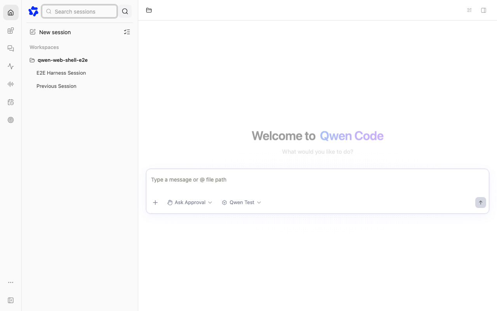
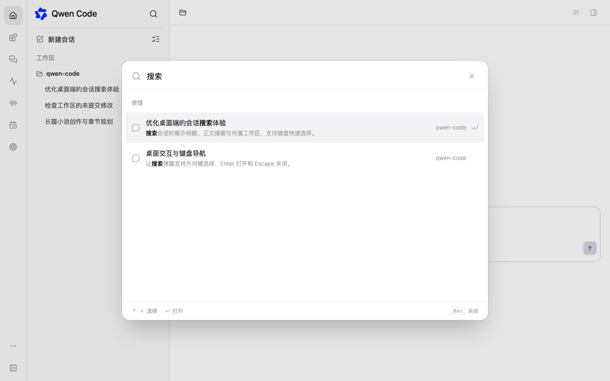

# Session search dialog

[English](session-search-dialog.md) | [简体中文](session-search-dialog.zh-CN.md)

## Problem and scope

The sidebar expands a search input into the brand row, squeezing the brand and
actions and exposing a heavy input focus ring. Replace that interaction with a
dedicated session search dialog. Tracked in
[session-search experience optimization #16778](https://github.com/QwenLM/qwen-code/issues/16778).

## Reference and design

The supplied local ChatGPT reference routes its search-chats command to a
centered command menu: a 48rem maximum width, 92vw responsive width, 64px search
header, and a scrollable result list capped at 440px. Adopt its quiet input,
rounded panel, lightly highlighted rows, title/snippet hierarchy, and workspace
context. Keep Qwen's own semantic theme tokens and shared Radix dialog primitive.
Do not copy unrelated commands, tabs, or the reference's backdrop blur: Web Shell
avoids blur over long transcripts for performance.

## Relationship to session overview

The dialog replaces the existing sidebar search interaction; it is a transient
find-and-open surface with transcript snippets. Session Overview remains the
persistent workspace/status-filtered management view, including sorting,
selection and archive/delete actions. Its table rows are not reused here because
search results are navigation-only and need conversation snippets. The dialog
reuses the existing Git-context and source-matching helpers and backend content
search contract. Matching in Session Overview is unchanged.

Typing in the dialog intentionally does not filter the background sidebar. This
replaces the previous inline-filter behavior and keeps navigation stable when
the dialog closes. Host-managed content retains its query callback inside the
dialog.

## Implementation

- Keep the existing search icon and brand stable. Open a portal-root-aware modal
  from every supported sidebar layout, including collapsed previews and Channels.
- Focus the input on open; support arrows and Enter to open results, Escape and
  outside click to dismiss, and restore focus to the invoking button.
- Show recent active sessions for an empty query. Search titles, identifiers,
  git context, and existing workspace transcript search. Display a muted snippet
  and workspace label per result; preserve workspace-qualified identities.
- Read trusted displayed workspaces and supported standalone sessions through
  existing SDK methods. Keep source filtering, locked-workspace scope, abort/stale
  result protection, debouncing, and partial-failure feedback. Do not add routes
  or change daemon ownership semantics. Standalone search remains title-based.
- Hosts supplying custom session content keep their existing query callback and
  content inside the dialog. Do not assume daemon catalogs represent managed
  sessions.
- Keep the ordinary sidebar unfiltered when the daemon search dialog is open.
  Search results are navigation targets, not an additional editing surface.

## Files and constraints

Changes are confined to Web Shell sidebar components, their tests, translations,
and this design. Reuse shared dialog and input primitives, preserving React 18/19
refs, portal isolation, and theme support.

| Before                                                    | After                                                       |
| --------------------------------------------------------- | ----------------------------------------------------------- |
|  |  |

Screenshots use an isolated mock daemon on macOS Chromium.

## Validation and acceptance

Verify title and content matches, multiple workspaces with duplicate session IDs,
standalone navigation, empty/loading/failure states, stale query responses,
keyboard navigation and focus restoration. Capture desktop light/dark and narrow
layouts. Run targeted component and browser tests, build, typecheck, and bundle.
The brand row must not shift or gain an input when search opens; the dialog must
fit small screens and open each result in its actual workspace. Review the full
diff twice and obtain an independent code review.

## Open questions

None. The requester has reviewed the local preview and approved Issue and PR
submission; repository review remains pending.
