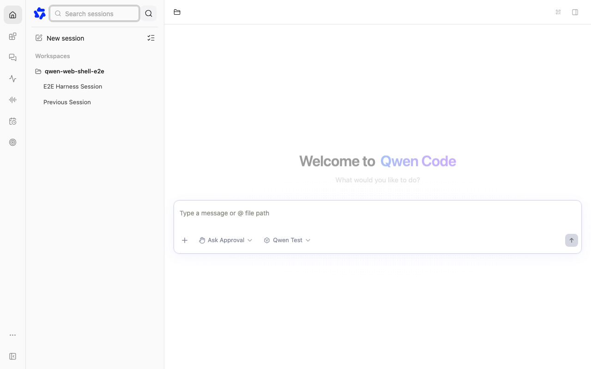
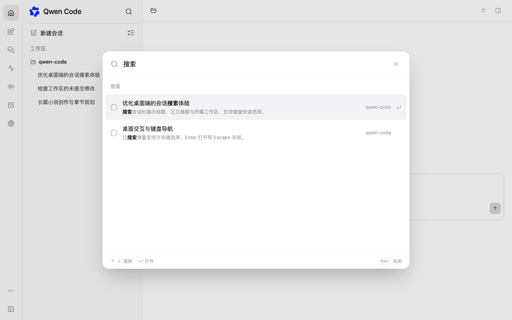

# 会话搜索弹窗

[English](session-search-dialog.md) | [简体中文](session-search-dialog.zh-CN.md)

## 问题与范围

当前侧边栏把搜索框展开到品牌行中，挤压品牌与操作按钮，并出现较重的输入框焦点描边。
将此交互替换为独立会话搜索弹窗。由
[会话搜索体验优化 #16778](https://github.com/QwenLM/qwen-code/issues/16778) 跟踪。

## 参考与设计

用户提供的本地 ChatGPT 参考实现将搜索会话命令路由到居中的命令菜单：最大宽度 48rem、
响应式宽度 92vw、搜索头部高 64px、结果滚动区域最高 440px。采用其简洁输入框、圆角面板、
浅色选中行、标题与摘要层次及工作区信息。使用 Qwen 自身的语义主题变量与共享 Radix 弹窗组件。
不引入无关命令和标签页，也不采用参考中的背景模糊；Web Shell 为避免长会话性能问题不使用背景模糊。

## 实现

- 保持搜索图标与品牌行稳定。所有支持的侧边栏布局均打开挂载到 portal root 的模态弹窗，
  包括折叠预览与频道视图。
- 打开后聚焦输入框；支持方向键选择、Enter 打开、Escape 与点击外部关闭，关闭后回焦到触发按钮。
- 空查询显示最近活跃会话。搜索标题、标识符、Git 上下文和已有的工作区正文搜索；
  每项显示弱化摘要与工作区名称，使用带工作区的会话身份。
- 通过现有 SDK 读取已展示且受信任的工作区与支持的独立会话。保留来源筛选、锁定工作区范围、
  请求取消与过期结果保护、防抖及部分失败反馈。不增加路由或改变 daemon 归属语义。
  独立会话仍按标题搜索。
- 注入自定义会话内容的宿主保留原有查询回调，并在弹窗内显示其内容；不假定 daemon 目录可以代表托管会话。
- daemon 搜索弹窗打开时，普通侧边栏不进行过滤。结果用于导航，不提供额外的编辑界面。

## 文件与约束

修改仅限 Web Shell 侧边栏组件、相关测试、翻译与本设计。复用共享弹窗和输入框组件，
保留 React 18/19 ref 兼容、portal 隔离与主题支持。

| 改动前                                                | 改动后                                           |
| ----------------------------------------------------- | ------------------------------------------------ |
|  |  |

截图在 macOS Chromium 上使用隔离的 mock daemon 生成。

## 验证与验收

验证标题和正文命中、多工作区同名会话 ID、独立会话导航、空白/加载/失败状态、过期请求响应、
键盘导航和焦点恢复。保存桌面浅色/深色及窄屏截图。运行针对性组件与浏览器测试、构建、类型检查和 bundle。
打开搜索时品牌行不得移动或出现输入框；弹窗应适配小屏幕，并在实际所属工作区中打开结果。
完整 diff 自审两遍，并进行独立代码审查。

## 待定问题

无待定问题。需求方已确认本地预览并同意提交 Issue 和 PR；仓库评审仍待完成。
