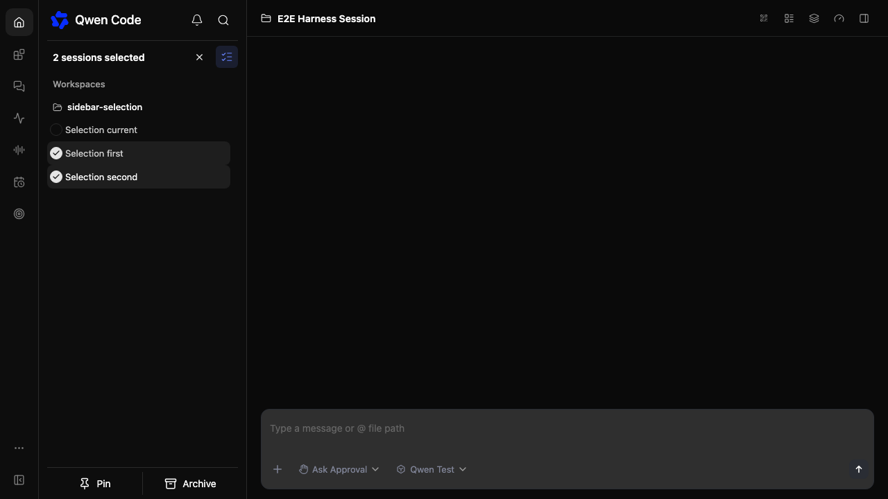

# Sidebar session selection

[English](sidebar-session-multiselect.md) | [简体中文](sidebar-session-multiselect.zh-CN.md)

## Problem and scope

The sidebar only offers individual session actions. Add a selection mode inspired
by the supplied reference: circular checkboxes, a selected count, an exit button,
and a fixed bottom bar with Pin and Archive. Preserve existing grouping and theme.
This change covers active workspace sessions; standalone and archived sessions
keep their existing actions. No daemon API changes are needed.

## Design

Keep selection in WebShellSidebar, keyed by workspace and session ID so duplicate
rows share selection without mixing workspaces. In selection mode, eligible rows
toggle selection instead of opening sessions. Hide their individual actions.
The header exits selection; Escape also clears selection. Changing workspace or
collapsing the sidebar clears selection to avoid acting on a previous context.

Pin only unpinned selected sessions through the existing permission checks and
optimistic update path. Archive runs without confirmation through the owning workspace client with
`requireIdle: true`, preserving current/running-session restrictions.
Require every selected session to support an action before enabling its button.
Keep unsuccessful actions selected so they can be retried.

## Files and validation

Update WebShellSidebar.tsx, its CSS Module, translations and collocated sidebar
tests. Validate selection, cancellation, duplicate identities, pinning, immediate archiving and existing current-session deletion behavior. Run build, typecheck
and focused tests; inspect desktop and narrow layouts when a browser is available.

## Acceptance and open questions

Selection never navigates; the count matches unique selected sessions; no action
is enabled with an empty selection. Existing permission and workspace boundaries
remain enforced. No open design questions for this initial implementation.

Bulk pin runs sequentially through the existing single-session organization API,
including optimistic updates and rollback; no backend route is added. Each
workspace retains ownership. Successful items leave selection, while failed
items remain selected with visible errors. Archive excludes the current session
and the server rejects sessions that start running after selection.

Bulk archive requires the `session_archive_idle_guard` capability. It uses the
primary client's legacy route for the primary workspace and qualified routes
for other trusted workspaces. Older daemons keep the bulk archive button disabled.

