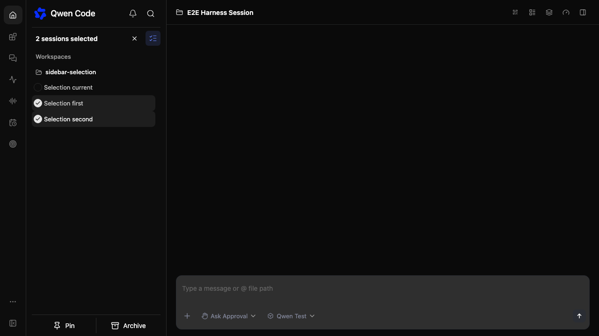

# 侧栏对话多选

[English](sidebar-session-multiselect.md) | [简体中文](sidebar-session-multiselect.zh-CN.md)

## 问题与范围

侧栏目前只支持单个对话操作。参考用户截图增加多选模式：圆形复选框、已选数量、退出按钮，以及固定在底部的置顶和归档操作栏。保留现有分组和主题。
本次覆盖活跃的工作区对话；独立对话和已归档对话保留现有操作。不修改 daemon API。

## 设计

在 WebShellSidebar 内保存选择状态，以工作区和对话 ID 作为标识，保证重复行共享选择且不同工作区互不混淆。多选模式下，可选择的行点击时切换选择，不打开对话，并隐藏单行操作。
顶部按钮和 Escape 均可清空选择并退出。切换工作区或折叠侧栏时清空选择，避免操作前一个上下文。

置顶只处理尚未置顶的选中对话，沿用权限检查和乐观更新逻辑。归档不需要二次确认，通过所属工作区客户端传递 `requireIdle: true`，保留当前会话和运行中会话不可归档的限制。
只有所有选中对话都支持某项操作时才启用对应按钮。归档失败的对话保留选中状态，便于重试。

## 文件与验证

修改 WebShellSidebar.tsx、对应 CSS Module、翻译和同目录侧栏测试。
验证选择、取消、重复标识、置顶、立即归档以及已有的当前对话删除行为。运行构建、类型检查和针对性测试；浏览器可用时检查桌面和窄屏布局。

## 验收与待定问题

选择不会触发导航；数量匹配去重后的选择；没有选择时操作按钮禁用。保留现有权限和工作区边界。本次初版没有待定设计问题。

批量置顶串行复用现有单会话接口及乐观更新和回滚，不新增后端接口。跨工作区按所属工作区执行；成功项取消选择，失败项保留并报告错误。归档传递 `requireIdle: true`，当前会话不可归档，运行竞态由服务端拒绝。

批量归档要求 `session_archive_idle_guard` 能力。主工作区使用主客户端的既有路由，其他可信工作区使用限定工作区的路由。旧 daemon 上批量归档按钮保持禁用。

