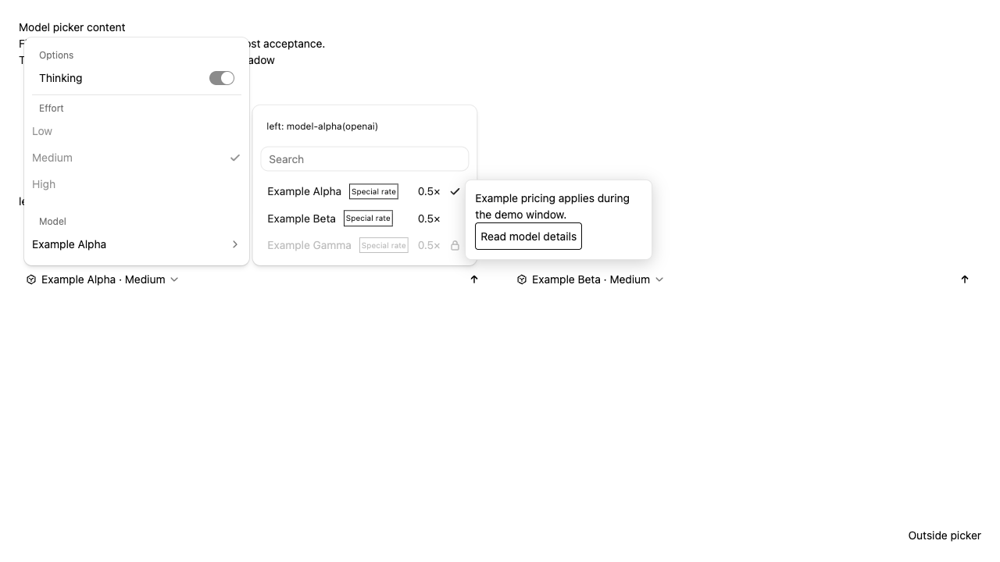

# Web Shell model-picker host content

[English](web-shell-model-picker-content.md) | [简体中文](web-shell-model-picker-content.zh-CN.md)

Status: implementation design for [#16893](https://github.com/QwenLM/qwen-code/issues/16893). Validation results belong in the implementation PR.

## Problem and current state

An embedding host can have model display information that changes independently
of the runtime catalog: a rate, a badge, an explanation, or a countdown. The
composer picker currently renders its own labels and native selection and
disabled indicators. It accepts additional unavailable models and a mounted
explanation for those models, but has no general header or row-content slot.

The picker lives in `ChatEditor`, including the model submenu shown alongside
reasoning controls. Main composers, split panes, side tasks, and managed
sessions reuse it. Replacing the entire picker would also replace search,
selection, disabled states, and keyboard behavior.

## Goals and scope

- Let hosts mount content above the model list and replace the display region
  of individual rows, keyed by the picker model id.
- Let hosts own the complete row presentation and any hover surface, including
  its loading, positioning, opening, closing, and interactive content.
- Keep list membership, order, search, selection, disabled state, native
  indicators, and keyboard navigation under Web Shell's control.
- Support DOM, React, and Solid hosts without requiring React nodes in the
  public contract.
- Give each composer independent mounted content and its actual context.

This applies to composer pickers, including their reasoning submenu. Settings,
the `/model` dialog, model-provider configuration, and daemon or SDK protocols
are outside this change. The customization does not add catalog rows or grant
access to an unavailable model.

## Public API

`WebShellProps`, and therefore its higher-level entry points, accepts an
optional `modelPicker` object. Public types are exported from the package.

```ts
export interface WebShellModelPickerContext {
  readonly composerId: string;
  readonly sessionId?: string;
  readonly workspaceId?: string;
  readonly workspaceCwd?: string;
  readonly daemonBaseUrl?: string;
  readonly currentModelId?: string;
  readonly language: WebShellLanguage;
  readonly theme: WebShellTheme;
  readonly overlayContainer: HTMLElement;
}

export interface WebShellModelPickerItemContext
  extends WebShellModelPickerContext {
  readonly model: {
    readonly id: string;
    readonly label: string;
    readonly disabled: boolean;
    readonly tooltip?: string;
  };
  readonly isSelected: boolean;
  readonly rowElement: HTMLElement;
}

export type WebShellModelPickerMount<TContext> = (
  container: HTMLElement,
  context: TContext,
) =>
  | {
      update(context: TContext): void;
      dispose(): void;
    }
  | null
  | undefined;

export interface WebShellModelPickerOptions {
  readonly mountHeader?: WebShellModelPickerMount<WebShellModelPickerContext>;
  readonly displayContentByModelId?: Readonly<
    Partial<
      Record<string, WebShellModelPickerMount<WebShellModelPickerItemContext>>
    >
  >;
}
```

Map values are reusable factories. The same model can appear in several
composers, so a host must create a separate view for every mount rather than
share an `HTMLElement` or a component root. Mount and update are synchronous;
data loading may happen inside the mounted view.

Keys match the picker model's original `id` exactly. Display labels and parsed
provider suffixes are not matching keys. Unknown keys are ignored until the
catalog contains that id. The existing catalog identifies and deduplicates by
id; this change does not distinguish endpoints that already share the same id.

`model.label` is the native display label. `model.tooltip` carries the existing
unavailable-model explanation as data that the host may include in its own
surface. `isSelected` describes the actual selected row, not pointer hover or
keyboard focus. A `currentModelId` that is absent from the catalog stays intact;
Web Shell does not substitute the first row.

## Presentation and interaction

The header appears immediately above the model search field. When the model
list is inside the reasoning submenu, the header belongs to that submenu;
existing reasoning controls remain in the outer popover. Mount the header only
while the model list is open. An omitted or declined header leaves no empty
region.

Rows retain their native selection button and selected or disabled indicator.
The host replaces the display region between those boundaries and controls its
name, icon, annotation, layout, and overflow. Row content is presentational;
independent buttons and links belong in a host overlay. The native accessible
name and disabled state remain available.

After a custom row mount succeeds, the host owns that row's hover behavior.
Suppress the native `title` and unavailable-model explanation for that row to
avoid competing surfaces. If the mount is omitted, declines, or fails
synchronously, restore the native content and its existing explanation. The
presence of a map key alone is not a successful mount.

Search keeps matching catalog labels and ids. It does not inspect mounted DOM
or automatically include prices or badges. A normal row click selects the
model. A host that consumes a touch gesture must prevent its click in a native
listener; Web Shell respects `event.defaultPrevented`. Disabled rows remain
unselectable.



Browser acceptance with fictional models and prices, a light theme, and a Shadow
DOM portal root.

## Host overlays

Each picker owns an overlay region under the existing themed portal root.
Each mounted slot receives its own `overlayContainer` within that region. The
container supplies ownership and the correct theme and Shadow DOM environment;
the host supplies the floating UI and its positioning.

- Pointer and focus interaction within this picker's overlay region does not
  dismiss the picker or select a row.
- Interaction outside the picker and its overlays retains native dismissal.
- Another composer's overlay is not an internal region of this picker.
- Ownership checks retain native events during capture, so delayed outside
  callbacks still recognize their picker after Shadow DOM retargeting clears
  the event path.
- While focus is inside a host overlay, the host handles Escape and restores
  focus. Escape on a row or search field keeps the native picker behavior.

The host may attach hover and focus listeners to `rowElement`, and is
responsible for keyboard and touch access to its optional surface. It must
clean up listeners and any added descriptive attributes. It must not replace
the row, change its selection semantics, or manipulate other slots. Custom
styles in Shadow DOM follow the existing `shadowDom.styles` mechanism.

## Context and lifecycle

The customization object is shared through the existing customization context.
Each `ChatEditor` creates a stable UI `composerId` for its mounted lifetime and
derives the current model and row state from its own props.

Direct composer owners supply a picker-only scope. Daemon-backed composers use
their own session, workspace, and complete daemon base URL, including a proxy
path. Managed sessions supply their actual session and workspace ids, and omit
an unavailable daemon base URL or absolute workspace path. Relative directories
are not presented as `workspaceCwd`, and missing values never fall back to the
main composer's state.

| Change                                                           | Behavior                                                      |
| ---------------------------------------------------------------- | ------------------------------------------------------------- |
| List opens or a row enters the rendered search results           | Mount the configured content                                  |
| Current model, language, theme, or row state changes             | Update the existing handle                                    |
| Map changes but the row's factory stays the same                 | Keep the view and update its context                          |
| Factory changes                                                  | Dispose the old view, then mount the new factory              |
| Row leaves the results, customization is removed, or list closes | Dispose the view                                              |
| Session, workspace, or source scope changes                      | Dispose the old scope's views and mount against the new scope |
| Composer unmounts                                                | Dispose all views and overlay containers                      |

Every successful mount has one dispose, including React StrictMode's repeated
mount cycles. Unrelated transcript renders must not remount content. Preserve
the row and slot node identities when enabling or disabling the old explanation
wrapper; changing the wrapper tree after a successful mount would create a
remount loop.

Isolate synchronous mount and update errors to the affected slot, dispose any
available handle, clear its owned containers, and restore native content.
Cleanup failures must not prevent other slots from being cleaned up. Retry a
declined or failed slot on a relevant context or configuration change, or when
the list reopens; unrelated rerenders do not cause repeated retries. A host
must also clean up resources if its mount throws before returning a handle.

Hosts may subscribe directly to reactive display data. Countdown ticks do not
need a Web Shell prop update. Replace the map immutably when its entries change
and keep unchanged factory references stable. Async work belongs to the host,
including cancellation and rejecting stale responses after scope changes.
Display updates must not recreate a session, reload the runtime catalog, or
write provider settings.

## Implementation and compatibility

Add the optional public configuration, context types, and exports. Share the
configuration through the existing customization context, while direct
composer owners provide the picker-only scope. Extend the existing picker with
header and row mounts, native fallback, and per-picker overlay containment.
Use the existing mounted-content patterns without building a general slot
framework, pool, or virtual list.

Existing `unavailableModels` and `mountUnavailableModelTooltip` remain supported.
Successful custom row content takes hover ownership for that row; native
fallback restores the previous unavailable-model behavior. An omitted
`modelPicker` preserves existing behavior. Hosts can roll back by removing the
property. No runtime dependency on Solid is added; its integration is a host
example using an owner, signals, `render`, and disposal.

## Validation and acceptance

- Exact id matching, unknown keys, native fallback, synchronous failures, and
  unchanged disabled-state enforcement.
- Header placement with and without reasoning controls, following the selected
  model of its own composer without following hover.
- Stable mounts, context updates, immutable map replacement, filtering,
  reopening, scope changes, cleanup failures, and StrictMode pairing.
- A host overlay with a link or button that neither selects a model nor
  dismisses the picker; outside dismissal and independent composer overlays.
- Main, split, side-task, managed-session, and draft contexts without substituting
  the main composer's state for missing values.
- Light and dark themes, Shadow DOM, narrow layouts, keyboard access, touch
  access in the host example, and native accessible names.
- Reactive prices, countdowns, language changes, and stale-response cleanup
  without session recreation or provider-configuration writes.

Use fixed model data for browser acceptance. Record the baseline, focused unit
and browser test commands, build and typecheck results, and observed evidence
in the implementation PR. The English and Chinese versions of this design
must remain complete and synchronized.
