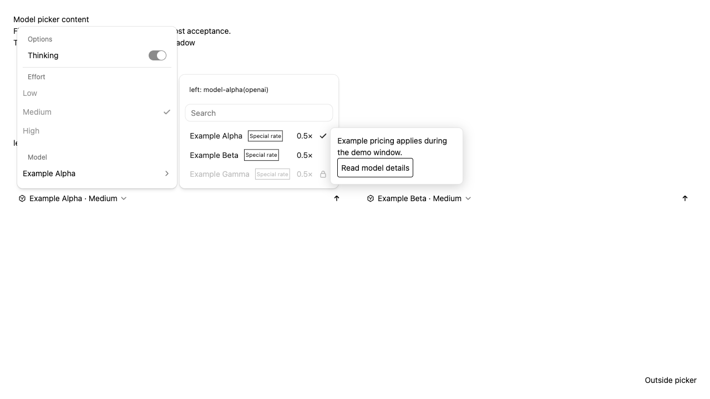

# Web Shell 模型选择器宿主内容

[English](web-shell-model-picker-content.md) | [简体中文](web-shell-model-picker-content.zh-CN.md)

状态：[#16893](https://github.com/QwenLM/qwen-code/issues/16893) 的实现设计。验证结果记录在实现 PR 中。

## 问题与现状

嵌入宿主可能持有独立于运行时目录变化的模型展示信息，例如价格、徽标、说明或倒计时。
输入框模型选择器目前自行渲染名称及原生选中、禁用标记。它支持追加不可用模型，并为
这些模型挂载说明内容，但没有通用的头部或行内容插槽。

选择器位于 `ChatEditor`，包括与思考参数配合显示的模型子菜单。主输入框、分屏、侧边
任务和托管会话都会复用它。整体替换选择器还需要替换搜索、选择、禁用态和键盘行为。

## 目标与范围

- 允许宿主在模型列表上方挂载内容，并按选择器模型 id 替换指定行的展示区域。
- 允许宿主管理完整行展示及可选 hover 浮层，包括取数、定位、开闭和交互内容。
- Web Shell 继续管理列表成员、顺序、搜索、选择、禁用态、原生标记和键盘导航。
- 支持 DOM、React 和 Solid 宿主，公共合同不要求传入 React 节点。
- 每个输入框拥有独立挂载内容，并获得自己的真实上下文。

本次覆盖输入框模型选择器及其思考参数子菜单。设置页、`/model` 对话框、模型 Provider
配置以及 daemon、SDK 协议不在本次改动范围内。定制不会增加目录条目，也不会授予
不可用模型的访问权限。

## 公共 API

在 `WebShellProps` 增加可选 `modelPicker` 对象，并由高层接入入口继承。公共类型从
包入口导出。

```ts
export interface WebShellModelPickerContext {
  readonly composerId: string;
  readonly sessionId?: string;
  readonly workspaceId?: string;
  readonly workspaceCwd?: string;
  readonly daemonBaseUrl?: string;
  readonly currentModelId?: string;
  readonly language: WebShellLanguage;
  readonly theme: WebShellTheme;
  readonly overlayContainer: HTMLElement;
}

export interface WebShellModelPickerItemContext
  extends WebShellModelPickerContext {
  readonly model: {
    readonly id: string;
    readonly label: string;
    readonly disabled: boolean;
    readonly tooltip?: string;
  };
  readonly isSelected: boolean;
  readonly rowElement: HTMLElement;
}

export type WebShellModelPickerMount<TContext> = (
  container: HTMLElement,
  context: TContext,
) =>
  | {
      update(context: TContext): void;
      dispose(): void;
    }
  | null
  | undefined;

export interface WebShellModelPickerOptions {
  readonly mountHeader?: WebShellModelPickerMount<WebShellModelPickerContext>;
  readonly displayContentByModelId?: Readonly<
    Partial<
      Record<string, WebShellModelPickerMount<WebShellModelPickerItemContext>>
    >
  >;
}
```

map 的值是可重复调用的工厂。同一模型可能同时出现在多个输入框中，宿主必须为每次
挂载创建独立视图，不能共享一个 `HTMLElement` 或组件根。挂载和更新同步返回，挂载
视图内部可以异步取数。

key 严格匹配选择器模型的原始 `id`。展示名称和解析后的供应商后缀都不是匹配依据。
未知 key 在目录出现对应 id 前不生效。现有目录按 id 标识和去重；本次不区分目录中
已经共用同一 id 的不同 endpoint。

`model.label` 是原生展示名称。`model.tooltip` 将已有不可用模型的说明作为数据传入，
宿主可将它放入自己的浮层。`isSelected` 表示实际选中的行，与鼠标悬停或键盘焦点
无关。`currentModelId` 即使不在目录中也保持原值，Web Shell 不会用第一项替代它。

## 展示与交互

头部紧邻模型搜索框上方。模型列表进入思考参数子菜单时，头部随列表进入子菜单；
原有思考参数控件继续留在外层浮层。只有模型列表打开时才挂载头部。未配置或挂载
返回空时，不保留空白区域。

模型行保留原生选择按钮和选中、禁用标记。宿主替换这些边界之间的展示区域，控制
名称、图标、说明、排版及溢出处理。行内内容只做展示，独立按钮和链接放在业务浮层
中。原生可访问名称和禁用态继续可用。

自定义行挂载成功后，该行的 hover 由宿主管理。关闭该行的原生 `title` 和不可用模型
说明，避免出现相互竞争的浮层。未配置、挂载返回空或发生同步错误时，恢复原生内容
及已有说明。仅有 map key 不代表挂载成功。

搜索继续匹配目录中的名称和 id，不读取挂载后的 DOM，也不自动搜索价格或徽标。
正常点击模型行会选择模型。宿主若消费触屏手势，需要在原生监听中取消对应点击；
Web Shell 尊重 `event.defaultPrevented`。禁用模型仍然不能选择。



浏览器验收使用虚构模型及价格、浅色主题和 Shadow DOM portal root。

## 宿主浮层

每个选择器在现有带主题的 portal root 下拥有自己的浮层区域。每次内容挂载获得该区域
内独立的 `overlayContainer`。容器提供归属及正确的主题、Shadow DOM 环境，宿主实现
浮层本身及其定位。

- 当前选择器浮层区域中的指针和焦点交互，不会关闭选择器或选择模型。
- 选择器及其浮层外的交互，继续按原生规则关闭。
- 其他输入框的浮层不会被识别为当前选择器的内部区域。
- 捕获阶段记录原始事件的归属，保证延后的外部交互回调在 Shadow DOM 重定向、
  事件路径清空后仍能识别所属选择器。
- 焦点在宿主浮层中时，由宿主处理 Escape 并恢复焦点；焦点在模型行或搜索框时，
  保留选择器原生的 Escape 行为。

宿主可在 `rowElement` 上绑定 hover 和 focus 监听，并负责其可选浮层的键盘和触屏访问。
监听器以及额外添加的说明属性都必须在销毁时清理。宿主不得替换模型行、改变选择
语义或操作其他插槽。Shadow DOM 内的自定义样式沿用 `shadowDom.styles` 机制。

## 上下文与生命周期

定制对象通过现有 customization context 共享。每个 `ChatEditor` 在自身挂载期间生成
稳定的 UI `composerId`，并根据自己的 props 得到当前模型和行状态。

直接持有输入框的组件传入仅供 picker 使用的 scope。daemon 输入框使用自己所属的
会话、工作区和完整 daemon 基址，包括代理路径。托管会话传入真实会话及工作区 id，
不存在 daemon 基址或绝对工作目录时省略对应字段。相对目录不能冒充 `workspaceCwd`，
缺失值也不能回填为主输入框的状态。

| 变化                             | 行为                                 |
| -------------------------------- | ------------------------------------ |
| 列表打开或行进入已渲染的搜索结果 | 挂载配置的内容                       |
| 当前模型、语言、主题或行状态变化 | 更新现有 handle                      |
| map 变化，但对应行的工厂未变     | 保留视图并更新上下文                 |
| 工厂变化                         | 销毁旧视图，再挂载新工厂             |
| 行移出结果、定制被移除或列表关闭 | 销毁视图                             |
| 会话、工作区或数据源 scope 变化  | 销毁旧 scope 的视图，按新 scope 挂载 |
| 输入框卸载                       | 销毁全部视图及浮层容器               |

每次成功挂载对应一次销毁，包括 React StrictMode 的重复挂载周期。无关的聊天记录
重渲染不能导致内容重挂。启停旧说明 wrapper 时保持模型行和插槽节点身份稳定；
挂载成功后改变 wrapper 树结构会导致反复卸载和挂载。

同步挂载、更新错误应被隔离到对应插槽：调用可用的清理句柄，清空其拥有的容器，
恢复原生内容。清理错误不能阻止其他插槽清理。相关上下文或配置变化、列表重新
打开时可以重试返回空或失败的插槽；无关重渲染不反复重试。宿主若在返回 handle 前
抛错，也必须清理已经创建的资源。

宿主可以直接订阅响应式展示数据，倒计时每秒更新无需更新 Web Shell props。map 条目
变化时以不可变方式替换 map，并保持未变化工厂的引用稳定。异步请求由宿主管理，
包括取消请求和在 scope 变化后丢弃过期响应。展示更新不得重建会话、刷新运行时目录
或写入 Provider 配置。

## 实现与兼容

增加可选公共配置、上下文类型和导出。配置通过现有 customization context 共享，直接
持有输入框的组件提供 picker 专用 scope。在现有选择器中接入头部、行内容挂载、原生
回退以及每个选择器的浮层边界。复用已有内容挂载模式，不建设通用插槽框架、池化或
虚拟列表。

已有 `unavailableModels` 和 `mountUnavailableModelTooltip` 继续受支持。自定义行内容
成功挂载时接管该行 hover；回退原生内容时恢复原有不可用模型行为。不传 `modelPicker`
时保留既有行为，宿主也可通过移除该属性回退。不增加 Solid 运行时依赖；其接入仅作为
宿主示例，使用 owner、signal、`render` 和销毁。

## 验证与验收

- 精确 id 匹配、未知 key、原生回退、同步错误以及禁用态强制约束。
- 有无思考参数时的头部位置正确，跟随所属输入框选中模型，不跟随 hover。
- 稳定挂载、上下文更新、不可变 map 替换、筛选、重新打开、scope 变化、清理错误
  及 StrictMode 配对。
- 宿主浮层中的链接或按钮不选择模型，也不关闭选择器；外部交互正常关闭，各输入框
  浮层相互独立。
- 主输入框、分屏、侧边任务、托管会话和草稿上下文正确，缺失字段不回填主输入框状态。
- 浅深主题、Shadow DOM、窄布局、键盘访问、宿主示例的触屏访问及原生可访问名称。
- 响应式价格、倒计时、语言变化和过期响应清理正常，不重建会话或写入 Provider 配置。

浏览器验收使用固定模型数据。在实现 PR 中记录基线、相关单测和浏览器测试命令、
构建及类型检查结果，以及实际观察到的证据。本文的英文和中文版本必须保持完整同步。
