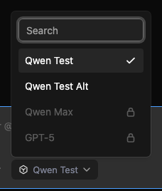
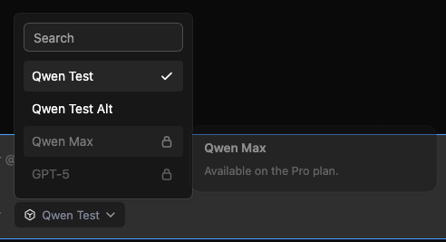
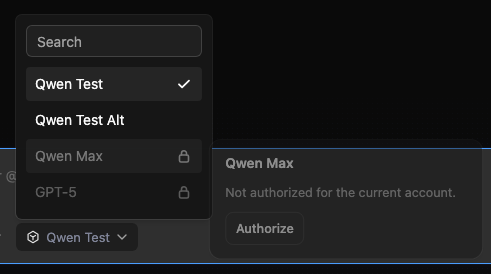

# Web Shell 宿主注入不可用模型

[English](web-shell-unavailable-models.md) | [简体中文](web-shell-unavailable-models.zh-CN.md)

## 问题

嵌入宿主通常有一份产品目录里的模型，但当前账号不可用（套餐、权限或未授权）。这些模型仍应出现在输入框模型选择器中，并以禁用行展示。Hover 或焦点打开提示，内容可以是纯文本，也可以是宿主自己的界面，包括「去授权」这类按钮。宿主可能是 SolidJS，因此公开插槽不能要求传入 React 元素。

这是目录展示，不是鉴权。

## 现状

输入框列表来自 daemon `connection.models`，经 `isVisibleComposerModel` 过滤后，渲染为可点的 `ToolbarPopover` 按钮。原生 `title` 只用于溢出全名。内置 Tooltip 不能放按钮。可交互 hover 已存在于 `ContextUsagePopover`。跨框架自定义 UI 已有成例：`mountFootnotePreview(container, info)` 返回 `{ update, dispose }`。

## 目标

- 宿主可以注入 daemon 列表里没有的模型。
- 这些行在输入框选择器中显示为禁用，包括 reasoning 子菜单里的同一份列表。
- Hover 和键盘焦点打开提示。提示可以是字符串，也可以是宿主挂到 DOM 上的内容（含按钮）。
- Solid 和原生 DOM 宿主挂到一个 `HTMLElement` 上，不必构造 React 元素。
- daemon 已有的可用模型保持可选。注入的相同 id 会被跳过。

## 范围

范围内：主聊天、分屏和侧任务的输入框选择器；公开类型和 README；中英设计文档。

范围外：daemon 与 SDK 路由；`/model`；`ModelDialog`；StatusBar；设置里的模型管理；页脚 `availableModels`；禁用 daemon 已经返回的模型。

## 公开 API

公开面只有纯数据和一个稳定的 mount 函数：

```ts
export interface WebShellUnavailableModel {
  id: string;
  label?: string;
  tooltip?: string;
}

export interface WebShellUnavailableModelTooltipInfo {
  readonly model: WebShellUnavailableModel;
}

export interface WebShellUnavailableModelTooltipHandle {
  update(info: WebShellUnavailableModelTooltipInfo): void;
  dispose(): void;
}

export type WebShellUnavailableModelTooltipMount = (
  container: HTMLElement,
  info: WebShellUnavailableModelTooltipInfo,
) => WebShellUnavailableModelTooltipHandle | null | undefined;
```

`WebShellProps`（以及 `WebShellWithProviders`）接受 `unavailableModels` 和 `mountUnavailableModelTooltip`。载荷不含 React、Solid 或 AST 对象。

优先级：mount 成功则使用宿主内容；省略、decline（`null`/`undefined`）或同步抛错则回退到 `model.tooltip`；两者都没有则不展示提示，但该行仍禁用。

## 合并与选择

`appendUnavailableComposerModels` 保留可用模型在前，再追加注入行。跳过空 id、已在可用列表中的 id、`HIDDEN_COMPOSER_MODEL_IDS`，以及注入列表中的重复 id（取第一条）。`isStandaloneModelPickerUnavailable` 仍只看 daemon 目录。

点击禁用行不调用 `onSelectModel`。提示层里的按钮由宿主处理。

## 提示层

复用 hover-intent Popover，不使用 Tooltip，也不新增 HoverCard。约 300ms 后打开，离开后短延迟关闭，指针进入内容层保持打开，键盘焦点同样打开。提示层是固定宽度的卡片：Web Shell 渲染模型名为标题、纯文本 tooltip 为说明。禁用行在 hover/焦点时保持高亮。Web Shell 拥有定位、开闭、portal 和滚动边界。宿主只填标题下方的区域。

提示层带标记，父选择器忽略其外部指针事件，用户点击「去授权」时不会关掉模型列表。提示层内的点击不选中该模型。

生命周期对齐脚注槽：mount 函数保持引用稳定；一次成功 mount 对应一次 dispose，包括 React StrictMode；悬停到另一条禁用模型且 mount 函数未变时走 update；关闭、卸载或替换 mount 函数时 dispose。Solid 宿主自行保留响应式 owner，并在 dispose 里拆掉 `render`。

## 验证

单测覆盖合并规则、禁用渲染、点击行不选择、搜索、纯文本回退、mount/update/dispose、decline 回退，以及提示层按钮既不切换模型也不关闭父选择器。输入框、分屏和侧任务的透传在各自 prop 链路覆盖。浏览器证据使用已有 ChatEditor DOM 测试和 settings harness 选择器。







## 验收

- 不传或空列表时选择器不变。
- 注入模型出现在可用模型之后，且不可选。
- 宿主纯文本提示在 hover 和焦点时出现。
- 宿主 mount 可以渲染按钮；点击它不切换模型，也不关掉选择器。
- Solid 或 DOM 宿主不需要 React 元素工厂。
- 即使注入了相同 id，daemon 可用模型仍可选择。
