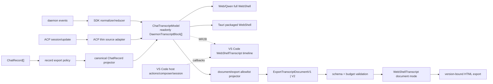
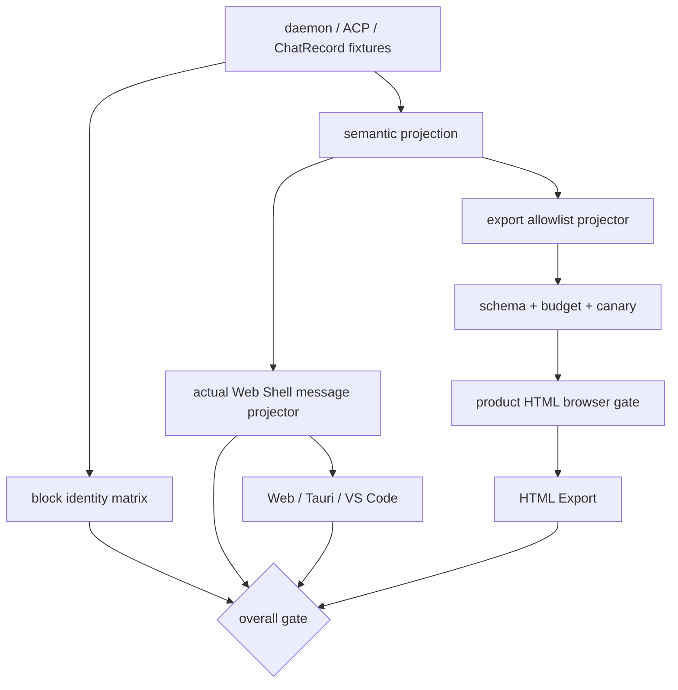

---

# Unified Chat Transcript Design for Web Shell, VS Code, Desktop, and HTML Export

[English](chat-transcript-contract-prevalidation.md) | [简体中文](chat-transcript-contract-prevalidation.zh-CN.md)

> Document status: the sole normative design document for this initiative
>
> Delivery sequence: merge MR1, MR2A, and MR2B in order
>
> Current state: MR1 contract pre-validation is complete. This branch implements MR2A's HTML Export product path; migrating the VS Code live transcript remains in MR2B
>
> Current gates: direct-daemon/ACP candidate identity and the product HTML browser gate pass. `selectedVscodePath: null` and `overall: "fail"` remain until MR2B completes product selection and the scope/generation, VSIX/host-action, and packaging gates

## 0. Document governance

This document defines the target architecture, shared contract, security constraints, implementation boundaries for the three MRs, and exit gates. Although the code is split into MR1, MR2A, and MR2B, these three MRs will not introduce another overall design document.

The automatic-trigger message display slice has a separate detailed design: [English](../2026-11-20-web-shell-automatic-trigger-message.md) | [简体中文](../2026-11-20-web-shell-automatic-trigger-message.zh-CN.md). This document remains the unified transcript master contract. The slice document is the detailed design for the automatic-trigger message display slice under that contract, not a parallel master design. The two documents link to each other. Any renderer schema-ceiling or allowlist change in this slice must be written back to this master contract; consult the slice document for presentation-scope trade-offs. Any conflict between the slice and this contract is an unresolved design review and must not silently change the existing contract.

The ongoing rules are:

1. Write design changes for MR1, MR2A, and MR2B back to this document.
2. Fixture schemas, the Export JSON Schema, capability matrix, and test reports are contract appendices to this document, not a second design.
3. Implementation plans, E2E records, and release reports may be stored separately, but must not redefine this initiative's model, identity, or security semantics.
4. Treat conflicts between code and this document as an incomplete design review; do not hide them by updating snapshots.
5. The earlier unified ChatPanel proposal and pre-split implementation are historical context only. This document supersedes them as the sole normative source.

## 1. Conclusion

This initiative will not create a standalone ChatPanel package or introduce a new cross-host message model in its first release. The minimum runtime semantics shared by all four targets remain based on the existing `DaemonTranscriptBlock[]`. `ChatTranscriptModel` is this document's logical name for that readonly boundary; MR1 need not add a production type.

The final data flow is:

```text
native source
  → source adapter / canonical projector
  → ChatTranscriptModel (readonly DaemonTranscriptBlock[])
  → live/readonly renderer

ChatTranscriptModel
  → document/export allowlist projector
  → ExportTranscriptDocumentV1 | V2
  → WebShellTranscript document mode
  → version-bound HTML
```

Specifically:

- Web/Qwen Server and Qwen Tauri Desktop already use the full WebShell and remain unchanged.
- VS Code selects a production path only after both direct-daemon and thin ACP conversion pass stable-identity probes; only its chat timeline moves.
- HTML Export obtains a `ChatTranscriptModel` from `ChatRecord[]` through the canonical projector, then converts it one way into a safe `ExportTranscriptDocumentV1 \| ExportTranscriptDocumentV2`.
- The host always owns the composer, active permission responses, session management, transport, persistence, and host side effects.
- The default interactive/readonly adapter must retain its existing `rawInput`, `rawOutput`, and Turn Output semantics.
- Safe consumption of typed `preview`/`resultPreview` is enabled only on the document/export path.
- Additional Mermaid budgets, timeouts, and fallback rules apply only in document mode.

The work is split into three sequential MRs:

1. **MR1: Contract pre-validation** — produces repeatable evidence only and lets gates report FAIL honestly.
2. **MR2A: HTML Export** — implements the safe document pipeline, document mode, and CLI/Web API/VS Code `/export html` consumers. The VS Code timeline continues to use legacy `MessageList`.
3. **MR2B: VS Code live transcript migration** — selects a product path and connects the real adapter, scope/generation, shared renderer, host actions, VSIX, and packaging gates.

## 2. Current repository facts and implementation state

### 2.1 Current production boundaries

| Consumer                | Current fact                                                                                                                                             | Treatment in this initiative                                                                                                       |
| ----------------------- | -------------------------------------------------------------------------------------------------------------------------------------------------------- | ---------------------------------------------------------------------------------------------------------------------------------- |
| Web/Qwen Server         | The SDK reducer produces `DaemonTranscriptBlock[]` from daemon state; the full WebShell renders it                                                       | Keep the production path unchanged as the semantic and compatibility baseline                                                      |
| Qwen Tauri Desktop      | Builds and copies the same WebShell artifact                                                                                                             | Add no Desktop adapter; MR1 does not certify installed-artifact behavior                                                           |
| VS Code                 | MR2A continues to use the existing legacy `MessageList`, with no transcript-update registration, `@qwen-code/web-shell` dependency, or dead feature flag | This render site is MR2B's designed integration seam; add no empty production adapter                                              |
| HTML Export             | CLI, Web API, and VS Code exports all pass raw records to the document projector and use a version-bound product template                                | Product path converged; the legacy renderer was removed when `@qwen-code/webui` retired, and `toHtml` requires records (see §12.4) |
| OpenWork/Craft Electron | Independent chat implementation                                                                                                                          | Outside this initiative's scope                                                                                                    |

Current `WebShellTranscript` behavior:

- It publicly accepts `readonly DaemonTranscriptBlock[]`.
- It is pinned to `readonly` render mode.
- It does not connect to the daemon, provide a composer, answer permissions, or modify the session.
- Its default adapter still restores complete tool display and Turn Output semantics from runtime blocks' raw fields.
- It provides a separate `document` render mode, while interactive/readonly raw-adapter semantics remain unchanged.

### 2.2 State of the three MRs

| Area                                                     | Current state                                                                                          | Result             |
| -------------------------------------------------------- | ------------------------------------------------------------------------------------------------------ | ------------------ |
| MR1 fixtures/schema/hash/capability matrix               | Complete                                                                                               | PASS               |
| ChatRecord → SDK → Web Shell default-adapter equivalence | Default raw-path regression passes                                                                     | PASS               |
| `write_file` → complete Turn Output diff regression      | Continues to read complete runtime raw content                                                         | PASS               |
| direct-daemon stable identity                            | SDK reducer plus integration candidate projection passes partial-prepend                               | PASS (candidate)   |
| ACP stable identity                                      | Integration candidate projection passes live/history/partial-prepend                                   | PASS (candidate)   |
| VS Code timeline                                         | MR2A keeps legacy `MessageList`, with no new transport/adapter/renderer wiring                         | DEFERRED TO MR2B   |
| Export document schema/builder                           | Canonical schema, strict structural validation, and semantic safety validation are in the product path | PASS               |
| document mode/HTML wiring                                | CLI, Web API, and VS Code export use the same version-bound product template                           | IMPLEMENTED        |
| Browser/Scope/VSIX/Packaging                             | Product HTML browser gate passes; scope/reconnect, VSIX, and installed artifacts are not yet certified | PARTIAL / DEFERRED |

`overall` remains FAIL not because the HTML renderer failed, but because MR2A deliberately does not select a VS Code product path. Required evidence for the live timeline, host behavior, and release-level behavior remains in MR2B. A candidate-probe PASS must not be mistaken for completed product wiring.

## 3. Goals and non-goals

### 3.1 Goals

1. Freeze the minimum readonly transcript semantics shared by all four targets.
2. Reuse the existing SDK reducer and `projectChatRecordsToDaemonTranscript()` without copying replay rules.
3. Establish auditable stable identity for blocks, renderer items, and host actions.
4. Let VS Code reuse the WebShell chat timeline while retaining its composer, permissions, sessions, and native operations.
5. Give HTML Export versioned, safe, resource-bounded input that does not initiate network access from document content.
6. Prevent regressions in Web Shell interactive/readonly behavior and Tauri Desktop.
7. Make every architectural conclusion repeatably verifiable through fixtures, hashes, a capability matrix, and automated gates.
8. Let the VS Code and HTML consumer paths undergo independent review, rollout, observation, and rollback through MR2A/MR2B.

### 3.2 Non-goals

- Do not add `@qwen-code/web-shell/chat-panel` or a new general ChatPanel framework.
- Do not unify composers, drafts, attachments, queues, permission interactions, session lists, or host navigation.
- Do not require a new production adapter for Web/Qwen Server or Tauri Desktop.
- Do not migrate OpenWork/Craft Electron.
- Do not include PDF, artifact viewers, or arbitrary host overlays in the transcript model.
- Do not put action callbacks, transport, credentials, or session services in transcript blocks.
- Do not let HTML Export execute tools, answer permissions, or modify sessions.
- Do not fake stable identity with content hashes, timestamps, random values, array indices, React keys, or DOM positions.

## 4. Overall architecture



### 4.1 Ownership boundaries

| Layer                | Responsible for                                                                                 | Not responsible for                                                |
| -------------------- | ----------------------------------------------------------------------------------------------- | ------------------------------------------------------------------ |
| source adapter       | Protocol normalization, source provenance, scope/generation admission                           | UI and host side effects                                           |
| ChatTranscriptModel  | Ordered readonly message semantics, stable block identity, and the hierarchy needed for display | Composer, active permission responses, transport, session mutation |
| WebShellTranscript   | Readonly timeline display for Markdown, thinking, tools, plans, and images                      | Daemon connection, persistence, and permission APIs                |
| VS Code host adapter | MR2B connection path, scope/generation, callbacks, feature flag, and native operations          | Copying the chat renderer; MR2A publishes no empty adapter         |
| export projector     | Record policy, per-field allowlist, ID rewriting, budgets, and diagnostics                      | Live side channels and raw-payload passthrough                     |
| HTML shell           | Schema/version validation, CSP, document mode, and themes/printing                              | Tool execution and remote runtime downloads                        |

The host remains the source of truth for transport, sessions, and side effects. The shared renderer must not reconstruct business state through the DOM.

## 5. ChatTranscriptModel contract

### 5.1 Minimum definition

```ts
import type { DaemonTranscriptBlock } from '@qwen-code/sdk/daemon';

interface ChatTranscriptModel {
  readonly blocks: readonly DaemonTranscriptBlock[];
}

interface TranscriptAdapterContext {
  readonly scopeKey: string;
  readonly generation: number;
}
```

`ChatTranscriptModel` is a logical contract name. Production code continues to pass `DaemonTranscriptBlock[]` directly and does not publish this wrapper unless real MR2 consumers prove the existing type cannot express required semantics.

The versioning systems must remain separate:

- The runtime model has no document schema version.
- Fixtures use `fixtureVersion`.
- The HTML envelope uses `schemaVersion`.
- The renderer uses an exact `rendererVersion`.

`scopeKey` and `generation` belong to the adapter context. They enter neither the block list nor the exported document.

### 5.2 Required shared semantics

| Capability          | Block semantics                                           | States that must be tested                                                  |
| ------------------- | --------------------------------------------------------- | --------------------------------------------------------------------------- |
| User/assistant text | `user` / `assistant`                                      | streaming, empty delta, usage, replay                                       |
| thinking/commentary | `thought`                                                 | interleaving with assistant, completion, collapsing                         |
| Images              | text block images                                         | multiple images, invalid MIME, missing/oversized resources                  |
| Tools               | `tool` + tool identity + typed preview                    | pending, completed, failed, cancelled, parallel, nested, background, replay |
| shell               | `shell` / `user_shell`                                    | stdout/stderr, increment, exit, reconnect                                   |
| Plan/Todo           | Typed plan presentation on a tool block                   | revision, priority, dependencies, completion, failure                       |
| Permission history  | `permission`                                              | pending, approved, rejected, cancelled, expired, resolved                   |
| Status and errors   | `status` / `error` / `prompt_cancelled`                   | cancellation, truncation, incomplete replay, connection/model errors        |
| Unknown input       | Safe fallback, explicit exclusion, or blocking diagnostic | Must not silently lose user-visible content                                 |

A plan is not currently a separate block kind. Support must not be claimed from a tool name alone; fixtures must prove that the user-visible title, steps, status, revision, and dependencies remain.

### 5.3 State excluded from the model

- Composer content, cursor, drafts, and attachments awaiting submission.
- Follow-up queue, suggestion queries, and input modes.
- Active permission responses, credential input, and ask-user form state.
- Session lists, current session, branch navigation, and persisted objects.
- Host side effects such as opening files, diffs, URLs, artifacts, copying, and message editing.
- Side channels such as current tool, approval mode, resync, and pending shell.

A `permission` block describes timeline history only; it grants no ability to call permission APIs.

### 5.4 Unknown content and completeness

Unknown input permits only three outcomes:

1. Convert it to a visible safe fallback that does not leak the raw payload.
2. Explicitly exclude it under the frozen policy and record a diagnostic.
3. If it should have been user-visible, record a contract gap and block the gate.

Arbitrary `unknown`, `meta`, `details`, `content`, or raw objects must not serve as escape hatches. Externally visible diagnostics contain only code, severity, count, and completeness flags; they must not echo prompts, tokens, absolute paths, or tool arguments.

## 6. Render modes and compatibility

Three modes are defined:

| Mode          | Input                                      | Raw semantics                                         | Interaction and resource policy                             |
| ------------- | ------------------------------------------ | ----------------------------------------------------- | ----------------------------------------------------------- |
| `interactive` | live runtime blocks                        | Unchanged; raw remains the complete tool truth        | Full WebShell interaction                                   |
| `readonly`    | live/replayed runtime blocks               | Unchanged; raw remains the complete tool truth        | No composer/permission response; optional host callbacks    |
| `document`    | Safe document envelope using schema 1 or 2 | Raw forbidden; consume only typed safe preview/result | No host actions, virtualization, or active remote resources |

Compatibility invariants:

1. MR2 does not change interactive/readonly precedence for `rawInput`, `rawOutput`, `content`, or permission `toolCall`.
2. Typed `preview`/`resultPreview`, even when both exist, cannot change default-adapter output.
3. Document mode cannot fall back to raw when safe typed fields are missing.
4. `write_file` Turn Output continues to prefer complete `tool.args.content`; it must not use truncated `preview.newText`.
5. Interactive/readonly Markdown, Mermaid, tool cards, collapsing, virtualization, and action behavior remain unchanged.
6. Document-mode restrictions are enabled through a separate context/option, and configuration caches are isolated by mode.

If `ExportTranscriptBlockV1` cannot be passed to `WebShellTranscript` in a type-safe way, MR2A may add only one pure document-adapter function. This adapter may map safe DTOs to renderer input but cannot restore raw payloads, copy the reducer, or evolve into a second message model.

## 7. Stable identity design

### 7.1 Stability domain

Within the same `scopeKey` and native semantic event chain, a block's identity must remain unchanged across:

- React rerenders.
- Repeated reduction of the same input.
- Streaming delta appends.
- Complete, partial, and overlapping replay.
- Reconnects.
- Loading a tail window and then prepending earlier history.
- Timestamp normalization.
- Permitted exchanges of independent out-of-order events.

Different sessions, branches, native protocols, or independent export files need not produce identical string IDs. Cross-adapter comparisons use semantics and provenance rather than an invented global ID.

### 7.2 scopeKey and generation

- `scopeKey` is a stable opaque key assigned by the host to a session + branch. It remains unchanged across reconnects to the same session and must change when switching sessions or branches.
- `generation` is a local epoch that increments whenever transport is rebound within the same scope.
- `generation` does not participate in block IDs.
- Events, tool updates, permissions, copy/edit/open-file requests, and asynchronous results all carry the `{scopeKey, generation}` captured on receipt.
- The reducer/host compares this against the current context again before applying a result and discards mismatches.
- Unknown, bootstrapping, draining, or removed scopes must fail closed and never fall back to the primary or previous session.

### 7.3 Native provenance

| Block                  | Preferred source identity                                  | Handling when absent                                    |
| ---------------------- | ---------------------------------------------------------- | ------------------------------------------------------- |
| tool                   | `toolCallId` + scope                                       | Fail without tool identity                              |
| permission             | `requestId` + scope                                        | Fail without request identity                           |
| persisted text/thought | `sourceRecordIds` + lane + persisted segment identity      | Fail if it cannot be derived deterministically          |
| live text/thought      | prompt identity + lane + producer-stamped segment identity | Never fall back to ordinal/content hash                 |
| shell/user_shell       | authoritative shell/event identity + scope                 | Fail when absent                                        |
| status/error/cancelled | authoritative event identity + scope                       | Fail when absent or merge into an existing stable block |

An event cursor represents transport order only. For a text block assembled from multiple deltas, the cursor changes with the last delta and therefore cannot independently serve as segment identity.

### 7.4 Segment identity rules

MR2A retains record-derived segment identity only for persisted replay/document projection. Live producer/admission identity is driven by MR2B's real VS Code consumer. The final rules are:

1. Multiple deltas in the same streaming segment reuse one `segmentId`.
2. User, assistant, thought, and sub-agent lanes remain separate.
3. Tool, permission, or discrete-message boundaries end the current text segment.
4. Persisted replay retains record-derived segment identity; the replay adapter cannot renumber it.
5. Both MR2B's direct-daemon envelope and ACP live updates must carry source identity to the normalizer.
6. Adjacent text with different `segmentId`s cannot merge into one identity block merely because it is adjacent in the current window.
7. Missing stable prompt/record/segment provenance produces a blocking diagnostic rather than a guessed substitute.

A versioned deterministic function derives stable block IDs from `{scopeKey, blockKind, nativeSourceIdentity}`. Parent/child block references must be rewritten consistently. The default Web/Tauri reducer's ordinal runtime IDs may remain compatible. MR2A keeps candidate evidence only in integration helpers; moving stable projection into a production VS Code adapter must be driven by MR2B's real consumer.

### 7.5 MR1 historical FAIL and MR2A candidate evidence

MR1's read-only probe uses the current `normalizeDaemonEvent` and `reduceDaemonTranscriptEvents`:

1. Reduce the complete input from empty state.
2. Remove the first historical segment and reduce the same tail again.
3. Align identical blocks through semantic keys.
4. Compare current block IDs and record whether source provenance exists.

MR1's results at that time:

| Candidate     | partial-prepend          | Native text identity          | MR1 gate |
| ------------- | ------------------------ | ----------------------------- | -------- |
| direct-daemon | ordinal block ID drifted | user/thought/assistant absent | FAIL     |
| ACP           | ordinal block ID drifted | user/thought/assistant absent | FAIL     |

Before MR2B merges, both candidates must run and pass the complete identity matrix. Permanently abandoning either candidate requires recording the scope change and rationale in this document first; a failing candidate cannot simply be deleted from the tests.

MR2A does not retain a VS Code production adapter used only by gates. The gates call the real SDK reducer, integration-only candidate projections, and the real Web Shell message projector. Both candidates pass the append/partial-prepend/replay matrix, but this proves contract feasibility only. MR2B must reassess whether ACP becomes the product path using scope/generation, host actions, VSIX, and three-platform evidence. MR2A keeps `selectedVscodePath` as `null`.

## 8. Renderer item and host-action identity

Stable block IDs are necessary but insufficient. The renderer merges assistant text, groups adjacent tools, and nests thought/sub-agent content, so a block does not necessarily map to one DOM node.

Tests and host seams use this logical evidence:

```ts
interface TranscriptRenderedItemEvidence {
  readonly renderedItemId: string;
  readonly sourceBlockIds: readonly string[];
  readonly sourceToolCallIds: readonly string[];
  readonly capabilities: readonly (
    | 'copy'
    | 'copy-all'
    | 'copy-last-reply'
    | 'edit-user-message'
    | 'open-file'
  )[];
}
```

Rules:

- `renderedItemId` derives from stable source IDs, tool-call identity, and fixed grouping boundaries.
- Tool grouping cannot depend only on adjacency in the current window. Without stable batch/turn boundaries, do not group across them.
- Preserve every `sourceBlockIds` entry after merging, and keep every tool call independently addressable.
- Identity remains unchanged across rerendering, collapsing, virtualization toggles, partial-prepend, and replay.
- Semantic copy is generated from the renderer presentation model, not scraped from the currently mounted DOM.
- Copy, edit, open-file, and other actions return stable targets to the host, which validates scope/generation again before execution.
- Streaming text growth may change the semantic copy hash but cannot change item identity within the same segment.
- React keys, DOM order, array indices, and the visible window cannot serve as business identity.

MR2B adds only the minimum callbacks/handles proven necessary by failing fixtures; it must not create a general host framework. MR2A adds no host callbacks/handles.

## 9. Adaptation design for the four targets

### 9.1 Web/Qwen Server

- Continue using the daemon reducer and full WebShell.
- Add no production adapter.
- Serve as the interactive/readonly raw-compatibility baseline.
- MR2 document/identity changes must run its regression tests without changing default output.

### 9.2 Qwen Tauri Desktop

- Continue packaging the same WebShell build, assets, and library dist.
- Add no Desktop transcript fork.
- MR1 establishes baseline evidence through source-wiring assertions.
- Final desktop release still requires installed-artifact smoke tests, but these do not block MR1.

### 9.3 VS Code direct-daemon candidate

```text
daemon events
  → SDK normalizer/reducer
  → stable identity projection
  → scoped ChatTranscriptModel
  → WebShellTranscript readonly timeline
```

Validation must cover loopback/auth/workspace scope, session lifecycle, SSE replay, permission ownership, VSIX bundling, CSP, sidebar/editor tabs, callbacks, and the feature flag. A pre-existing connection spike in the repository does not automatically make direct-daemon the production path.

### 9.4 VS Code ACP candidate

```text
ACP session/update
  → thin source normalizer
  → SDK transcript reducer
  → stable identity projection
  → scoped ChatTranscriptModel
  → WebShellTranscript readonly timeline
```

The ACP adapter performs protocol normalization and provenance forwarding only:

- It does not reimplement Markdown, tool, plan, or permission display.
- It does not pass an ACP session object to the renderer.
- It does not take over the composer, permission responses, session management, or native file operations.
- Live updates and history must share segment-identity semantics.
- Late updates and asynchronous action results are discarded by scope/generation.

### 9.5 VS Code selection rules

Both candidates first use the same fixtures and identity matrix. MR2B may select only a path that:

1. Passes every stable-identity check.
2. Preserves existing composer, permission, session, and host-action boundaries, or has a separately reviewed scope change.
3. Passes VSIX bundling, CSP, and three-platform behavior checks.
4. Fully falls back to the legacy timeline when the feature flag is off.

ACP is the current production baseline, so thin ACP conversion is preferred when both paths are equally viable. This is not an MR1 preselection. Record the final choice and reasons for rejection in the capability matrix and this document's status table.

MR2A makes no product selection. VS Code does not forward raw `session/update` through a bypass; the Webview does not instantiate a transcript reducer; `qwen-code.experimental.webShellTranscript` is not declared; and the existing legacy `MessageList` always renders. This render site is MR2B's target integration seam, not a production abstraction requiring placeholder code. ACP remains the preferred candidate as the current transport, but only MR2B can write `selectedVscodePath`, after passing host-action parity, VSIX, and three-platform gates.

### 9.6 HTML Export

```text
ChatRecord[]
  → record-level export policy
  → projectChatRecordsToDaemonTranscript()
  → ChatTranscriptModel
  → safe document projector
  → ExportTranscriptDocumentV1 | V2
  → schema/budget validation
  → WebShellTranscript document mode
  → version-bound HTML
```

The HTML path must neither copy the ChatRecord replay/reducer nor serialize complete `ChatRecord`, `DaemonTranscriptState`, or runtime blocks directly into the file.

## 10. ExportTranscriptDocumentV1 | V2

### 10.1 Role

`ExportTranscriptDocumentV1` is a one-way safe derivative of `ChatTranscriptModel`:

```text
ExportTranscriptDocumentV1 = projectForDocument(ChatTranscriptModel)
```

It is a versioned document DTO, not a second runtime transcript model, and never flows back into a live session.

V2 adds the restricted user `meta.source: 'cron'` to this base projection. The new version is emitted only through the document DTO. The field axis `schemaVersion` and implementation axis `rendererVersion` must not be conflated. Readers accept valid V1 and V2 but reject other versions, newly added `meta` in V1, and non-canonical single-key Cron metadata in V2.

```ts
interface ExportTranscriptDocumentV1 {
  readonly schemaVersion: 1;
  readonly rendererVersion: string;
  readonly blocks: readonly ExportTranscriptBlockV1[];
  readonly diagnostics: readonly {
    readonly code: string;
    readonly severity: 'info' | 'warning' | 'error';
    readonly count: number;
  }[];
  readonly metadata: ExportMetadataPresentationV1;
}
```

### 10.2 Two-layer safe projection

This order cannot be reversed:

1. **record-level policy**: classify user-visible, internal control, system, and unknown records without changing order, parent/branch relationships, or causal chains.
2. **post-projection allowlist**: construct a new safe object for each canonical block kind rather than spreading an object and deleting denylisted fields.

If a rejected record is a necessary causal node for later visible records, mark the export incomplete or fail outright; never reconnect parents to fabricate a session.

### 10.3 Block-field allowlist

JSON Schema closes every block kind with `additionalProperties: false`:

| Block                        | Fields allowed in V1                                                                                                                                                                                                |
| ---------------------------- | ------------------------------------------------------------------------------------------------------------------------------------------------------------------------------------------------------------------- |
| Every kind                   | Document-local opaque `id` and `kind`; all three block timestamp fields fixed at `0`                                                                                                                                |
| `user`/`assistant`/`thought` | `text`, safe raster images, `collapsed`, safe parent references; `author` on `user` and `assistant` only, containing only a safe `name`; `usage` after numeric allowlisting, on `assistant` only; `streaming=false` |
| `tool`                       | Opaque `toolCallId`, title, terminal status, boolean `background`, safe toolName/toolKind, typed `preview`/`resultPreview`, safe parent/child references, short `subagentType`                                      |
| `shell`                      | `text`, `stream`                                                                                                                                                                                                    |
| `user_shell`                 | `text`, `command`, sanitized workspace-relative `cwd`, `stream`                                                                                                                                                     |
| `permission`                 | Opaque `requestId`, title, label/description, options with `raw:null`, typed preview, opaque tool identity, safe resolved terminal state                                                                            |
| `status`/`error`             | text, known code/errorKind, safe source                                                                                                                                                                             |
| `prompt_cancelled`           | Safe reason                                                                                                                                                                                                         |
| `debug`                      | Rejected by default in V1; emit code/count diagnostic                                                                                                                                                               |

Schema version 2 permits one additional restricted `meta: { source: 'cron' }`, and only on a `user` block. This is a canonical display-routing tag generated by offline replay, not a passthrough metadata bag. It contains no timestamp, sourceRecordIds, or other user-provided metadata. A V1 `user` block contains no `meta` and retains its original closed field set.

These fields are never exported directly:

- `eventId`, `serverTimestamp`, `sourceRecordIds`, `promptId`, `branchRecordId`.
- Tool `content`, `locations`, `details`, `rawInput`, and `rawOutput`.
- Permission `sessionId`, `toolCall`, and raw response tokens.
- Status `data` and `debugReason`.
- Credentials, environment variables, absolute user paths, raw session IDs/labels, or arbitrary metadata bags.

### 10.4 Typed tool projection

- Before entering the document, runtime `preview` must be reconstructed by kind with recursive length, URL, path, image, and array limits.
- `ask_user_question`/permission `raw` is fixed to `null`.
- After tool completion, write only safe `resultPreview`, never a raw result.
- A new unsafe, oversized, or unclassifiable tool update must clear any earlier safe result preview for the same call to prevent stale-preview leakage.
- Plan/Todo retains only allowlisted fields such as id, content, status, priority, blockedBy, planId, and revision.
- The document adapter consumes only typed preview/result. If absent, emit a safe placeholder and diagnostic; never fall back to raw.
- Interactive/readonly adapters retain their existing raw semantics.

### 10.5 Opaque IDs and references

Native IDs never enter the export document directly. During final canonical traversal, the projector creates document-local opaque mappings for blocks, tools, permissions, and parent/child references, then rewrites every reference consistently:

- Mapping is deterministic for the same input.
- No reverse map from original to opaque IDs is written.
- ID stability is not promised between export files.
- Duplicate, dangling, or cyclic references cause document failure or explicit degradation.
- Opaque IDs have charset and length limits.

These IDs and live stable identity are separate domains: the former serves one offline document; the latter serves replay and action addressing within a session scope.

### 10.6 metadata

```ts
interface ExportMetadataPresentationV1 {
  readonly title?: string;
  readonly startedAt?: string;
  readonly exportedAt: string;
  readonly complete: boolean;
  readonly truncated: boolean;
  readonly projectName?: string;
  readonly repository?: string;
  readonly gitBranch?: string;
  readonly model?: string;
  readonly channel?: string;
  readonly promptCount?: number;
  readonly contextUsagePercent?: number;
  readonly contextWindowSize?: number;
  readonly totalTokens?: number;
  readonly filesWritten?: number;
  readonly linesAdded?: number;
  readonly linesRemoved?: number;
}
```

Metadata is constructed field by field:

- `projectName` may be only a basename or an explicitly safe label.
- Do not export absolute cwd, uniqueFiles, raw session IDs/labels, or user directories.
- Strings obey length/character policies; counts are non-negative safe integers.
- Block timestamps are zeroed. `exportedAt` belongs only to document metadata and cannot participate in identity or semantic snapshots.

### 10.7 Resource and computation budgets

| Budget                                  | V1 limit                                                                      |
| --------------------------------------- | ----------------------------------------------------------------------------- |
| transcript blocks                       | 1,000                                                                         |
| Single text field                       | 400 KiB UTF-8; schema `maxLength` separately imposes 409,600 structural limit |
| All visible text                        | 8 MiB UTF-8                                                                   |
| One decoded raster                      | 8 MiB                                                                         |
| All decoded rasters                     | 16 MiB                                                                        |
| JSON envelope                           | 32 MiB UTF-8                                                                  |
| JSON/preview depth                      | 16                                                                            |
| Elements per array                      | 1,000                                                                         |
| Properties per object                   | 1,000                                                                         |
| Mermaid/chart/diff/highlight rich tasks | 100 total; excess displays source fallback                                    |

JSON Schema cannot express aggregate UTF-8 bytes, text, images, or envelope budgets. Both the Node builder and browser validator must therefore perform explicit budget checks; schema `maxLength` is only a structural limit and cannot replace byte budgets.

Resource rules:

- Permit only restricted base64 rasters of type `image/png`, `image/jpeg`, `image/gif`, or `image/webp`; V1 rejects animated content.
- Reject SVG, HTML, JavaScript, `file:`, `blob:`, remote images, and unexpected data URIs.
- Markdown images and structured images share MIME/source/byte policies.
- URL literals in code, diffs, shell, commands, and ordinary text remain text and trigger no resource load.
- External links navigate only on explicit user clicks, with credentials removed and query/fragment handled by policy.
- Credential stripping actually applies to http(s): `sanitizeEmbeddedUrls` rewrites each embedded URL in free text, while `normalizeNavigableUrl` handles Markdown links/autolinks; both clear userinfo, query, and fragment. Non-navigable schemes (`ssh user:pw@host`), bare-argument credentials (`-pSECRET`, `--token=...`), and content inside `code` / `inlineCode` nodes are exported unchanged. The document boundary is not a general-purpose secret scanner. This boundary must match the code and must not promise stronger protection in documentation.
- When limits are exceeded, emit a safe placeholder and diagnostic before rich parsing; do not continue lenient parsing of dangerous content.

### 10.8 document mode

Document mode must:

- Disable virtualization and internal scrolling so find, selection, copy, and print cover all blocks.
- Expand thinking, plans, tool groups, parallel agents, sub-agents, and nested tools by default.
- Disable the composer, permission responses, retry, branch and session navigation, and host actions.
- Read only safe document envelopes using schema 1 or 2, rejecting all other version values.
- Avoid network requests for remote Markdown images and never execute dangerous HTML/SVG.
- Enable Mermaid restrictions, timeouts, and fallbacks only in document mode without polluting interactive/readonly global configuration or caches.
- Preserve copyable source when Mermaid, code highlighting, diff, or chart rendering fails.
- Load no resource requiring `unsafe-eval`, remote WASM, remote grammars, fonts, or other dynamic assets beyond the version-bound renderer.

### 10.9 CSP and registered network access

HTML uses a renderer exactly bound to the CLI build. `latest`, version ranges, and runtime remote resolution are forbidden.

When a source build delegates to a published renderer, emit according to that renderer's schema ceiling: a pre-V2 renderer defaults to V1, preventing unconditional V2 from breaking every export. Explicitly selecting a renderer that cannot read the emitted document, or one whose identity or SRI does not match the actual asset, still fails closed. An explicit ceiling of 2 must correspond to the same actually V2-capable renderer and its JS/CSS digests.

Minimum security requirements:

- `default-src 'none'`.
- `connect-src 'none'`, `object-src 'none'`, `frame-src 'none'`, `media-src 'none'`.
- `base-uri 'none'`, `form-action 'none'`.
- Images may use only approved `data:` or explicitly registered same-package resources.
- Scripts/styles use nonce/hash or an equivalent static policy. If existing React requires style attributes, permit only the minimal `style-src-attr` exception; DTOs accept no style field.
- The renderer, including React runtime, may load only from exact-version npm URLs on unpkg and must verify SRI against the final published bytes. Opening local HTML must produce no other unregistered subrequests.
- Browser tests intercept every request during opening, expansion, Markdown/Mermaid rendering, themes, and printing. Any unregistered request or CSP violation fails immediately.

### 10.10 Failure, completeness, and canaries

- Sanitizer errors must not echo rejected values.
- Safe degradation records code/severity/count.
- If budget or safety policy replaces originally visible content, set `truncated=true` and `complete=false`.
- If rich rendering fails but complete safe source remains, `complete=true` is allowed alongside a warning.
- If tool results, plans, or permission history become inequivalent summaries after raw removal, positive fixtures and the MR2 gate fail.
- Perform byte-level canary scans on the envelope, HTML, CSP, diagnostics, and ancillary resources.
- Duplicate IDs, dangerous URLs/images, cycles, object-property floods, invalid metadata, schema widening, or rendering after budget excess all fail.

### 10.11 Version rules

- Any safety-semantic change to fields, kinds, defaults, allowlists, metadata, CSP, MIME/URL policy, or resource budgets increments `schemaVersion`.
- Published schemas cannot change meaning in place.
- `rendererVersion` must be an exact CLI version or content hash. `latest`, `~`, `^`, comparison ranges, and `*` are forbidden.
- Renderers explicitly declare supported schema versions. Incompatibility displays a readonly error page instead of lenient parsing.
- A schema upgrade retains reader and safety-canary tests for the previous published version until the corresponding CLI leaves support.
- Automatic-trigger document projection follows this increment: version 2 user blocks may add the single-key `meta.source` fixed to `cron`. Version 1 producers and files still reject that field. The HTML writer selects the version using the renderer schema ceiling declared at compile time. The current local renderer supports 2; a pre-V2 delegate selects 1 by default. An explicit ceiling of 2 is permitted only when the actual renderer, identity, and SRI all support 2. Readers accept both versions 1 and 2; any other version still triggers a readonly error page. V2's remaining metadata-exclusion rules are unchanged.
- `fixtureVersion` describes only the test-recording format and does not replace the export schema version.

## 11. Fixtures, schema, and capability matrix

### 11.1 Current MR1 directory

```text
integration-tests/fixtures/chat-transcript-contract/v1/
├── capability-matrix.md
├── cases/
│   └── representative/
│       ├── manifest.json
│       ├── daemon-events.jsonl
│       ├── acp-session-updates.jsonl
│       ├── chat-records.jsonl
│       ├── expected-model.json
│       ├── expected-render-items.json
│       ├── expected-export.json
│       └── expected-gate.json
└── schema/
    └── manifest.schema.json
```

The sole production copy of the V1 schema remains at `packages/cli/src/ui/utils/export/export-transcript-document-v1.schema.json`. The integration gate reads it directly; fixtures no longer copy a second drift-prone schema. This file is not rewritten. The V2 schema derives from it in the export factory, changes the version identifier, and adds only the restricted `meta.source` to the existing `userBlock`; all other structure and safety policy inherit unchanged.

Rules:

- Use deterministic synthetic data only; collect no real user sessions.
- IDs, timestamps, cwd, usernames, URLs, tokens, and images use fixed test values.
- The manifest records source, consumer, capability, expected diagnostics, and SHA-256 for every case/schema.
- Ordinary tests validate only and never overwrite fixtures automatically.
- Gate reports are test-run artifacts and are not written back into hash fixtures.
- `complete: true` means the fixture case is complete, not that the migration gate passes.

### 11.2 Scenarios MR2 must extend

1. Multi-delta streaming, duplication/reordering, and complete/partial/overlapping replay.
2. Multi-delta partial-prepend and distinct-segment adjacency.
3. Parallel/nested tools, shell, background agents, failure/cancellation/late completion.
4. Plan/Todo revision, priority, dependencies, and safe result preview.
5. Full permission lifecycle with safe historical display even without raw `toolCall`.
6. Source mapping and actions under render merging/grouping/collapse/virtualization.
7. Scope switches, generation increments, and late events/actions/results.
8. Raw data, credentials, absolute paths, dangerous URLs/images, and unknown/system/debug canaries.
9. Remote Markdown resources, HTML/SVG/data URIs, redirects, and nested links.
10. Every budget boundary/excess and maximum-document find/copy/print/performance.
11. Positive Markdown, code, diff, LaTeX, Mermaid, tool-summary, and metadata cases.
12. `write_file` with both complete raw content and truncated preview.
13. No Mermaid configuration leakage after switching document → readonly/interactive mode.

### 11.3 capability matrix

Each entry in MR1's compact matrix records Capability, current source/path, Fixture/Evidence, Owner, and Gate. Path combines native source and current mapping; evidence combines contract/render evidence. When MR2 adds real consumers, split out Consumers and Render/action mapping rather than hiding unverified capabilities by omitting columns.

Required items cannot pass with `unknown`, `TBD`, manual screenshots, or merely "the test runs." Use PASS, FAIL, BLOCKED, and DEFERRED distinctly; an anticipated future fix must not be recorded as a current PASS.

## 12. Implementation boundaries for the three MRs

### 12.1 MR1: contract pre-validation

It contains only:

- This document.
- Fixtures, schemas, hashes, and the capability matrix.
- direct-daemon/ACP/read-only probes within test directories.
- ChatRecord → SDK → default Web Shell adapter equivalence tests.
- The `write_file` → complete Turn Output diff regression.
- Necessary integration-test aliases/config and no-AK CI wiring.
- Explicit `.js` ESM import specifiers required by the integration TypeScript program; these changes must not alter Web Shell runtime semantics.

It explicitly excludes:

- New daemon/ACP protocol or source-emitter fields.
- Production pipelines in SDK/CLI/Web Shell/VS Code.
- A stable-identity production projector.
- An `ExportTranscriptDocumentV1` builder.
- `document` render mode or Mermaid/CSP/browser probes.
- VS Code timeline migration or path selection.
- HTML exporter wiring.

MR1 acceptance: tests pass while `expected-gate.json` retains `overall: "fail"`, both candidates FAIL, and `selectedVscodePath: null`.

### 12.2 MR2A: HTML Export

Every MR2A production-code change must have an HTML product consumer. Implementation order:

1. **Safe tool projection**: implement document-only typed preview/result while retaining runtime raw compatibility.
2. **Export builder**: implement record policy, canonical projection, allowlists, opaque IDs, metadata, budgets, and diagnostics.
3. **Document mode**: implement a non-virtualized, readonly, action-free renderer; Mermaid restrictions apply only here.
4. **HTML wiring**: CLI, Web API, VS Code `/export html`, and the integration runner reuse the same product template and version-bound renderer.
5. **Browser/security gates**: test CSP, registered network access, canaries, maximum budgets, and version failures.
6. **Candidate evidence**: direct-daemon/ACP identity remains only in integration helpers, with no VS Code production adapter.
7. **Gate state**: HTML capabilities may be PASS, but `selectedVscodePath: null` and `overall: "fail"` remain unchanged.

MR2A explicitly excludes:

- `@qwen-code/web-shell` as a direct VS Code dependency.
- A VS Code transcript feature flag, raw-update forwarding, ACP adapter, hook, theme bridge, or shared-timeline render branch.
- A VS Code host-action/copy/edit/open-file seam.
- Empty components, callbacks, dead protocol fields, or production probes that exist only for future migration.
- Transcript dependency increments in `NOTICES.txt` and the notices generator.

The only new VS Code behavior is `/export html` passing raw records to the document pipeline; it does not take over the live timeline. The existing legacy `MessageList` render site is the documented MR2B integration point and needs no new runtime placeholder abstraction.

### 12.3 MR2B: VS Code live transcript migration

MR2B starts after MR2A and is driven by the real VS Code consumer:

1. Rerun the complete direct-daemon/ACP identity matrix and select a product path.
2. Establish scope/generation admission, stable block/item identity, and parent-reference projection.
3. Connect the real transcript adapter, hook, feature flag, and `WebShellTranscript` readonly timeline.
4. Preserve the existing composer, permissions, sessions, legacy timeline, and host actions.
5. Complete reconnect, late update/action rejection, and copy/edit/open-file parity.
6. Add required direct dependencies and generate accurate NOTICES.
7. Select a path or flip the overall gate only after VSIX, three-platform, and packaged-artifact gates pass.

MR2A first converges the product HTML Export independently. MR2B then integrates the VS Code live timeline so renderer, transport, host action, VSIX, and license changes do not crowd one review. Credential URLs, sanitized paths, aggregate bytes, and resource budgets that JSON Schema cannot express remain the responsibility of a small semantic safety layer; do not restore a duplicate per-field structural validator.

### 12.4 Retiring the legacy HTML renderer

After MR2A lands, `@qwen-code/webui` has only one remaining consumer: the legacy HTML Export fallback. The package then retires as a whole, removing the legacy renderer with it. Evidence for deletion:

1. **No remaining product consumers**: CLI `/export html`, Web API `session-export`, and VS Code `/export html` all unconditionally supply raw records, making the legacy branch unreachable on product paths.
2. **Tightened interfaces**: the second argument to `toHtml(sessionData, originalRecords)` becomes required. `loadHtmlTemplate`, `injectDataIntoHtmlTemplate`, and the UMD/CDN templates are deleted, leaving the document renderer as the only HTML export implementation.
3. **Fallback explicitly rejected, not silently degraded**: the integration runner reports an error for legacy exported JSONL and requires source ChatRecord JSONL, avoiding an unallowlisted rendering path for old files.
4. **One final confirmation**: before merging retirement, scan the entire repository to confirm no remaining product dependency or workspace-path reference.

This section covers only the legacy HTML renderer. VS Code legacy `MessageList` is outside this section; its removal remains governed by §15's observation period and deletion evidence.

## 13. Validation architecture and test matrix



### 13.1 Validation executed for MR1

```bash
npm run build
npm run typecheck
cd integration-tests && npx tsc -p tsconfig.json --pretty false
npx vitest run chat-transcript-contract.test.ts
cd ../packages/web-shell && npx vitest run client/components/artifacts/turnOutputSelectors.test.ts
```

MR1 proves repeatable fixtures/hashes/schemas, default raw-runtime compatibility, no regression in complete Turn Output diffs, and reproducibility of the two identity blockers.

MR1 does not certify Desktop packaging behavior through source-text assertions. Existing Web/Tauri build checks remain regression signals. Behavioral smoke tests for Web Shell file layout and loadability in installed artifacts belong to the MR2B Packaging gate and remain DEFERRED in the current matrix.

### 13.2 Required MR2A and MR2B validation

| Area           | Required coverage                                                                                                           |
| -------------- | --------------------------------------------------------------------------------------------------------------------------- |
| SDK/source     | Segment provenance, append/prepend/replay, parent refs, and default ordinal compatibility                                   |
| ACP            | Same identity for live/history, fail closed on missing provenance, and late updates                                         |
| VS Code        | MR2A: legacy timeline and `/export html`; MR2B: selected path, scope/generation, callbacks, feature flag, and legacy parity |
| Web Shell      | Interactive/readonly raw compatibility, document safe-only behavior, and render/action identity                             |
| Export builder | Record policy, per-kind allowlist, opaque IDs, metadata, diagnostics, and versioning                                        |
| Browser        | Schema failures, registered network access, CSP, canaries, find/copy/print, and maximum budgets                             |
| Packaging      | Web/Tauri regressions, three-platform VSIX, CLI renderer version binding, and integration-runner convergence                |

Passing tests also require reverse auditing: do they assert the correct semantics, load the current build artifact, and exercise real consumers? Static source assertions cannot replace browser or VSIX behavioral validation.

Current MR2A results: focused SDK, Core, CLI, Web Shell, and VS Code `/export html` tests plus the direct-daemon/ACP integration candidate gate pass. Product HTML has completed its build, Node-side safety assertions, and real Chromium browser gate. The concurrent runner also reuses the same product collection, normalization, and formatting. The browser gate covers maximum documents, real product entry points, registered network access, deliberate CSP violations, canaries, search, copy, print, remote-resource degradation, and exclusion of epoch timestamps. VS Code live timeline, scope/generation/reconnect, host actions, VSIX, and packaged-artifact evidence all remain in MR2B.

## 14. Gates

### 14.1 Shared-semantic gate

- Every required capability has a source, mapping, owner, fixture, and conclusion.
- Unknown/incomplete input receives a safe fallback, explicit exclusion, or a block.
- Tool, plan, and permission history retain equivalent visible semantics in document mode after raw removal.
- The interactive/readonly default adapter does not consume document-only result projections.
- No host object, callback, or transport enters the model.

### 14.2 identity/action gate

- direct-daemon and ACP pass append, partial-prepend, replay, reconnect, and reordering matrices.
- Every block has source provenance.
- Rendered items preserve complete source block/tool mappings.
- Copy/edit/open-file do not depend on DOM or array positions.
- Scope/generation switches discard every late event/action/result.
- Missing identity fails closed.

### 14.3 Export safety gate

- Record policy and the allowlist for every block kind are implemented and validated.
- Negative tests for raw data, credentials, absolute paths, session identity, and dangerous resources pass.
- Envelope/HTML/CSP/diagnostic/resource canaries have zero hits.
- Opening, expansion, rich rendering, themes, and printing produce zero unregistered network requests and zero CSP violations.
- Every budget boundary and over-limit fixture passes.
- Normal Markdown, code, diff, LaTeX, Mermaid, tool/plan/permission, and metadata are not over-redacted.
- Schema/renderer incompatibility fails safely.

### 14.4 Current and final conclusions

MR1's historical conclusion is FAIL evidence. MR2A passes both candidate identity checks and the product HTML browser gate but selects no VS Code product path. The overall gate remains FAIL:

```json
{
  "overall": "fail",
  "selectedVscodePath": null
}
```

MR2B can select a path or change to PASS only after all three gate groups above and real-consumer validation pass. Failure of any required group blocks MR2B. Manual waivers are forbidden, as is asserting false, merging production code, and then changing only the expectation to true while the same evidence remains absent.

## 15. Release, observation, and rollback

### 15.1 VS Code

- MR2A releases neither a new timeline nor a feature flag and always uses the legacy timeline.
- MR2B's new timeline is controlled by an independent feature flag.
- Retain the legacy timeline throughout pre-release and observation.
- Compare state, actions, screenshots, performance, and errors using identical recorded sessions.
- Disabling the flag must fully revert to legacy without changing session data.
- Remove the legacy timeline only after completing the observation period and assembling deletion evidence.

### 15.2 HTML Export

- New and old exporters can be switched independently.
- Generation failure does not overwrite an existing file.
- Schema/version errors display a safe readonly page.
- Delete duplicate renderers from the integration runner and product template only after the new path stabilizes.
- Renderer rollback must not loosen the safety semantics of an already published schema.

### 15.3 Web and Desktop

Web/Qwen and Tauri do not migrate. If MR2A/MR2B shared-component changes regress default behavior, roll back the relevant MR rather than adding compatibility adapters to either target.

## 16. Risks and controls

| Risk                                                 | Control                                                                                          |
| ---------------------------------------------------- | ------------------------------------------------------------------------------------------------ |
| Evidence MR expands into production implementation   | MR1 file-scope allowlist; HTML and VS Code production changes belong to MR2A/MR2B real consumers |
| Test model becomes a second model                    | `ChatTranscriptModel` only names existing blocks; publish no wrapper                             |
| Ordinal IDs appear stable in simple replay           | Require multi-delta, partial-prepend, and overlap replay                                         |
| Stable block IDs but unstable render/action identity | Separate item/source/action probes                                                               |
| Only ACP or direct is validated                      | Both candidates share the matrix; removing a candidate requires updating this document           |
| Document projection contaminates runtime             | Mode isolation and default raw-compatibility tests                                               |
| Preview truncation breaks Turn Output                | `write_file` complete raw-content regression                                                     |
| raw/metadata leakage                                 | Two-layer allowlists, closed schema, canaries, and byte scans                                    |
| Markdown/images bypass network policy                | Unified resource policy, CSP, and interception of every browser request                          |
| Mermaid global-configuration pollution               | Enable restrictions only in document context; isolate caches by mode                             |
| Unvirtualized documents exhaust resources            | Builder/browser dual budgets, source fallback, and maximum-document tests                        |
| Snapshot updates hide blockers                       | Hashes, explicit fixture diffs, and test-generated gates                                         |
| Backup implementation drifts from latest main        | Selective MR2A/MR2B migration and re-audit rather than wholesale restoration                     |

## 17. Definition of done

The overall design is complete only when all of these hold:

- MR1 has merged and durably stores PASS/FAIL/DEFERRED evidence.
- direct-daemon and ACP identity validation satisfies this document's gates.
- MR2A's VS Code `/export html` uses the new document pipeline while the live timeline remains legacy.
- MR2B has selected and implemented one VS Code live transcript path whose timeline uses WebShell UI, with existing composer, permission, session, and host-action boundaries preserved.
- HTML Export uses the canonical projector, a safe schema 1 or 2 document envelope, a version-bound renderer, and document mode.
- The HTML product path and integration runner no longer maintain a second renderer.
- Web/Qwen Server and Tauri Desktop show no default-behavior regressions.
- Security, network, budget, CSP, version, VSIX/CLI packaging, and observation requirements are complete.
- The legacy HTML renderer has been removed, with evidence in §12.4; the VS Code legacy timeline is removed only when deletion evidence exists.
- No new cross-host ChatPanel package, general message model, or OpenWork overlay has been introduced.
- Every future public-contract change continues to update this document without creating a parallel design source.
