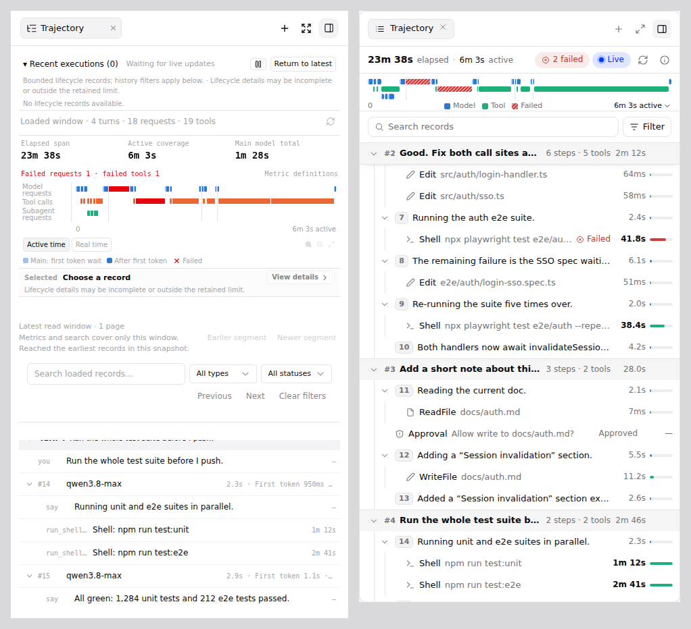
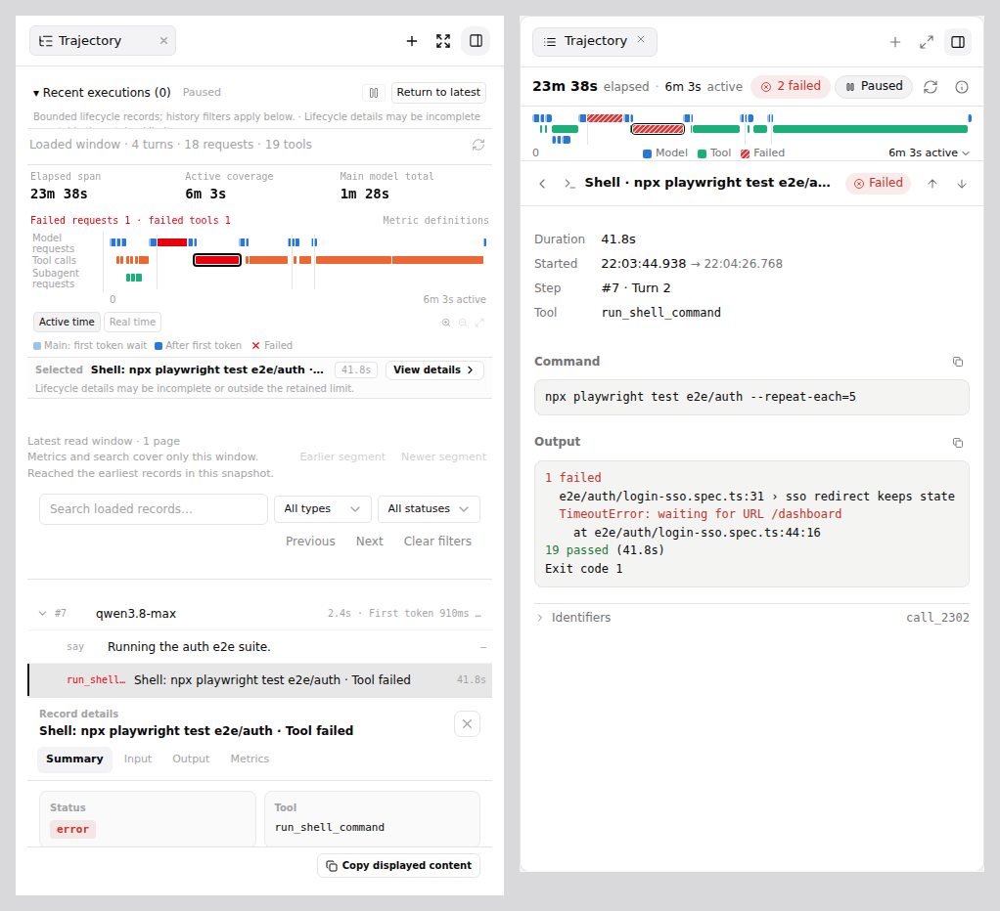
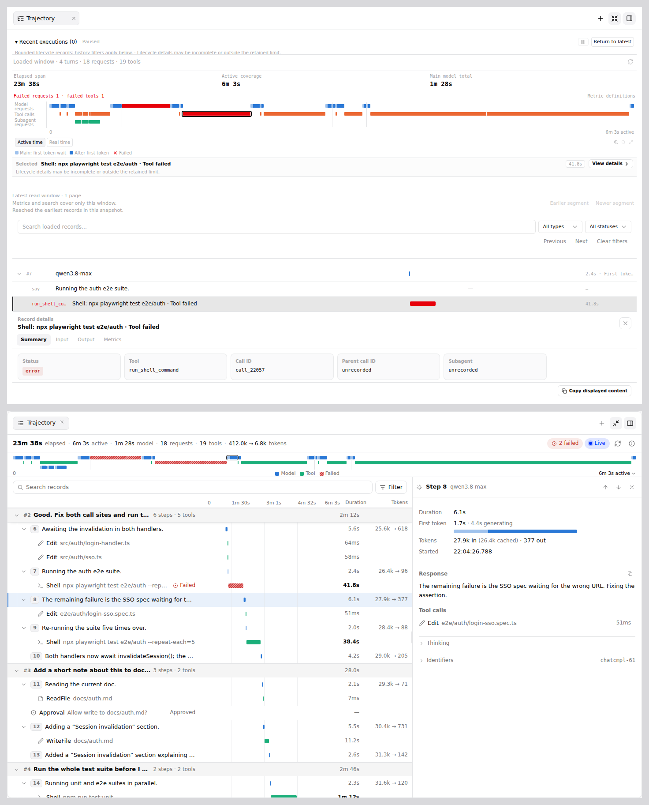
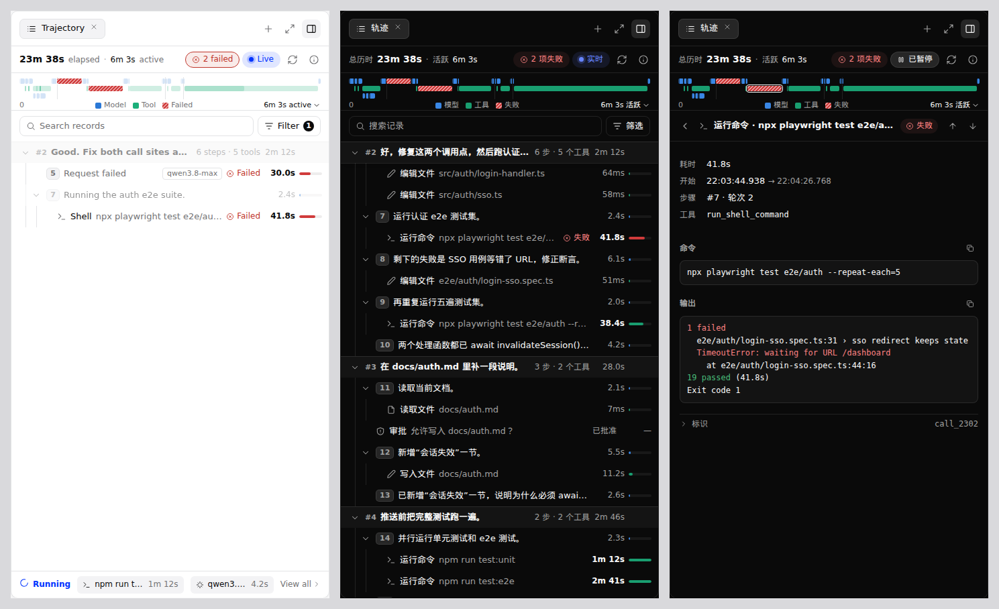
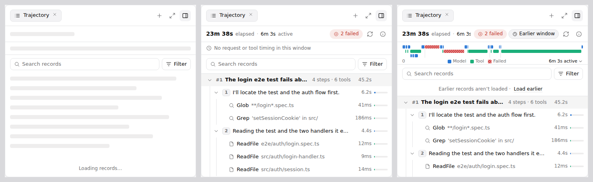
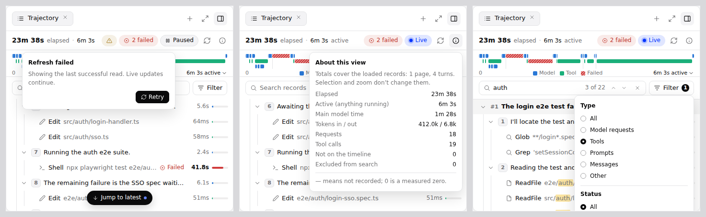

# Web Shell Trajectory View Redesign

[English](web-shell-trajectory-redesign.md) | [简体中文](web-shell-trajectory-redesign.zh-CN.md)

Status: proposed. Nothing in this document is implemented yet. Scope:
`packages/web-shell` only. There are no daemon, SDK, wire-format,
persistence or settings changes. Related: #12293 (Trajectory view), #14071
(PR7A), #14723 (PR7B).

## Summary

The Trajectory panel answers "how did this session run". About twenty PRs
since 2026-09-20 each added one capability, and each capability brought its own
permanent band of controls and caveat text. In the default docked panel the
record list now starts 572 px below the top of an 824 px panel and shows 7
rows. With the inspector open it shows 2.

This redesign keeps every data guarantee and almost all behavior. It changes
how the panel is laid out and drawn:

- Three slim bars on top: a summary bar (40 px), a time strip (56 px) and a
  toolbar (46 px). That is 142 px of chrome instead of 572 px, and about 21
  rows fit.
- A real tree: turn → step (one model request with its text) → tool →
  subagent steps. Tools use the same icons, localized names and descriptions
  as Chat and the Tool Calls panel.
- Record details open as a drill-in view in the docked panel and as a
  resizable side panel in fullscreen. The bottom split goes away.
- One status control for live, paused and history; one warning indicator; and
  an About popover that holds every scope caveat.
- A validated timeline palette in which a failure no longer depends on telling
  red from orange.
- A running-now footer that appears only while something runs. It replaces
  the always-visible Recent executions table.

The work ships in five PRs; see [Implementation plan](#implementation-plan).



_Left: upstream `main` at `a1fb0306ae`, captured with the Playwright mock
daemon. Right: mockup of this proposal with the same session data and the real
Web Shell theme tokens._

## Background

### What the panel does today

Data path (unchanged by this proposal):

- Paged transcript replay emits timing frames (`_meta.timing`) in place.
  `projectTrajectoryWindow` → `buildTrajectory` fold them into turns and rows.
  `buildTrajectoryLayout`, `buildTimeline`, `filterTrajectory` and
  `summarizeTrajectory` project those rows for the view.
- `useTrajectoryWindow` holds a bounded window: up to 4 pages of 250 records,
  read newest first, with Earlier/Newer navigation over cursor bookmarks.
- Live request and tool lifecycles come from the session event stream through
  `trajectory-live-store`, `project-trajectory-lifecycle` and
  `project-trajectory-executions` (at most 256 requests and 256 tools).

UI, top to bottom, all composed in `TrajectoryPanel.tsx` (2,153 lines):

1. Recent executions: a collapsible virtualized table with its own Following,
   Pause and Return to latest controls.
2. A totals line ("Loaded window · 4 turns · 18 requests · 19 tools") and a
   refresh button.
3. Elapsed span, Active coverage and Main model total, the failure counts and a
   Metric definitions disclosure.
4. The time overview: three labelled lanes, an axis, Active time / Real time,
   zoom buttons and a legend.
5. A "Selected" bar with View details and a one-line context notice.
6. A fixed error slot.
7. Window navigation: status text, Earlier segment, Newer segment, Back to
   latest.
8. Filters: search, type, status, Previous, Next, Clear filters and a coverage
   line.
9. The virtualized table, and the inspector as a bottom split.

### Measurements

Captured on upstream `main` `a1fb0306ae` with the Playwright mock daemon
(`client/e2e/utils/mockDaemon.ts`). The session has 4 turns, 18 requests and 19
tool calls, including a subagent, a failed request, a failed tool and a
permission prompt. Viewport 1440×900, docked panel 475×824 px.

| Metric                                                                 | Today                                      |
| ---------------------------------------------------------------------- | ------------------------------------------ |
| Panel top to first list row                                            | 572 px (69% of the panel)                  |
| Rows visible, details closed / open                                    | 7 / 2                                      |
| Bands stacked above the list                                           | 8: 84, 37, 69, 128, 42, 32, 58, 96 px      |
| The 32 px band                                                         | an error slot, empty in normal use         |
| Distinct font sizes                                                    | 5 (10, 11, 12, 14 px) in two families      |
| Text nodes at 10 px                                                    | 62 of 112 (55%)                            |
| Text nodes in the chrome (outside the list)                            | 44                                         |
| Light-theme secondary text, `--muted-foreground` #a3a3a5 on #fff       | 2.52:1 (WCAG AA needs 4.5:1)               |
| Dark-theme secondary text, `--muted-foreground` ≈ #a1a1a1 on ≈ #0a0a0a | 7.63:1 (passes; the problem is light only) |
| Failed bar vs tool bar, light (#e7000b vs #eb6834)                     | ΔE 11.7 normal vision: fails (≥ 15)        |
| Failed bar vs tool bar, dark (#ff6467 vs #d95926)                      | ΔE 9.9 normal vision: fails                |

ΔE is OKLab × 100, computed with the data-visualization palette validator; see
[Appendix B](#appendix-b-palette-validation).





## Problems

**P1. Chrome first, content last.** Every capability added a permanent band.
Fixed-height slots (the error slot, notice lines, the older-records bar) keep
blank space even when they are empty, so the list gets whatever height is left.

**P2. Caveats rendered as content.** Scope and limit disclaimers stay on
screen: "Bounded lifecycle records; history filters apply below", "Metrics and
search cover only this window", "Reached the earliest records in this
snapshot", and "Lifecycle details may be incomplete or outside the retained
limit" (shown twice). They are true and matter for reading the numbers
correctly, but they are reference material, not status.

**P3. Two lists and three ways to move the window.** Recent executions and the
history table show overlapping data with different ordering and scroll rules.
"Return to latest", "Back to latest", the refresh icon and the
Earlier/Newer segment buttons all change the window.

**P4. Flat rows with little information per row.**

- The hierarchy turn → request → output is one 18 px indent.
- Each turn's prompt appears twice: in the turn header and again as a "you"
  row.
- Every request row names the model, the same on all 18 rows, while its useful
  numbers are cut off ("2.4s · First toke…").
- One monospace badge column carries three meanings: row kind, request number,
  and tool wire name (`run_shell_co…`).
- Thoughts and messages each take a full row.

**P5. Details compete with the list.** The bottom inspector is capped at
320 px and shrinks the list to two rows. Its Summary tab draws every field as
a bordered card, including "unrecorded" placeholders, and timing sits on a
separate Metrics tab.

**P6. No consistent visual system.**

- 10 px text dominates, and monospace is used for labels.
- Light-theme secondary text fails contrast.
- A failed span is red on an orange tool lane.
- The zoom buttons are 14 px, and the legend sits apart from what it explains.
- The same tool is drawn differently here than in Chat and Tool Calls.

**P7. Hidden gestures.** Drag selects a range, right-drag pans, right-click
clears and the wheel zooms, with nothing on screen to say so. One 60 px chart
also carries four rows of controls.

## Goals

- **G1 Content first.** Chrome above the list is at most 150 px in the docked
  panel, and at least 20 rows are visible at 1440×900 with details closed.
- **G2 Say it once.** One list, one status control, one warning indicator.
  Caveats are available on demand.
- **G3 Rows read like the rest of Web Shell.** Shared tool icons, localized
  tool names and descriptions; status shown as an icon plus a word.
- **G4 Details without losing the list.** Drill-in when narrow, side panel
  when wide, keyboard stepping between records in both.
- **G5 An accessible visual system.** No text below 11 px, secondary text at
  4.5:1 or better in both themes, a timeline palette that passes the
  validator, and no status conveyed by color alone.
- **G6 Keep every existing guarantee.** Only recorded values are shown ("—"
  means not recorded, 0 is a measured zero). Rows never jump under the reader.
  The window stays bounded and paged. The PR7B follow/pause semantics, the
  single-tab-stop keyboard model and per-session isolation stay as they are.

## Non-goals

- No daemon, SDK, wire-format, persistence or settings changes. The panel
  stays opt-in through `rightPanelItems`.
- No automatic history synchronization while following; see
  [Follow-ups](#follow-ups).
- No merge with the Tool Calls panel. The two only share components.
- No new measurements. The only new numbers are token totals and per-turn wall
  duration, both computed from recorded values already in the window.
- No TUI changes.

## Prior art

**DeepSeek Harness** (`dsh-v0.2.1-rc.2`, `packages/client/ui-trajectory`), the
reference named in #12293:

- A 32 px toolbar, a 50 px three-lane overview, then the ledger.
- The inspector is a side panel, 320–720 px wide and resizable. At 760 px or
  less it becomes an overlay drawer.
- Rows are 30 px. Each model step is one record that merges its text and
  reasoning. A tool call and its result share one line.
- Durations and tokens appear only in the inspector, and running rows have no
  indicator. qwen-code should not copy either choice: timing is the point of
  this view.

**Trace viewers** (official docs and code, fetched 2026-10-20):

- Jaeger replaced inline span details with a resizable side panel because
  inline expansion causes scroll displacement and jitter
  ([ADR-0006](https://github.com/jaegertracing/jaeger-ui/blob/main/docs/adr/0006-side-panel-span-details.md)).
- Langfuse reflows its toolbar by panel width, keeps one renderer from a
  320 px peek to a 4K pane, and replaced per-row truncation markers with a
  single notice
  ([responsive timeline](https://langfuse.com/changelog/2026-08-28-responsive-timeline),
  [truncation notice](https://github.com/langfuse/langfuse/blob/main/web/src/features/traces/components/TraceTruncationNotice.tsx)).
- Phoenix drives its bar column with container queries: bars are hidden below
  500 px and take a third of the width above 800 px
  ([traceTreeStyles.ts](https://github.com/Arize-ai/phoenix/blob/main/js/app/src/components/trace/traceTreeStyles.ts)).
- LangSmith added a full-height waterfall with sticky turn headers
  ([changelog](https://docs.langchain.com/langsmith/changelog)).
- Sentry compresses long inactive gaps by default, and Langfuse borrowed it
  ([timeCompression.ts](https://github.com/langfuse/langfuse/blob/main/web/src/features/traces/fns/timeline/timeCompression.ts)).
  A Cursor forum report shows an unlabeled 70.5 s gap read as a model stall
  ([forum](https://forum.cursor.com/t/170426)).
- SigNoz and W&B Weave reserve red for errors and pair it with an icon
  ([SigNoz](https://signoz.io/blog/new-trace-detail-view/)). OpenAI treats a
  null count as "unknown, not zero"
  ([tracing guide](https://developers.openai.com/api/docs/guides/agents-api/tracing)).
- Jaeger marks an error in a descendant with a hollow icon
  ([PR #3302](https://github.com/jaegertracing/jaeger-ui/pull/3302)).

What this proposal takes:

- A single overview strip as the only range control.
- Drill-in or side-panel details; never inline expansion.
- A sticky turn header.
- One record per model step.
- Red reserved for failure, always with an icon.
- Caveats as state (a tag, a placeholder row, one popover) rather than text.
- Marked idle gaps.

## Design principles

1. **The list is the product.** Everything else is a lens on it.
2. **Say it once, where it matters.** Status lives in one place; reference
   material sits behind ⓘ.
3. **Calm by default, loud on failure.** Success shows nothing; a failure shows
   an icon and a word.
4. **Same thing, same look.** A Shell call looks the same here, in Chat and in
   Tool Calls.
5. **Recorded facts only.** Missing timing shows "—". Nothing is estimated
   except the live elapsed time that exists today, which stays labelled as
   approximate.

## Proposed design

### Layout

```
┌ Summary bar · 40 px ─ stats ……… [⚠] [⊗ 2 failed] [● Live] [⟳] [ⓘ]
├ Time strip · 56 px ── three lanes · idle-gap marks · legend · time-mode menu
├ Toolbar · 46 px ───── [🔍 search · 3 of 22 ˄ ˅ ×] [range chip] [Filter ①]
├ Record list (flex) ── boundary rows · tree rows · pinned turn header
│                        floating "Jump to latest" while paused
└ Running footer · 40 px, only while something runs
```

Record details open over the toolbar and list in the docked panel; the summary
bar and time strip stay visible. In fullscreen, details open in a side panel to
the right of the list.

The panel already declares `container-type: inline-size`. The tiers below use
container queries, and a `ResizeObserver` on the panel gives the same tier to
the code that picks drill-in or side panel:

| Panel width                | Behavior                                                                                                                                                                                  |
| -------------------------- | ----------------------------------------------------------------------------------------------------------------------------------------------------------------------------------------- |
| below 420 px               | The summary shows elapsed time and the chips only. Filter becomes an icon button.                                                                                                         |
| 420–959 px (docked)        | The layout above. Details are a drill-in view.                                                                                                                                            |
| 960 px and up (fullscreen) | The summary adds model time, requests, tools and tokens. List and details sit side by side. When the list itself is at least 760 px wide, it adds a waterfall column and a tokens column. |

### Where every current element goes

| Today                                             | New home                                                                                                  |
| ------------------------------------------------- | --------------------------------------------------------------------------------------------------------- |
| Recent executions section                         | Running footer and status pill. The full list opens from the footer's "View all" in the details slot.     |
| Following / Pause / Return to latest              | Status pill, plus a floating "Jump to latest" in the list while paused                                    |
| Totals line ("Loaded window · …")                 | Summary bar stats; the scope wording moves to About                                                       |
| Refresh button                                    | Summary bar icon                                                                                          |
| Elapsed / Active / Main model total               | Summary bar stats. Definitions move to About.                                                             |
| Failure counts                                    | The "N failed" chip, which toggles the Failed filter                                                      |
| Metric definitions disclosure                     | About popover                                                                                             |
| Overview lane labels, axis, legend                | Time strip; the legend joins the axis row                                                                 |
| Active time / Real time buttons                   | Time-mode menu on the strip's end label                                                                   |
| Zoom buttons                                      | Hover/focus overlay on the strip; double-click resets                                                     |
| Selected bar and View details                     | Removed. The highlighted row is the selection, and a click opens details.                                 |
| Context notice and error slot                     | Warning indicator (actionable items) and About (counts and coverage)                                      |
| Window navigation band                            | Boundary rows at the list edges, and the status pill in history mode                                      |
| Filter block (search, selects, buttons, coverage) | Toolbar: search with i of N and stepping, a Filter popover; coverage in the search field's ⓘ and in About |
| Older-records bar                                 | Top boundary row                                                                                          |
| Table rows                                        | New row anatomy and tree                                                                                  |
| Bottom inspector                                  | Details view: drill-in or side panel                                                                      |

### A. Summary bar

One line, 40 px, `white-space: nowrap`.

- **Stats (left).** The elapsed time is the headline (14 px semibold),
  followed by active time. Labels are 12 px in `--traj-text-secondary` (see
  [H](#h-visual-system)); values use `font-variant-numeric: tabular-nums`. In
  fullscreen the bar adds main model time, request and tool counts, and tokens
  in → out. When space runs short, the stats truncate first; the chips never
  truncate, and the full values are always in About. Chinese copy puts the
  label first ("总历时 23m 38s · 活跃 6m 3s").
- **Warning indicator (⚠).** Shown only when at least one item is active.
  Clicking it opens a popover listing each item with its action:

  | Item                                        | Action                 |
  | ------------------------------------------- | ---------------------- |
  | Refresh failed; showing the last read       | Retry                  |
  | History may have changed while disconnected | Refresh                |
  | Moving to another window failed             | Retry / Back to latest |
  | Part of the transcript was unreadable       | Retry                  |
  | Lifecycle details incomplete or omitted     | none (information)     |

  This one control replaces the context notice, the error slot and the window
  failure line, without moving any row.

- **Failure chip.** "N failed" in `--error-color` on `--error-bg`, shown only
  when N > 0. It toggles the Status = Failed filter, and `aria-pressed`
  reflects that.
- **Status pill.** Driven by the follow state machine from PR7B:

  | State                                | Pill                   | Click            |
  | ------------------------------------ | ---------------------- | ---------------- |
  | Lifecycle unavailable, latest window | (none)                 |                  |
  | Following and `live`                 | ● Live                 | pause            |
  | Following and `catching-up`          | Connecting…            |                  |
  | Paused, latest window                | ❚❚ Paused              | return to latest |
  | Returning                            | Updating…              | (disabled)       |
  | History window                       | Earlier window         | return to latest |
  | Lifecycle `stale`                    | Reconnecting…, plus ⚠ |                  |

  While paused, the list also shows a floating "Jump to latest" button at its
  bottom center. It carries a dot when new executions arrived (the PR7B
  "updated" flag). This is the familiar chat pattern and replaces the
  "Execution list updated" text.

- **Refresh (⟳)** and **About (ⓘ)**. About is a popover with:
  - scope: pages and turns loaded, and the fact that selection and zoom do not
    change totals;
  - metric definitions: elapsed, active, main model time, tokens in / out /
    cached, requests, tools;
  - counts of records missing a start or a duration;
  - the number of records excluded from search;
  - lifecycle omitted / outside-window counts;
  - a note that request numbers are relative to the loaded window;
  - "— means not recorded; 0 is a measured zero."

### B. Time strip

56 px: a 30 px lane area (three 8 px lanes, 3 px apart), a 14 px axis row and
padding. `TrajectoryOverview` keeps its interaction model: drag selects a
range, a click selects the span's row, the wheel zooms around the pointer,
horizontal swipe or right-drag pans, and Ctrl+wheel is left to the browser. The
changes:

- **Lanes:** Model, Tool, Subagent. The 78 px lane-label column goes away; the
  axis row carries a legend (■ Model ■ Tool ▨ Failed) between the start label
  and the end label. The lane label is also in each span's tooltip.
- **Mode:** the end label reads "6m 3s active ▾" and opens a menu with Active
  time and Real time. This replaces the two buttons.
- **Zoom:** zoom in, zoom out and reset appear in a small overlay at the
  strip's top-right on hover or keyboard focus. Double-click resets. The
  buttons stay in the DOM for keyboard and assistive-technology users.
- **Hint:** the strip's tooltip states the gestures: "Drag to select · Scroll to
  zoom · Double-click to reset".
- **Idle-gap marks (new):** in Active mode, each cut-out gap of at least one
  second becomes a 1 px dashed tick with the tooltip "Idle 1m 34s".
  `buildTimeline` already computes the gaps while it removes them; it will also
  return them. Turn boundaries keep their solid tick.
- **Selection:** a range is drawn as now, and the toolbar shows it as a
  removable chip ("⏱ 0:42 – 1:58 ×").
- **Height** drops from 128 px to 56 px. With no timing at all, the strip
  shrinks to a 32 px line, "No request or tool timing in this window", in the
  same slot.

### C. Toolbar

- **Search field** (flex). It keeps today's behavior: 256 characters at most,
  composition-safe input, Enter for next and Shift+Enter for previous. With a
  query, its right side shows "3 of 22", up and down step buttons and a clear
  button. Matches are highlighted inside the row text.
- **Range chip.** Shown only while a time range is selected.
- **Filter button and popover.** Type: All, Steps, Tools, Prompts, Other.
  Status: All, Failed, Cancelled, Running, Unknown, Succeeded. Plus Clear
  filters. A badge counts the facets that are not at their default.
  "Messages" leaves the type facet because messages now belong to steps; a text
  search still finds them.
- **Coverage note.** When search excludes text, a small ⓘ in the search field
  says how many records are affected. The line under the filters goes away.

Search, type and status keep today's semantics: matches plus their ancestors.
Ancestors shown only as context are drawn in the secondary text color; the
inline "Context" tag goes away. A time range filters the same way as today.

### D. Record list

**Hierarchy.**

| Level | Row                                  | Children                                |
| ----- | ------------------------------------ | --------------------------------------- |
| 1     | Turn header (it is also the prompt)  | Steps and the turn's other rows         |
| 2     | Step: one main-session model request | Its tool calls                          |
| 3     | Tool call                            | For an agent call: the subagent's steps |
| 4–5   | Subagent step / subagent tool        |                                         |

- The turn's opening user row is absorbed into the turn header. Selecting the
  header shows the prompt in details.
- A step's assistant message and thought are absorbed into the step row. The
  step's description is the first line of the message, or of the thought in
  italics if there is no message, or "Tool calls only".
- Rows that belong to no step stay visible as their own rows. This covers
  sessions recorded before timing frames, injected prompts (background
  notifications, cron, mid-turn messages), shell output, permission prompts,
  status and error lines, and cancellations.
- Subagent rows nest under the agent tool call that spawned them, when that
  call is in the window. When it is not, they stay under the step and show
  "parent not in this window" as a tooltip on a small marker.
- Subagent groups start collapsed and show a rollup chip ("3 steps · 6
  tools"). Turns and steps start expanded.

**Row anatomy.** Every row is 32 px and single-line: indent and tree guides →
fold chevron → icon or step chip → primary text → secondary text → status →
metrics.

| Row           | Content                                                                                                                                                                                                          |
| ------------- | ---------------------------------------------------------------------------------------------------------------------------------------------------------------------------------------------------------------- |
| Turn header   | "#N" (11 px) · prompt (13 px semibold, one line) · "6 steps · 5 tools" plus "· 1 failed" when there are failures · wall duration. The background is 4% foreground on the panel background, with a border above.  |
| Step          | Step chip "7" (11 px, tabular) · description (13 px, foreground) · model chip only when the model differs from the window's dominant model, or the step failed · "⊗ Failed" when failed · duration               |
| Tool          | Tool icon (`ToolSummaryIcon`) · localized tool name (13 px medium) · description (13 px secondary, from `rawInput.description` or `getToolSummaryDescription`) · rollup chip for agent calls · status · duration |
| Subagent step | Like a step, with a dashed-outline chip numbered within the subagent                                                                                                                                             |
| Note rows     | Icon (approval, terminal, info, alert, ban) · label · text. Approvals show their resolution ("Approved", "Denied", "Pending").                                                                                   |
| Boundary rows | "Earlier records aren't loaded · Load earlier", "Start of session", "Newer records"; error and retry states appear inline                                                                                        |

- **Status.** Success shows nothing. Failed shows `⊗ Failed` in
  `--error-color`; cancelled shows `⊘ Cancelled` in `--warning-color`; running
  shows a spinner and an elapsed time in `--status-running-fg`; unknown shows
  "?" in secondary text. A collapsed group, or a turn header, with a failed
  descendant shows a hollow ⊗.
- **Metrics in narrow layouts.** A duration in 12 px tabular numerals, then a
  34 px micro-bar whose length is the duration relative to the longest timed
  row in the same turn, in the lane color. Durations of at least half that
  maximum are drawn in foreground semibold. Rows without a recorded duration
  show "—" and no bar.
- **Metrics in wide layouts.** The micro-bar becomes a waterfall column (about
  a third of the list width), and a tokens column ("27.9k → 377", steps only)
  is added. A 24 px header row carries axis ticks that follow the strip's zoom.
  Zero-duration rows draw a 2 px tick. Rows without timing leave the cell
  empty: the duration column already says "—".
- **Tree guides.** 1 px `--border` vertical lines, 16 px per level.
- **Hover and selection.** Hover is a `--subtle-bg` background. Selection is
  the model hue at 10% (16% in dark) with a 2 px inset edge. Per-row bottom
  borders go away.
- **Pinned turn header.** While the first visible row belongs to a turn whose
  header has scrolled away, a copy of that header is pinned at the top of the
  list. It is `aria-hidden` and not focusable, and clicking it selects and
  reveals the real header.
- **Selection and opening.** A click selects the row and opens its details: as
  a drill-in when narrow, in the side panel when wide. Arrow keys move the
  selection without opening anything when narrow; when wide, the open side
  panel follows. Enter opens. Clicking the fold chevron only folds.

### E. Record details

One component replaces `TrajectoryInspector`, in two presentations:

- **Drill-in (docked).** It covers the toolbar and list; the summary bar and
  time strip stay, with the record highlighted in the strip. The header reads
  ‹ Back · icon · title · status pill · ↑ ↓. Back or Esc closes it, and the
  list returns with the same scroll offset, the same selection and focus on the
  grid. The list stays mounted under the overlay and is marked `inert`, so its
  scroll offset and virtualizer state survive; Back only removes the overlay.
- **Side panel (fullscreen).** It sits right of the list, starts at 40% width
  and can be resized between 320 px and 60%, using `components/ui/resizable`.
  The header has × instead of ‹. It follows the selection.

Body, top to bottom; a section with no content is left out:

1. **Facts.** A two-column grid: 12 px secondary labels, 13 px values.
   - Step: Duration · First token, with a two-tone bar (first token, then
     generation) and both numbers · Tokens in / cached / out · Started · Model.
   - Tool: Duration · Started → ended (milliseconds) · Step and turn · Tool
     wire name in monospace · for an agent call, the rollup and subagent type.
   - Turn: Steps · Tools · Wall duration · Main model time · Tokens.
   - Timing fields that were not recorded show "—" with the tooltip "Not
     recorded". Identifier fields that were not recorded are omitted.
2. **Content.**
   - Tool: Input, then Output. These reuse the Tool Calls renderers: shell
     command and output, Markdown JSON code blocks, `DiffView` for edits and
     writes, a 4,000-character preview with Show more up to 40,000 characters,
     and Copy on each section.
   - Step: Response (the full assistant text), Thinking (collapsed), and Tool
     calls (each one jumps to its row).
   - Turn: the prompt text and its attachments.
   - Notes: the body text.
3. **Identifiers.** Collapsed. Call, response, prompt, execution, record,
   parent call and subagent IDs, in 11 px monospace, each with copy.
4. **Lifecycle.** Collapsed, only when a lifecycle entry exists: execution
   status, outcome, start, end, and a raw JSON toggle.
5. **Notices.** When the record is hidden by a filter, a range or a collapsed
   group, one callout at the top of the body offers the action that reveals it.

Execution details opened from the running footer use the same component, with
lifecycle facts and "Locate in history" when the request is in the window.

### F. Live activity

- The Recent executions section leaves the default layout.
- **Running footer** (40 px, top border). It is shown while lifecycle status is
  `live` and at least one execution runs. It holds a spinner, "Running", up to
  two items (icon, name, approximate elapsed time in tabular numerals), "+N"
  and "View all".
  - Clicking an item opens its execution details.
  - "View all" opens the existing `TrajectoryExecutions` list, restyled with
    the new row anatomy, in the details slot.
- **Not running, but executions outside the window.** When nothing runs but
  executions outside the history window exist (`lifecycle.outsideWindow`), the
  footer reads "3 new executions · Refresh".
- **Unchanged from PR7B.** Pause on scroll, wheel, keyboard paging, selection,
  filtering and range changes. Return to latest refreshes the bounded window,
  clears filters and selection after success, and scrolls to the tail. Failure,
  reconnects and reading during a pending refresh keep the panel paused.
  Running elapsed time is approximate and shown only for trusted live
  executions.

### G. History window and paging

- The top boundary row is "Earlier records aren't loaded · Load earlier"; it
  calls `older()`. At the true start it reads "Start of session".
- In history mode, a bottom boundary row "Newer records" calls `newer()`, and
  the status pill reads "Earlier window" and returns to latest.
- Loading and failure states appear inside the boundary row ("Loading earlier
  records…", or "Couldn't load earlier records · Retry").
- Boundary rows are virtual rows of the list, so they scroll away with the
  content. They take part in keyboard navigation, and Enter runs their action. When one appears or disappears, the list adjusts its scroll offset
  by the row height so the rows already on screen do not move. This keeps the
  intent of today's fixed-height bars without permanent chrome.

### H. Visual system

**Type.**

| Size           | Use                                                           |
| -------------- | ------------------------------------------------------------- |
| 14 px semibold | the elapsed headline                                          |
| 13 px          | row primary text, detail values, search input                 |
| 12 px          | secondary text, metrics, chips, section headings              |
| 11 px          | axis, legend, step chips, turn numbers, monospace identifiers |

Nothing is smaller than 11 px. Durations and tokens use tabular sans numerals.
Monospace is reserved for identifiers, JSON, commands and output.

**Text color.** `--foreground` for primary text. Secondary text uses a
panel-local token, `--traj-text-secondary`, because no single theme token works
in both themes:

- In the light theme the dock resolves `App.module.css` `.themeLight`, where
  `--muted-foreground` is #a3a3a5 (2.52:1 on white) and
  `--secondary-foreground` is #747476 (4.66:1).
- In the dark theme the shadcn `.dark` scope on the Web Shell root wins. There
  `--muted-foreground` is oklch(0.708 0 0) ≈ #a1a1a1 (7.63:1 on ≈ #0a0a0a), but
  `--secondary-foreground` is oklch(0.985 0 0) ≈ #fafafa, which would erase the
  hierarchy.

So `.panel { --traj-text-secondary: var(--secondary-foreground); }` and
`:global(.dark) .panel { --traj-text-secondary: var(--muted-foreground); }`,
the same `:global(.dark)` pattern `TrajectoryOverview.module.css` already uses.
`--muted-foreground` itself is then used only for tree guides, placeholders and
disabled controls.

**Status colors.** These are the existing tokens:

| Status    | Token                              | Notes                                         |
| --------- | ---------------------------------- | --------------------------------------------- |
| Running   | `--status-running-fg` / `-bg`      |                                               |
| Failed    | `--error-color` / `--error-bg`     |                                               |
| Cancelled | `--warning-color` / `--warning-bg` |                                               |
| Success   | (none)                             | no color in rows; green only in details pills |

**Timeline palette.** One shared CSS module, so the duplicate token blocks in
`TrajectoryOverview.module.css` and `TrajectoryWaterfallCell.module.css` go
away:

| Role                              | Light                                | Dark                        |
| --------------------------------- | ------------------------------------ | --------------------------- |
| Model request (main and subagent) | `#2a78d6`                            | `#3987e5`                   |
| First-token segment               | model hue at 45% over the background | same                        |
| Tool                              | `#1baf7a`                            | `#199e70`                   |
| Failed                            | `#d03b3b` with a 135° hatch          | `#d03b3b` with a 135° hatch |
| Cancelled                         | lane hue at 45% opacity              | same                        |

- Tools move from orange to aqua. Orange sat ΔE 11.7 (light) and 9.9 (dark)
  from the failure red under normal vision.
- Subagent requests share the model hue. The lane position and the legend
  identify them, which frees a hue.
- Failure is never color alone. It carries a hatch in the strip and the
  waterfall, plus an icon and a word in the row.
- The validator passes model, tool and failed under all-pairs comparison in
  both themes. Dark tool versus failed is in the CVD warning band (7.2), which
  is legal only with a secondary encoding; the hatch, icon and label provide
  it. See [Appendix B](#appendix-b-palette-validation).

**Spacing.** 12 px horizontal panel padding, 6 px gaps inside rows, 16 px per
tree level, 8 px radius on inputs and code blocks, and one divider under each
chrome bar.

**Motion.** Only the live dot pulses, and only when
`prefers-reduced-motion` is not `reduce`. Folding does not animate.

### I. Accessibility and keyboard

- **Tree grid.** The list becomes `role="treegrid"`. Rows carry `aria-level`,
  group rows `aria-expanded`, and every row `aria-setsize` and
  `aria-posinset`. It keeps the single tab stop with `aria-activedescendant`.
- **List keys.**
  - ↑ / ↓, Home / End and PageUp / PageDown move and page.
  - ← collapses a group or moves to its parent; → expands it or moves to its
    first child.
  - Enter opens details.
  - Esc unwinds in stages: close details, then clear the range, then clear the
    search.
  - `/` focuses search while focus is inside the panel.
- **Detail keys.** ↑ / ↓ in the header step through records. Esc goes back,
  and focus returns to the list row.
- **Announcements.** Status icons carry text ("Failed", "Cancelled",
  "Running"). The filter count, range changes and pill changes are announced
  through a polite live region.
- **Unchanged.** The strip keeps its group label and zoom status announcements.
  Popovers use `useWebShellPortalRoot()`. Focus rings stay visible, and the
  Shadow DOM focus fixes from #14641 keep working.

### J. Copy

Primary UI avoids implementation words such as "read window", "segment",
"snapshot" and "bounded lifecycle records". The precise wording moves to
About. Key strings:

| Key idea        | English                                                                               | 简体中文                                                      |
| --------------- | ------------------------------------------------------------------------------------- | ------------------------------------------------------------- |
| Summary         | 23m 38s elapsed · 6m 3s active                                                        | 总历时 23m 38s · 活跃 6m 3s                                   |
| Failure chip    | 2 failed                                                                              | 2 项失败                                                      |
| Pill            | Live · Paused · Earlier window · Updating…                                            | 实时 · 已暂停 · 更早的记录 · 正在更新…                        |
| Jump            | Jump to latest                                                                        | 跳到最新                                                      |
| Boundary        | Earlier records aren't loaded · Load earlier                                          | 更早的记录未加载 · 加载更早记录                               |
| Start           | Start of session                                                                      | 会话开始                                                      |
| Search          | Search records · 3 of 22                                                              | 搜索记录 · 3 / 22                                             |
| Filter          | Filter · Type · Status · Clear filters                                                | 筛选 · 类型 · 状态 · 清除筛选                                 |
| Footer          | Running · View all · 3 new executions · Refresh                                       | 运行中 · 全部 · 3 条新执行 · 刷新                             |
| Detail sections | Command · Output · Input · Response · Thinking · Tool calls · Identifiers · Lifecycle | 命令 · 输出 · 输入 · 回复 · 思考 · 工具调用 · 标识 · 生命周期 |
| Not recorded    | Not recorded                                                                          | 未记录                                                        |







## Data and state changes

All changes are inside `packages/web-shell/client`, and all projections stay
pure and unit-tested.

- **`buildTrajectoryLayout`**
  - Absorb each turn's opening user row into the turn header, and each
    message or thought row into its resolved step.
  - Expose `owner: Map<rowKey, visualKey>` so search hits, selection and
    `rowIndexByKey` lookups resolve to a visible row.
  - Nest subagent rows under the spawning tool row when `parentToolCallId`
    resolves in the window. Subagent rows carry no `requestIndex`, so they are
    grouped by record order: each subagent request starts a subagent step, and
    the later rows with the same parent call belong to it until the next one.
    Rows that cannot be placed stay direct children of the agent call.
  - Expose `level`, `setSize`, `posInSet` and each step's summary text.
  - Keep `groupIdentities`, so folds survive re-projection as they do today.
- **`summarizeTrajectory`** adds token totals (main session: input, output,
  cached) in PR-R1, then the dominant model and per-turn wall duration from
  recorded starts and durations in PR-R3. When starts are missing, it falls back to main-model time with
  a "model" suffix.
- **`buildTimeline`** also returns the idle gaps it removes (position and
  length).
- **New `trajectory-status.ts`** (pure). It derives the pill state, the
  warnings list and the boundary-row states from the window, the lifecycle
  projection and the follow state. The decision table above becomes unit
  tests.
- **`filterTrajectory`** keeps its index. The type facet maps "Steps" to
  `request` and "Prompts" to `user`. Match counts and stepping count distinct
  owners, not raw rows.
- **No change:** `buildTrajectory`, `projectTrajectoryWindow`,
  `useTrajectoryWindow`, the live store and lifecycle projections, the
  transcript page loader.
- **Props.** `TrajectoryPanel` gains `workspaceCwd`, so paths in descriptions
  are relative as in Tool Calls. It optionally gains `onOpenFile` and
  `onOpenAgent`, passed only when the tab's session belongs to the active
  workspace, under the same ownership rule Tool Calls uses.

## Implementation plan

Five PRs, in order. Each one leaves the panel shippable, updates its own tests
and visual baselines, and attaches before/after screenshots.

### PR-R1: chrome consolidation

- **New**
  - `TrajectorySummaryBar.tsx`, with its CSS module and tests.
  - `TrajectoryToolbar.tsx`, with its CSS module and tests. It replaces
    `TrajectoryFilters.tsx`, `.module.css` and `.test.tsx`.
  - `trajectory/trajectory-status.ts`, with tests.
- **Changed**
  - `TrajectoryPanel.tsx` and its CSS. Remove the totals header, metrics,
    failure line, metric help, Selected bar, context notice, error slot,
    window navigation band and filter block. Add boundary rows to the virtual
    list, the floating Jump to latest, and an "open details" icon button on
    hover or selection until PR-R2 makes a click open details.
  - `TrajectoryExecutions.tsx`. Its follow controls and caveat lines move to
    the pill, the warning indicator and About. The section renders only while
    there are executions, and keeps its current behavior until PR-R5.
  - `summarizeTrajectory.ts` (token totals). The dominant model and per-turn
    wall duration land in PR-R3, where rows first use them.
  - `window-messages.ts`, `filter-messages.ts`, `execution-messages.ts` and the
    trajectory keys in `i18n.tsx`, in both languages.
- **Test ids**
  - Keep `trajectory-metrics` and `trajectory-totals` on the summary stats.
  - `trajectory-follow-status` moves to the pill, which also replaces
    `trajectory-follow-pause`, `trajectory-follow-return` and
    `trajectory-window-latest`.
  - `trajectory-window-older` and `trajectory-window-newer` move to the
    boundary rows.
  - `trajectory-older-*` and `trajectory-truncated` move to boundary-row
    states.
  - `trajectory-filters`, `trajectory-filter-empty` and `trajectory-range-*`
    stay.
  - Remove `trajectory-selected`, `trajectory-context-notice`,
    `trajectory-window-status` and `trajectory-window-navigation`.
  - Add `trajectory-warnings`, `trajectory-about` and `trajectory-jump-latest`.
- **Done when** the bands above the list shrink from 572 px to the summary
  bar, the unchanged 128 px overview and the toolbar (about 214 px; the 150 px
  target is reached when PR-R4 shrinks the strip), and the 43 Chromium tests in
  `web-shell.trajectory.spec.ts` pass after their updates.

### PR-R2: record details

- **New**
  - `TrajectoryDetail.tsx`, with its CSS module and tests. It replaces
    `TrajectoryInspector.*`.
  - A shared `tool-call-content.tsx`, extracted from `TurnCallsPanel.tsx`:
    value stringifying, shell details, JSON and diff rendering. Tool Calls and
    the trajectory both use it.
- **Changed**
  - `TrajectoryPanel.tsx`: the layout-tier observer; the drill-in overlay over
    the `inert` list, and the side-by-side split with `ResizablePanelGroup`;
    click opens details; ↑ / ↓ stepping; focus and scroll restoration on Back.
- **Test ids.** `trajectory-inspector` becomes `trajectory-detail`. The 8 e2e
  uses are updated in the same PR.
- **Done when**
  - Details show at least 20 lines of content in the docked panel.
  - Back restores the scroll offset to within one row, keeps the selection and
    puts focus on the grid.
  - Resizing works with the pointer and the keyboard.
- **Moved to PR-R3.** These depend on the row absorption and step model that
  PR-R3 introduces:
  - Step content (Response, Thinking, Tool calls). Until then a step shows its
    facts, identifiers and lifecycle.
  - Turn wall duration and tokens. Until then a turn shows steps, tools, main
    model time and the prompt.
  - Passing `workspaceCwd`, `onOpenFile` and `onOpenAgent` from
    `ArtifactPanel.tsx`, together with the file and agent links they serve.

### PR-R3: rows and tree

- **Changed**
  - `buildTrajectoryLayout.ts`: absorption, subagent nesting, `owner`, `level`
    and set information.
  - `filterTrajectory.ts`: the type facet mapping.
  - Row components move into a new `TrajectoryRows.tsx`.
  - `summarizeTrajectory.ts`: dominant model and per-turn wall duration.
  - `TrajectoryPanel.tsx`: the tree grid, the pinned turn header, micro-bars,
    owner-based search counts and stepping, and the hollow descendant-failure
    icon.
  - `TrajectoryDetail.tsx` and `ArtifactPanel.tsx`: the items moved from
    PR-R2.
- **Tests**
  - Layout units: absorption, nesting, unresolved parents, partial turns,
    sessions without timing frames (their messages stay visible), injected
    prompts.
  - Row rendering per kind.
  - Tree-grid keyboard behavior.
  - e2e. `trajectory-row-request` stays on step rows (12 uses) and
    `trajectory-row-tool` stays on tool rows (17 uses). Assertions on "you",
    "say" and "think" rows move to the turn header and step descriptions.
- **Done when** at least 20 rows are visible in the measurement scenario, and
  no row repeats the model name unless the model differs or the step failed.

### PR-R4: time strip and waterfall

- **Changed**
  - `TrajectoryOverview.tsx` and its CSS: the compact strip, the axis-row
    legend, the time-mode menu, the zoom overlay, the gesture hint and idle-gap
    marks.
  - `buildTimeline.ts`: gap output.
  - `TrajectoryWaterfallCell.*`, plus the list header with axis ticks.
  - The palette moves to one shared CSS module.
- **Tests.** The zoom, pan and range unit tests and e2e keep their semantics.
  New tests cover gap marks and the legend. Visual baselines are updated.
- **Done when**
  - The validator output in Appendix B matches the shipped tokens.
  - In the measurement scenario the strip is 56 px, and the failed tool is
    visibly hatched in the strip and the waterfall.

### PR-R5: live footer and cleanup

- **New:** `TrajectoryLiveFooter.tsx`, with tests.
- **Changed**
  - `TrajectoryExecutions.tsx`: rendered in the details slot from "View all",
    with restyled rows.
  - `TrajectoryPanel.tsx`.
  - Remove obsolete i18n keys.
  - `client/e2e/visuals/screenshots.spec.ts` captures: docked list, docked
    details, fullscreen split, running footer and failures filter, in light
    and dark.
- **Tests.** Footer visibility rules. The PR7B follow, pause and return flows
  run again in e2e.
- **Done when**
  - The footer appears within one render of a lifecycle update with a running
    execution, and disappears when none run.
  - All PR7B behaviors listed in [F](#f-live-activity) still hold.

### Each PR also runs

- `npm run build && npm run typecheck` from the root, plus
  `cd packages/web-shell && npx vitest run` on the changed files.
- `npx playwright test --config playwright.config.ts client/e2e/web-shell.trajectory.spec.ts`
  and the visuals config for the trajectory captures.
- A real daemon pass: build the bundle, start `qwen serve` with an isolated
  `HOME`, run a session with a subagent, a failing shell command and an
  approval, then check the panel docked and fullscreen in both themes and both
  languages.

## Testing and verification

- **Pure projections.** Layout absorption and nesting, owners and set sizes,
  summary totals, timeline gaps, and the status decision table.
- **Components** (Vitest with Testing Library): summary bar states and pill
  transitions, toolbar stepping and the filter popover, rows per kind, details
  sections per kind, drill-in restoration, split resizing, and the footer.
- **e2e** (Chromium, mock daemon): every flow that exists today keeps a test,
  including window navigation, follow, pause and return, filters, range,
  zoom, inspector or details, and focus in a Shadow DOM host. New flows are
  drill-in and back, split, the failure chip, Jump to latest and the footer.
- **Measurement.** The scenario from [Measurements](#measurements) is rerun on
  each PR. It records chrome height, visible rows, the font-size histogram and
  the text-node count.
- **Accessibility.** The measurement script also computes the contrast of
  every text node against its nearest opaque background, in both themes; no new
  dependency is needed. Add keyboard-only walkthroughs and a screen-reader spot
  check of the tree grid.
- **Performance.** Add a `@perf`-tagged trajectory scenario (run with
  `npm run test:e2e:perf`) with a 3,000-record window, the worst case in
  `useTrajectoryWindow`. Scrolling it must not produce long tasks over 50 ms in
  Chromium, and re-projection on a new page must stay within today's time. The
  waterfall and micro-bars render only for virtualized rows.

## Acceptance criteria

- [ ] Docked at 1440×900: chrome at most 150 px; at least 20 rows with details
      closed.
- [ ] Docked details show the record over the list while the summary bar and
      time strip remain; Back restores position, selection and focus.
- [ ] Fullscreen: list and side panel; the waterfall and tokens columns appear
      when the list is at least 760 px wide; the waterfall follows the strip's
      zoom.
- [ ] No permanently visible caveat text. Warnings appear only while active,
      and scope information is in About.
- [ ] No text below 11 px; secondary text at 4.5:1 or better in both themes.
- [ ] Tool rows show the same icon, name and description as Tool Calls for the
      same call.
- [ ] Failures: the failure chip filters in one click; failed rows show an icon
      and the word; failed spans are hatched.
- [ ] One status control covers live, paused, history and updating. Jump to
      latest appears while paused. All PR7B semantics hold.
- [ ] Every value shown is recorded or explicitly approximate; "—" marks
      missing timing.
- [ ] Keyboard parity with today plus tree-grid semantics. No regression in
      the Shadow DOM focus behavior.
- [ ] The palette tokens match Appendix B; light and dark visual baselines are
      updated.
- [ ] No files outside `packages/web-shell` and `docs/` change.

## Risks and mitigations

| Risk                                                                     | Mitigation                                                                                                                 |
| ------------------------------------------------------------------------ | -------------------------------------------------------------------------------------------------------------------------- |
| Large e2e churn: 43 trajectory tests and about 10.8k lines of unit tests | Phase the work; keep test ids for every surviving concept; update tests in the PR that changes the behavior.               |
| Absorbed rows change search counts and stepping                          | Count and step by owner; unit-test that a hit in a thought selects its step; keep all text searchable.                     |
| A pinned header over a virtualized list flickers                         | Derive the turn from the virtualizer range; render an `aria-hidden` overlay outside the virtual body; test fast scrolling. |
| Drill-in focus handling regresses the #14641 fixes                       | Reuse the focused-unmount handling; run the Shadow DOM focus tests again.                                                  |
| Users miss the always-visible Recent executions                          | Running footer, "N new executions", and "View all"; re-check after automatic history sync exists.                          |
| The tool color change surprises existing users                           | It is a one-time change, justified by the measured red/orange collision; the legend is always visible.                     |
| Boundary rows that appear or disappear move content                      | Adjust the scroll offset by the row height; extend the existing resize-restore tests.                                      |

## Alternatives considered

- **Tabs (Overview | Timeline | Records).** Rejected: they hide the link
  between time and records that the strip and the list now share.
- **DeepSeek Harness style, boundaries drawn on rows with no header rows.**
  Rejected for now: qwen-code needs per-step timing and tokens, and the step
  row is where they belong.
- **A resizable bottom inspector.** Rejected: in a docked panel it still
  competes with the list.
- **Range selection that dims instead of filtering.** Considered. Today's
  filtering is kept because it is tested and works for long sessions; only the
  "Context" tags go.
- **Search that highlights in place without filtering**, as LangSmith and
  Perfetto do. Rejected for now: see resolved question 5.
- **Two-line rows**, as Langfuse uses. Rejected: one line holds about 21 rows
  instead of about 13 at the docked size.

## Resolved questions

Decided on 2026-10-20; each takes the proposed option.

1. **Recent executions** stays reachable behind the running footer's "View
   all". Removing it is reconsidered once automatic history sync exists.
2. **A single click opens details** in the docked panel (drill-in). Enter
   also opens; arrow keys only move the selection.
3. **Token totals** count the main session only.
4. **Micro-bars** scale against the longest timed row in the same turn.
5. **Text search filters** to matches and their ancestors, as today; it does
   not switch to highlight-in-place.

## Follow-ups

- Automatic history refresh at turn end while following. That removes the "N
  new executions" state, and lets running spans extend to "now" in the strip
  and the waterfall.
- An "Inspect in trajectory" action on Chat tool rows, as DeepSeek Harness
  has.
- Critical-path highlighting and an error stepper (next and previous failure).
- Optional canvas rendering of the strip for very large windows.

## Appendix A: measurement method

A Playwright spec runs against the Vite dev server with `installMockDaemon`,
serving one transcript page that has the shape paged replay produces. It opens
the trajectory tab and reads bounding boxes:

- `trajectory-panel` and `trajectory-rows`;
- each direct child band of the panel;
- the number of `[role=row]` elements fully inside the grid;
- the computed `font-size` and font family of every element with direct text.

It then repeats the measurement with the inspector open on the failing shell
call. The "After" figures come from a static mockup that uses the same session
data and the tokens the dock actually resolves: `App.module.css` in the light
theme and the shadcn `.dark` scope in the dark theme, read with
`getComputedStyle` on the live panel. They are a design target, not a
measurement of shipped code.

## Appendix B: palette validation

Validator: `validate_palette.js` from the data-visualization guidelines (OKLab,
Machado 2009 CVD simulation), all-pairs mode. Surfaces: #ffffff (light) and
#0a0a0a (dark), the computed panel backgrounds. Today's failure color is
`--destructive`, which computes to oklch(0.577 0.245 27.325) = #e7000b in light
and oklch(0.704 0.191 22.216) = #ff6467 in dark; the tool lane computes to
#eb6834 and #d95926.

| Palette                                   | Theme | CVD worst           | Normal-vision worst  | Result                                             |
| ----------------------------------------- | ----- | ------------------- | -------------------- | -------------------------------------------------- |
| Today: #2a78d6, #eb6834, #1baf7a, #e7000b | light | 8.1 (red vs orange) | 11.7 (red vs orange) | FAIL                                               |
| Today: #3987e5, #d95926, #199e70, #ff6467 | dark  | 4.8 (red vs aqua)   | 9.9 (red vs orange)  | FAIL                                               |
| Proposed: #2a78d6, #1baf7a, #d03b3b       | light | 9.9                 | 24.0                 | PASS                                               |
| Proposed: #3987e5, #199e70, #d03b3b       | dark  | 7.2 (warning band)  | 20.9                 | PASS, with secondary encoding (hatch, icon, label) |

Contrast relief: aqua is 2.82:1 on white, under 3:1. The relief rule is met
because every tool span sits beside a labelled row and the legend is always
visible.
