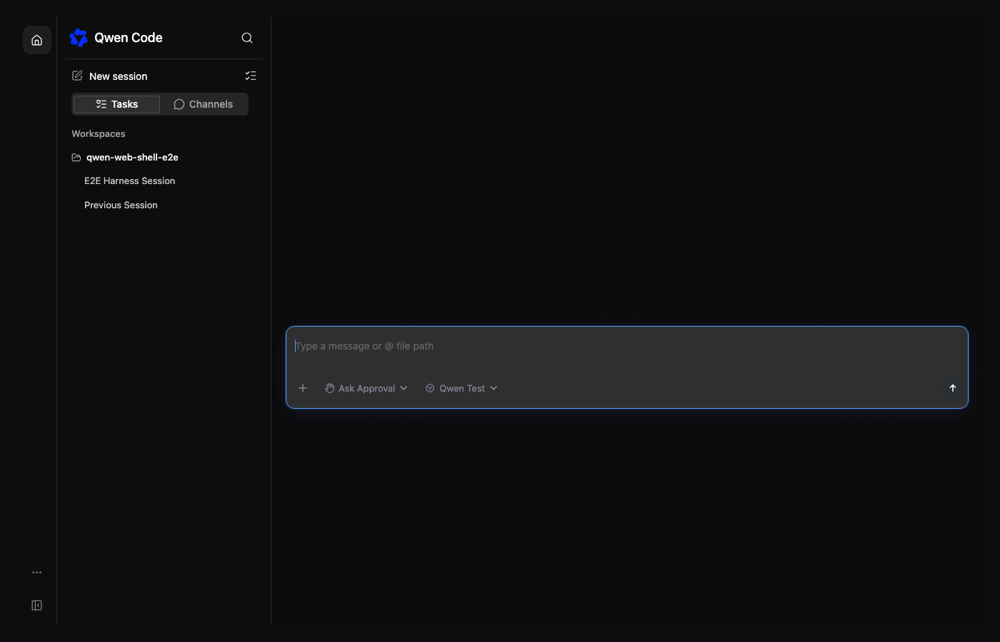
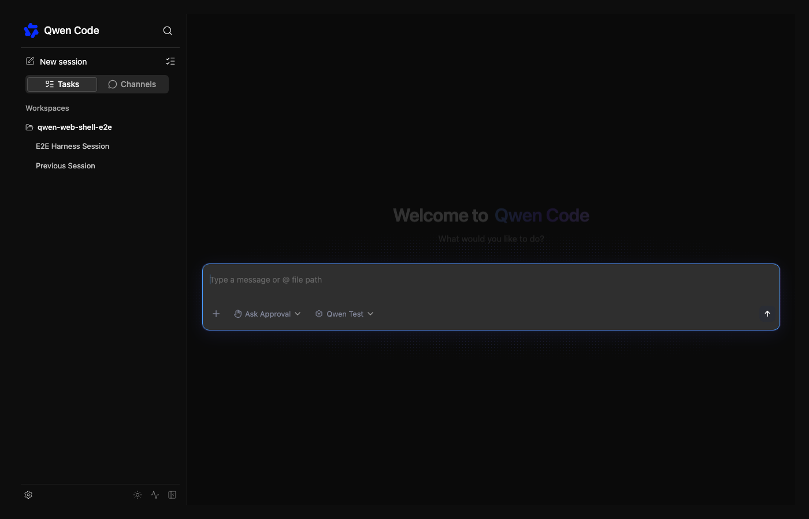
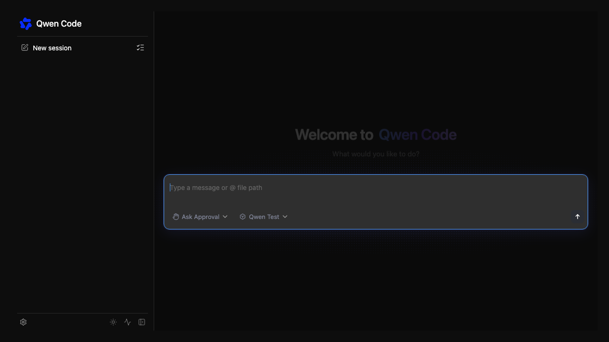

# Minimal embedded WebShell navigation

[English](webshell-minimal-navigation.md) | [简体中文](webshell-minimal-navigation.zh-CN.md)

Embedded hosts may expose only the session list and chat while retaining settings,
theme and status actions. The automatic sidebar layout currently treats those
footer actions as additional navigation pages, so enabling a theme button brings
back the 56px Home rail and More menu even when Home is the only primary page.

Choose the rail from available primary navigation pages only. Keep existing
feature gates for workspaces, Live, workflows, managed sessions and PR watches.
Footer actions continue to respect their configured list: in a Home-only shell
they render directly below the session list, with collapse at the right. With
additional primary pages they retain the existing More menu. Custom renderers
continue to occupy the session column and do not themselves require a rail.
The single-column footer participates in flex layout so it reserves its actual
height. Its utility buttons wrap at narrow widths; in a short collapsed column,
utilities can scroll while Expand stays visible. The rail's More menu keeps its
existing layout.

No new layout or theme API is needed. Hosts can omit the built-in theme action
and implement theme selection in their own settings using the existing controlled
theme prop and callback. Existing workspace header and composer toolbar controls
are preferable to another overlapping embedding switch. Empty-workspace behavior
must preserve actionable workspace creation, and hiding display controls must not
change session scope or runtime permissions.

When no project features are available, omit the synthetic primary workspace
folder rather than displaying an empty "Workspace" group. Keep that fallback for
legacy daemons with project features, and keep the workspace creation header
unless the host explicitly hides it.
Project-hooks approval is mounted only for workspace session contexts; standalone
chat must not probe a workspace-only hooks endpoint. Workspace sessions retain
their existing approval checks.

## Compatibility and theme access

Public props and their defaults are unchanged. The intentional UI behavior change
is limited to Home-only hosts that explicitly enable footer utilities: the rail
and its More menu disappear, and the same utilities render inline. Hosts styling
or querying that conditional rail/More DOM may need to adapt. This should not be
described as identical rendering for every existing host.

Generic users do not need host-specific settings to change theme. An explicitly
enabled theme footer remains a native button; the full standalone app retains its
More/theme action; `/theme` remains available with the unchanged minimal SDK
defaults. Native settings can still edit `ui.theme` when the daemon exposes that
setting. Moving theme into a host's own settings is an optional host decision.

Affected areas are the shell's layout decision, the embedding README, and the
existing browser navigation harness. Browser regressions cover Home-only hosts
with footer tools, collapse/expand, theme changes, custom footer content, workspace
control exclusions and hosts with a second primary page.

Before (Home-only configuration with footer tools):

After (same configuration, tools and collapse in the session footer):

No registered workspaces, with the workspace header, composer workspace action
and session-source switch explicitly hidden by the host:

