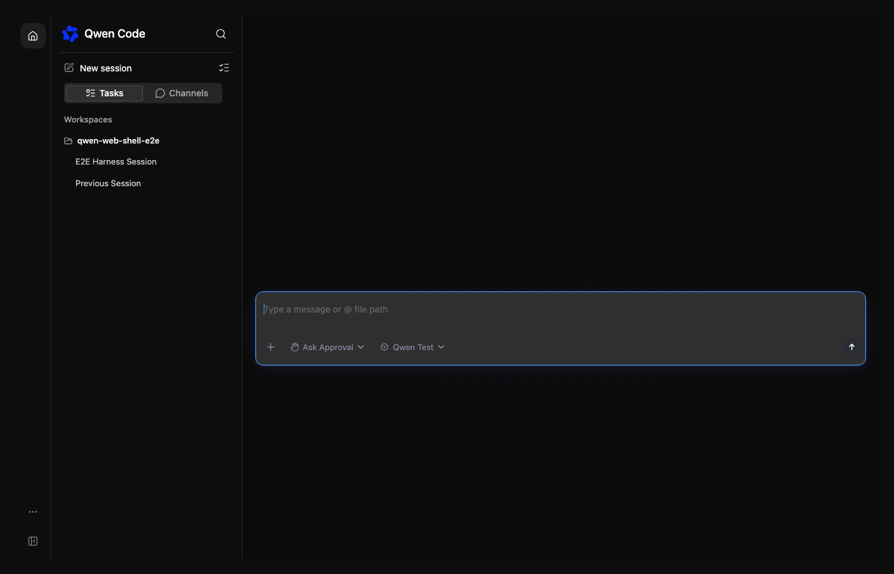
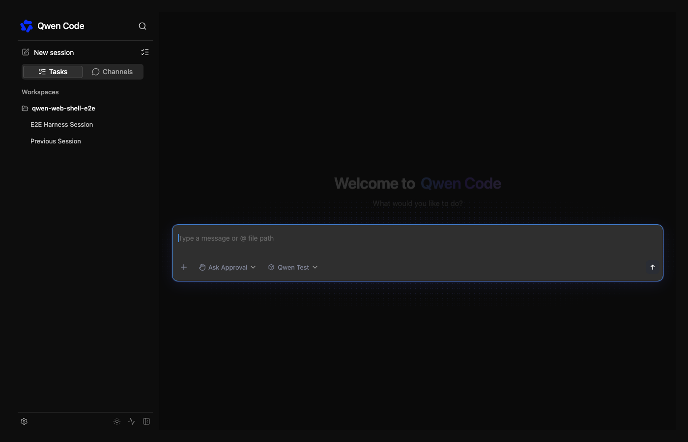
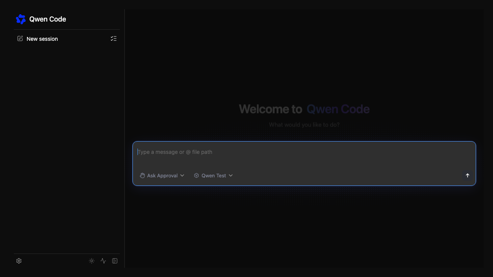

# 嵌入式 WebShell 的精简导航

[English](webshell-minimal-navigation.md) | [简体中文](webshell-minimal-navigation.zh-CN.md)

嵌入宿主可能只需要会话列表和聊天，同时保留设置、主题和状态操作。目前自动布局
把这些底部工具也视为额外页面，因此仅开启主题按钮就会恢复 56px 首页图标栏和
「更多」菜单，即使首页是唯一的主导航页面。

仅根据可用的主导航页面选择双栏布局。保留工作区、Live、工作流、托管会话和 PR
监控的现有功能门控。底部工具继续遵循配置列表：仅首页时直接放在会话列表下方，
右侧保留收起按钮；有其他主导航页面时继续放入「更多」。自定义 renderer 仍占用
会话栏，不单独触发一级栏。

无需新增布局或主题 API。宿主可不启用内置主题按钮，通过现有受控 theme 属性和
回调在自己的设置中实现主题选择。工作区标题和输入框工具已有显示配置，应优先
复用，避免新增重叠开关。工作区为空时仍应保留可用的创建入口，隐藏显示控件不能
改变会话作用域或运行时权限。

没有可用的项目功能时，不再合成默认的工作区文件夹，避免展示空的「工作区」分组。
有项目功能的旧版 daemon 继续使用该兜底；工作区创建标题仍保留，除非宿主显式隐藏。
项目 Hooks 审批只在工作区会话上下文中挂载；无工作区聊天不探测工作区专用的
Hooks 接口。工作区会话继续保留原有审批检查。

涉及 shell 布局判断、嵌入文档和现有浏览器导航测试夹具。浏览器回归覆盖仅首页但
有底部工具、展开收起、主题变化、自定义底部内容、工作区控件隐藏，以及第二个
主导航页面保留双栏的场景。

修改前（仅首页，配置底部工具）：

修改后（相同配置，工具和收起按钮位于会话列表底部）：

没有已注册工作区，宿主显式隐藏工作区标题、输入框工作区工具和会话来源切换：

