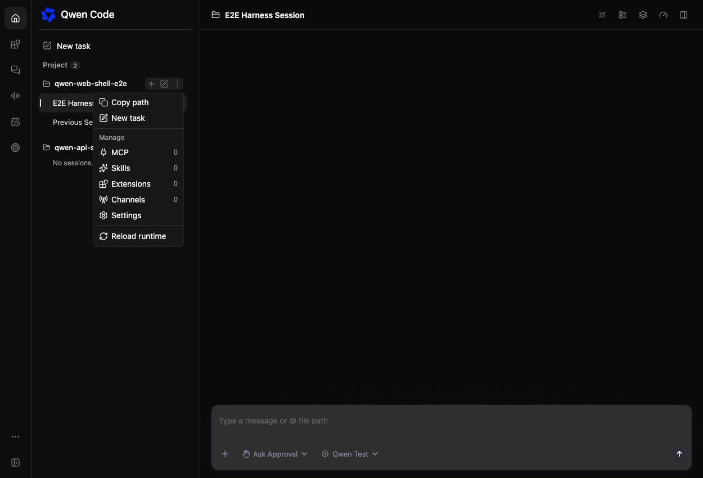
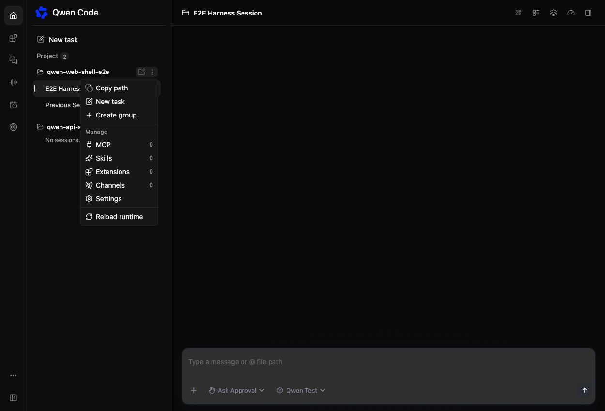

# Move workspace group creation into the More menu

[English](workspace-create-group-menu.md) | [简体中文](workspace-create-group-menu.zh-CN.md)

## Problem and scope

Issue [#15312](https://github.com/QwenLM/qwen-code/issues/15312) reports that
users mistake the workspace row's Create group `+` for new-session creation.
Session creation is frequent; group creation is an occasional organizing action.
Move only the group-creation entry point, preserving its name and behavior.

## Implementation

Add an optional `createGroup` action to `WorkspaceMenu`, after session creation
entries, using the existing `sidebar.groupCreate` translation. The sidebar
supplies it only under the existing trusted-workspace and organization policy.
Reuse the existing primary or workspace-qualified group editor handlers.
Remove the inline group button and keep the inline new-session action.

An embedded sidebar with `lockedWorkspaceCwd` currently hides its workspace
menu but allows group creation. Give that sidebar a menu containing only the
allowed group-creation action, preserving access without exposing workspace
management. Hide that menu when grouping is unavailable.

Affected components are `WorkspaceMenu` and `WebShellSidebar`, with their
collocated tests. No daemon, SDK, group data, translation, or session-creation
changes are needed. There are no open product questions.

## Validation and acceptance

- No workspace header has an inline Create group button.
- The More menu uses the existing localized label and opens the existing editor.
- Primary and secondary workspaces create groups through their original clients.
- Untrusted workspaces, disabled organization, and excluded group actions do not
  gain access. Locked sidebars expose only their permitted group action.
- New-session actions remain available and retain their behavior.

Run focused component tests, build, typecheck, and browser verification with
before/after evidence. The main risk is losing the locked-sidebar entry point
or dispatching a secondary workspace action to the primary client; regression
checks must cover both. The E2E plan and results live under `.qwen/e2e-tests/`.

## Browser evidence

Before: the workspace row contains the group-creation `+`.

After: Create group is available in the workspace More menu.

