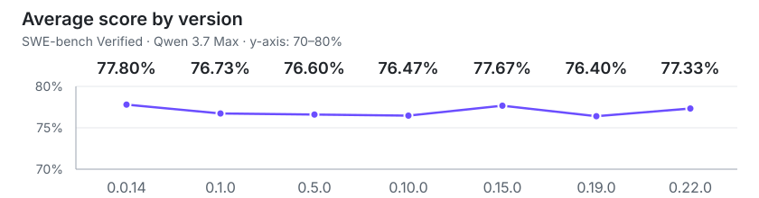

# Qwen Code 评测

[English](evaluation.md) | [简体中文](evaluation.zh-CN.md)

本次评测使用相同的 Qwen 3.7 Max 模型和配置，在 SWE-bench Verified 上比较七个
Qwen Code 版本。平均得分为 **76.40%–77.80%**，最大差值为 **1.40 个百分点**。

## 各版本得分

| 版本   | Avg Score | Pass Rate | pass@3 | pass^3 |
| ------ | --------: | --------: | -----: | -----: |
| 0.0.14 |    77.80% |     84.6% |  84.6% |  69.2% |
| 0.1.0  |    76.73% |     84.6% |  84.6% |  68.0% |
| 0.5.0  |    76.60% |     83.0% |  83.0% |  68.4% |
| 0.10.0 |    76.47% |     84.4% |  84.4% |  67.4% |
| 0.15.0 |    77.67% |     84.6% |  84.6% |  68.6% |
| 0.19.0 |    76.40% |     85.0% |  85.0% |  65.8% |
| 0.22.0 |    77.33% |     84.4% |  84.4% |  68.0% |

折线图按发布顺序连接各版本，明确标示 70%–80% 的纵轴范围。表格保留全部已报告指标；本组结果中 Pass Rate 与
pass@3 的数值相同。

## 评测配置

| 配置项        | 值                                                                                                  |
| ------------- | --------------------------------------------------------------------------------------------------- |
| 数据集        | `princeton-nlp/SWE-bench_Verified`，500 个任务                                                      |
| 运行次数      | 每个版本 3 次，共 1,500 个作业；覆盖 7 个 Qwen Code 版本                                            |
| 模型          | `Qwen 3.7 Max`                                                                                      |
| 采样          | `temperature=1`, `top_p=0.95`                                                                       |
| 思考 / 推理   | `interleaved_thinking=true`, `thinking_type=adaptive`, `reasoning_effort=high`                      |
| 上下文 / 输出 | `context_1m=true`, `model_context_length=1,000,000`, `max_tokens=64,000`, `model_max_tokens=65,535` |
| Harness 限制  | `max_iterations=500`, `runtime_timeout_sec=7,200`, `agent_timeout_multiplier=3.0`                   |

[返回 README](../README.md#qwen-code-evaluation)
