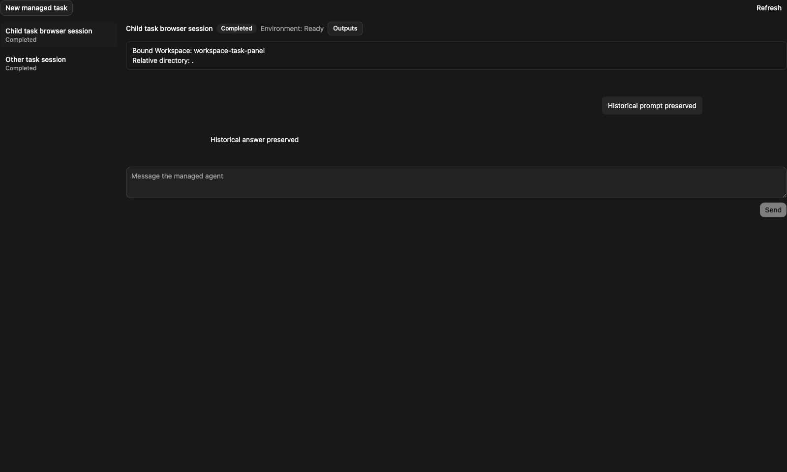
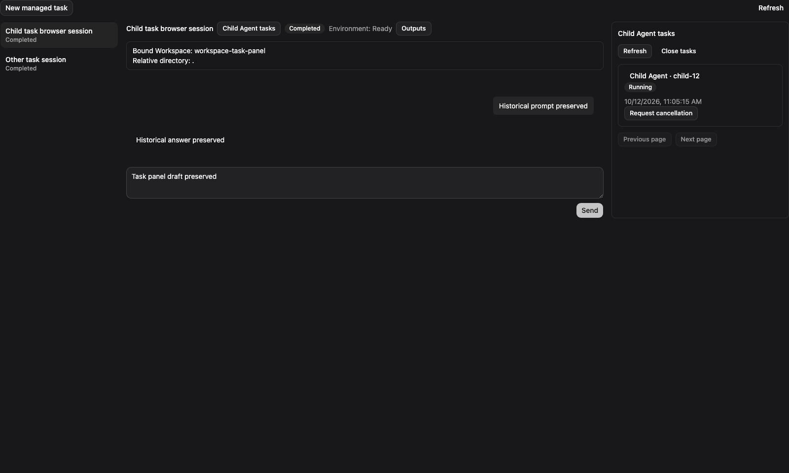
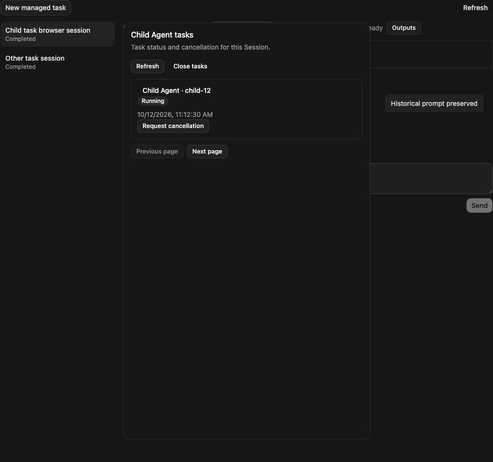

# Managed 子 Agent 面板 E2E 计划

[English](2026-10-12-managed-child-task-panel-e2e.md) | [简体中文](2026-10-12-managed-child-task-panel-e2e.zh-CN.md)

## 基线

实现前运行全局 `qwen --version` 和 `qwen serve --help`。CLI 基线证明运行时可用，不证明浏览器功能支持。独立启动端口 18480 的 Web Shell Vite，使用已有 Managed Java Provider 浏览器 fixture。变更前即使 Java Session 声明 `tasks: true`，也没有子 Agent 任务入口。浏览器测试使用受控 BFF 制造响应丢失与竞争，不作为真实 Hosted 执行证据。

## 浏览器分组

通过 `.qwen/e2e-tests/managed-child-task-panel-browser.mjs` 运行隔离 Playwright context；临时状态和截图保存在 `.qwen/e2e-tests/`。使用已安装的 Chromium。每个 context 独立持有 Session 和 operation map。

1. 兼容：缺少任务能力及 Daemon 无入口；Java 缺少身份范围时可读取、不可取消。
2. 浏览：混合原始分页、过滤空页但有下一页、返回上一页及滚动恢复；不捏造名称或总数。查看详情、状态历史与产物缺失，验证草稿和历史保留、不重载 transcript。
3. 布局与可访问性：宽容器显示 360px 右栏且可编辑草稿；窄容器使用带主题的 portal Dialog，支持键盘和焦点恢复。
4. 取消：行内确认、一次提交、命令完成而任务仍执行、draining、任务已取消、自然完成、失败与服务端竞争。发送始终遵守原有 Session 规则。
5. 恢复：丢失 202、刷新后仅有意图、明确点击后原键重放、已知 operation ID 刷新、超时及继续确认、恢复阻塞、权限或查询失败、存储拒绝。不把未知结果显示为失败，不产生新键。
6. 隔离：切换任务、分页、Session、账号后迟到的列表、详情、事件和 operation 响应；双标签页竞争；标签页隐藏或关闭面板暂停普通读取，取消恢复继续保留。
7. 事件与产物：游标过期重置并显示历史缺失；未知类型推进游标但不展示，分页游标不替换为任务尾部；授权公开产物引用复用现有读取器。

8. 导出边界：重新构建库，验证只读 transcript 不携带 `managed.tasks.*` 文案或读取点，且满足既有 JS 预算。确认交互界面的英文、中文取消状态和耗时文案仍正常。

9. 结局竞争：取消读取已观察到任务终态后，延迟列表和详情刷新。两种界面必须立即同步终态、不再提供二次取消，并拒绝迟到的运行中快照。竞争失败的标签页在任务结束后清理失效的 admission 提示，未知命令恢复及真实命令失败继续保留。确认周期读取不会反复播报加载或禁用分页，时间戳跟随所选语言。

## 真实 Java 与 Hosted

先 build 和 bundle CLI，再使用 JDK 21 和本地 `dist/cli.js` 运行现有 Java 任务读取、取消和 Hosted 子 Agent 验收。通过浏览器面板连接真实 Java 服务及 Hosted Harness，使用确定性的 OpenAI 兼容模型 fixture，启动并取消真实子任务。区分停止受理与实际任务结局，并验证父会话后续执行。确定性模型提供协议及物理执行证据，不代表真实模型质量验证。明确记录未执行场景。

## 单测与发布检查

从 `packages/web-shell` 运行受影响的 client、Provider、hook 和组件测试，并隔离运行 React 18 ref 与 Dialog 路径测试。运行根目录 build、typecheck、bundle，针对性 ESLint/Prettier 及生成类型漂移检查。完整 diff 两轮干净自审后执行独立代码审查。在唯一 draft PR 上单独发布实际 E2E 结果，如实说明 macOS、Windows 和 Linux 验证。

## 实际结果（2026-10-12）

全局 qwen 0.25.0 可用性基线通过；变更前浏览器即使声明 `tasks: true`，也没有任务入口。实现后通过 190 项针对性 React 19 测试、24 项隔离 React 18 测试和 73 项 Java 任务及取消回归。受控 Chromium 验证通过 10 组主要场景和 6 项补充检查，包括公开产物预览、实际 30 秒超时、可见性暂停/恢复、双标签页竞争和迟到 Session 响应。根目录 build、typecheck、bundle 及最终 Web Shell build/typecheck 均通过；生成类型无漂移。

首次 Ubuntu CI 暴露了 transcript 包体积回归：1,329,779 个 UTF-16 字符超过保持不变的 1,325,000 上限。现有产物测试在本地复现了相同失败。将全部 51 条英文和 51 条中文任务面板文案移入独立字典，仅在 transcript 构建中替换为空 stub 后，JS 剩余部分降至 1,324,541。新增包边界检查在旧产物上失败，重新构建后通过。全部 26 项产物测试及 97 项针对性文案、面板、恢复测试通过；文案值和体积上限均保留。

真实浏览器通过同源代理连接 Java、Hosted Harness、Broker/worker 和子结果 relay。它只提交一次取消 operation，观察到已确认的完成回执时任务仍 running/draining，随后才观察到任务 cancelled。父会话草稿保留，下一轮显示 `PARENT_CONTINUATION_OK`。macOS 测试 rig 使用 H2 MySQL 模式、确定性模型和非持久本地 worker。这证明已测试的取消及后续执行链路，不代表 Linux 持久 worker 恢复、完整 MySQL 验收或真实模型质量。未测试 Windows/Linux、React 18 浏览器渲染、原生屏幕阅读器输出或移动原生 WebView。滚动位置恢复由组件测试验证。

| 变更前                                                                | 宽屏面板                                                                      | 窄屏弹层                                                                        |
| --------------------------------------------------------------------- | ----------------------------------------------------------------------------- | ------------------------------------------------------------------------------- |
|  |  |  |

本地可复用命令为 `node .qwen/e2e-tests/managed-child-task-panel-browser.mjs`、同一命令加 `--extras`，以及依次执行 `.qwen/e2e-tests/` 下的 `managed-child-task-hosted-launch.mjs` / `managed-child-task-panel-hosted-browser.mjs`。脚本和原始报告为忽略的工作产物；PR 独立报告发布其实际结果。验证后已停止独立 Vite 和真实 Java/Hosted 进程。
