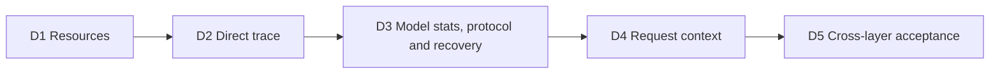

# Managed Session Diagnostics Implementation Plan

[English](2026-11-06-managed-session-diagnostics-and-organization.md) | [简体中文](2026-11-06-managed-session-diagnostics-and-organization.zh-CN.md)

Status: D1–D4 are implemented locally; D5 has focused evidence, with full CI acceptance pending. Date: 2026-11-06. Baseline: `1bac51b7d9`. This plan implements the three parts in the [design](../design/2026-11-06-managed-session-diagnostics-and-organization.md): context/model statistics, Skills/MCP inventory, and direct child-agent relationships. Stage IDs are local planning labels, not issue numbers. Organization, Sources and PR metadata implementation have been removed from this plan. Section 8 separates implementation from verified acceptance.

## 1. Order and completion rule

D1/D2 are the preferred delivery order, not a runtime dependency. D4 relies on D3's bounded versioned resources, snapshot revisions and recovery. Every stage includes its actual API/provider/UI consumer and focused evidence. Foundation code or a generated DTO alone does not complete a stage. No stage introduces a table, DDL, native domain, Stage H family or a second request journal.

## 2. D1 — Passive resource inventory

1. Add the authorized Public `/resources` and WebShell `session-resources/query` contracts and shared query service. Read under one short read-only `REPEATABLE_READ` transaction; return an honest persisted `readRevision`.
2. Resolve full base Skills plus activated extension Skills/commands, preserving invocation policy and attribution. Keep composer catalog semantics unchanged.
3. Read latest config directly, following predecessors when necessary within a total of 64 configuration records including the current one. Resolve the earliest baseline only after reaching the actual boundary; otherwise configuration is partial/unknown.
4. Scan at most 256 MCP configuration rows plus a sentinel using the existing Session/domain/delivery index. Bound total resource reads to 8 MiB and public output to 1 MiB. Separate selection, attempt, catalog and live unknown state, including the attempt's server revision and logical/physical states. Incomplete history leaves latest-attempt fields null and retained catalogs historical. No derived MCP index or Runtime traffic.
5. Wire the resources tab through optional provider `diagnostics`, regenerate OpenAPI types, update `SurfaceRegistry`, and add unavailable/partial states.

Extend `ManagedSessionCreationSkillsTest`, `ManagedMcpCatalogServiceTest`, `ManagedMcpSettingsStoreTest` and extension tests. Add query/service, authorization, budget and MySQL snapshot-consistency tests. Cover model-only/manual-only Skills, extension commands, enabled/disabled/removed MCP, failed new attempts with old catalogs, 64/65 config steps, 256/257 history rows, 8 MiB/1 MiB boundaries, malformed resources and offline/no-acquire behavior. Use MySQL EXPLAIN to verify the intended existing-index plan.

Done when authorized users can read known configuration offline without falsely claiming complete history or live health. New tests are required; existing green tests alone do not prove this stage.

## 3. D2 — Direct invocation trace

1. Add Public `/agent-trace` and WebShell `session-agent-trace/query`, with parent-scoped cursors and limit 1–100.
2. Filter `task_kind='child_agent'` before SQL keyset pagination by `(gmt_create, record_key)` descending. Preserve invocation identity separately from child Session identity; no recursive traversal or `rootAgentId`.
3. Reuse task details, validate stored parent/run lineage and independently authorize child links. Missing or inaccessible child details retain the visible parent invocation.
4. Add the trace tab and reuse `ManagedChildSessionView`. Visible active trace refreshes every 5 seconds; hidden/closed views stop polling and scope changes discard old responses.

Extend `ManagedExtensionRecordStoreTest.pagesTasksNewestFirstThenByTaskId`, child/task tests, `use-managed-tasks.test.tsx` and child-view consumers. Add mixed-kind pagination, equal timestamps, repeated invocations, invalid/foreign cursors, deleted/restricted child and permission-revocation cases. Show persisted direct relationships only; legacy deeper parser support is not a nested-execution promise.

Done when pages have no duplicate/skipped child invocations and only verified authorized detail links open. No child is started or recovered by reads.

## 4. D3 — Model statistics, protocol and recovery

1. Add one collector with ContentGenerator invocation units, outcomes `success/error/cancelled/interrupted`, normalized tokens, observed timing/TTFT and backoff retries. Cover `main/hook/compression`; auxiliary calls follow the owner and parent/child totals stay separate.
2. Bound data to 16 model buckets plus overflow and 20 whole-Session recent samples. Enforce a 64 KiB UTF-8 resource envelope: stats 40 KiB, context 8 KiB, envelope/budget 12 KiB, reserve 4 KiB. Keep `rawOutputTokensTotal` separate and do not serialize raw prompts/errors or legacy `models` maps.
3. At native `runSerial`, freeze deltas, fold from the latest committed baseline, allocate `snapshotRevision` and retry identical bytes. Add main/hook usage v2, automatic-compression terminal/`turn.settled` usage refs and maintenance v2 `modelStatsRef` with the candidate before `PostCompact`. Existing active v1 chains finish with partial coverage; leave `context.compacted.tokenCountsRef` unchanged.
4. Project `hosted_session_statistics/latest` alongside `hosted_context_usage/latest`, preserving highest snapshot revision, resource closure, retention and replay. Recover committed accumulators and retain sticky gaps for unclosed native owners.
5. Read storage 1/2/3 before enabling the first v2 writer's storage-3 floor; reject old workers with 409. Keep CSI old/v1 behavior and add independent `csi-files-retirement/2` manifest/proof without expanding supported execution paths.
6. Add Public `/stats`, WebShell `session-stats/query` and the model-statistics tab. Refresh visible active stats every 5 seconds and expose partial, gap, overflow and unavailable metrics.

Use shared Java/TypeScript fixtures, collector and Hosted source tests, SQL projection/retention tests, API gates and actual restart/replay paths. Verify main r1 → Hook r2 → old r1 never rolls back totals; interleaved/manual/automatic compression, retry, cancellation and replay do not double count. Test Unicode byte budgets, source/model overflow, cold owner recovery, control-plane/worker rollout order and both CSI profile versions. Real MySQL and process-recovery evidence are required; full gates remain in CI.

Done when every intended model source/outcome is collected and the accepted revision has the required evidence. Fixture-only correctness is not durability acceptance.

## 5. D4 — Last committed main request context

1. Preserve safe attribution at the actual prepared-request boundary. Extract only the pure measurement helper needed from daemon context logic.
2. Collect `systemPrompt`, `builtinTools`, `mcpTools`, `instructionFiles`, `memoryFiles`, `skills`, `startupContext`, `messages`; keep provider totals and cached overlap separate.
3. Publish the bounded main context with durable main output using D3's envelope/revision mechanism. Hook/compression samples do not replace main context. Track model/configuration/compaction changes and mark stale/partial evidence.
4. Add Public `/context-usage`, WebShell `session-context-usage/query` and the Context tab. Use actual model/window/compaction policy and display last-request semantics, never a next-request preview.

Extend context measurement, prepared Hosted model, `ManagedModelContextTest`, retention/CSI and provider/UI tests. Cover actual tool selection, imported/extension Skills, instructions/startup, provider usage missing, fallback, attachments, compression, empty history, two concurrent Sessions and offline reopen. Validate all eight categories against the captured prepared request without retaining private bodies.

Done when context is request-correct, bounded and visibly distinct from provider totals, and older or Hook observations cannot be mislabeled as current main context.

## 6. D5 — Cross-layer acceptance

Run the plan in `.qwen/e2e-tests/managed-session-diagnostics.md`. Baseline uses the global `qwen`; implementation verification uses the built local CLI plus the local Java service. A CLI-only smoke check cannot prove Java/API, MySQL or WebShell behavior. Mark unsupported or unavailable baseline paths explicitly.

Keep four Public/WebShell operations, `SurfaceRegistry`, OpenAPI, generated types, provider methods, capability parity and the four visible tabs consistent. Test both home and non-home entry points, closed/archived/offline reads, visible-only 5-second polling, explicit resources/context refresh, abort-ignoring late responses, actor/provider/Session changes and permission loss. Reads must produce no model, acquire, attach, recover or discovery traffic.

Run required root build/typecheck and focused package tests from their package directories. Use the module's JDK/Maven preflight and one task-specific Maven repository. All preparation/build/test/retry work across agents shares the ten-minute local Java budget; record remaining real MySQL/Hosted/fault and full verify/SpotBugs checks for CI. Do not reset the budget after a commit or review.

Record commands, revision, selected cases, exit status and evidence paths. Self-audit the full diff with two consecutive clean passes, resetting after fixes, and follow repository review rules. No issue, PR, commit, push or deployment is implied by this plan.

## 7. Final acceptance checklist

- All three requested parts have real provider/UI consumers and authorized passive reads.
- Resources obey 64/256/8 MiB/1 MiB limits and distinguish current selection from partial historical discovery.
- Trace is a correctly paginated direct-invocation list with independent child authorization.
- Model calls, source attribution, normalization, timings, retry counts and recovery follow the declared bounded accumulator semantics.
- Context has the eight exact categories and main-request-only freshness semantics.
- Snapshot revisions, storage-3 reader floor and CSI diagnostics-only versioning preserve compatibility and retention.
- Required tests for the accepted revision have actual evidence; any missing gate remains explicitly pending.
- Both languages and user-facing documentation match the implemented scope. No organization, Sources, PR metadata or unrequested statistics work is counted as part of delivery.

## 8. Implementation and verification record

All three parts now have persisted query services, four Public/WebShell operation pairs, a generated provider contract and four visible WebShell tabs. Home, ordinary Session and child Session views expose diagnostics when supported. Actor/Session changes discard old results; a failed Session read closes diagnostics and aborts pending reads. No database table, DDL, native domain or Stage H family was added.

The writer publishes bounded model statistics and main-request context through existing native commits, projects two latest pointers and restores committed totals. Main/Hook/compression attribution, highest-revision folding, duplicate/replay handling, abandoned observations and sticky recovery gaps are covered by focused tests. Storage readers now advertise version 3 at both HTTP exits. CSI `/1` remains immutable; `/2` adds diagnostics awareness and preserves existing execution restrictions. Deploy the updated control plane before enabling updated writers.

The required root build, typecheck and bundle passed. After the last reader-header and permission-gate fixes, affected Core/WebShell builds, WebShell typecheck and the bundle passed again. Focused TypeScript evidence is 466 Core tests (465 originally, replacing the 209-test HTTP subset with its final 210-test run), 416 CLI tests and 280 WebShell tests; these counts do not add repeated executions. ESLint, generated-contract checks, formatting and reference checks are recorded separately in the local evidence report.

Java evidence includes the repaired 68-test contract/projection/service selection, surface admission/registry and retention tests, capability guards, ClassSizeRatchet and all-module Checkstyle. Nine selected real MySQL 8.4 cases passed with zero skips, covering projection ordering, conflicts, stale/missing context, direct-child pagination and persisted MCP state. Two selected CSI activation/session tests also passed with zero skips. The packaged Hosted Harness + Spring + MySQL case passed after reproducing and repairing the HTTP reader-version mismatch: four actual model requests yield three successes and one cancellation; replay, close/load and detach/load preserve totals. Earlier failures and their explanations remain in the evidence report.

Chromium fixtures passed at 1280 px and 390 px, covering the four tabs, closed-Session reads, restricted-child links, focus restoration, layout and absence of unexpected/mutating requests. These browser tests use API fixtures; the real Hosted integration is a separate test. Commands, selected cases, toolchain, exit codes and local log paths are in `.qwen/e2e-tests/managed-session-diagnostics.md`; the shared Java budget ledger is `/tmp/qwen-managed-diagnostics-java-budget.jsonl`.

Acceptance remains pending full Java verify/SpotBugs, complete MySQL/Hosted/fault CI profiles and full cross-language CI on the revision being accepted. Real backend-to-browser integration, stopped-Runtime passive-read instrumentation, kill/restart fault scenarios, all eight context categories compared with an actual prepared request, concurrent configuration/MCP snapshot interleaving and MySQL EXPLAIN are not established by the selected local checks. They remain explicit follow-up validation requirements; local green checks do not imply deployment or full acceptance.

## 9. PR integration with current main

PR preparation rebased the implementation from tested commit `bb12bb572e` onto main `478c2f87ab`. Conflict resolution preserves structured-question action-options v4 promotion to storage 2, diagnostic promotion to storage 3, and the upstream Session-root-before-binding lock order. The new upstream execution-control path now recognizes both CSI profiles. The OpenAPI version advances to `1.101.0`.

On the integrated TypeScript tree, the root build/typecheck/bundle, 282 WebShell tests, 26 structured-question tests, four selected Hosted Session tests (687 deliberately unselected cases) and two Chromium fixture cases passed. The shared Java ledger reached 599.08 of 600 seconds, including a conservative charge for the entire prerequisite workspace rebuild. No additional local Java run is authorized by this plan's budget.

The bounded Java increment completed ClassSizeRatchet and the CSI `/1` case, failed the new CSI `/2` missing-request-key case, then stopped while the structured-question test was starting. The failure showed that the old generated guard marker omits `/2` when the request key is absent. The same primary-key locking read now also checks the tool profile, preserving the regression assertion and avoiding DDL. The corrected Java source has not been rerun locally; its compilation, focused tests and full acceptance remain pending CI. The earlier 9-case MySQL, packaged Hosted and 2-case CSI passes belong to the pre-rebase implementation and do not certify this final Java increment.
