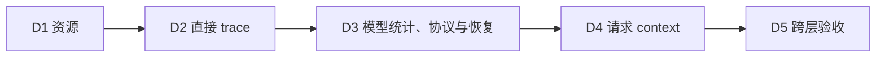

# Managed 会话诊断实施计划

[English](2026-11-06-managed-session-diagnostics-and-organization.md) | [简体中文](2026-11-06-managed-session-diagnostics-and-organization.zh-CN.md)

状态：D1–D4 已在本地实现；D5 已有定向证据，完整 CI 验收仍待完成。日期：2026-11-06。基线：`1bac51b7d9`。本计划落实[设计](../design/2026-11-06-managed-session-diagnostics-and-organization.zh-CN.md)中的三部分：context/模型统计、Skills/MCP 清单、直接子代理关系。阶段 ID 只是本地计划标签，不是 issue 编号。会话组织、Sources 和 PR metadata 实施内容已从本计划移除。第 8 节区分实现状态与已验证的验收结果。

## 1. 顺序与完成规则

D1/D2 是建议交付顺序，不是运行时依赖。D4 依赖 D3 的有界版本化资源、snapshot revision 和恢复。每个阶段包含真实 API/provider/UI 消费者及定向证据。只有基础代码或生成 DTO 不算完成阶段。任何阶段都不新增表、DDL、native domain、Stage H 家族或第二份请求 journal。

## 2. D1 — 被动资源清单

1. 增加已授权 Public `/resources`、WebShell `session-resources/query` 契约与共享查询服务。使用一个短只读 `REPEATABLE_READ` 事务，返回真实的持久化 `readRevision`。
2. 解析完整 base Skills 与已激活 extension Skills/commands，保留 invocation policy 和归属。保持 composer catalog 原有语义。
3. 直接读取 latest config，必要时沿 predecessor 查找，包含当前记录在内总计最多读取 64 条配置记录。只有到达真实边界才解析最早 baseline，否则配置为 partial/unknown。
4. 使用已有 Session/domain/delivery 索引最多扫描 256 条 MCP 配置及一条 sentinel。资源读取总量上限 8 MiB，公开输出上限 1 MiB。区分 selection、attempt、catalog 与 live unknown，包含 attempt 对应的 server revision 及逻辑/物理状态。历史不完整时最新 attempt 字段为 null，保留的 catalog 标记为历史。不增加 MCP 派生索引，不产生 Runtime 流量。
5. 通过可选 provider `diagnostics` 接通资源页签，重新生成 OpenAPI 类型、更新 `SurfaceRegistry`，增加 unavailable/partial 状态。

扩展 `ManagedSessionCreationSkillsTest`、`ManagedMcpCatalogServiceTest`、`ManagedMcpSettingsStoreTest` 与 extension 测试。增加 query/service、授权、预算和 MySQL 快照一致性测试。覆盖 model-only/manual-only Skills、extension commands、enabled/disabled/removed MCP、新失败尝试与旧 catalog、64/65 配置步数、256/257 历史行、8 MiB/1 MiB 边界、损坏资源和离线无 acquire 行为。用 MySQL EXPLAIN 验证预期已有索引执行计划。

完成标准：授权用户离线可读已知配置，不错误宣称历史完整或实时健康。必须有新增测试；原有绿色测试本身不能证明本阶段。

## 3. D2 — 直接调用 trace

1. 增加 Public `/agent-trace`、WebShell `session-agent-trace/query`，cursor 限定 parent，limit 为 1–100。
2. SQL keyset 分页前过滤 `task_kind='child_agent'`，按 `(gmt_create, record_key)` 降序。区分调用身份与 child Session 身份；不递归遍历，不提供 `rootAgentId`。
3. 复用 task details，验证持久化 parent/run 谱系，独立授权 child 链接。子明细缺失或不可读时仍保留可见父调用。
4. 增加 trace 页签并复用 `ManagedChildSessionView`。Active trace 可见时每 5 秒刷新；隐藏/关闭停止轮询，范围变化丢弃旧响应。

扩展 `ManagedExtensionRecordStoreTest.pagesTasksNewestFirstThenByTaskId`、child/task 测试、`use-managed-tasks.test.tsx` 与 child-view 消费者。增加混合类型分页、相同时间戳、重复调用、非法/跨范围 cursor、已删除/受限 child 和权限撤销用例。仅展示持久化直接关系；legacy 更深层 parser 支持不代表承诺嵌套执行。

完成标准：分页不重复、不遗漏 child 调用，只能打开已验证且有权限的明细链接。读取不启动或恢复 child。

## 4. D3 — 模型统计、协议与恢复

1. 增加以 ContentGenerator invocation 为单位的统一 collector，终态为 `success/error/cancelled/interrupted`，记录规范化 tokens、已观察 timing/TTFT 与 backoff retries。覆盖 `main/hook/compression`；辅助调用归拥有方，父子总量分开。
2. 限制为 16 个模型桶加 overflow，以及整个 Session 的 20 条近期样本。落实 64 KiB UTF-8 resource envelope：统计 40 KiB、context 8 KiB、envelope/budget 12 KiB、预留 4 KiB。单独保留 `rawOutputTokensTotal`，不序列化原始 prompt/error 或旧 `models` map。
3. 在 native `runSerial` 冻结增量，从最新已提交 baseline 折叠、分配 `snapshotRevision`，重试复用相同 bytes。增加 main/hook usage v2、自动压缩 terminal/`turn.settled` usage refs，以及 candidate 先于 `PostCompact` 的 maintenance v2 `modelStatsRef`。已有活动 v1 链以 partial 兼容收尾；保持 `context.compacted.tokenCountsRef` 不变。
4. 在 `hosted_context_usage/latest` 旁投影 `hosted_session_statistics/latest`，保留最高 snapshot revision、资源闭包、保留与重放。恢复已提交累计值，未闭合 native owner 保留 sticky gap。
5. 先支持读取 storage 1/2/3，再启用首次 v2 writer 的 storage-3 floor；旧 worker 返回 409。保留 CSI old/v1 行为，增加独立 `csi-files-retirement/2` manifest/proof，不扩大执行路径支持范围。
6. 增加 Public `/stats`、WebShell `session-stats/query` 和模型统计页签。Active stats 可见时每 5 秒刷新，展示 partial、gap、overflow 和不可用指标。

使用共享 Java/TypeScript fixture、collector 与 Hosted source 测试、SQL 投影/保留测试、API 门禁和真实重启/重放路径。验证 main r1 → Hook r2 → 旧 r1 不回退总量；交错执行、手动/自动压缩、重试、取消和重放不重复计数。测试 Unicode 字节预算、来源/模型溢出、冷 owner 恢复、控制面/worker 发布顺序和两个 CSI profile 版本。需要真实 MySQL 与进程恢复证据；完整门禁仍由 CI 负责。

完成标准：所有预定模型来源/终态都已采集，且被验收 revision 具备必需证据。仅 fixture 正确不等于持久性验收。

## 5. D4 — 最近已提交主请求 context

1. 在实际 prepared-request 边界保留安全归因。仅从 daemon context 逻辑提取所需纯测量 helper。
2. 采集 `systemPrompt`、`builtinTools`、`mcpTools`、`instructionFiles`、`memoryFiles`、`skills`、`startupContext`、`messages`；provider 总量与 cached 重叠独立处理。
3. 通过 D3 的 envelope/revision 机制，随持久主输出发布有界主 context。Hook/压缩样本不替换主 context。跟踪模型/配置/压缩变化并标记 stale/partial。
4. 增加 Public `/context-usage`、WebShell `session-context-usage/query` 和 Context 页签。使用实际模型/窗口/压缩策略，表达最近请求语义，不作为下一请求预览。

扩展 context 测量、prepared Hosted model、`ManagedModelContextTest`、保留/CSI 与 provider/UI 测试。覆盖实际工具选择、导入/extension Skills、instructions/startup、缺少 provider usage、fallback、附件、压缩、空历史、并行双 Session 和离线重开。在不保留私有正文的前提下，将八类结果与采集的 prepared request 对照。

完成标准：context 与请求一致、有界，展示上与 provider 总量有明确区别，旧观察或 Hook 观察不能误标为当前主 context。

## 6. D5 — 跨层验收

执行 `.qwen/e2e-tests/managed-session-diagnostics.md`。基线使用全局 `qwen`；实现验证使用本地构建 CLI 和本地 Java service。仅 CLI smoke 不能证明 Java/API、MySQL 或 WebShell 行为。基线路径不支持或不可用时明确记录。

保持四个 Public/WebShell operation、`SurfaceRegistry`、OpenAPI、生成类型、provider 方法、capability parity 与四个可见页签一致。验证 home/非 home 入口、关闭/归档/离线读取、仅可见时 5 秒轮询、resources/context 显式刷新、忽略 abort 的迟到响应、actor/provider/Session 切换与权限丢失。读取不得产生 model、acquire、attach、recover 或 discovery 流量。

运行必需的根目录 build/typecheck 和从各包目录执行的定向测试。按模块要求预检 JDK/Maven，使用一个任务专用 Maven repository。所有 agent 的准备/构建/测试/重试共享十分钟本地 Java 预算；将剩余真实 MySQL/Hosted/fault 和完整 verify/SpotBugs 检查明确留给 CI。提交或评审之后不重置预算。

记录命令、revision、所选用例、退出状态和证据路径。对完整 diff 自审至连续两轮干净，修复后重新计数，并遵守仓库评审要求。本计划不隐含创建 issue、PR、commit、push 或部署。

## 7. 最终验收清单

- 三部分均有真实 provider/UI 消费者和已授权被动读取。
- 资源遵守 64/256/8 MiB/1 MiB 上限，区分当前选择与部分历史发现。
- Trace 是正确分页的直接调用列表，并独立授权子会话。
- 模型 calls、来源归因、规范化、timing、重试次数与恢复符合既定有界累计语义。
- Context 具有精确八类和仅主请求的当前性语义。
- Snapshot revision、storage-3 reader floor 与仅增加诊断的 CSI 版本化保持兼容和保留。
- 被验收 revision 的必需测试有真实证据；缺失门禁仍明确待完成。
- 两种语言与用户文档匹配实际范围。不将组织、Sources、PR metadata 或未要求的统计工作计入交付。

## 8. 实现与验证记录

三部分均已接通持久化查询服务、四组 Public/WebShell operation、生成的 provider 契约及 WebShell 四个可见页签。Home、普通会话和子会话视图均在支持时提供诊断入口。Actor/Session 切换丢弃旧响应；Session 读取失败时关闭诊断并中止待处理请求。没有新增数据库表、DDL、native domain 或 Stage H 家族。

Writer 通过已有 native commit 发布有界模型统计和主请求 context，投影两个 latest 指针并恢复已提交累计值。定向测试覆盖 main/Hook/compression 归因、最高 revision 折叠、重复/重放处理、放弃的观察及 sticky recovery gap。Storage reader 的两个 HTTP 出口现均声明 version 3。CSI `/1` 保持不变；`/2` 增加诊断感知并保留已有执行限制。启用新版 writer 前应先部署新版控制面。

必需的根目录 build、typecheck 与 bundle 已通过。最后修复 reader header 和权限入口后，受影响的 Core/WebShell build、WebShell typecheck 与 bundle 再次通过。定向 TypeScript 证据为 Core 466 项（原 465 项中的 209 项 HTTP 子集由最终 210 项运行替代）、CLI 416 项、WebShell 280 项；这些数字不累加重复执行。ESLint、生成契约、格式与引用检查在本地证据报告中单独记录。

Java 证据包括修复后的 68 项契约/投影/服务定向测试、surface admission/registry 与保留测试、capability guards、ClassSizeRatchet 以及所有模块的 Checkstyle。9 项真实 MySQL 8.4 用例零跳过通过，覆盖投影顺序、冲突、过期/缺失 context、直接子调用分页及持久化 MCP 状态。2 项 CSI activation/session 定向用例也零跳过通过。复现并修复 HTTP reader version 不匹配后，打包 Hosted Harness + Spring + MySQL 用例通过：4 次真实模型请求对应 3 次成功、1 次取消，重放、close/load 和 detach/load 保持累计值不变。此前失败及其解释均保留在证据报告中。

Chromium fixture 在 1280 px 和 390 px 下通过，覆盖四个页签、关闭会话读取、受限 child 链接、焦点恢复、布局及不存在意外/变更请求。浏览器测试使用 API fixture；真实 Hosted 集成为另一项独立测试。命令、所选用例、工具链、退出状态和本地日志路径记录在 `.qwen/e2e-tests/managed-session-diagnostics.md`，共享 Java 预算账本为 `/tmp/qwen-managed-diagnostics-java-budget.jsonl`。

完整验收仍等待被验收 revision 的 Java verify/SpotBugs、完整 MySQL/Hosted/fault CI profiles 和跨语言 CI。所选本地检查尚未证明真实 backend-to-browser 集成、停止 Runtime 后的被动读取流量、kill/restart 故障场景、八类 context 与实际 prepared request 的逐项比对、配置/MCP 并发交错快照及 MySQL EXPLAIN。这些是明确保留的后续验证要求；本地通过不代表部署或完整验收完成。

## 9. 与当前 main 的 PR 集成

整理 PR 时，将已测试提交 `bb12bb572e` 的实现重基到 main `478c2f87ab`。冲突处理保留结构化提问 action-options v4 升级至 storage 2、诊断升级至 storage 3，以及上游 Session root 先于 binding 的锁序。上游新增的 execution-control 路径现同时识别两个 CSI profile。OpenAPI version 推进至 `1.101.0`。

集成后的 TypeScript 代码通过根目录 build/typecheck/bundle、282 项 WebShell 测试、26 项结构化提问测试、4 项所选 Hosted Session 测试（687 项明确未选）和 2 项 Chromium fixture。共享 Java 账本累计 599.08/600 秒，其中保守计入了整个前置工作区重建。按本计划预算，不再执行额外本地 Java 检查。

有界 Java 增量检查完成 ClassSizeRatchet 和 CSI `/1` 用例，新增 CSI `/2` 缺失 request key 用例失败，随后在结构化提问测试启动期间停止。失败表明旧生成 guard 标记在 request key 缺失时未覆盖 `/2`。现已在同一次主键加锁读取中补充 tool profile 判定，保留回归断言且不增加 DDL。修正后的 Java 源码尚未在本地重跑；其编译、定向测试和完整验收仍等待 CI。此前 9 项 MySQL、打包 Hosted 和 2 项 CSI 通过证据属于重基前实现，不能证明最终 Java 增量已通过。

## 10. 评审与 CI 修正轮次

本轮修复 CSI 测试 admission fixture，缓存不可变 profile 读取，避免仅诊断 observer 复制 prepared request，在填入最终 attempt 元数据后限制 context，并拒绝无效模型容量。Java 终态总数及 overflow 单调性与共享 TypeScript 契约对齐，修正资源截断覆盖状态，补充真实 `/2` 诊断提交/重放及 `/1` 拒绝用例。CSI 仍不支持 Hook 和手动 maintenance；损坏的已提交诊断继续失败关闭。重复投影扫描留待测量证据支持后单独优化。

WebShell trace 请求现拒绝未知字段，limit/cursor 限制与 OpenAPI 一致。Capability parity 包含已实现的四个诊断 surface；从源码生成的 route 和 SQL capture 分别包含 178 条路由、356 条 SQL ownership。子会话 context 刷新包含活动 Turn 和 workspace context revision。界面展示未知时间、具体 coverage 原因及部分发现结果；trace 分页失败仍可返回上一页。页签换行后按实际高度布局，390 px 回归强制使用 Verdana，检查四个页签的溢出和重叠，保留原有断言。

本轮定向证据为 Core context/Hook/statistics 40 项及最终 restore/Hook/sink 66 项（重叠用例不累加），另有 prepared-request 14 项（明确未选 703 项）、CLI 210 项及 capability-parity 210 项、WebShell 15 项及 Chromium fixture 2 项。独立 CSI retirement/admission 验证通过 CLI 所选用例中的 10 项；属于重复验证，不另加十项独立测试。根目录 TypeScript build、typecheck 与 bundle 已完成；格式与定向 lint 记录在本地报告。Build 日志完整，但命令退出元数据在上下文压缩时丢失。未重新启动 Java、Maven 或 MySQL 验证；共享账本保持 599.08/600 秒。

被评审 head `42562a31bd` 的 CI 确认此前 CSI guard 修正通过，同时发现过期 route/SQL capture、model-selection 断言，以及两个漏启 collector 的 `/2` Hosted fixture；这些输入已在本轮修正。Approval failover runner 现期待诊断 storage floor 3。两个 Hosted 假模型工具列表补入已允许的 question 工具，该偏差在 base commit 也存在。这些 Java/真实进程修正未在本地验证，需要新 head CI。保留的 Hosted 故障 artifact 明确了 automation DELETE 503 的原因：冷恢复结算 Turn B 时，快照仍携带从 Turn A 恢复的预算，因此服务端正确拒绝统计并停止写入。结算 carrier 必须接收实际 Turn 身份并省略无关预算；保留 Java 校验。该真实进程修正仍需新 head CI；未盲目重跑，也未报告通过。此前 CI 失败及评审前所选成功证据保持分别记录。

最终 Core 包构建先因新增冷恢复夹具缺少必需的 `endedAt` 字段而失败。补齐后，该冷恢复定向用例及 Core 构建通过；此前 66 项结果分别保留，不重复累加该用例。

## 11. 最新 main 的 CI freshness 集成

首个修正提交 `75f72f708f` 进入 CI 后，Lint & Static 因 main 已更新 CI host-asset 交接而被 freshness guard 拦截。两个 PR 提交已无冲突重基到 `80fd7c3353`。该基线还更新 Hosted 基础工具、本地 journal prefix 刷新、WebShell 入口布局、JDBC helper/锁范围及包版本 0.26.9。Latency 假模型预期现包含新允许的 `glob`，与上游 workspace driver 一致，保留严格工具列表比较。

静态集成复核保留上游共享 JDBC helper、摘要实现和锁范围，以及两个 CSI profile、诊断预算和恢复修正。不重新启动 Java 验证；共享账本保持 599.08/600 秒。此前成功检查仅在测试输入不变时继续作为证据；更新后的 TypeScript 基础及受影响消费者在发布刷新分支前进行定向验证。

刷新后的代码通过完整根目录 TypeScript build、根目录 typecheck（含 integration 消费者）、bundle、Core restore/Hook/sink 66 项及本地 journal snapshot 30 项、CLI 诊断消费者 210 项及所选基础工具/恢复分支 21 项（明确未选 1,336 项），以及 host-asset 交接元测试 3 项（明确未选 78 项）。首次 Core 选择器误将 journal 文件放在另一目录下，因此仅运行 66 项；修正选择器后单独运行全部 30 项 journal 用例。诊断浏览器 fixture 不挂载变更后的 Sidebar，page/Dialog/Tabs 源码不变，因此此前受控布局 2/2 证据仍有效，未重复执行。WebShell 与 capability-parity 证据同样仅在消费者未变时复用。所有新增 Java 和真实 Hosted/fault 检查仍等待发布 head 的 CI。

## 12. Java CI 边界与 producer 修正

在 `30a7e354f7` 上，fast H2 suite 实际执行 6,387 项，报告两个失败、一个 setup 错误和 17 个跳过。路由 capture、受保护 SQL ownership 门禁、model context suite、真实 Hosted files 用例及 CSI binding guard 定向用例分别通过，但整体 suite 仍失败。失败暴露：诊断安全整数上限被无关的 extension-record count helper 静默截低、legacy 测试使用文本 SQL 字面量比较二进制 tenant 列，以及 native producer collector 的 grant 未声明支持的 storage version。修正保留 extension-record 序号契约，显式绑定二进制 tenant/Session 身份，并声明 collector 支持 storage 3，同时保留初始持久 floor 1。

随后，仅用 Node 复现完整 legacy producer 时发现第四个失败：小数 usage 样本之后，原始输出账本被新增诊断的整数约束拒绝。原始预算值现按有限、非负的原始数值保留小数，在发布及暖/冷恢复时保持一致；规范化 token 计数仍为整数。Java 累计比较保留小数顺序。变更仅涉及内部 carrier，公开投影继续省略原始预算标量。原有五回合样本及真实 Java profile 拒绝断言保持。

修正通过 142 项受影响 Core 测试和定向 ESLint，随后完整根目录 TypeScript build、typecheck、bundle 均通过，退出状态已记录。五回合暖/冷恢复单元回归保留下一 Turn 的 38.25 baseline 和最终 50.25 原始总量。独立使用 Node 22 执行未改动的五回合 producer 成功，记录五次真实 loopback 模型请求；由于其中包含预期的工具拒绝，其保留的原始 baseline 为 28.25，最终原始总量为 40.25。规范化统计保留五次请求、四次成功、一次中断及 usage 缺失覆盖。此前通过的两回合 `/2` producer 与关闭诊断的 `/1` 控制用例证据仍适用，未重复执行。

共享本地 Java 账本仍为 599.08/600 秒。不重新启动 Maven、Java 或 MySQL 验证。Java 计数、精度及二进制 key 回归等待新 head CI；Node producer 检查仅证明夹具生成，不证明 Java admission 或退休行为。
